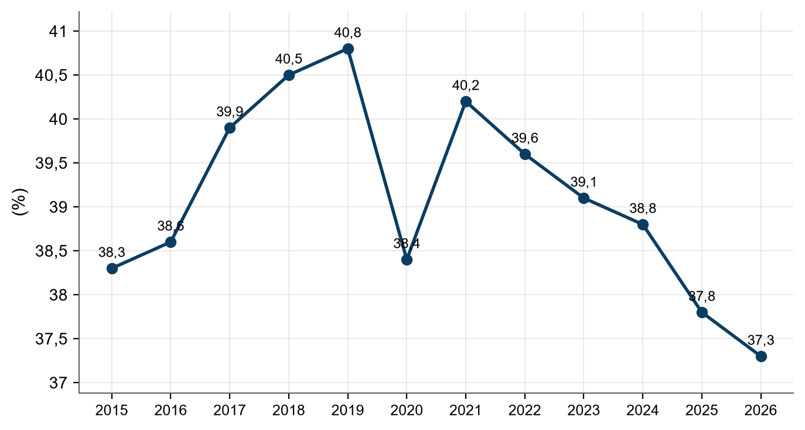
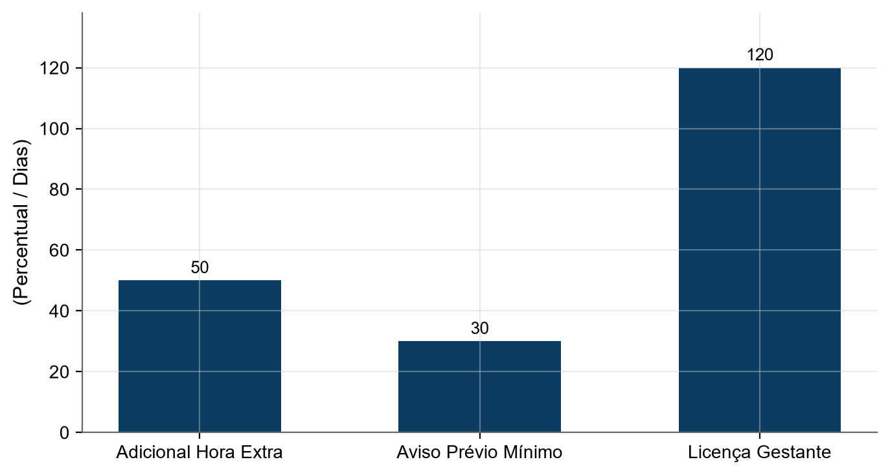
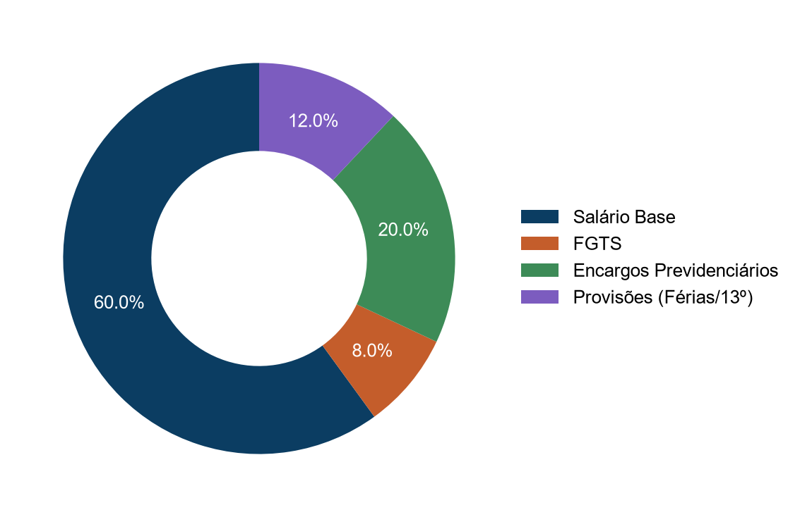
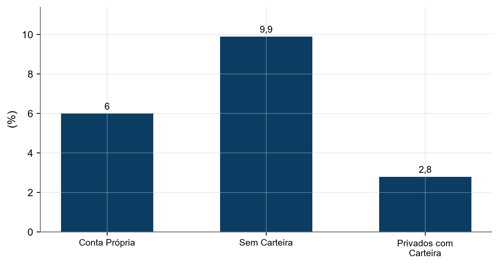
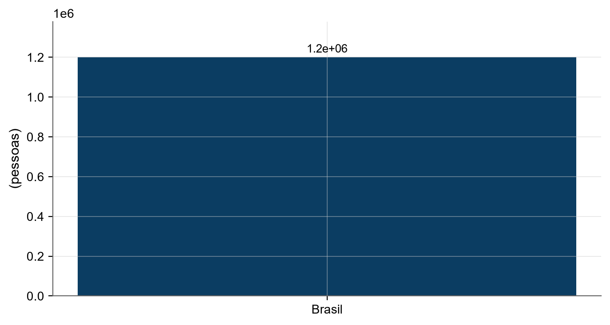
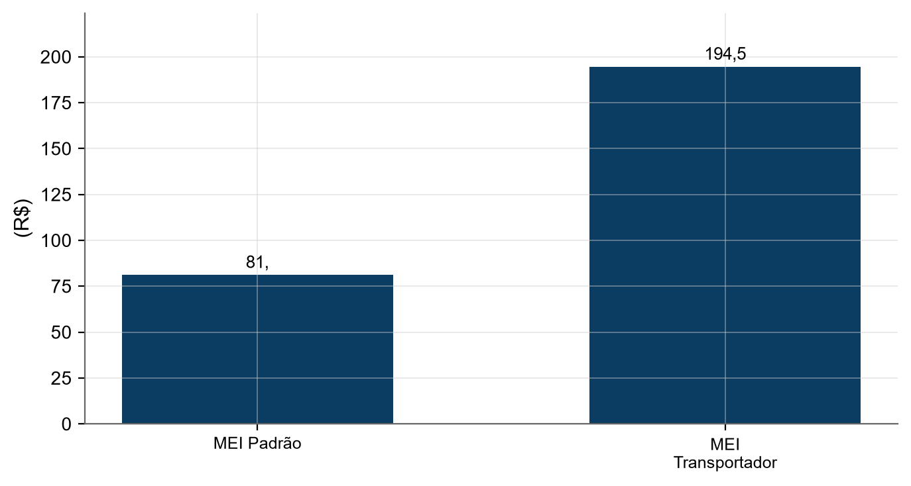
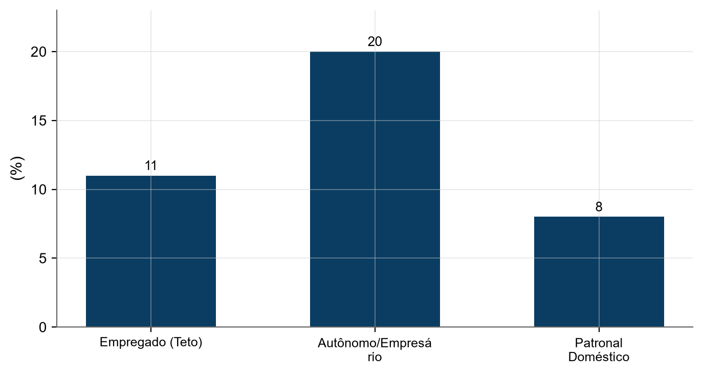
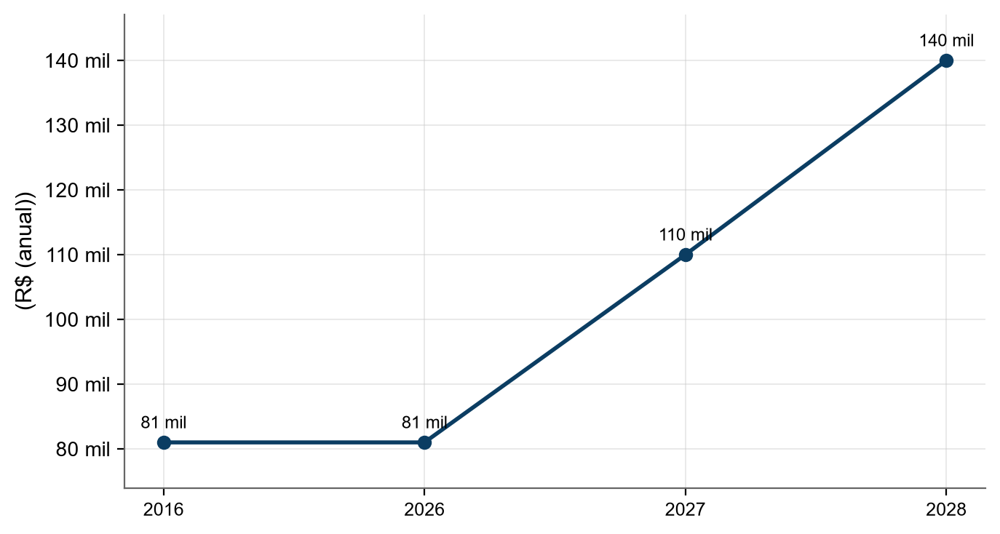
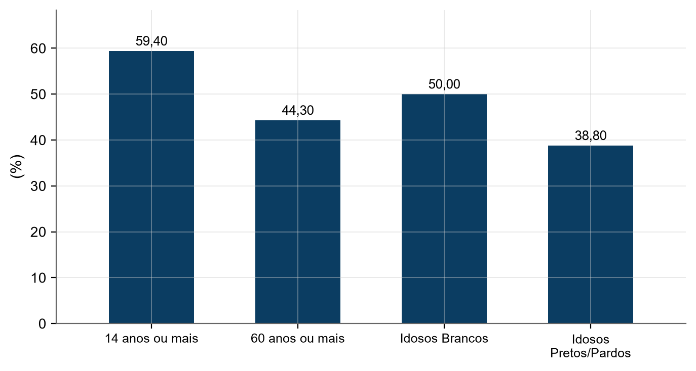
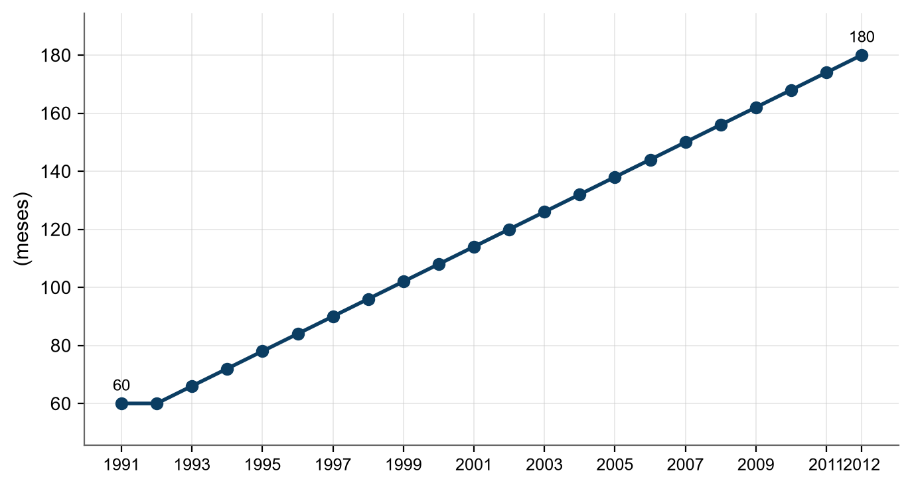

RELATÓRIO

Yago Melo da Costa
<h1 class="capa-titulo">Trabalho no Brasil 2026: Legislação, Modalidades e Tendências</h1>
Relações de trabalho, CLT, PJ, MEI e trabalho informal

Fortaleza, Ceará

2026

## Resumo

O relatório "Trabalho no Brasil 2026" apresenta uma análise abrangente do mercado laboral brasileiro, integrando dados estatísticos do IBGE/PNAD Contínua com a fundamentação jurídica vigente. A obra examina os princípios constitucionais dos direitos sociais, a liberdade sindical e a estrutura da CLT, detalhando a evolução do Decreto-Lei 5.452/1943. Um ponto central é a discussão sobre o vínculo de emprego, analisando os requisitos de pessoa física, habitualidade, onerosidade, pessoalidade e subordinação, com especial atenção à subordinação algorítmica sob a ótica do TST e STF. O documento estabelece distinções claras entre modalidades com e sem vínculo empregatício, comparando a relação CLT com a contratação via PJ e o regime do MEI, abrangendo custos empresariais, tributação previdenciária conforme a Lei 8.212/1991 e benefícios sociais. Adicionalmente, aborda a economia de plataformas digitais, a incidência de riscos ocupacionais, normas de saúde e segurança, e o combate ao assédio conforme a Lei 14.457/2022. Por fim, o relatório monitora as proposições legislativas em tramitação no Congresso Nacional em 2026, focando em reformas trabalhistas e na regulamentação da pejotização, consolidando as conclusões em quadros comparativos de direitos, deveres e riscos para trabalhadores e empregadores.

Palavras-chave: CLT; Vínculo Empregatício; MEI; Plataformas Digitais; Direito do Trabalho.

## Sumário

1. [Panorama do trabalho no Brasil em 2026](#1-panorama-do-trabalho-no-brasil-em-2026)
2. [Princípios constitucionais do trabalho](#2-princípios-constitucionais-do-trabalho)
3. [CLT: estrutura, história e direitos essenciais](#3-clt-estrutura-história-e-direitos-essenciais)
4. [Vínculo de emprego: os 4 requisitos e a subordinação algorítmica](#4-vínculo-de-emprego-os-4-requisitos-e-a-subordinação-algorítmica)
5. [Modalidades de trabalho com vínculo empregatício](#5-modalidades-de-trabalho-com-vínculo-empregatício)
6. [Modalidades de trabalho sem vínculo empregatício](#6-modalidades-de-trabalho-sem-vínculo-empregatício)
7. [PJ versus CLT: comparação objetiva](#7-pj-versus-clt-comparação-objetiva)
8. [MEI e trabalho informal](#8-mei-e-trabalho-informal)
9. [Previdência e tributos do trabalhador](#9-previdência-e-tributos-do-trabalhador)
10. [Trabalho por plataformas digitais](#10-trabalho-por-plataformas-digitais)
11. [Mudanças em tramitação no Congresso em 2026](#11-mudanças-em-tramitação-no-congresso-em-2026)
12. [Riscos e como se proteger](#12-riscos-e-como-se-proteger)
13. [Quadro resumo e conclusões](#13-quadro-resumo-e-conclusões)
A. [Apêndice A - Legislação citada e o que ela muda na prática]
R. [Referências](#referências)

## 1. Panorama do trabalho no Brasil em 2026

O mercado de trabalho brasileiro em 2026 apresenta um cenário de resiliência, com a taxa de desocupação atingindo patamares historicamente baixos [(IPEA, 2026b)](https://www.ipea.gov.br/cartadeconjuntura/index.php/category/mercado-de-trabalho/). A taxa de desocupação média anual em 2026 foi de 5,8%, consolidando uma trajetória de queda desde o pico de 13,8% registrado em 2020 [(IBGE, 2026d)](https://www.ibge.gov.br/estatisticas/sociais/trabalho/17270-pnad-continua.html). Esse movimento é impulsionado pela expansão da população ocupada, que alcançou a média anual de 102,5 milhões de pessoas em 2026 [(IBGE, 2026d)](https://www.ibge.gov.br/estatisticas/sociais/trabalho/17270-pnad-continua.html).

<figure class="figura"><figcaption><strong>Figura 1 – Taxa de Desocupação no Brasil (2012-2026).</strong> <em>Fonte: [(IBGE, 2026d)](https://www.ibge.gov.br/estatisticas/sociais/trabalho/17270-pnad-continua.html).</em> A taxa de desocupação atingiu seu pico em 2020 e caiu para o menor nível da série em 2026.</figcaption></figure>

O volume de pessoas ocupadas demonstra crescimento sustentado, saindo de 89,3 milhões em 2012 para 102,5 milhões em 2026 [(IBGE, 2026d)](https://www.ibge.gov.br/estatisticas/sociais/trabalho/17270-pnad-continua.html). O crescimento recente é sustentado especialmente pelo emprego formal, com taxa de expansão de 3,6%, superando a do setor informal, que foi de 1,5% [(IPEA, 2026b)](https://www.ipea.gov.br/cartadeconjuntura/index.php/category/mercado-de-trabalho/).

<figure class="figura"><figcaption><strong>Figura 2 – População Ocupada no Brasil (2012-2026).</strong> <em>Fonte: [(IBGE, 2026d)](https://www.ibge.gov.br/estatisticas/sociais/trabalho/17270-pnad-continua.html).</em> O número de ocupados cresceu consistentemente, superando a marca de 100 milhões a partir de 2024.</figcaption></figure>

O rendimento médio mensal real do trabalho principal acompanhou essa tendência de alta, registrando R$ 3.777,50 em 2026, comparado a R$ 3.191,30 em 2012 [(IBGE, 2026d)](https://www.ibge.gov.br/estatisticas/sociais/trabalho/17270-pnad-continua.html).

<figure class="figura"><figcaption><strong>Figura 3 – Rendimento Médio Mensal Real (2012-2026).</strong> <em>Fonte: [(IBGE, 2026d)](https://www.ibge.gov.br/estatisticas/sociais/trabalho/17270-pnad-continua.html).</em> O rendimento médio real apresenta tendência de alta, com aceleração a partir de 2023.</figcaption></figure>

### 1.1 Segmentação e Informalidade

O mercado divide-se entre trabalhadores com carteira assinada, sem carteira (informais), autônomos e MEIs [(IPEA, 2026a)](https://www.ipeadata.gov.br/). Em 2026, o número de empregados com carteira assinada foi de 39,3 milhões [(IPEA, 2026a)](https://www.ipeadata.gov.br/). Já os empregados sem carteira somaram 13,4 milhões [(IPEA, 2026a)](https://www.ipeadata.gov.br/). A taxa de informalidade, que atingiu 40,8% em 2019, recuou para 37,3% em 2026 [(IPEA, 2026a)](https://www.ipeadata.gov.br/).

<figure class="figura"><figcaption><strong>Figura 4 – Taxa de Informalidade no Brasil (2015-2026).</strong> <em>Fonte: [(IPEA, 2026a)](https://www.ipeadata.gov.br/).</em> A informalidade atingiu seu pico em 2019 e apresenta queda gradual até 2026.</figcaption></figure>

### 1.2 Saúde e Condições Sociais

A Pesquisa Nacional de Saúde (PNS) é realizada quinquenalmente, com edições disponíveis de 2013 e 2019, enquanto a terceira edição (PNS 2026) encontra-se em fase de coleta [(IBGE, 2019)](https://www.ibge.gov.br/estatisticas/sociais/saude/9160-pesquisa-nacional-de-saude.html). A percepção de saúde "boa ou muito boa" é significativamente maior entre pessoas ocupadas (73,8% em 2019) do que entre aquelas fora da força de trabalho (51,3% em 2019) [(IBGE, 2019)](https://www.ibge.gov.br/estatisticas/sociais/saude/9160-pesquisa-nacional-de-saude.html).

<figure class="figura"><figcaption><strong>Figura 5 – Saúde Autoavaliada Boa/Muito Boa por Situação Ocupacional.</strong> <em>Fonte: [(IBGE, 2019)](https://www.ibge.gov.br/estatisticas/sociais/saude/9160-pesquisa-nacional-de-saude.html).</em> Trabalhadores ocupados mantêm a melhor percepção de saúde, enquanto quem está fora da força de trabalho tem a pior.</figcaption></figure>

A desigualdade na saúde também é evidente por cor ou raça e renda [(IBGE, 2019)](https://www.ibge.gov.br/estatisticas/sociais/saude/9160-pesquisa-nacional-de-saude.html). Em 2019, 71% das pessoas brancas avaliaram sua saúde como boa ou muito boa, contra 62,9% de pretos e 62,1% de pardos [(IBGE, 2019)](https://www.ibge.gov.br/estatisticas/sociais/saude/9160-pesquisa-nacional-de-saude.html). Na faixa de renda, quem ganha mais de 5 salários mínimos reporta 86,4% de saúde boa/muito boa, enquanto quem ganha até 1/4 do salário mínimo reporta apenas 55,5% [(IBGE, 2019)](https://www.ibge.gov.br/estatisticas/sociais/saude/9160-pesquisa-nacional-de-saude.html).

<figure class="figura"><figcaption><strong>Figura 6 – Saúde Autoavaliada por Cor ou Raça (2019).</strong> <em>Fonte: [(IBGE, 2019)](https://www.ibge.gov.br/estatisticas/sociais/saude/9160-pesquisa-nacional-de-saude.html).</em> Há uma disparidade na percepção de saúde entre pessoas brancas e pretas/pardas.</figcaption></figure>

### 1.3 Política de Salário Mínimo e Arcabouço Fiscal

A trajetória do salário mínimo é regida pela Lei 14.663/2023, que prevê o reajuste pelo INPC acrescido do crescimento do PIB [(SENADO FEDERAL, 2026b)](https://www12.senado.leg.br/noticias/materias/2023/08/31/novo-arcabouco-fiscal-entra-em-vigencia-no-brasil). O novo regime fiscal, estabelecido pela Lei Complementar 200/2023 e a EC 126/2022, substituiu o teto de gastos por um arcabouço que busca a sustentabilidade da dívida pública [(SENADO FEDERAL, 2026b)](https://www12.senado.leg.br/noticias/materias/2023/08/31/novo-arcabouco-fiscal-entra-em-vigencia-no-brasil).

O salário mínimo para 2026 foi fixado em R$ 1.621,00 [(SENADO FEDERAL, 2026d)](https://www12.senado.leg.br/radio/1/noticia/2025/12/19/congresso-nacional-aprova-o-orcamento-de-2026-com-salario-minimo-de-r-1-621-a-partir-de-janeiro). De acordo com o Senado, se não houvesse o limite imposto pelo arcabouço fiscal, o valor do aumento teria sido R$ 10,00 maior [(SENADO FEDERAL, 2026d)](https://www12.senado.leg.br/radio/1/noticia/2025/12/19/congresso-nacional-aprova-o-orcamento-de-2026-com-salario-minimo-de-r-1-621-a-partir-de-janeiro).

### 1.4 Poder de Compra e Rendimentos Reais

O rendimento médio real e o salário mínimo real apresentam comportamentos distintos. Em 2026, o salário mínimo real foi de R$ 1.643,40, enquanto o rendimento real médio do empregado com carteira foi de R$ 3.395,90 e do sem carteira R$ 2.670,50 [(IPEA, 2026a)](https://www.ipeadata.gov.br/).

<figure class="figura">

<h4>Categoria</h4><ul><li>Salário Mínimo Real</li><li>Com Carteira</li><li>Sem Carteira</li></ul>

<h4>Valor (R$)</h4><ul><li>1643.4</li><li>3395.9</li><li>2670.5</li></ul>

<figcaption><strong>Figura 7 – Rendimentos Reais Médios em 2026.</strong> <em>Fonte: [(IPEA, 2026a)](https://www.ipeadata.gov.br/).</em> O rendimento de quem possui carteira assinada é mais que o dobro do salário mínimo real.</figcaption></figure>

O crescimento dos rendimentos deve ser analisado frente ao IPCA [(IPEA, 2026a)](https://www.ipeadata.gov.br/). Quando o rendimento médio cresce acima da inflação, há ganho de poder de compra; caso contrário, ocorre perda real, mesmo com aumento nominal dos valores [(IPEA, 2026a)](https://www.ipeadata.gov.br/).

### 1.5 Salário Mínimo e Médio vs. Custo de Vida

A análise do DIEESE utiliza a metodologia do Salário Mínimo Necessário, calculada com base na cesta básica de maior valor entre as capitais, multiplicada por 3 (família de quatro pessoas) e dividida por 35,71% (participação orçamentária da alimentação) [(DIEESE, 2026a)](https://www.dieese.org.br/analisecestabasica/salarioMinimo.html). Este cálculo visa suprir alimentação, moradia, saúde, educação, vestuário, higiene, transporte, lazer e previdência, conforme o art. 7º, IV da Constituição Federal [(DIEESE, 2026a)](https://www.dieese.org.br/analisecestabasica/salarioMinimo.html).

Em setembro de 2026, o salário mínimo nominal era de R$ 1.621,00, enquanto o salário mínimo necessário era de R$ 7.750,01 [(DIEESE, 2026a)](https://www.dieese.org.br/analisecestabasica/salarioMinimo.html). Isso significa que o valor pago corresponde a apenas 20,9% do necessário para a cesta constitucional [(DIEESE, 2026a)](https://www.dieese.org.br/analisecestabasica/salarioMinimo.html).

<figure class="figura"><figcaption><strong>Figura 8 – Salário Mínimo Nominal vs. Necessário (2012-2026).</strong> <em>Fonte: [(DIEESE, 2026a)](https://www.dieese.org.br/analisecestabasica/salarioMinimo.html).</em> A distância entre o salário pago e o necessário para a cesta constitucional aumentou ao longo da série.</figcaption></figure>

Comparando o rendimento médio nominal com o necessário, a defasagem permanece crítica [(DIEESE, 2026a)](https://www.dieese.org.br/analisecestabasica/salarioMinimo.html).

<figure class="figura"><figcaption><strong>Figura 9 – Rendimento Médio Nominal vs. Salário Necessário (2012-2026).</strong> <em>Fonte: [(DIEESE, 2026a)](https://www.dieese.org.br/analisecestabasica/salarioMinimo.html).</em> Mesmo o rendimento médio nominal do brasileiro não atinge metade do valor necessário para a cesta constitucional.</figcaption></figure>

<strong>Tabela 1 – Custo da Cesta Básica de Alimentos (Setembro 2026).</strong> <em>Fonte: [(DIEESE, 2026b)](https://www.dieese.org.br/analisecestabasica/2026/202609cestabasica.pdf).</em>

| Item | Valor/Indicador | Fonte |
| :--- | :--- | :--- |
| Custo Cesta Básica (São Paulo) | R$ 922,51 | [(DIEESE, 2026b)](https://www.dieese.org.br/analisecestabasica/2026/202609cestabasica.pdf) |
| Horas de Trabalho Necessárias | 125 horas e 12 minutos | [(DIEESE, 2026b)](https://www.dieese.org.br/analisecestabasica/2026/202609cestabasica.pdf) |
| % da Renda Líquida (após Prev.) | 61,52% | [(DIEESE, 2026b)](https://www.dieese.org.br/analisecestabasica/2026/202609cestabasica.pdf) |

**Conclusão Numérica:**
Para satisfazer a cesta constitucional, o salário deveria ser de R$ 7.750,01 [(DIEESE, 2026a)](https://www.dieese.org.br/analisecestabasica/salarioMinimo.html). Para alcançar esse patamar, faltam R$ 6.129,01 para o salário mínimo de R$ 1.621,00 e aproximadamente R$ 4.750,01 para o rendimento médio nominal estimado em R$ 3.000,00 [(DIEESE, 2026a)](https://www.dieese.org.br/analisecestabasica/salarioMinimo.html).

**Em termos simples:**
O desemprego caiu bastante e mais gente está trabalhando em 2026, mas o dinheiro ainda não dá para tudo. O salário mínimo é de R$ 1.621,00, mas para viver com a dignidade que a lei manda (com saúde, lazer e educação), o trabalhador precisaria de R$ 7.750,01 [(DIEESE, 2026a)](https://www.dieese.org.br/analisecestabasica/salarioMinimo.html). Só para comprar a comida básica em São Paulo, gasta-se mais de 60% do que sobra do salário mínimo [(DIEESE, 2026b)](https://www.dieese.org.br/analisecestabasica/2026/202609cestabasica.pdf).

Fontes consultadas:
* [(IBGE, 2026d)](https://www.ibge.gov.br/estatisticas/sociais/trabalho/17270-pnad-continua.html)
* [(IPEA, 2026a)](https://www.ipeadata.gov.br/)
* [(IPEA, 2026b)](https://www.ipea.gov.br/cartadeconjuntura/index.php/category/mercado-de-trabalho/)
* [(IBGE, 2019)](https://www.ibge.gov.br/estatisticas/sociais/saude/9160-pesquisa-nacional-de-saude.html)
* [(SENADO FEDERAL, 2026d)](https://www12.senado.leg.br/radio/1/noticia/2025/12/19/congresso-nacional-aprova-o-orcamento-de-2026-com-salario-minimo-de-r-1-621-a-partir-de-janeiro)
* [(SENADO FEDERAL, 2026b)](https://www12.senado.leg.br/noticias/materias/2023/08/31/novo-arcabouco-fiscal-entra-em-vigencia-no-brasil)
* [(DIEESE, 2026a)](https://www.dieese.org.br/analisecestabasica/salarioMinimo.html)
* [(DIEESE, 2026b)](https://www.dieese.org.br/analisecestabasica/2026/202609cestabasica.pdf)

## 2. Princípios constitucionais do trabalho

O sistema jurídico brasileiro estabelece o trabalho como um dos fundamentos da República Federativa do Brasil, integrando os valores sociais do trabalho e da livre iniciativa [(BRASIL, 1988, art. 1º, IV)](https://www.planalto.gov.br/ccivil_03/constituicao/constituicao.htm). A proteção ao trabalho humano é elevada ao status de direito social, abrangendo a educação, a saúde, a alimentação, o trabalho, a moradia, o transporte, o lazer, a segurança, a previdência social, a proteção à maternidade e à infância, além da assistência aos desamparados [(BRASIL, 1988, art. 6º)](https://www.planalto.gov.br/ccivil_03/constituicao/constituicao.htm).

A proteção legal estende-se a grupos vulneráveis, proibindo-se o trabalho noturno, perigoso ou insalubre a menores de 18 anos e qualquer trabalho a menores de 16 anos, salvo na condição de aprendiz a partir dos 14 anos [(BRASIL, 1988, art. 7º, XXXIII)](https://www.planalto.gov.br/ccivil_03/constituicao/constituicao.htm).

### 2.1 Direitos Sociais e Garantias do Trabalhador

A Constituição Federal assegura um conjunto de direitos mínimos para garantir a dignidade do trabalhador. Entre as garantias fundamentais, destacam-se a irredutibilidade do salário, salvo disposição em convenção ou acordo coletivo [(BRASIL, 1988, art. 7º, VI)](https://www.planalto.gov.br/ccivil_03/constituicao/constituicao.htm), e a remuneração do trabalho noturno em patamar superior à do diurno [(BRASIL, 1988, art. 7º, IX)](https://www.planalto.gov.br/ccivil_03/constituicao/constituicao.htm).

A jornada de trabalho normal é limitada a 8 horas diárias e 44 horas semanais, permitindo-se a compensação de horários ou a redução da jornada mediante acordo ou convenção coletiva [(BRASIL, 1988, art. 7º, XIII)](https://www.planalto.gov.br/ccivil_03/constituicao/constituicao.htm). Além disso, é garantido o décimo terceiro salário com base na remuneração integral ou no valor da aposentadoria [(BRASIL, 1988, art. 7º, VIII)](https://www.planalto.gov.br/ccivil_03/constituicao/constituicao.htm).

<figure class="figura">

<h4>Direito</h4><ul><li>Jornada Diária Máxima</li><li>Jornada Semanal Máxima</li><li>Salário Mínimo</li><li>Remuneração Noturna</li></ul>

<h4>Regra Constitucional</h4><ul><li>8 horas</li><li>44 horas</li><li>Nunca inferior ao mínimo</li><li>Superior à do diurno</li></ul>

<figcaption><strong>Figura 10 – Principais Direitos Sociais do Trabalhador.</strong> <em>Fonte: [(BRASIL, 1988)](https://www.planalto.gov.br/ccivil_03/constituicao/constituicao.htm).</em> O gráfico resume as limitações de jornada e garantias remuneratórias básicas previstas no art. 7º da CF.</figcaption></figure>

### 2.2 Liberdade Sindical, Greve e Proteção Legal

A liberdade de associação profissional ou sindical é um direito assegurado, incluindo a garantia de que o trabalhador não sofra cobranças ou descontos salariais estabelecidos em convenção ou acordo coletivo sem sua anuência prévia e expressa [(BRASIL, LEI 13.467/2017, XXVI)](https://www.planalto.gov.br/ccivil_03/_ato2015-2018/2017/lei/l13467.htm). O direito de greve é igualmente garantido, cabendo aos trabalhadores a decisão sobre a oportunidade de seu exercício e os interesses a serem defendidos [(BRASIL, LEI 13.467/2017, XXVII)](https://www.planalto.gov.br/ccivil_03/_ato2015-2018/2017/lei/l13467.htm).

No entanto, a lei deve definir os serviços ou atividades essenciais para garantir o atendimento das necessidades inadiáveis da comunidade durante greves [(BRASIL, LEI 13.467/2017, XXVIII)](https://www.planalto.gov.br/ccivil_03/_ato2015-2018/2017/lei/l13467.htm).

### 2.3 Função Social e Princípios de Proteção

A propriedade, no ordenamento brasileiro, deve atender a sua função social [(BRASIL, 1988, art. 5º, XXIII)](https://www.planalto.gov.br/ccivil_03/constituicao/constituicao.htm). No âmbito do trabalho, o Princípio da Proteção visa equilibrar a relação entre empregador e empregado, combatendo práticas que fragilizam os vínculos trabalhistas, como a "pejotização" (CHAGAS, 2018).

O empregador é definido como a empresa que assume os riscos da atividade econômica, admitindo, assalariando e dirigindo a prestação pessoal de serviço [(BRASIL, 1943, art. 2º)](https://www.planalto.gov.br/ccivil_03/decreto-lei/del5452.htm).

<strong>Tabela 2 – Comparativo de Proteção por Categoria.</strong> <em>Fonte: [(BRASIL, 1988)](https://www.planalto.gov.br/ccivil_03/constituicao/constituicao.htm).</em>

| Categoria | Base de Proteção | Direitos Assegurados |
| :--- | :--- | :--- |
| Trabalhador Permanente | Vínculo Empregatício | Igualdade de direitos com o trabalhador avulso [(BRASIL, 1988, art. 7º, XXXIV)](https://www.planalto.gov.br/ccivil_03/constituicao/constituicao.htm) |
| Trabalhador Avulso | Vínculo Intermitente | Igualdade de direitos com o trabalhador permanente [(BRASIL, 1988, art. 7º, XXXIV)](https://www.planalto.gov.br/ccivil_03/constituicao/constituicao.htm) |
| Trabalhador Doméstico | Lei Complementar | Direitos previstos em incisos específicos do art. 7º e integração previdenciária [(BRASIL, 1988, art. 7º, Parágrafo único)](https://www.planalto.gov.br/ccivil_03/constituicao/constituicao.htm) |

<figure class="figura">

<h4>Aspecto</h4><ul><li>Interferência Estatal</li><li>Dissolução de Associações</li><li>Adesão Sindical</li></ul>

<h4>Regra</h4><ul><li>Vedada no funcionamento</li><li>Apenas por decisão judicial</li><li>Ninguém é compelido a associar-se</li></ul>

<figcaption><strong>Figura 11 – Garantias de Associação e Organização.</strong> <em>Fonte: [(BRASIL, 1988)](https://www.planalto.gov.br/ccivil_03/constituicao/constituicao.htm).</em> A Constituição protege a autonomia das organizações trabalhistas contra a intervenção do Estado.</figcaption></figure>

**Em termos simples:** A lei brasileira protege o trabalhador porque entende que ele é a parte mais fraca na relação com o patrão [(BRASIL, 1988)](https://www.planalto.gov.br/ccivil_03/constituicao/constituicao.htm). Isso garante coisas básicas como limite de horas por dia, salário mínimo, 13º e a liberdade de criar sindicatos ou fazer greve para lutar por melhorias [(BRASIL, LEI 13.467/2017)](https://www.planalto.gov.br/ccivil_03/_ato2015-2018/2017/lei/l13467.htm).

Fontes consultadas:
* [(BRASIL, 1988)](https://www.planalto.gov.br/ccivil_03/constituicao/constituicao.htm)
* [(BRASIL, LEI 13.467/2017)](https://www.planalto.gov.br/ccivil_03/_ato2015-2018/2017/lei/l13467.htm)
* [(BRASIL, 1943)](https://www.planalto.gov.br/ccivil_03/decreto-lei/del5452.htm)
* (CHAGAS, 2018)

## 3. CLT: estrutura, história e direitos essenciais

A Consolidação das Leis do Trabalho (CLT) foi aprovada pelo Decreto-Lei nº 5.452, de 1º de maio de 1943 [(BRASIL, 1943)](https://www.planalto.gov.br/ccivil_03/decreto-lei/del5452.htm). Ela estatui as normas que regulam as relações individuais e coletivas de trabalho [(BRASIL, 1943, art. 1º)](https://www.planalto.gov.br/ccivil_03/decreto-lei/del5452.htm). A estrutura define o empregador como a empresa que assume os riscos da atividade econômica, admite, assalaria e dirige a prestação pessoal de serviço [(BRASIL, 1943, art. 2º)](https://www.planalto.gov.br/ccivil_03/decreto-lei/del5452.htm).

### 3.1 Direitos Essenciais e Jornada de Trabalho

A Constituição Federal e a CLT estabelecem garantias fundamentais ao trabalhador. A jornada normal de trabalho não deve superar 8 horas diárias e 44 horas semanais [(BRASIL, 1988, inciso XIII)](https://www.planalto.gov.br/ccivil_03/constituicao/constituicao.htm). O repouso semanal remunerado deve ocorrer preferencialmente aos domingos [(BRASIL, 1988, inciso XV)](https://www.planalto.gov.br/ccivil_03/constituicao/constituicao.htm).

Para a jornada excepcional, o trabalhador pode ultrapassar as 8 horas diárias mediante a prestação de horas extras [(BRASIL, 1943, art. 59)](https://www.planalto.gov.br/ccivil_03/decreto-lei/del5452.htm). A remuneração do serviço extraordinário deve ser, no mínimo, 50% superior à do normal [(BRASIL, 1988, inciso XVI)](https://www.planalto.gov.br/ccivil_03/constituicao/constituicao.htm).

<strong>Tabela 3 – Direitos Essenciais do Trabalhador.</strong> <em>Fonte: [(BRASIL, 1988)](https://www.planalto.gov.br/ccivil_03/constituicao/constituicao.htm).</em>

| Direito | Regra Principal | Fonte |
| :--- | :--- | :--- |
| Férias | Anuais remuneradas com 1/3 a mais que o salário normal | [(BRASIL, 1988, inciso XVII)](https://www.planalto.gov.br/ccivil_03/constituicao/constituicao.htm) |
| Aviso Prévio | Proporcional ao tempo de serviço, mínimo de 30 dias | [(BRASIL, 1988, inciso XXI)](https://www.planalto.gov.br/ccivil_03/constituicao/constituicao.htm) |
| Licença-Gestante | Duração de 120 dias, sem prejuízo do emprego e salário | [(BRASIL, 1988, inciso XVIII)](https://www.planalto.gov.br/ccivil_03/constituicao/constituicao.htm) |
| Adicionais | Remuneração extra para atividades penosas, insalubres ou perigosas | [(BRASIL, 1988, inciso XXIII)](https://www.planalto.gov.br/ccivil_03/constituicao/constituicao.htm) |

<figure class="figura">

<h4>Tipo de Hora</h4><ul><li>Hora Normal</li><li>Hora Extraordinária</li></ul>

<h4>Valor/Adicional</h4><ul><li>100%</li><li>150%</li></ul>

<figcaption><strong>Figura 12 – Remuneração da Hora de Trabalho.</strong> <em>Fonte: [(BRASIL, 1988)](https://www.planalto.gov.br/ccivil_03/constituicao/constituicao.htm).</em> O serviço extraordinário deve ser remunerado com um adicional mínimo de 50% sobre o valor da hora normal.</figcaption></figure>

### 3.2 Reforma Trabalhista de 2017 (Lei 13.467/2017)

A Lei 13.467/2017 alterou a CLT para adequar a legislação às novas relações de trabalho [(BRASIL, LEI 13.467/2017)](https://www.planalto.gov.br/ccivil_03/_ato2015-2018/2017/lei/l13467.htm). Entre as principais mudanças práticas, destacam-se:

*   **Negociação sobre a Lei:** A reforma permitiu que convenções e acordos coletivos prevaleçam sobre a lei em diversos pontos [(BRASIL, LEI 13.467/2017)](https://www.planalto.gov.br/ccivil_03/_ato2015-2018/2017/lei/l13467.htm).
*   **Teletrabalho e Intermitente:** Introduziu-se o contrato intermitente, onde as verbas rescisórias e o aviso prévio são calculados pela média dos valores recebidos [(BRASIL, 1943, art. 452-F)](https://www.planalto.gov.br/ccivil_03/decreto-lei/del5452.htm).
*   **Jornada e Compensação:** A prestação de horas extras habituais não descaracteriza mais o acordo de compensação de jornada ou o banco de horas [(BRASIL, 1943, art. 59-B, parágrafo único)](https://www.planalto.gov.br/ccivil_03/decreto-lei/del5452.htm).
*   **Intervalos:** A remuneração mensal pactuada para jornadas específicas pode abranger o descanso semanal e feriados, sendo considerados compensados [(BRASIL, 1943, art. 59-A, parágrafo único)](https://www.planalto.gov.br/ccivil_03/decreto-lei/del5452.htm).

A flexibilização trazida pela reforma, como a ampliação da terceirização e a criação de modalidades como o trabalho intermitente, reduz a complexidade e o custo do vínculo empregatício tradicional [(BRASIL, LEI 13.467/2017)](https://www.planalto.gov.br/ccivil_03/_ato2015-2018/2017/lei/l13467.htm). Isso impulsiona a migração para modelos de PJ e MEI, onde o custo tributário é simplificado em comparação aos encargos da CLT [(BRASIL, LEI 13.467/2017)](https://www.planalto.gov.br/ccivil_03/_ato2015-2018/2017/lei/l13467.htm).

<figure class="figura">

<h4>Regra</h4><ul><li>Horas Extras Habituais</li><li>Acordo de Compensação</li></ul>

<h4>Efeito Pós-Reforma 2017</h4><ul><li>Não descaracteriza o banco de horas</li><li>Mantém-se a validade do acordo</li></ul>

<figcaption><strong>Figura 13 – Impacto da Reforma na Compensação de Jornada.</strong> <em>Fonte: [(BRASIL, 1943)](https://www.planalto.gov.br/ccivil_03/decreto-lei/del5452.htm).</em> A reforma de 2017 garantiu que a prática habitual de horas extras não anule a validade dos acordos de compensação de jornada.</figcaption></figure>

**Em termos simples:** A CLT é o livro de regras do trabalho no Brasil. Ela garante que você não trabalhe mais de 8 horas por dia (ou 44 por semana) sem receber extra, que tenha férias com um dinheiro a mais (1/3) e aviso prévio se for demitido [(BRASIL, 1988)](https://www.planalto.gov.br/ccivil_03/constituicao/constituicao.htm). A Reforma de 2017 deixou as regras mais flexíveis, permitindo que patrão e empregado combinem coisas diferentes da lei e criando contratos como o intermitente, o que acabou incentivando muita gente a trabalhar como MEI ou PJ para fugir dos custos da carteira assinada [(BRASIL, LEI 13.467/2017)](https://www.planalto.gov.br/ccivil_03/_ato2015-2018/2017/lei/l13467.htm).

Fontes consultadas:
* [(BRASIL, 1988)](https://www.planalto.gov.br/ccivil_03/constituicao/constituicao.htm)
* [(BRASIL, 1943)](https://www.planalto.gov.br/ccivil_03/decreto-lei/del5452.htm)
* [(BRASIL, LEI 13.467/2017)](https://www.planalto.gov.br/ccivil_03/_ato2015-2018/2017/lei/l13467.htm)

## 4. Vínculo de emprego: os 4 requisitos e a subordinação algorítmica

A caracterização da relação de emprego no Brasil depende da coexistência de pressupostos específicos que distinguem o empregado do trabalhador autônomo [(BRASIL, 1943)](https://www.planalto.gov.br/ccivil_03/decreto-lei/del5452.htm). O empregador é definido como a empresa que assume os riscos da atividade econômica, admite, assalaria e dirige a prestação pessoal de serviço [(BRASIL, 1943, art. 2º)](https://www.planalto.gov.br/ccivil_03/decreto-lei/del5452.htm).

<strong>Tabela 4 – Requisitos do Vínculo Empregatício.</strong> <em>Fonte: [(BRASIL, 1943)](https://www.planalto.gov.br/ccivil_03/decreto-lei/del5452.htm).</em>

| Passo | Requisito | Base Legal |
| :--- | :--- | :--- |
| 1 | Pessoa Física | [(BRASIL, 1943, art. 3º)](https://www.planalto.gov.br/ccivil_03/decreto-lei/del5452.htm) |
| 2 | Habitualidade (Não eventualidade) | [(BRASIL, 1943, art. 3º)](https://www.planalto.gov.br/ccivil_03/decreto-lei/del5452.htm) |
| 3 | Onerosidade (Pagamento de salário) | [(BRASIL, 1943, art. 3º)](https://www.planalto.gov.br/ccivil_03/decreto-lei/del5452.htm) |
| 4 | Pessoalidade | [(BRASIL, 1943, art. 3º)](https://www.planalto.gov.br/ccivil_03/decreto-lei/del5452.htm) |
| 5 | Subordinação | [(BRASIL, 1943, art. 3º)](https://www.planalto.gov.br/ccivil_03/decreto-lei/del5452.htm) |

A subordinação jurídica é o ponto central para a caracterização do vínculo [(FONSECA, 2026)](https://doi.org/10.21527/2176-6622.2022.57.12136). Atualmente, a lei equipara os meios telemáticos e informatizados de comando, controle e supervisão aos meios pessoais e diretos de supervisão do trabalho [(BRASIL, 1943, art. 6º, parágrafo único)](https://www.planalto.gov.br/ccivil_03/decreto-lei/del5452.htm). Essa definição fundamenta a análise da subordinação algorítmica, especialmente em trabalhos intermediados por aplicativos digitais [(FONSECA, 2026)](https://doi.org/10.21527/2176-6622.2022.57.12136).

A legislação distingue o emprego do trabalho autônomo, estabelecendo que a contratação de autônomo, desde que cumpridas as formalidades legais, afasta a qualidade de empregado, independentemente de haver exclusividade ou continuidade [(BRASIL, LEI 13.467/2017, art. 442-B)](https://www.planalto.gov.br/ccivil_03/_ato2015-2018/2017/lei/l13467.htm). No entanto, se a subordinação jurídica estiver presente, o vínculo empregatício deve ser reconhecido [(BRASIL, 1943)](https://www.planalto.gov.br/ccivil_03/decreto-lei/del5452.htm).

A "pejotização" ocorre quando um trabalhador é contratado por meio de uma pessoa jurídica constituída para a prestação de serviços [(STF, 2026b)](https://noticias.stf.jus.br/postsnoticias/stf-retira-suspensao-de-processos-sobre-pejotizacao-na-primeira-instancia-e-nos-trts). Esse modelo é frequente em setores como tecnologia da informação, saúde, advocacia associada e serviços de entrega [(STF, 2026b)](https://noticias.stf.jus.br/postsnoticias/stf-retira-suspensao-de-processos-sobre-pejotizacao-na-primeira-instancia-e-nos-trts). A prática é considerada abusiva quando a pessoa jurídica é utilizada para mascarar uma relação de emprego real, especialmente quando os titulares da empresa mantêm com o contratante relação de pessoalidade, subordinação e habitualidade [(BRASIL, LC 123/2006, art. 4º, § 4º, XI)](https://www.planalto.gov.br/ccivil_03/leis/lcp/lcp123.htm).

As consequências da fraude na contratação podem incluir o reconhecimento do vínculo e o pagamento retroativo de verbas. O Supremo Tribunal Federal (STF) tem analisado a licitude desses contratos, tendo inclusive retirado a suspensão de processos sobre pejotização na primeira instância e nos TRTs para evitar o represamento de ações [(STF, 2026c)](https://noticias.stf.jus.br/postsnoticias/stf-retira-suspensao-de-processos-sobre-pejotizacao-na-primeira-instancia-e-nos-trts/).

Quanto à responsabilidade, empresas que integram grupo econômico respondem solidariamente pelas obrigações decorrentes da lei [(BRASIL, LEI 8.212/1991, art. 31, IX)](https://www.planalto.gov.br/ccivil_03/leis/l8212cons.htm). Da mesma forma, empresas sob direção, controle ou administração de outra, constituindo grupo econômico, são solidariamente responsáveis pela relação de emprego [(BRASIL, 1943, art. 2º, § 2º)](https://www.planalto.gov.br/ccivil_03/decreto-lei/del5452.htm).

**Em termos simples:** Para ser considerado empregado, a pessoa precisa trabalhar com frequência, receber salário, não poder ser substituída por outra pessoa e, principalmente, obedecer às ordens do patrão [(BRASIL, 1943)](https://www.planalto.gov.br/ccivil_03/decreto-lei/del5452.htm). A "pejotização" é quando a empresa obriga o trabalhador a abrir um CNPJ para evitar pagar direitos trabalhistas, mas continua mandando nele como se fosse um funcionário comum [(STF, 2026b)](https://noticias.stf.jus.br/postsnoticias/stf-retira-suspensao-de-processos-sobre-pejotizacao-na-primeira-instancia-e-nos-trts).

Fontes consultadas:
* [(BRASIL, 1943)](https://www.planalto.gov.br/ccivil_03/decreto-lei/del5452.htm)
* [(FONSECA, 2026)](https://doi.org/10.21527/2176-6622.2022.57.12136)
* [(BRASIL, LEI 13.467/2017)](https://www.planalto.gov.br/ccivil_03/_ato2015-2018/2017/lei/l13467.htm)
* [(BRASIL, LC 123/2006)](https://www.planalto.gov.br/ccivil_03/leis/lcp/lcp123.htm)
* [(STF, 2026b)](https://noticias.stf.jus.br/postsnoticias/stf-retira-suspensao-de-processos-sobre-pejotizacao-na-primeira-instancia-e-nos-trts)
* [(STF, 2026c)](https://noticias.stf.jus.br/postsnoticias/stf-retira-suspensao-de-processos-sobre-pejotizacao-na-primeira-instancia-e-nos-trts/)
* [(BRASIL, LEI 8.212/1991)](https://www.planalto.gov.br/ccivil_03/leis/l8212cons.htm)

## 5. Modalidades de trabalho com vínculo empregatício

### 5.1 CLT tempo indeterminado (padrão)

**Como funciona na prática:**
O contrato individual de trabalho é firmado como um acordo, que pode ser tácito ou expresso, estabelecendo a relação de emprego [(BRASIL, 1943, art. 442)](https://www.planalto.gov.br/ccivil_03/decreto-lei/del5452.htm). O empregador é a empresa, individual ou coletiva, que assume os riscos da atividade econômica e dirige a prestação pessoal de serviço [(BRASIL, 1943, art. 2º)](https://www.planalto.gov.br/ccivil_03/decreto-lei/del5452.htm).

**Como deveria funcionar segundo a lei:**
A relação é regida pela Consolidação das Leis do Trabalho, onde o empregador admite, assalaria e dirige o trabalhador [(BRASIL, 1943, art. 2º)](https://www.planalto.gov.br/ccivil_03/decreto-lei/del5452.htm). O vínculo é caracterizado pela continuidade e pela subordinação do empregado à direção da empresa [(BRASIL, 1943, art. 2º)](https://www.planalto.gov.br/ccivil_03/decreto-lei/del5452.htm).

<strong>Tabela 5 – Direitos e Deveres - CLT Indeterminado.</strong> <em>Fonte: [(BRASIL, 1943)](https://www.planalto.gov.br/ccivil_03/decreto-lei/del5452.htm).</em>

| Direitos do trabalhador | Deveres (trabalhador e contratante) |
| :--- | :--- |
| Remuneração pelo serviço prestado [(BRASIL, 1943, art. 2º)](https://www.planalto.gov.br/ccivil_03/decreto-lei/del5452.htm) | Prestação pessoal do serviço [(BRASIL, 1943, art. 2º)](https://www.planalto.gov.br/ccivil_03/decreto-lei/del5452.htm) |
| Proteção contra riscos da atividade [(BRASIL, 1943, art. 2º)](https://www.planalto.gov.br/ccivil_03/decreto-lei/del5452.htm) | Direção e subordinação ao empregador [(BRASIL, 1943, art. 2º)](https://www.planalto.gov.br/ccivil_03/decreto-lei/del5452.htm) |

O contratante deve assumir integralmente os riscos da atividade econômica desenvolvida [(BRASIL, 1943, art. 2º)](https://www.planalto.gov.br/ccivil_03/decreto-lei/del5452.htm).

**Como o Estado enxerga e age:**
A fiscalização é realizada pela Secretaria de Inspeção do Trabalho do MTE, através da Auditoria-Fiscal do Trabalho, cujas competências são organizadas pela Lei 10.593/2002 [(BRASIL, LEI 10.593/2002, art. 1º)](https://www.planalto.gov.br/ccivil_03/leis/2002/l10593.htm). O registro deve ser efetuado via eSocial para controle de obrigações previdenciárias e trabalhistas [(ESOCIAL, 2026)](https://www.esocial.gov.br/). Irregularidades são apuradas via denúncias ou ações fiscais, resultando em autos de infração e multas administrativas [(MTE, 2026b)](https://www.gov.br/trabalho-e-emprego/pt-br/assuntos/inspecao-do-trabalho).

**Em termos simples:**
É o emprego comum, com carteira assinada e sem data para acabar, onde o patrão manda e o funcionário recebe o salário mensal [(BRASIL, 1943, art. 2º)](https://www.planalto.gov.br/ccivil_03/decreto-lei/del5452.htm).

### 5.2 CLT tempo determinado e contrato de experiência

**Como funciona na prática:**
O contrato de experiência é uma modalidade de prazo determinado usada para testar a aptidão do empregado [(BRASIL, LC 150/2015, art. 4º)](https://www.planalto.gov.br/ccivil_03/leis/lcp/lcp150.htm). Ele possui um limite máximo de duração e pode ser prorrogado uma única vez [(BRASIL, LC 150/2015, art. 5º)](https://www.planalto.gov.br/ccivil_03/leis/lcp/lcp150.htm).

**Como deveria funcionar segundo a lei:**
O contrato de experiência não pode exceder 90 dias [(BRASIL, LC 150/2015, art. 5º)](https://www.planalto.gov.br/ccivil_03/leis/lcp/lcp150.htm). A prorrogação é permitida desde que a soma dos dois períodos não ultrapasse esse limite de 90 dias [(BRASIL, LC 150/2015, art. 5º, § 1º)](https://www.planalto.gov.br/ccivil_03/leis/lcp/lcp150.htm). Se houver continuidade do serviço após o prazo ou se ultrapassar os 90 dias, o contrato torna-se automaticamente por prazo indeterminado [(BRASIL, LC 150/2015, art. 5º, § 2º)](https://www.planalto.gov.br/ccivil_03/leis/lcp/lcp150.htm).

<strong>Tabela 6 – Direitos e Deveres - Contrato de Experiência.</strong> <em>Fonte: [(BRASIL, LC 150/2015)](https://www.planalto.gov.br/ccivil_03/leis/lcp/lcp150.htm).</em>

| Direitos do trabalhador | Deveres (trabalhador e contratante) |
| :--- | :--- |
| Pagamento de verbas rescisórias se houver dispensa sem justa causa [(BRASIL, LC 150/2015, art. 6º)](https://www.planalto.gov.br/ccivil_03/leis/lcp/lcp150.htm) | Cumprimento do prazo estipulado [(BRASIL, LC 150/2015, art. 5º)](https://www.planalto.gov.br/ccivil_03/leis/lcp/lcp150.htm) |
| Registro em CTPS [(BRASIL, 1943, art. 442)](https://www.planalto.gov.br/ccivil_03/decreto-lei/del5452.htm) | Observância do limite de 90 dias [(BRASIL, LC 150/2015, art. 5º)](https://www.planalto.gov.br/ccivil_03/leis/lcp/lcp150.htm) |

O contratante deve observar rigorosamente o prazo de término para evitar a conversão do contrato em tempo indeterminado [(BRASIL, LC 150/2015, art. 5º, § 2º)](https://www.planalto.gov.br/ccivil_03/leis/lcp/lcp150.htm).

**Como o Estado enxerga e age:**
O MTE fiscaliza a validade dos prazos através da Auditoria-Fiscal do Trabalho [(BRASIL, LEI 10.593/2002, art. 2º)](https://www.planalto.gov.br/ccivil_03/leis/2002/l10593.htm). O controle de datas de admissão e término é monitorado pelo eSocial [(ESOCIAL, 2026)](https://www.esocial.gov.br/). A extrapolação do prazo sem a devida anotação gera multas administrativas previstas na CLT [(MTE, 2026b)](https://www.gov.br/trabalho-e-emprego/pt-br/assuntos/inspecao-do-trabalho).

**Em termos simples:**
É o "período de teste" de até 3 meses; se o patrão não te demitir nem você sair até o 90º dia, você vira funcionário fixo [(BRASIL, LC 150/2015, art. 5º)](https://www.planalto.gov.br/ccivil_03/leis/lcp/lcp150.htm).

### 5.3 Trabalho intermitente

**Como funciona na prática:**
O trabalhador é contratado para prestar serviços de forma não contínua, ocorrendo alternância de períodos de prestação de serviços e de inatividade [(BRASIL, 1943, art. 452-A)](https://www.planalto.gov.br/ccivil_03/decreto-lei/del5452.htm). O empregador convoca o trabalhador para ciclos específicos de trabalho.

**Como deveria funcionar segundo a lei:**
A convocação deve ser feita com antecedência, e o trabalhador tem o prazo de até 3 dias para responder ao chamado [(BRASIL, 1943, art. 452-A)](https://www.planalto.gov.br/ccivil_03/decreto-lei/del5452.htm). O silêncio do trabalhador é interpretado como recusa da oferta [(BRASIL, 1943, art. 452-A)](https://www.planalto.gov.br/ccivil_03/decreto-lei/del5452.htm).

<strong>Tabela 7 – Direitos e Deveres - Trabalho Intermitente.</strong> <em>Fonte: [(BRASIL, 1943)](https://www.planalto.gov.br/ccivil_03/decreto-lei/del5452.htm).</em>

| Direitos do trabalhador | Deveres (trabalhador e contratante) |
| :--- | :--- |
| Recebimento imediato de remuneração ao fim do ciclo [(BRASIL, 1943, art. 452-A)](https://www.planalto.gov.br/ccivil_03/decreto-lei/del5452.htm) | Resposta à convocação em até 3 dias [(BRASIL, 1943, art. 452-A)](https://www.planalto.gov.br/ccivil_03/decreto-lei/del5452.htm) |
| Direito a férias e 13º proporcionais [(BRASIL, 1943, art. 452-A)](https://www.planalto.gov.br/ccivil_03/decreto-lei/del5452.htm) | Registro do contrato mesmo em inatividade [(BRASIL, 1943, art. 452-A)](https://www.planalto.gov.br/ccivil_03/decreto-lei/del5452.htm) |

O contratante deve formalizar a convocação e garantir o pagamento de todas as verbas ao final de cada período de prestação de serviço [(BRASIL, 1943, art. 452-A)](https://www.planalto.gov.br/ccivil_03/decreto-lei/del5452.htm).

**Como o Estado enxerga e age:**
A Auditoria-Fiscal do Trabalho verifica se a intermitência não está sendo usada para mascarar fraude à jornada de trabalho [(BRASIL, LEI 10.593/2002, art. 3º)](https://www.planalto.gov.br/ccivil_03/leis/2002/l10593.htm). O eSocial registra os períodos de atividade e inatividade para fins previdenciários [(ESOCIAL, 2026)](https://www.esocial.gov.br/). A ausência de registro do contrato gera sanções administrativas [(MTE, 2026b)](https://www.gov.br/trabalho-e-emprego/pt-br/assuntos/inspecao-do-trabalho).

**Em termos simples:**
Você tem a carteira assinada, mas só trabalha e ganha quando a empresa te chama e você aceita [(BRASIL, 1943, art. 452-A)](https://www.planalto.gov.br/ccivil_03/decreto-lei/del5452.htm).

### 5.4 Trabalho em tempo parcial

**Como funciona na prática:**
É a contratação com jornada reduzida em relação à jornada normal da empresa [(BRASIL, 1943, art. 58-A)](https://www.planalto.gov.br/ccivil_03/decreto-lei/del5452.htm). No caso de domésticos, a jornada é proporcional ao tempo trabalhado semanalmente [(BRASIL, LC 150/2015, art. 3º)](https://www.planalto.gov.br/ccivil_03/leis/lcp/lcp150.htm).

**Como deveria funcionar segundo a lei:**
Para empregados domésticos em regime parcial, as férias são proporcionais: 18 dias para jornadas entre 22 e 25 horas semanais, e 8 dias para jornadas iguais ou inferiores a 5 horas [(BRASIL, LC 150/2015, art. 3º, § 3º)](https://www.planalto.gov.br/ccivil_03/leis/lcp/lcp150.htm). É permitida 1 hora suplementar diária mediante acordo escrito, respeitando o limite de 6 horas diárias [(BRASIL, LC 150/2015, art. 3º, § 2º)](https://www.planalto.gov.br/ccivil_03/leis/lcp/lcp150.htm).

<strong>Tabela 8 – Direitos e Deveres - Tempo Parcial.</strong> <em>Fonte: [(BRASIL, LC 150/2015)](https://www.planalto.gov.br/ccivil_03/leis/lcp/lcp150.htm).</em>

| Direitos do trabalhador | Deveres (trabalhador e contratante) |
| :--- | :--- |
| Férias proporcionais à jornada semanal [(BRASIL, LC 150/2015, art. 3º)](https://www.planalto.gov.br/ccivil_03/leis/lcp/lcp150.htm) | Cumprimento da carga horária acordada [(BRASIL, LC 150/2015, art. 3º)](https://www.planalto.gov.br/ccivil_03/leis/lcp/lcp150.htm) |
| Salário proporcional à jornada [(BRASIL, 1943, art. 58-A)](https://www.planalto.gov.br/ccivil_03/decreto-lei/del5452.htm) | Acordo escrito para horas suplementares [(BRASIL, LC 150/2015, art. 3º)](https://www.planalto.gov.br/ccivil_03/leis/lcp/lcp150.htm) |

O contratante deve observar a proporcionalidade do salário e das férias conforme a carga horária semanal [(BRASIL, LC 150/2015, art. 3º)](https://www.planalto.gov.br/ccivil_03/leis/lcp/lcp150.htm).

**Como o Estado enxerga e age:**
A fiscalização do MTE monitora se a jornada parcial não excede os limites legais sem o pagamento de horas extras [(BRASIL, LEI 10.593/2002, art. 2º)](https://www.planalto.gov.br/ccivil_03/leis/2002/l10593.htm). O eSocial controla a folha de pagamento proporcional [(ESOCIAL, 2026)](https://www.esocial.gov.br/). O descumprimento gera autos de infração [(MTE, 2026b)](https://www.gov.br/trabalho-e-emprego/pt-br/assuntos/inspecao-do-trabalho).

**Em termos simples:**
É o emprego de "meio período", onde você trabalha menos horas e recebe um salário menor, proporcional ao tempo gasto [(BRASIL, 1943, art. 58-A)](https://www.planalto.gov.br/ccivil_03/decreto-lei/del5452.htm).

### 5.5 Trabalho temporário

**Como funciona na prática:**
O trabalhador é contratado por uma empresa de trabalho temporário para ser colocado à disposição de uma empresa tomadora [(BRASIL, LEI 6.019/1974, art. 2º)](https://www.planalto.gov.br/ccivil_03/leis/l6019.htm). Serve para substituição de pessoal regular ou acréscimo extraordinário de serviços [(BRASIL, LEI 6.019/1974, art. 2º)](https://www.planalto.gov.br/ccivil_03/leis/l6019.htm).

**Como deveria funcionar segundo a lei:**
O contrato não pode exceder 180 dias, consecutivos ou não [(BRASIL, LEI 6.019/1974, art. 10, § 1º)](https://www.planalto.gov.br/ccivil_03/leis/l6019.htm). Pode ser prorrogado por mais 90 dias se comprovada a manutenção das condições que justificaram a contratação [(BRASIL, LEI 6.019/1974, art. 10, § 2º)](https://www.planalto.gov.br/ccivil_03/leis/l6019.htm). Não se aplica o contrato de experiência ao trabalhador temporário contratado pela tomadora [(BRASIL, LEI 6.019/1974, art. 10, § 4º)](https://www.planalto.gov.br/ccivil_03/leis/l6019.htm).

<strong>Tabela 9 – Direitos e Deveres - Trabalho Temporário.</strong> <em>Fonte: [(BRASIL, LEI 6.019/1974)](https://www.planalto.gov.br/ccivil_03/leis/l6019.htm).</em>

| Direitos do trabalhador | Deveres (trabalhador e contratante) |
| :--- | :--- |
| Atendimento médico e refeição igual aos empregados da tomadora [(BRASIL, LEI 6.019/1974, art. 9º, § 2º)](https://www.planalto.gov.br/ccivil_03/leis/l6019.htm) | Garantia de segurança, higiene e salubridade pela tomadora [(BRASIL, LEI 6.019/1974, art. 9º, § 1º)](https://www.planalto.gov.br/ccivil_03/leis/l6019.htm) |
| Remuneração definida no contrato escrito [(BRASIL, LEI 6.019/1974, art. 9º)](https://www.planalto.gov.br/ccivil_03/leis/l6019.htm) | Registro na Junta Comercial da empresa temporária [(BRASIL, LEI 6.019/1974, art. 6º)](https://www.planalto.gov.br/ccivil_03/leis/l6019.htm) |

A empresa tomadora é subsidiariamente responsável pelas obrigações trabalhistas do período [(BRASIL, LEI 6.019/1974, art. 10, § 7º)](https://www.planalto.gov.br/ccivil_03/leis/l6019.htm).

**Como o Estado enxerga e age:**
A Auditoria-Fiscal do Trabalho verifica se a empresa temporária possui o capital social mínimo exigido [(BRASIL, LEI 6.019/1974, art. 6º)](https://www.planalto.gov.br/ccivil_03/leis/l6019.htm). O eSocial monitora o vínculo tripartido (temporária, tomadora e trabalhador). A contratação anterior ao prazo de 90 dias após o término de um contrato anterior caracteriza vínculo direto com a tomadora [(BRASIL, LEI 6.019/1974, art. 10, § 6º)](https://www.planalto.gov.br/ccivil_03/leis/l6019.htm).

**Em termos simples:**
Você é contratado por uma agência para trabalhar em outra empresa por um tempo curto, geralmente para cobrir férias ou um pico de serviço [(BRASIL, LEI 6.019/1974, art. 2º)](https://www.planalto.gov.br/ccivil_03/leis/l6019.htm).

### 5.6 Teletrabalho/trabalho remoto e híbrido

**Como funciona na prática:**
A prestação de serviços ocorre preponderantemente fora das dependências do empregador, com a utilização de tecnologias de informação e comunicação [(BRASIL, 1943, art. 75-A)](https://www.planalto.gov.br/ccivil_03/decreto-lei/del5452.htm). Pode ser adotado em regime total ou híbrido.

**Como deveria funcionar segundo a lei:**
O regime deve ser formalizado por aditivo ao contrato individual de trabalho [(BRASIL, 1943, art. 75-C)](https://www.planalto.gov.br/ccivil_03/decreto-lei/del5452.htm). A lei define a responsabilidade pela aquisição e manutenção dos equipamentos tecnológicos [(BRASIL, 1943, art. 75-D)](https://www.planalto.gov.br/ccivil_03/decreto-lei/del5452.htm).

<strong>Tabela 10 – Direitos e Deveres - Teletrabalho.</strong> <em>Fonte: [(BRASIL, 1943)](https://www.planalto.gov.br/ccivil_03/decreto-lei/del5452.htm).</em>

| Direitos do trabalhador | Deveres (trabalhador e contratante) |
| :--- | :--- |
| Manutenção do vínculo empregatício [(BRASIL, 1943, art. 75-A)](https://www.planalto.gov.br/ccivil_03/decreto-lei/del5452.htm) | Responsabilidade pelos equipamentos conforme contrato [(BRASIL, 1943, art. 75-D)](https://www.planalto.gov.br/ccivil_03/decreto-lei/del5452.htm) |
| Respeito às normas de saúde e segurança [(BRASIL, 1943, art. 75-E)](https://www.planalto.gov.br/ccivil_03/decreto-lei/del5452.htm) | Instruções escritas sobre prevenção de acidentes [(BRASIL, 1943, art. 75-E)](https://www.planalto.gov.br/ccivil_03/decreto-lei/del5452.htm) |

O contratante deve fornecer as instruções necessárias para a segurança do trabalho no ambiente remoto [(BRASIL, 1943, art. 75-E)](https://www.planalto.gov.br/ccivil_03/decreto-lei/del5452.htm).

**Como o Estado enxerga e age:**
O MTE fiscaliza a correta anotação do regime de teletrabalho na CTPS digital [(BRASIL, 1943, art. 75-C)](https://www.planalto.gov.br/ccivil_03/decreto-lei/del5452.htm). O eSocial é utilizado para a gestão da jornada, quando aplicável. A fraude no regime para evitar o pagamento de adicionais é apurada pela Auditoria-Fiscal do Trabalho [(BRASIL, LEI 10.593/2002, art. 2º)](https://www.planalto.gov.br/ccivil_03/leis/2002/l10593.htm).

**Em termos simples:**
É o trabalho feito de casa ou de qualquer lugar usando internet, com as regras combinadas no contrato [(BRASIL, 1943, art. 75-A)](https://www.planalto.gov.br/ccivil_03/decreto-lei/del5452.htm).

### 5.7 Trabalhador avulso

**Como funciona na prática:**
O trabalhador presta serviços a diversas empresas, sem vínculo empregatício permanente com elas, mas com a intermediação de um órgão gestor de mão de obra [(BRASIL, LEI 8.213/1991, art. 34)](https://www.planalto.gov.br/ccivil_03/leis/l8213cons.htm). É comum no setor portuário.

**Como deveria funcionar segundo a lei:**
O trabalhador avulso possui igualdade de direitos em relação ao trabalhador com vínculo empregatício permanente [(BRASIL, LEI 13.467/2017, art. 3º, XXV)](https://www.planalto.gov.br/ccivil_03/_ato2015-2018/2017/lei/l13467.htm). Para fins previdenciários, os salários de contribuição são computados normalmente [(BRASIL, LEI 8.213/1991, art. 34, I)](https://www.planalto.gov.br/ccivil_03/leis/l8213cons.htm).

<strong>Tabela 11 – Direitos e Deveres - Trabalhador Avulso.</strong> <em>Fonte: [(BRASIL, LEI 13.467/2017)](https://www.planalto.gov.br/ccivil_03/_ato2015-2018/2017/lei/l13467.htm).</em>

| Direitos do trabalhador | Deveres (trabalhador e contratante) |
| :--- | :--- |
| Igualdade de direitos com o empregado permanente [(BRASIL, LEI 13.467/2017, art. 3º)](https://www.planalto.gov.br/ccivil_03/_ato2015-2018/2017/lei/l13467.htm) | Prestação do serviço via órgão gestor [(BRASIL, LEI 8.213/1991, art. 34)](https://www.planalto.gov.br/ccivil_03/leis/l8213cons.htm) |
| Acesso a benefícios previdenciários [(BRASIL, LEI 8.213/1991, art. 34)](https://www.planalto.gov.br/ccivil_03/leis/l8213cons.htm) | Recolhimento de contribuições previdenciárias [(BRASIL, LEI 8.213/1991, art. 34)](https://www.planalto.gov.br/ccivil_03/leis/l8213cons.htm) |

O órgão gestor deve organizar a escala de trabalho e garantir a remuneração correta [(BRASIL, LEI 8.213/1991, art. 34)](https://www.planalto.gov.br/ccivil_03/leis/l8213cons.htm).

**Como o Estado enxerga e age:**
A fiscalização ocorre através do monitoramento do órgão gestor e da Auditoria-Fiscal do Trabalho [(BRASIL, LEI 10.593/2002, art. 2º)](https://www.planalto.gov.br/ccivil_03/leis/2002/l10593.htm). O eSocial processa as informações de remuneração enviadas pelo órgão intermediador. Irregularidades no repasse de verbas geram sanções administrativas [(MTE, 2026b)](https://www.gov.br/trabalho-e-emprego/pt-br/assuntos/inspecao-do-trabalho).

**Em termos simples:**
É aquele trabalhador (como o estivador do porto) que não tem um único patrão, mas é chamado por um órgão para trabalhar em várias empresas diferentes [(BRASIL, LEI 8.213/1991, art. 34)](https://www.planalto.gov.br/ccivil_03/leis/l8213cons.htm).

### 5.8 Trabalhador doméstico

**Como funciona na prática:**
Pessoa que presta serviços de natureza não lucrativa à pessoa ou família, no âmbito residencial destas [(BRASIL, LC 150/2015)](https://www.planalto.gov.br/ccivil_03/leis/lcp/lcp150.htm). Inclui a contratação por prazo determinado para necessidades transitórias [(BRASIL, LC 150/2015, art. 4º)](https://www.planalto.gov.br/ccivil_03/leis/lcp/lcp150.htm).

**Como deveria funcionar segundo a lei:**
Contratos por prazo determinado para substituição ou necessidades transitórias são limitados ao término do evento, com teto máximo de 2 anos [(BRASIL, LC 150/2015, art. 4º, parágrafo único)](https://www.planalto.gov.br/ccivil_03/leis/lcp/lcp150.htm). O contrato de experiência é limitado a 90 dias [(BRASIL, LC 150/2015, art. 5º)](https://www.planalto.gov.br/ccivil_03/leis/lcp/lcp150.htm).

<strong>Tabela 12 – Direitos e Deveres - Trabalhador Doméstico.</strong> <em>Fonte: [(BRASIL, LC 150/2015)](https://www.planalto.gov.br/ccivil_03/leis/lcp/lcp150.htm).</em>

| Direitos do trabalhador | Deveres (trabalhador e contratante) |
| :--- | :--- |
| Férias proporcionais no regime parcial [(BRASIL, LC 150/2015, art. 3º)](https://www.planalto.gov.br/ccivil_03/leis/lcp/lcp150.htm) | Registro obrigatório em CTPS [(BRASIL, 1943, art. 442)](https://www.planalto.gov.br/ccivil_03/decreto-lei/del5452.htm) |
| Verbas rescisórias em dispensa sem justa causa [(BRASIL, LC 150/2015, art. 6º)](https://www.planalto.gov.br/ccivil_03/leis/lcp/lcp150.htm) | Pagamento de salários e encargos [(BRASIL, LC 150/2015, art. 3º)](https://www.planalto.gov.br/ccivil_03/leis/lcp/lcp150.htm) |

O contratante deve observar a jornada de trabalho e o limite de horas suplementares [(BRASIL, LC 150/2015, art. 3º, § 2º)](https://www.planalto.gov.br/ccivil_03/leis/lcp/lcp150.htm).

**Como o Estado enxerga e age:**
A gestão é feita obrigatoriamente pelo eSocial Doméstico, que unifica a folha de pagamento e os recolhimentos previdenciários [(ESOCIAL, 2026)](https://www.esocial.gov.br/). A Auditoria-Fiscal do Trabalho atua em casos de denúncias de análogas à escravidão ou falta de registro [(BRASIL, LEI 10.593/2002, art. 2º)](https://www.planalto.gov.br/ccivil_03/leis/2002/l10593.htm).

**Em termos simples:**
É quem trabalha na casa de alguém (faxineira, babá, motorista) com carteira assinada e direitos garantidos por lei [(BRASIL, LC 150/2015)](https://www.planalto.gov.br/ccivil_03/leis/lcp/lcp150.htm).

### 5.9 Trabalhador rural

**Como funciona na prática:**
Trabalhador que presta serviços em propriedade rural, regido por normas específicas que consideram a natureza da atividade agrícola ou pecuária [(BRASIL, LEI 5.889/1973)](https://www.planalto.gov.br/ccivil_03/leis/l5889.htm).

**Como deveria funcionar segundo a lei:**
O trabalhador rural possui prazo prescricional de cinco anos para créditos resultantes da relação de trabalho, limitado a dois anos após a extinção do contrato [(BRASIL, LEI 13.467/2017, art. 3º, XXI)](https://www.planalto.gov.br/ccivil_03/_ato2015-2018/2017/lei/l13467.htm).

<strong>Tabela 13 – Direitos e Deveres - Trabalhador Rural.</strong> <em>Fonte: [(BRASIL, LEI 13.467/2017)](https://www.planalto.gov.br/ccivil_03/_ato2015-2018/2017/lei/l13467.htm).</em>

| Direitos do trabalhador | Deveres (trabalhador e contratante) |
| :--- | :--- |
| Prazo prescricional de 5 anos para créditos [(BRASIL, LEI 13.467/2017, art. 3º)](https://www.planalto.gov.br/ccivil_03/_ato2015-2018/2017/lei/l13467.htm) | Observância de normas de saúde e segurança [(BRASIL, LEI 13.467/2017, art. 3º)](https://www.planalto.gov.br/ccivil_03/_ato2015-2018/2017/lei/l13467.htm) |
| Proteção contra discriminação salarial [(BRASIL, LEI 13.467/2017, art. 3º)](https://www.planalto.gov.br/ccivil_03/_ato2015-2018/2017/lei/l13467.htm) | Registro do vínculo empregatício [(BRASIL, 1943, art. 442)](https://www.planalto.gov.br/ccivil_03/decreto-lei/del5452.htm) |

O contratante rural deve observar as normas de saúde, higiene e segurança do trabalho previstas em lei ou normas regulamentadoras [(BRASIL, LEI 13.467/2017, art. 3º, XVII)](https://www.planalto.gov.br/ccivil_03/_ato2015-2018/2017/lei/l13467.htm).

**Como o Estado enxerga e age:**
A Auditoria-Fiscal do Trabalho realiza inspeções rigorosas em áreas rurais para combater o trabalho infantil e forçado [(BRASIL, LEI 10.593/2002, art. 2º)](https://www.planalto.gov.br/ccivil_03/leis/2002/l10593.htm). O registro deve ser feito no eSocial. A falta de registro em áreas rurais é alvo prioritário de ações fiscais do MTE [(MTE, 2026b)](https://www.gov.br/trabalho-e-emprego/pt-br/assuntos/inspecao-do-trabalho).

**Em termos simples:**
É o trabalhador do campo, que tem direitos parecidos com o da cidade, mas com algumas regras específicas para a roça [(BRASIL, LEI 13.467/2017, art. 3º)](https://www.planalto.gov.br/ccivil_03/_ato2015-2018/2017/lei/l13467.htm).

### 5.10 Estágio

**Como funciona na prática:**
O estágio não gera vínculo empregatício, sendo um ato educativo escolar supervisionado [(BRASIL, LEI 11.788/2008)](https://www.planalto.gov.br/ccivil_03/_ato2007-2010/2008/lei/l11788.htm). É formalizado por um Termo de Compromisso entre o estudante, a instituição de ensino e a empresa.

**Como deveria funcionar segundo a lei:**
A empresa deve oferecer atividades compatíveis com o projeto pedagógico do curso [(BRASIL, LEI 11.788/2008)](https://www.planalto.gov.br/ccivil_03/_ato2007-2010/2008/lei/l11788.htm). O estágio deve ter supervisão e carga horária que não prejudique os estudos.

<strong>Tabela 14 – Direitos e Deveres - Estágio.</strong> <em>Fonte: [(BRASIL, LEI 11.788/2008)](https://www.planalto.gov.br/ccivil_03/_ato2007-2010/2008/lei/l11788.htm).</em>

| Direitos do estagiário | Deveres (estagiário e empresa) |
| :--- | :--- |
| Bolsa-auxílio e auxílio-transporte [(BRASIL, LEI 11.788/2008)](https://www.planalto.gov.br/ccivil_03/_ato2007-2010/2008/lei/l11788.htm) | Cumprimento do plano de atividades [(BRASIL, LEI 11.788/2008)](https://www.planalto.gov.br/ccivil_03/_ato2007-2010/2008/lei/l11788.htm) |
| Recesso remunerado [(BRASIL, LEI 11.788/2008)](https://www.planalto.gov.br/ccivil_03/_ato2007-2010/2008/lei/l11788.htm) | Seguro contra acidentes pessoais [(BRASIL, LEI 11.788/2008)](https://www.planalto.gov.br/ccivil_03/_ato2007-2010/2008/lei/l11788.htm) |

A empresa deve designar um supervisor para orientar o estagiário e emitir relatórios de atividades [(BRASIL, LEI 11.788/2008)](https://www.planalto.gov.br/ccivil_03/_ato2007-2010/2008/lei/l11788.htm).

**Como o Estado enxerga e age:**
A Auditoria-Fiscal do Trabalho verifica se o estágio não está sendo usado para substituir empregados regulares (fraude ao vínculo) [(BRASIL, LEI 10.593/2002, art. 2º)](https://www.planalto.gov.br/ccivil_03/leis/2002/l10593.htm). Se as regras da Lei 11.788/2008 forem descumpridas, o vínculo de emprego é reconhecido judicialmente.

**Em termos simples:**
É um aprendizado prático para quem estuda; não é emprego, por isso não tem carteira assinada nem FGTS, mas tem bolsa e seguro [(BRASIL, LEI 11.788/2008)](https://www.planalto.gov.br/ccivil_03/_ato2007-2010/2008/lei/l11788.htm).

### 5.11 Aprendiz

**Como funciona na prática:**
O contrato de aprendizagem é um contrato de trabalho especial, ajustado por escrito e por prazo determinado [(BRASIL, 1943, art. 428)](https://www.planalto.gov.br/ccivil_03/decreto-lei/del5452.htm). O aprendiz recebe formação técnico-profissional metódica.

**Como deveria funcionar segundo a lei:**
O contrato extingue-se no termo final, quando o aprendiz completa 24 anos, ou antecipadamente por desempenho insuficiente, falta disciplinar grave ou ausência injustificada à escola [(BRASIL, 1943, art. 433)](https://www.planalto.gov.br/ccivil_03/decreto-lei/del5452.htm). Menores de 18 anos não podem dar quitação de rescisão sem assistência dos responsáveis legais [(BRASIL, 1943, art. 439)](https://www.planalto.gov.br/ccivil_03/decreto-lei/del5452.htm).

<strong>Tabela 15 – Direitos e Deveres - Aprendiz.</strong> <em>Fonte: [(BRASIL, 1943)](https://www.planalto.gov.br/ccivil_03/decreto-lei/del5452.htm).</em>

| Direitos do aprendiz | Deveres (aprendiz e empresa) |
| :--- | :--- |
| Formação profissional teórica e prática [(BRASIL, 1943, art. 428)](https://www.planalto.gov.br/ccivil_03/decreto-lei/del5452.htm) | Frequência escolar obrigatória [(BRASIL, 1943, art. 433, III)](https://www.planalto.gov.br/ccivil_03/decreto-lei/del5452.htm) |
| Salário mínimo hora [(BRASIL, 1943, art. 428)](https://www.planalto.gov.br/ccivil_03/decreto-lei/del5452.htm) | Observância da cota de aprendizes [(BRASIL, 1943, art. 429)](https://www.planalto.gov.br/ccivil_03/decreto-lei/del5452.htm) |

A empresa deve observar a cota de aprendizes conforme a lei, integrando-os ao quadro de pessoal [(BRASIL, 1943, art. 429)](https://www.planalto.gov.br/ccivil_03/decreto-lei/del5452.htm).

**Como o Estado enxerga e age:**
O MTE fiscaliza o cumprimento da cota de aprendizes através da Auditoria-Fiscal do Trabalho [(BRASIL, LEI 10.593/2002, art. 2º)](https://www.planalto.gov.br/ccivil_03/leis/2002/l10593.htm). O eSocial controla a validade do contrato e a idade do aprendiz. O descumprimento da cota gera multas administrativas pesadas [(MTE, 2026b)](https://www.gov.br/trabalho-e-emprego/pt-br/assuntos/inspecao-do-trabalho).

**Em termos simples:**
É um emprego para jovens aprenderem uma profissão enquanto estudam, com regras rígidas de escola e tempo de contrato [(BRASIL, 1943, art. 428)](https://www.planalto.gov.br/ccivil_03/decreto-lei/del5452.htm).

<figure class="figura"><figcaption><strong>Figura 14 – Limites Legais de Prazo em Dias.</strong> <em>Fonte: [(BRASIL, LC 150/2015)](https://www.planalto.gov.br/ccivil_03/leis/lcp/lcp150.htm) e [(BRASIL, LEI 6.019/1974)](https://www.planalto.gov.br/ccivil_03/leis/l6019.htm).</em> O trabalho temporário possui o maior prazo legal inicial, enquanto a resposta do intermitente é a mais célere.</figcaption></figure>

<figure class="figura">

<h4>Limite Mínimo</h4><ul><li>5% do quadro</li></ul>

<h4>Limite Máximo</h4><ul><li>15% do quadro</li></ul>

<figcaption><strong>Figura 15 – Cota de Aprendizagem.</strong> <em>Fonte: [(BRASIL, 1943)](https://www.planalto.gov.br/ccivil_03/decreto-lei/del5452.htm).</em> A cota de aprendizes deve variar entre 5% e 15% das funções que demandem formação profissional.</figcaption></figure>

**Em termos simples:**
Existem várias formas de contratar: desde o emprego fixo (CLT), o teste (experiência), o temporário para picos de serviço, até o jovem aprendiz e o estagiário. Cada um tem seu prazo e seus direitos, e o governo fiscaliza tudo pelo eSocial e por fiscais do trabalho para evitar abusos [(BRASIL, 1943)](https://www.planalto.gov.br/ccivil_03/decreto-lei/del5452.htm); [(BRASIL, LEI 6.019/1974)](https://www.planalto.gov.br/ccivil_03/leis/l6019.htm); [(BRASIL, LC 150/2015)](https://www.planalto.gov.br/ccivil_03/leis/lcp/lcp150.htm).

Fontes consultadas:
* [(BRASIL, 1943)](https://www.planalto.gov.br/ccivil_03/decreto-lei/del5452.htm)
* [(BRASIL, LEI 6.019/1974)](https://www.planalto.gov.br/ccivil_03/leis/l6019.htm)
* [(BRASIL, LEI 13.467/2017)](https://www.planalto.gov.br/ccivil_03/_ato2015-2018/2017/lei/l13467.htm)
* [(BRASIL, LC 150/2015)](https://www.planalto.gov.br/ccivil_03/leis/lcp/lcp150.htm)
* [(BRASIL, LEI 8.213/1991)](https://www.planalto.gov.br/ccivil_03/leis/l8213cons.htm)
* [(BRASIL, LEI 10.593/2002)](https://www.planalto.gov.br/ccivil_03/leis/2002/l10593.htm)
* [(MTE, 2026b)](https://www.gov.br/trabalho-e-emprego/pt-br/assuntos/inspecao-do-trabalho)
* [(ESOCIAL, 2026)](https://www.esocial.gov.br/)

## 6. Modalidades de trabalho sem vínculo empregatício

### 6.1 Trabalhador autônomo

**Como funciona na prática:** O profissional atua por conta própria, sendo contratado para a entrega de um resultado ou a prestação de um serviço específico [(BRASIL, LEI 10.406/2002)](https://www.planalto.gov.br/ccivil_03/leis/2002/l10406.htm). O pagamento é geralmente acordado por tarefa ou período, e o prestador assume a gestão de seu próprio tempo e riscos da atividade [(BRASIL, 1943)](https://www.planalto.gov.br/ccivil_03/decreto-lei/del5452.htm).

**Como deveria funcionar segundo a lei:** A relação é regida pelo Código Civil, especificamente nos artigos 593 e seguintes, que tratam da prestação de serviço [(BRASIL, LEI 10.406/2002)](https://www.planalto.gov.br/ccivil_03/leis/2002/l10406.htm). Para não configurar vínculo empregatício, não deve haver subordinação jurídica, habitualidade controlada pelo tomador ou dependência econômica exclusiva [(BRASIL, 1943)](https://www.planalto.gov.br/ccivil_03/decreto-lei/del5452.htm).

**Direitos e deveres:** [(BRASIL, 1943)](https://www.planalto.gov.br/ccivil_03/decreto-lei/del5452.htm)

<strong>Tabela 16 – Direitos e Deveres do Autônomo.</strong> <em>Fonte: [(BRASIL, LEI 10.406/2002)](https://www.planalto.gov.br/ccivil_03/leis/2002/l10406.htm).</em>

| Direitos/garantias do prestador | Deveres (prestador e contratante) [(BRASIL, 1943)](https://www.planalto.gov.br/ccivil_03/decreto-lei/del5452.htm) |
| :--- | :--- |
| Recebimento da remuneração acordada [(BRASIL, LEI 10.406/2002)](https://www.planalto.gov.br/ccivil_03/leis/2002/l10406.htm) | Execução do serviço conforme contratado [(BRASIL, LEI 10.406/2002)](https://www.planalto.gov.br/ccivil_03/leis/2002/l10406.htm) |
| Autonomia na condução técnica do trabalho [(BRASIL, LEI 10.406/2002)](https://www.planalto.gov.br/ccivil_03/leis/2002/l10406.htm) | Pagamento do preço ajustado no prazo [(BRASIL, LEI 10.406/2002)](https://www.planalto.gov.br/ccivil_03/leis/2002/l10406.htm) |

O contratante deve respeitar a autonomia do profissional, abstendo-se de aplicar sanções disciplinares típicas de empregador ou controlar a jornada de trabalho [(BRASIL, 1943)](https://www.planalto.gov.br/ccivil_03/decreto-lei/del5452.htm).

**Como o Estado enxerga e age:** A fiscalização é realizada pela Auditoria-Fiscal do Trabalho, vinculada ao MTE, conforme a Lei 10.593/2002 [(BRASIL, LEI 10.593/2002)](https://www.planalto.gov.br/ccivil_03/leis/2002/l10593.htm). Caso seja detectada a "pejotização" ou fraude para encobrir vínculo, o Estado exige a anotação na CTPS, o recolhimento de verbas retroativas e a aplicação de multas previstas no Livro V da CLT [(BRASIL, 1943)](https://www.planalto.gov.br/ccivil_03/decreto-lei/del5452.htm).

**Em termos simples:** É o profissional "freela" que trabalha por conta própria e emite nota ou recibo, sem ter patrão para mandar no seu horário [(BRASIL, LEI 10.406/2002)](https://www.planalto.gov.br/ccivil_03/leis/2002/l10406.htm).

### 6.2 PJ (ME, EPP, Simples Nacional, Lucro Presumido e Lucro Real)

**Como funciona na prática:** O prestador constitui uma pessoa jurídica para emitir notas fiscais e formalizar a prestação de serviços [(BRASIL, LC 123/2006)](https://www.planalto.gov.br/ccivil_03/leis/lcp/lcp123.htm). A empresa deve manter contabilidade regular e observar o regime tributário escolhido para o recolhimento de impostos [(BRASIL, LEI 9.249/1995)](https://planalto.gov.br/ccivil_03/leis/l9249.htm).

**Como deveria funcionar segundo a lei:** Deve haver a real separação entre a pessoa física e a jurídica, com a empresa assumindo os riscos do negócio [(BRASIL, LC 123/2006)](https://www.planalto.gov.br/ccivil_03/leis/lcp/lcp123.htm). A tributação varia: o Simples Nacional unifica impostos para ME e EPP [(BRASIL, LC 123/2006)](https://www.planalto.gov.br/ccivil_03/leis/lcp/lcp123.htm), enquanto o Lucro Presumido utiliza a presunção de renda para serviços [(BRASIL, LEI 9.249/1995)](https://planalto.gov.br/ccivil_03/leis/l9249.htm) e o Lucro Real baseia-se no lucro líquido efetivo [(BRASIL, LEI 9.249/1995)](https://planalto.gov.br/ccivil_03/leis/l9249.htm).

**Direitos e deveres:** [(BRASIL, 1943)](https://www.planalto.gov.br/ccivil_03/decreto-lei/del5452.htm)

<strong>Tabela 17 – Direitos e Deveres da PJ.</strong> <em>Fonte: [(BRASIL, LC 123/2006)](https://www.planalto.gov.br/ccivil_03/leis/lcp/lcp123.htm).</em>

| Direitos/garantias do prestador | Deveres (prestador e contratante) [(BRASIL, 1943)](https://www.planalto.gov.br/ccivil_03/decreto-lei/del5452.htm) |
| :--- | :--- |
| Tratamento diferenciado para ME e EPP [(BRASIL, LC 123/2006)](https://www.planalto.gov.br/ccivil_03/leis/lcp/lcp123.htm) | Emissão de nota fiscal de serviços [(BRASIL, LC 123/2006)](https://www.planalto.gov.br/ccivil_03/leis/lcp/lcp123.htm) |
| Acesso a crédito e mercado [(BRASIL, LC 123/2006)](https://www.planalto.gov.br/ccivil_03/leis/lcp/lcp123.htm) | Recolhimento de tributos federais e municipais [(BRASIL, LEI 9.249/1995)](https://planalto.gov.br/ccivil_03/leis/l9249.htm) |

O contratante deve pagar a fatura da empresa e não pode tratar o sócio da PJ como empregado subordinado [(BRASIL, 1943)](https://www.planalto.gov.br/ccivil_03/decreto-lei/del5452.htm).

**Como o Estado enxerga e age:** A Receita Federal e o Comitê Gestor do Simples Nacional fiscalizam a conformidade tributária [(BRASIL, LC 123/2006)](https://www.planalto.gov.br/ccivil_03/leis/lcp/lcp123.htm). A Auditoria-Fiscal do Trabalho (Lei 10.593/2002) atua quando a PJ é usada apenas para evitar encargos trabalhistas, podendo declarar a nulidade do contrato civil e impor a responsabilidade solidária do tomador [(BRASIL, LEI 10.593/2002)](https://www.planalto.gov.br/ccivil_03/leis/2002/l10593.htm).

**Em termos simples:** É quando o trabalhador abre uma empresa para prestar serviços a outra empresa, pagando seus próprios impostos via CNPJ [(BRASIL, LC 123/2006)](https://www.planalto.gov.br/ccivil_03/leis/lcp/lcp123.htm).

### 6.3 MEI (Microempreendedor Individual)

**Como funciona na prática:** O trabalhador formaliza-se como MEI, pagando mensalmente o DAS (Documento de Arrecadação do Simples Nacional) com valor fixo [(BRASIL, LC 123/2006)](https://www.planalto.gov.br/ccivil_03/leis/lcp/lcp123.htm). O MEI pode ter no máximo um empregado contratado [(BRASIL, LC 123/2006)](https://www.planalto.gov.br/ccivil_03/leis/lcp/lcp123.htm).

**Como deveria funcionar segundo a lei:** Regido pela LC 123/2006, o MEI deve respeitar o limite de faturamento anual e exercer atividades permitidas na lista oficial [(BRASIL, LC 123/2006)](https://www.planalto.gov.br/ccivil_03/leis/lcp/lcp123.htm). O regime é simplificado e garante a formalização do trabalhador autônomo [(BRASIL, LC 123/2006)](https://www.planalto.gov.br/ccivil_03/leis/lcp/lcp123.htm).

**Direitos e deveres:** [(BRASIL, 1943)](https://www.planalto.gov.br/ccivil_03/decreto-lei/del5452.htm)

<strong>Tabela 18 – Direitos e Deveres do MEI.</strong> <em>Fonte: [(BRASIL, LC 123/2006)](https://www.planalto.gov.br/ccivil_03/leis/lcp/lcp123.htm).</em>

| Direitos/garantias do prestador | Deveres (prestador e contratante) [(BRASIL, 1943)](https://www.planalto.gov.br/ccivil_03/decreto-lei/del5452.htm) |
| :--- | :--- |
| Acesso a benefícios previdenciários [(BRASIL, LC 123/2006)](https://www.planalto.gov.br/ccivil_03/leis/lcp/lcp123.htm) | Pagamento mensal do DAS [(BRASIL, LC 123/2006)](https://www.planalto.gov.br/ccivil_03/leis/lcp/lcp123.htm) |
| CNPJ e emissão de nota fiscal [(BRASIL, LC 123/2006)](https://www.planalto.gov.br/ccivil_03/leis/lcp/lcp123.htm) | Controle do limite de faturamento [(BRASIL, LC 123/2006)](https://www.planalto.gov.br/ccivil_03/leis/lcp/lcp123.htm) |

O contratante deve realizar o pagamento ao MEI e não pode exigir exclusividade ou subordinação, sob risco de caracterizar vínculo [(BRASIL, 1943)](https://www.planalto.gov.br/ccivil_03/decreto-lei/del5452.htm).

**Como o Estado enxerga e age:** A fiscalização ocorre via Receita Federal e Comitê Gestor do Simples Nacional [(BRASIL, LC 123/2006)](https://www.planalto.gov.br/ccivil_03/leis/lcp/lcp123.htm). Se o MEI for utilizado para mascarar emprego (pejotização), a Auditoria-Fiscal do Trabalho (Lei 10.593/2002) descaracteriza a modalidade e exige o pagamento de todas as verbas da CLT [(BRASIL, LEI 10.593/2002)](https://www.planalto.gov.br/ccivil_03/leis/2002/l10593.htm).

**Em termos simples:** É a forma mais barata e fácil de ter um CNPJ, pagando um valor fixo por mês para ter direitos como aposentadoria [(BRASIL, LC 123/2006)](https://www.planalto.gov.br/ccivil_03/leis/lcp/lcp123.htm).

### 6.4 Cooperado

**Como funciona na prática:** O profissional associa-se a uma cooperativa de trabalho, que intermedia a prestação de serviços para tomadores [(BRASIL, LEI 12.690/2012)](https://www.planalto.gov.br/ccivil_03/_ato2011-2014/2012/lei/l12690.htm). O cooperado não é empregado da cooperativa, mas seu sócio [(BRASIL, LEI 12.690/2012)](https://www.planalto.gov.br/ccivil_03/_ato2011-2014/2012/lei/l12690.htm).

**Como deveria funcionar segundo a lei:** Deve seguir a Lei 12.690/2012, baseando-se na mútua ajuda e na gestão democrática [(BRASIL, LEI 12.690/2012)](https://www.planalto.gov.br/ccivil_03/_ato2011-2014/2012/lei/l12690.htm). Configura fraude quando a cooperativa é usada apenas para reduzir custos trabalhistas do tomador, sem a real natureza cooperativista [(BRASIL, LEI 12.690/2012)](https://www.planalto.gov.br/ccivil_03/_ato2011-2014/2012/lei/l12690.htm).

**Direitos e deveres:** [(BRASIL, 1943)](https://www.planalto.gov.br/ccivil_03/decreto-lei/del5452.htm)

<strong>Tabela 19 – Direitos e Deveres do Cooperado.</strong> <em>Fonte: [(BRASIL, LEI 12.690/2012)](https://www.planalto.gov.br/ccivil_03/_ato2011-2014/2012/lei/l12690.htm).</em>

| Direitos/garantias do prestador | Deveres (prestador e contratante) [(BRASIL, 1943)](https://www.planalto.gov.br/ccivil_03/decreto-lei/del5452.htm) |
| :--- | :--- |
| Participação nos resultados da cooperativa [(BRASIL, LEI 12.690/2012)](https://www.planalto.gov.br/ccivil_03/_ato2011-2014/2012/lei/l12690.htm) | Contribuição para o fundo de reserva [(BRASIL, LEI 12.690/2012)](https://www.planalto.gov.br/ccivil_03/_ato2011-2014/2012/lei/l12690.htm) |
| Direito a voto nas assembleias [(BRASIL, LEI 12.690/2012)](https://www.planalto.gov.br/ccivil_03/_ato2011-2014/2012/lei/l12690.htm) | Observância do estatuto social [(BRASIL, LEI 12.690/2012)](https://www.planalto.gov.br/ccivil_03/_ato2011-2014/2012/lei/l12690.htm) |

O tomador do serviço deve contratar a cooperativa, e não o indivíduo isoladamente, respeitando a autonomia do cooperado [(BRASIL, LEI 12.690/2012)](https://www.planalto.gov.br/ccivil_03/_ato2011-2014/2012/lei/l12690.htm).

**Como o Estado enxerga e age:** A Auditoria-Fiscal do Trabalho (Lei 10.593/2002) fiscaliza se a cooperativa é "fake" (fraude). Se comprovado que o cooperado era, na verdade, um empregado subordinado, o vínculo é reconhecido com o tomador do serviço [(BRASIL, LEI 10.593/2002)](https://www.planalto.gov.br/ccivil_03/leis/2002/l10593.htm).

**Em termos simples:** É quando profissionais se unem em uma cooperativa para conseguir serviços, dividindo os lucros e as despesas [(BRASIL, LEI 12.690/2012)](https://www.planalto.gov.br/ccivil_03/_ato2011-2014/2012/lei/l12690.htm).

### 6.5 Contribuinte individual previdenciário

**Como funciona na prática:** É a pessoa física que exerce atividade remunerada por conta própria e recolhe a contribuição previdenciária para garantir aposentadoria e auxílios [(BRASIL, LEI 8.212/1991)](https://www.planalto.gov.br/ccivil_03/leis/l8212cons.htm).

**Como deveria funcionar segundo a lei:** A Lei 8.212/1991 obriga o recolhimento da contribuição previdenciária sobre a renda do trabalhador autônomo [(BRASIL, LEI 8.212/1991)](https://www.planalto.gov.br/ccivil_03/leis/l8212cons.htm). A regularidade dos pagamentos é essencial para a manutenção da qualidade de segurado [(BRASIL, LEI 8.212/1991)](https://www.planalto.gov.br/ccivil_03/leis/l8212cons.htm).

**Direitos e deveres:** [(BRASIL, 1943)](https://www.planalto.gov.br/ccivil_03/decreto-lei/del5452.htm)

<strong>Tabela 20 – Direitos e Deveres do Contribuinte Individual.</strong> <em>Fonte: [(BRASIL, LEI 8.212/1991)](https://www.planalto.gov.br/ccivil_03/leis/l8212cons.htm).</em>

| Direitos/garantias do prestador | Deveres (prestador e contratante) [(BRASIL, 1943)](https://www.planalto.gov.br/ccivil_03/decreto-lei/del5452.htm) |
| :--- | :--- |
| Acesso a aposentadoria e auxílio-doença [(BRASIL, LEI 8.212/1991)](https://www.planalto.gov.br/ccivil_03/leis/l8212cons.htm) | Recolhimento mensal da guia de previdência [(BRASIL, LEI 8.212/1991)](https://www.planalto.gov.br/ccivil_03/leis/l8212cons.htm) |
| Proteção previdenciária ao dependente [(BRASIL, LEI 8.212/1991)](https://www.planalto.gov.br/ccivil_03/leis/l8212cons.htm) | Declaração correta da base de cálculo [(BRASIL, LEI 8.212/1991)](https://www.planalto.gov.br/ccivil_03/leis/l8212cons.htm) |

O contribuinte deve manter seus pagamentos em dia para não perder a qualidade de segurado perante o INSS [(BRASIL, LEI 8.212/1991)](https://www.planalto.gov.br/ccivil_03/leis/l8212cons.htm).

**Como o Estado enxerga e age:** A Receita Federal fiscaliza a arrecadação das contribuições previdenciárias [(BRASIL, LEI 8.212/1991)](https://www.planalto.gov.br/ccivil_03/leis/l8212cons.htm). A falta de recolhimento pode gerar multas e a perda de benefícios previdenciários [(BRASIL, LEI 8.212/1991)](https://www.planalto.gov.br/ccivil_03/leis/l8212cons.htm).

**Em termos simples:** É o trabalhador que paga o INSS por conta própria para não ficar desamparado na velhice ou doença [(BRASIL, LEI 8.212/1991)](https://www.planalto.gov.br/ccivil_03/leis/l8212cons.htm).

### 6.6 Trabalho voluntário

**Como funciona na prática:** O indivíduo presta serviços a entidades públicas ou instituições sem fins lucrativos sem receber remuneração [(BRASIL, LEI 9.608/1998)](https://www.planalto.gov.br/ccivil_03/leis/l9608.htm).

**Como deveria funcionar segundo a lei:** Regido pela Lei 9.608/1998, exige-se a assinatura de um termo de adesão [(BRASIL, LEI 9.608/1998)](https://www.planalto.gov.br/ccivil_03/leis/l9608.htm). O trabalho voluntário não gera vínculo empregatício nem obrigações previdenciárias [(BRASIL, LEI 9.608/1998)](https://www.planalto.gov.br/ccivil_03/leis/l9608.htm).

**Direitos e deveres:** [(BRASIL, 1943)](https://www.planalto.gov.br/ccivil_03/decreto-lei/del5452.htm)

<strong>Tabela 21 – Direitos e Deveres do Voluntário.</strong> <em>Fonte: [(BRASIL, LEI 9.608/1998)](https://www.planalto.gov.br/ccivil_03/leis/l9608.htm).</em>

| Direitos/garantias do prestador | Deveres (prestador e contratante) [(BRASIL, 1943)](https://www.planalto.gov.br/ccivil_03/decreto-lei/del5452.htm) |
| :--- | :--- |
| Reembolso de despesas autorizadas [(BRASIL, LEI 9.608/1998)](https://www.planalto.gov.br/ccivil_03/leis/l9608.htm) | Cumprimento do termo de adesão [(BRASIL, LEI 9.608/1998)](https://www.planalto.gov.br/ccivil_03/leis/l9608.htm) |
| Certificado de trabalho voluntário [(BRASIL, LEI 9.608/1998)](https://www.planalto.gov.br/ccivil_03/leis/l9608.htm) | Atuação sem expectativa de salário [(BRASIL, LEI 9.608/1998)](https://www.planalto.gov.br/ccivil_03/leis/l9608.htm) |

A entidade deve garantir que o voluntário esteja ciente de que a atividade é gratuita e formalizada via termo de adesão [(BRASIL, LEI 9.608/1998)](https://www.planalto.gov.br/ccivil_03/leis/l9608.htm).

**Como o Estado enxerga e age:** A Auditoria-Fiscal do Trabalho (Lei 10.593/2002) verifica se o "voluntariado" não é usado para mascarar emprego remunerado [(BRASIL, LEI 10.593/2002)](https://www.planalto.gov.br/ccivil_03/leis/2002/l10593.htm). Se houver pagamento habitual de "ajudas" que simulem salário, o vínculo é reconhecido [(BRASIL, 1943)](https://www.planalto.gov.br/ccivil_03/decreto-lei/del5452.htm).

**Em termos simples:** É trabalhar de graça para ajudar uma causa ou instituição, com um papel assinado dizendo que você não quer salário [(BRASIL, LEI 9.608/1998)](https://www.planalto.gov.br/ccivil_03/leis/l9608.htm).

### 6.7 Trabalho informal

**Como funciona na prática:** Abrange pessoas que trabalham sem qualquer registro, como bicos, ajuda familiar ou conta própria sem contribuição previdenciária [(IBGE, 2026a)](https://agenciadenoticias.ibge.gov.br/media/com_mediaibge/arquivos/71016b2eb0a5feb8f7685271b1233db7.pdf). É a modalidade com maior precariedade, onde não há contrato formal [(IBGE, 2026a)](https://agenciadenoticias.ibge.gov.br/media/com_mediaibge/arquivos/71016b2eb0a5feb8f7685271b1233db7.pdf).

**Como deveria funcionar segundo a lei:** A lei brasileira visa a formalização do trabalho para garantir proteção social [(BRASIL, 1943)](https://www.planalto.gov.br/ccivil_03/decreto-lei/del5452.htm). O trabalho informal é, por definição, a ausência de cumprimento das normas de registro da CLT ou de formalização via MEI/PJ [(BRASIL, 1943)](https://www.planalto.gov.br/ccivil_03/decreto-lei/del5452.htm).

**Direitos e deveres:** [(BRASIL, 1943)](https://www.planalto.gov.br/ccivil_03/decreto-lei/del5452.htm)

<strong>Tabela 22 – Situação do Trabalhador Informal.</strong> <em>Fonte: [(IBGE, 2026a)](https://agenciadenoticias.ibge.gov.br/media/com_mediaibge/arquivos/71016b2eb0a5feb8f7685271b1233db7.pdf).</em>

| Direitos/garantias do prestador | Deveres (prestador e contratante) [(BRASIL, 1943)](https://www.planalto.gov.br/ccivil_03/decreto-lei/del5452.htm) |
| :--- | :--- |
| Nenhum direito legal garantido [(IBGE, 2026a)](https://agenciadenoticias.ibge.gov.br/media/com_mediaibge/arquivos/71016b2eb0a5feb8f7685271b1233db7.pdf) | Inexistência de contrato formal [(IBGE, 2026a)](https://agenciadenoticias.ibge.gov.br/media/com_mediaibge/arquivos/71016b2eb0a5feb8f7685271b1233db7.pdf) |
| Dependência de acordos verbais [(IBGE, 2026a)](https://agenciadenoticias.ibge.gov.br/media/com_mediaibge/arquivos/71016b2eb0a5feb8f7685271b1233db7.pdf) | Ausência de recolhimento previdenciário [(IBGE, 2026a)](https://agenciadenoticias.ibge.gov.br/media/com_mediaibge/arquivos/71016b2eb0a5feb8f7685271b1233db7.pdf) |

O trabalhador informal assume todos os riscos da atividade, sem qualquer rede de proteção do Estado ou do empregador [(IBGE, 2026a)](https://agenciadenoticias.ibge.gov.br/media/com_mediaibge/arquivos/71016b2eb0a5feb8f7685271b1233db7.pdf).

**Como o Estado enxerga e age:** O Estado monitora a informalidade via PNAD Contínua para planejar políticas públicas [(IBGE, 2026a)](https://agenciadenoticias.ibge.gov.br/media/com_mediaibge/arquivos/71016b2eb0a5feb8f7685271b1233db7.pdf). A Auditoria-Fiscal do Trabalho atua na repressão ao trabalho análogo ao escravo ou infantil dentro da informalidade [(BRASIL, LEI 10.593/2002)](https://www.planalto.gov.br/ccivil_03/leis/2002/l10593.htm).

**Em termos simples:** É o trabalho "sem carteira", onde a pessoa faz bicos ou ajuda a família sem ter garantia de salário ou aposentadoria [(IBGE, 2026a)](https://agenciadenoticias.ibge.gov.br/media/com_mediaibge/arquivos/71016b2eb0a5feb8f7685271b1233db7.pdf).

### 6.8 Serviço via aplicativos/plataformas

**Como funciona na prática:** O trabalhador utiliza uma plataforma digital para conectar-se a clientes, recebendo a remuneração via app [(IBGE, 2026a)](https://agenciadenoticias.ibge.gov.br/media/com_mediaibge/arquivos/71016b2eb0a5feb8f7685271b1233db7.pdf). A relação é apresentada como parceria comercial [(IBGE, 2026a)](https://agenciadenoticias.ibge.gov.br/media/com_mediaibge/arquivos/71016b2eb0a5feb8f7685271b1233db7.pdf).

**Como deveria funcionar segundo a lei:** Atualmente, há intenso debate jurídico sobre a subordinação algorítmica [(BRASIL, 1943)](https://www.planalto.gov.br/ccivil_03/decreto-lei/del5452.htm). Se houver controle rígido de preços, punições por recusa de corridas e dependência econômica, pode-se argumentar a existência de vínculo [(BRASIL, 1943)](https://www.planalto.gov.br/ccivil_03/decreto-lei/del5452.htm).

**Direitos e deveres:** [(BRASIL, 1943)](https://www.planalto.gov.br/ccivil_03/decreto-lei/del5452.htm)

<strong>Tabela 23 – Relação em Plataformas.</strong> <em>Fonte: [(IBGE, 2026a)](https://agenciadenoticias.ibge.gov.br/media/com_mediaibge/arquivos/71016b2eb0a5feb8f7685271b1233db7.pdf).</em>

| Direitos/garantias do prestador | Deveres (prestador e contratante) [(BRASIL, 1943)](https://www.planalto.gov.br/ccivil_03/decreto-lei/del5452.htm) |
| :--- | :--- |
| Liberdade de conexão ao app [(IBGE, 2026a)](https://agenciadenoticias.ibge.gov.br/media/com_mediaibge/arquivos/71016b2eb0a5feb8f7685271b1233db7.pdf) | Manutenção de veículo/equipamento [(IBGE, 2026a)](https://agenciadenoticias.ibge.gov.br/media/com_mediaibge/arquivos/71016b2eb0a5feb8f7685271b1233db7.pdf) |
| Recebimento por tarefa concluída [(IBGE, 2026a)](https://agenciadenoticias.ibge.gov.br/media/com_mediaibge/arquivos/71016b2eb0a5feb8f7685271b1233db7.pdf) | Cumprimento dos termos de uso do app [(IBGE, 2026a)](https://agenciadenoticias.ibge.gov.br/media/com_mediaibge/arquivos/71016b2eb0a5feb8f7685271b1233db7.pdf) |

A plataforma deve fornecer a infraestrutura tecnológica, enquanto o trabalhador provê os meios de produção [(IBGE, 2026a)](https://agenciadenoticias.ibge.gov.br/media/com_mediaibge/arquivos/71016b2eb0a5feb8f7685271b1233db7.pdf).

**Como o Estado enxerga e age:** A Auditoria-Fiscal do Trabalho (Lei 10.593/2002) analisa a natureza da subordinação [(BRASIL, LEI 10.593/2002)](https://www.planalto.gov.br/ccivil_03/leis/2002/l10593.htm). Decisões judiciais têm variado entre o reconhecimento do vínculo e a manutenção da autonomia [(BRASIL, 1943)](https://www.planalto.gov.br/ccivil_03/decreto-lei/del5452.htm).

**Em termos simples:** É o trabalho para apps de entrega ou transporte, onde o "chefe" é um algoritmo que distribui as tarefas [(IBGE, 2026a)](https://agenciadenoticias.ibge.gov.br/media/com_mediaibge/arquivos/71016b2eb0a5feb8f7685271b1233db7.pdf).

### 6.9 Análise Detalhada da Informalidade e Subutilização

A informalidade no Brasil é estrutural e atinge mais de 40% da população ocupada em 2024 [(IBGE, 2026a)](https://agenciadenoticias.ibge.gov.br/media/com_mediaibge/arquivos/71016b2eb0a5feb8f7685271b1233db7.pdf). Ela engloba empregados e domésticos sem carteira, conta própria e empregadores que não contribuem para a previdência, além de trabalhadores familiares auxiliares [(IBGE, 2026a)](https://agenciadenoticias.ibge.gov.br/media/com_mediaibge/arquivos/71016b2eb0a5feb8f7685271b1233db7.pdf).

**Recortes da Informalidade (2024):**
*   **Cor ou Raça:** A informalidade é maior entre pretos e pardos. Idosos pretos ou pardos apresentam taxa de formalização de apenas 38,8%, contra 49,6% dos idosos brancos [(IBGE, 2026a)](https://agenciadenoticias.ibge.gov.br/media/com_mediaibge/arquivos/71016b2eb0a5feb8f7685271b1233db7.pdf).
*   **Idade:** Pessoas idosas (60+) estão mais presentes como conta própria ou empregador (51,1%), mas possuem menor taxa de formalização (44,3%) que a média geral (59,4%) [(IBGE, 2026a)](https://agenciadenoticias.ibge.gov.br/media/com_mediaibge/arquivos/71016b2eb0a5feb8f7685271b1233db7.pdf).
*   **Rendimento:** O rendimento-hora dos ocupados foi de R$ 19,20 em 2024, sendo maior nos grupos de idade mais avançada (R$ 25,60 para 60+) [(IBGE, 2026a)](https://agenciadenoticias.ibge.gov.br/media/com_mediaibge/arquivos/71016b2eb0a5feb8f7685271b1233db7.pdf).

**Subutilização da Força de Trabalho:**
O IBGE define a força de trabalho subutilizada como a soma de pessoas desocupadas, subocupadas por insuficiência de horas e a força de trabalho potencial [(IBGE, 2026a)](https://agenciadenoticias.ibge.gov.br/media/com_mediaibge/arquivos/71016b2eb0a5feb8f7685271b1233db7.pdf). A força de trabalho potencial inclui quem procurou trabalho mas não estava disponível, ou quem gostaria de trabalhar mas não procurou [(IBGE, 2026a)](https://agenciadenoticias.ibge.gov.br/media/com_mediaibge/arquivos/71016b2eb0a5feb8f7685271b1233db7.pdf).

<figure class="figura"><figcaption><strong>Figura 16 – Distribuição da População na Força de Trabalho Potencial por Sexo e Cor/Raça - 2024.</strong> <em>Fonte: [(IBGE, 2026a)](https://agenciadenoticias.ibge.gov.br/media/com_mediaibge/arquivos/71016b2eb0a5feb8f7685271b1233db7.pdf).</em> Mulheres pretas ou pardas representam a maior parcela da força de trabalho potencial do Brasil.</figcaption></figure>

**Saúde Mental e Informalidade:**
Trabalhadores informais apresentam riscos elevados de transtornos mentais. Pesquisas indicam que a precariedade do vínculo impacta a saúde mental, com a OMS apontando que transtornos mentais menores acometem cerca de 30% dos trabalhadores ocupados [(OLIVEIRA, 2026b)](https://doi.org/10.5216/ree.v12i2.10354). A falta de acesso a planos de saúde e a instabilidade financeira tornam esse grupo mais vulnerável à depressão e ansiedade [(OLIVEIRA, 2026b)](https://doi.org/10.5216/ree.v12i2.10354).

**Diferença entre Conta Própria Informal e MEI:**
Enquanto o MEI é um trabalhador formalizado, com CNPJ, CNAE definido e recolhimento de impostos via DAS [(BRASIL, LC 123/2006)](https://www.planalto.gov.br/ccivil_03/leis/lcp/lcp123.htm), o trabalhador por conta própria informal opera sem qualquer registro legal ou contribuição previdenciária [(IBGE, 2026a)](https://agenciadenoticias.ibge.gov.br/media/com_mediaibge/arquivos/71016b2eb0a5feb8f7685271b1233db7.pdf).

<figure class="figura"><figcaption><strong>Figura 17 – Taxa Composta de Subutilização por Sexo - Brasil (Série Histórica).</strong> <em>Fonte: [(IBGE, 2026a)](https://agenciadenoticias.ibge.gov.br/media/com_mediaibge/arquivos/71016b2eb0a5feb8f7685271b1233db7.pdf).</em> A subutilização atingiu pico em 2021 e apresentou queda acentuada até 2024 para ambos os sexos.</figcaption></figure>

**Em termos simples:** Trabalhar sem registro (informal) é muito comum no Brasil, especialmente para mulheres e pessoas negras, e isso gera mais estresse e menos acesso a médicos do que para quem tem empresa ou carteira assinada [(IBGE, 2026a)](https://agenciadenoticias.ibge.gov.br/media/com_mediaibge/arquivos/71016b2eb0a5feb8f7685271b1233db7.pdf); [(OLIVEIRA, 2026b)](https://doi.org/10.5216/ree.v12i2.10354).

**Fontes consultadas:**
* [(IBGE, 2026a)](https://agenciadenoticias.ibge.gov.br/media/com_mediaibge/arquivos/71016b2eb0a5feb8f7685271b1233db7.pdf)
* [(BRASIL, LEI 9.249/1995)](https://planalto.gov.br/ccivil_03/leis/l9249.htm)
* [(OLIVEIRA, 2026b)](https://doi.org/10.5216/ree.v12i2.10354)
* [(BRASIL, LC 123/2006)](https://www.planalto.gov.br/ccivil_03/leis/lcp/lcp123.htm)
* [(BRASIL, 1943)](https://www.planalto.gov.br/ccivil_03/decreto-lei/del5452.htm)
* [(BRASIL, LEI 10.406/2002)](https://www.planalto.gov.br/ccivil_03/leis/2002/l10406.htm)
* [(BRASIL, LEI 10.593/2002)](https://www.planalto.gov.br/ccivil_03/leis/2002/l10593.htm)

## 7. PJ versus CLT: comparação objetiva

A relação de emprego CLT é caracterizada pela admissão, assalariamento e direção da prestação pessoal de serviço, com a empresa assumindo os riscos da atividade econômica [(BRASIL, 1943, art. 2º)](https://www.planalto.gov.br/ccivil_03/decreto-lei/del5452.htm). Já a contratação como Pessoa Jurídica (PJ) é lícita quando há autonomia técnica e ausência de subordinação, como observado em casos de médicos com autonomia, onde a pejotização não configura fraude [(CONSULTOR JURÍDICO, 2026a)](https://conjur.com.br/2026-ago-12/sem-prova-de-subordinacao-pejotizacao-de-medicos-nao-configura-fraude/).

A fraude, ou "pejotização", ocorre quando a empresa utiliza a estrutura de PJ para mascarar um vínculo empregatício real, visando reduzir custos e encargos [(BRASIL, LEI 8.036/1990, § 3º)](https://www.planalto.gov.br/ccivil_03/leis/l8036consol.htm).

<strong>Tabela 24 – Comparativo de Direitos e Custos CLT vs PJ.</strong> <em>Fonte: [(BRASIL, 1943)](https://www.planalto.gov.br/ccivil_03/decreto-lei/del5452.htm), [(BRASIL, LEI 8.036/1990)](https://www.planalto.gov.br/ccivil_03/leis/l8036consol.htm), [(G1, 2026l)](https://g1.globo.com/trabalho-e-carreira/noticia/2026/10/14/quando-comeca-a-valer-o-fim-da-escala-6x1.ghtml).</em>

| Item | Regime CLT | Regime PJ |
| :--- | :--- | :--- |
| FGTS | Depósito obrigatório mensal [(BRASIL, LEI 8.036/1990)](https://www.planalto.gov.br/ccivil_03/leis/l8036consol.htm) | Não possui [(BRASIL, LEI 8.036/1990)](https://www.planalto.gov.br/ccivil_03/leis/l8036consol.htm) |
| Férias e 13º | Garantidos por lei [(BRASIL, 1943)](https://www.planalto.gov.br/ccivil_03/decreto-lei/del5452.htm) | Negociados em contrato [(BRASIL, 1943)](https://www.planalto.gov.br/ccivil_03/decreto-lei/del5452.htm) |
| Aviso Prévio | Mínimo de 30 dias para mensais [(BRASIL, 1943, art. 487)](https://www.planalto.gov.br/ccivil_03/decreto-lei/del5452.htm) | Inexistente/Contratual [(BRASIL, 1943)](https://www.planalto.gov.br/ccivil_03/decreto-lei/del5452.htm) |
| Jornada | Máxima de 44h, com redução para 40h [(G1, 2026l)](https://g1.globo.com/trabalho-e-carreira/noticia/2026/10/14/quando-comeca-a-valer-o-fim-da-escala-6x1.ghtml) | Definida por entrega/contrato [(G1, 2026l)](https://g1.globo.com/trabalho-e-carreira/noticia/2026/10/14/quando-comeca-a-valer-o-fim-da-escala-6x1.ghtml) |
| Horas Extras | Pagas conforme lei [(G1, 2026l)](https://g1.globo.com/trabalho-e-carreira/noticia/2026/10/14/quando-comeca-a-valer-o-fim-da-escala-6x1.ghtml) | Não aplicável [(G1, 2026l)](https://g1.globo.com/trabalho-e-carreira/noticia/2026/10/14/quando-comeca-a-valer-o-fim-da-escala-6x1.ghtml) |
| Risco Empresa | Alto (Risco de vínculo trabalhista) [(CONSULTOR JURÍDICO, 2026a)](https://conjur.com.br/2026-ago-12/sem-prova-de-subordinacao-pejotizacao-de-medicos-nao-configura-fraude/) | Baixo (Se houver autonomia real) [(CONSULTOR JURÍDICO, 2026a)](https://conjur.com.br/2026-ago-12/sem-prova-de-subordinacao-pejotizacao-de-medicos-nao-configura-fraude/) |

A redução da jornada de 44 para 40 horas semanais, mantendo o salário, eleva o custo da hora trabalhada para a empresa em aproximadamente 10% [(G1, 2026l)](https://g1.globo.com/trabalho-e-carreira/noticia/2026/10/14/quando-comeca-a-valer-o-fim-da-escala-6x1.ghtml).

<figure class="figura">

<h4>CLT</h4><ul><li>FGTS: Sim</li><li>13º Salário: Sim</li><li>Férias Remuneradas: Sim</li><li>Aviso Prévio: Sim</li><li>Horas Extras: Sim</li></ul>

<h4>PJ</h4><ul><li>FGTS: Não</li><li>13º Salário: Não</li><li>Férias Remuneradas: Não</li><li>Aviso Prévio: Não</li><li>Horas Extras: Não</li></ul>

<figcaption><strong>Figura 18 – Comparativo de Direitos Garantidos.</strong> <em>Fonte: [(BRASIL, 1943)](https://www.planalto.gov.br/ccivil_03/decreto-lei/del5452.htm).</em> O regime CLT oferece a totalidade dos direitos trabalhistas legais, enquanto o PJ depende de negociação contratual.</figcaption></figure>

A reforma tributária, via EC 132/2023 e LC 214/2025, institui o IBS e a CBS sob o princípio da neutralidade para evitar distorções na organização da atividade econômica [(BRASIL, EC 132/2023)](https://www.planalto.gov.br/ccivil_03/constituicao/emendas/emc/emc132.htm), [(BRASIL, LC 214/2025, art. 2º)](https://www.planalto.gov.br/ccivil_03/leis/lcp/lcp214.htm). O regime de MEI e Microempresas continua com tratamento diferenciado e favorecido para apuração de impostos [(BRASIL, LC 123/2006, art. 1º)](https://www.planalto.gov.br/ccivil_03/leis/lcp/lcp123.htm).

A categoria "sem carteira" é heterogênea e não se confunde apenas com "conta própria" ou MEI. Ela engloba empregados sem registro, trabalhadores domésticos sem carteira, trabalhadores por conta própria que não contribuem para a previdência e trabalhadores familiares auxiliares [(IBGE, 2026a)](https://agenciadenoticias.ibge.gov.br/media/com_mediaibge/arquivos/71016b2eb0a5feb8f7685271b1233db7.pdf).

<figure class="figura"><figcaption><strong>Figura 19 – Crescimento Real da Renda no T1 2026 por Categoria.</strong> <em>Fonte: [(IPEA, 2026b)](https://www.ipea.gov.br/cartadeconjuntura/index.php/category/mercado-de-trabalho/).</em> Trabalhadores informais (conta própria e sem carteira) apresentaram maior crescimento de renda que os formais no T1 2026.</figcaption></figure>

<figure class="figura"><figcaption><strong>Figura 20 – Expansão de Ocupados em 12 Meses.</strong> <em>Fonte: [(IPEA, 2026b)](https://www.ipea.gov.br/cartadeconjuntura/index.php/category/mercado-de-trabalho/).</em> O crescimento de ocupações formais superou a expansão do mercado informal no período.</figcaption></figure>

A diferença de rendimento entre categorias reflete a estabilidade e os encargos do vínculo formal. Enquanto o trabalhador CLT possui proteção previdenciária e fundos, o informal assume todo o risco da atividade [(IBGE, 2026a)](https://agenciadenoticias.ibge.gov.br/media/com_mediaibge/arquivos/71016b2eb0a5feb8f7685271b1233db7.pdf).

<figure class="figura"><figcaption><strong>Figura 21 – Evolução do Rendimento Médio Mensal Real (2012-2026).</strong> <em>Fonte: [(IBGE, 2026d)](https://www.ibge.gov.br/estatisticas/sociais/trabalho/17270-pnad-continua.html).</em> A renda média real apresentou tendência de alta a partir de 2022, atingindo o pico em 2026.</figcaption></figure>

**Em termos simples:**
A CLT é como um "pacote completo" com seguro (FGTS), descanso pago e regras de horário, mas custa mais caro para o patrão. O PJ é um contrato entre duas empresas: o profissional ganha mais no valor bruto, mas não tem garantias se for demitido e precisa pagar seu próprio INSS [(BRASIL, 1943)](https://www.planalto.gov.br/ccivil_03/decreto-lei/del5452.htm), [(IBGE, 2026a)](https://agenciadenoticias.ibge.gov.br/media/com_mediaibge/arquivos/71016b2eb0a5feb8f7685271b1233db7.pdf).

Fontes consultadas:
* [(CONSULTOR JURÍDICO, 2026a)](https://conjur.com.br/2026-ago-12/sem-prova-de-subordinacao-pejotizacao-de-medicos-nao-configura-fraude/)
* [(G1, 2026l)](https://g1.globo.com/trabalho-e-carreira/noticia/2026/10/14/quando-comeca-a-valer-o-fim-da-escala-6x1.ghtml)
* [(BRASIL, LEI 8.036/1990)](https://www.planalto.gov.br/ccivil_03/leis/l8036consol.htm)
* [(IBGE, 2026a)](https://agenciadenoticias.ibge.gov.br/media/com_mediaibge/arquivos/71016b2eb0a5feb8f7685271b1233db7.pdf)
* [(BRASIL, 1943)](https://www.planalto.gov.br/ccivil_03/decreto-lei/del5452.htm)
* [(BRASIL, EC 132/2023)](https://www.planalto.gov.br/ccivil_03/constituicao/emendas/emc/emc132.htm)
* [(BRASIL, LC 214/2025)](https://www.planalto.gov.br/ccivil_03/leis/lcp/lcp214.htm)
* [(BRASIL, LC 123/2006)](https://www.planalto.gov.br/ccivil_03/leis/lcp/lcp123.htm)
* [(IPEA, 2026b)](https://www.ipea.gov.br/cartadeconjuntura/index.php/category/mercado-de-trabalho/)
* [(IBGE, 2026d)](https://www.ibge.gov.br/estatisticas/sociais/trabalho/17270-pnad-continua.html)

## 8. MEI e trabalho informal

O Microempreendedor Individual (MEI) é um regime simplificado de formalização para profissionais que exercem atividades econômicas de pequeno porte [(SENADO FEDERAL, 2026c)](https://www12.senado.leg.br/noticias/materias/2026/10/15/senado-aprova-aumento-do-teto-para-mei-e-perdao-de-dividas). A formalização permite a inclusão produtiva de milhões de brasileiros, estimando-se a existência de aproximadamente 17 milhões de MEIs [(SENADO FEDERAL, 2026c)](https://www12.senado.leg.br/noticias/materias/2026/10/15/senado-aprova-aumento-do-teto-para-mei-e-perdao-de-dividas).

### 8.1 Tributação e Vantagens do MEI

O MEI opera sob o regime do Simples Nacional, com arrecadação única mensal via Documento de Arrecadação do Simples (DAS) [(BRASIL, LC 123/2006)](https://www.planalto.gov.br/ccivil_03/leis/lcp/lcp123.htm). Em 2026, a composição do DAS baseia-se no salário-mínimo de R$ 1.621,00, resultando nos seguintes valores [(BRASIL, 2026a)](https://www8.receita.fazenda.gov.br/simplesnacional/noticias/NoticiaCompleta.aspx?id=c3b2044c-ff97-432a-b33c-ecf2a3df6dc3):

*   **INSS:** R$ 81,05 (correspondente a 5% do salário-mínimo) [(BRASIL, 2026a)](https://www8.receita.fazenda.gov.br/simplesnacional/noticias/NoticiaCompleta.aspx?id=c3b2044c-ff97-432a-b33c-ecf2a3df6dc3).
*   **ISS:** R$ 5,00 (para contribuintes deste imposto) [(BRASIL, 2026a)](https://www8.receita.fazenda.gov.br/simplesnacional/noticias/NoticiaCompleta.aspx?id=c3b2044c-ff97-432a-b33c-ecf2a3df6dc3).
*   **ICMS:** R$ 1,00 (para contribuintes deste imposto) [(BRASIL, 2026a)](https://www8.receita.fazenda.gov.br/simplesnacional/noticias/NoticiaCompleta.aspx?id=c3b2044c-ff97-432a-b33c-ecf2a3df6dc3).
*   **Transportador Autônomo de Cargas:** O valor do INSS é elevado para R$ 194,52 (12% do salário-mínimo) [(BRASIL, 2026a)](https://www8.receita.fazenda.gov.br/simplesnacional/noticias/NoticiaCompleta.aspx?id=c3b2044c-ff97-432a-b33c-ecf2a3df6dc3).

A preferência pelo MEI em relação à CLT ou PJ comum deve-se ao custo mensal fixo e baixo, reduzida burocracia e a possibilidade de emissão de notas fiscais via portal [(SENADO FEDERAL, 2026c)](https://www12.senado.leg.br/noticias/materias/2026/10/15/senado-aprova-aumento-do-teto-para-mei-e-perdao-de-dividas). Contudo, ao optar por este modelo, o trabalhador abdica de direitos vinculados ao emprego formal, como FGTS, aviso prévio, horas extras, adicional noturno, multa rescisória e estabilidade [(BRASIL, LC 123/2006)](https://www.planalto.gov.br/ccivil_03/leis/lcp/lcp123.htm).

<strong>Tabela 25 – Comparativo de Direitos e Riscos.</strong> <em>Fonte: [(BRASIL, LC 123/2006)](https://www.planalto.gov.br/ccivil_03/leis/lcp/lcp123.htm), [(BRASIL, LEI 8.213/1991)](https://www.planalto.gov.br/ccivil_03/leis/l8213cons.htm), [(SENADO FEDERAL, 2026c)](https://www12.senado.leg.br/noticias/materias/2026/10/15/senado-aprova-aumento-do-teto-para-mei-e-perdao-de-dividas).</em>

| Categoria | Contribuição Previdenciária | Direitos Garantidos | Principais Riscos |
| :--- | :--- | :--- | :--- |
| **MEI Formalizado** | Fixa via DAS (5% a 12% SM) [(BRASIL, 2026a)](https://www8.receita.fazenda.gov.br/simplesnacional/noticias/NoticiaCompleta.aspx?id=c3b2044c-ff97-432a-b33c-ecf2a3df6dc3) | Aposentadoria, auxílio-doença e pensão [(BRASIL, LEI 8.213/1991)](https://www.planalto.gov.br/ccivil_03/leis/l8213cons.htm) | Ausência de FGTS e multa rescisória [(BRASIL, LC 123/2006)](https://www.planalto.gov.br/ccivil_03/leis/lcp/lcp123.htm) |
| **Trabalho Informal** | Inexistente ou facultativa [(BRASIL, LEI 8.213/1991)](https://www.planalto.gov.br/ccivil_03/leis/l8213cons.htm) | Nenhum vínculo legal [(BRASIL, LEI 8.213/1991)](https://www.planalto.gov.br/ccivil_03/leis/l8213cons.htm) | Ausência total de INSS e FGTS [(BRASIL, LEI 8.213/1991)](https://www.planalto.gov.br/ccivil_03/leis/l8213cons.htm) |

### 8.2 Limites de Faturamento e Evolução Legal

O teto de faturamento anual do MEI, fixado em R$ 81.000,00 desde 2016, passará por atualizações conforme o PLP 186/2026 aprovado no Senado [(SENADO FEDERAL, 2026c)](https://www12.senado.leg.br/noticias/materias/2026/10/15/senado-aprova-aumento-do-teto-para-mei-e-perdao-de-dividas). O projeto também amplia a contratação de empregados de um para até dois e prevê o perdão de débitos com a União [(SENADO FEDERAL, 2026c)](https://www12.senado.leg.br/noticias/materias/2026/10/15/senado-aprova-aumento-do-teto-para-mei-e-perdao-de-dividas).

<strong>Tabela 26 – Cronograma de Evolução do Teto de Faturamento MEI.</strong> <em>Fonte: [(SENADO FEDERAL, 2026c)](https://www12.senado.leg.br/noticias/materias/2026/10/15/senado-aprova-aumento-do-teto-para-mei-e-perdao-de-dividas).</em>

| Ano | Limite de Receita Bruta Anual | Limite Mensal (Início de Atividade) |
| :--- | :--- | :--- |
| 2016 a 2026 | R$ 81.000,00 [(SENADO FEDERAL, 2026c)](https://www12.senado.leg.br/noticias/materias/2026/10/15/senado-aprova-aumento-do-teto-para-mei-e-perdao-de-dividas) | N/A [(SENADO FEDERAL, 2026c)](https://www12.senado.leg.br/noticias/materias/2026/10/15/senado-aprova-aumento-do-teto-para-mei-e-perdao-de-dividas) |
| 2027 | R$ 110.000,00 [(SENADO FEDERAL, 2026c)](https://www12.senado.leg.br/noticias/materias/2026/10/15/senado-aprova-aumento-do-teto-para-mei-e-perdao-de-dividas) | R$ 9.166,67 [(SENADO FEDERAL, 2026c)](https://www12.senado.leg.br/noticias/materias/2026/10/15/senado-aprova-aumento-do-teto-para-mei-e-perdao-de-dividas) |
| 2028 | R$ 140.000,00 [(SENADO FEDERAL, 2026c)](https://www12.senado.leg.br/noticias/materias/2026/10/15/senado-aprova-aumento-do-teto-para-mei-e-perdao-de-dividas) | R$ 11.666,67 [(SENADO FEDERAL, 2026c)](https://www12.senado.leg.br/noticias/materias/2026/10/15/senado-aprova-aumento-do-teto-para-mei-e-perdao-de-dividas) |

### 8.3 Benefícios Previdenciários e Informalidade

O MEI tem acesso a benefícios da Previdência Social, como aposentadoria por idade e auxílio-doença, desde que mantenha os recolhimentos em dia [(BRASIL, LEI 8.213/1991)](https://www.planalto.gov.br/ccivil_03/leis/l8213cons.htm). A inadimplência do DAS resulta na não contagem da competência para fins de carência [(BRASIL, LC 123/2006)](https://www.planalto.gov.br/ccivil_03/leis/lcp/lcp123.htm). O MEI não possui direito à aposentadoria por tempo de contribuição, a menos que realize a complementação previdenciária [(BRASIL, LC 123/2006)](https://www.planalto.gov.br/ccivil_03/leis/lcp/lcp123.htm).

O trabalhador informal é aquele que exerce atividade econômica sem registro, ficando desprotegido contra riscos de incapacidade ou idade avançada [(BRASIL, LEI 8.213/1991)](https://www.planalto.gov.br/ccivil_03/leis/l8213cons.htm). Programas como o Seguro Defeso protegem categorias específicas, como pescadores, permitindo a remuneração em períodos de entressafra por até 120 dias [(BRASIL, LEI 8.213/1991)](https://www.planalto.gov.br/ccivil_03/leis/l8213cons.htm).

<figure class="figura">

<h4>MEI</h4><ul><li>{"rotulo": "Custo Mensal (INSS)", "valor": "R$ 81,05"}</li><li>{"rotulo": "Acesso a Benefícios", "valor": "Sim"}</li><li>{"rotulo": "Emissão de Nota", "valor": "Sim"}</li></ul>

<h4>Informal</h4><ul><li>{"rotulo": "Custo Mensal (INSS)", "valor": "R$ 0,00"}</li><li>{"rotulo": "Acesso a Benefícios", "valor": "Não"}</li><li>{"rotulo": "Emissão de Nota", "valor": "Não"}</li></ul>

<figcaption><strong>Figura 22 – Comparativo de Custos e Proteção: MEI vs Informal.</strong> <em>Fonte: [(BRASIL, 2026a)](https://www8.receita.fazenda.gov.br/simplesnacional/noticias/NoticiaCompleta.aspx?id=c3b2044c-ff97-432a-b33c-ecf2a3df6dc3), [(BRASIL, LEI 8.213/1991)](https://www.planalto.gov.br/ccivil_03/leis/l8213cons.htm).</em> O MEI substitui a ausência de proteção do informal por um custo fixo reduzido.</figcaption></figure>

<figure class="figura"><figcaption><strong>Figura 23 – Evolução do Teto de Faturamento MEI.</strong> <em>Fonte: [(SENADO FEDERAL, 2026c)](https://www12.senado.leg.br/noticias/materias/2026/10/15/senado-aprova-aumento-do-teto-para-mei-e-perdao-de-dividas).</em> O teto de faturamento terá um crescimento expressivo a partir de 2027 conforme o PLP 186/2026.</figcaption></figure>

**Em termos simples:** O MEI é um jeito barato e fácil de sair da informalidade. Você paga um valor fixo por mês (o DAS) e garante aposentadoria e auxílio-doença, mas não tem direito a FGTS ou seguro-desemprego como quem tem carteira assinada [(BRASIL, 2026a)](https://www8.receita.fazenda.gov.br/simplesnacional/noticias/NoticiaCompleta.aspx?id=c3b2044c-ff97-432a-b33c-ecf2a3df6dc3), [(BRASIL, LEI 8.213/1991)](https://www.planalto.gov.br/ccivil_03/leis/l8213cons.htm).

Fontes consultadas:
* [(BRASIL, LC 123/2006)](https://www.planalto.gov.br/ccivil_03/leis/lcp/lcp123.htm)
* [(BRASIL, LEI 8.213/1991)](https://www.planalto.gov.br/ccivil_03/leis/l8213cons.htm)
* [(BRASIL, 2026a)](https://www8.receita.fazenda.gov.br/simplesnacional/noticias/NoticiaCompleta.aspx?id=c3b2044c-ff97-432a-b33c-ecf2a3df6dc3)
* [(SENADO FEDERAL, 2026c)](https://www12.senado.leg.br/noticias/materias/2026/10/15/senado-aprova-aumento-do-teto-para-mei-e-perdao-de-dividas)

## 9. Previdência e tributos do trabalhador

A Seguridade Social brasileira é composta por um conjunto integrado de ações destinadas a assegurar direitos relativos à saúde, previdência e assistência social [(BRASIL, LEI 8.212/1991)](https://www.planalto.gov.br/ccivil_03/leis/l8212cons.htm). A Previdência Social, especificamente, opera mediante contribuição para garantir a manutenção do beneficiário em casos de incapacidade, idade avançada, tempo de serviço, entre outros [(BRASIL, LEI 8.213/1991)](https://www.planalto.gov.br/ccivil_03/leis/l8213cons.htm).

### 9.1 Contribuições Previdenciárias por Categoria

O custeio da previdência varia conforme o vínculo do trabalhador com a atividade econômica:

*   **CLT e Domésticos:** A contribuição do empregado, inclusive o doméstico e o trabalhador avulso, é calculada sobre o salário-de-contribuição mensal [(BRASIL, LEI 8.212/1991)](https://www.planalto.gov.br/ccivil_03/leis/l8212cons.htm). Para o empregado doméstico, o recolhimento ocorre via documento único, incluindo a cota do segurado (8% a 11%) e a contribuição patronal de 8% [(BRASIL, LC 150/2015)](https://www.planalto.gov.br/ccivil_03/leis/lcp/lcp150.htm).
*   **Autônomos, Empresários e Facultativos:** A alíquota geral de contribuição para segurados empresários, facultativos e trabalhadores autônomos é de 20% sobre o salário-de-contribuição mensal [(BRASIL, LEI 8.212/1991)](https://www.planalto.gov.br/ccivil_03/leis/l8212cons.htm).
*   **MEI:** O Microempreendedor Individual possui regras específicas de contribuição, podendo haver a necessidade de complementação previdenciária para fins de aposentadoria por tempo de contribuição [(BRASIL, LC 123/2006)](https://www.planalto.gov.br/ccivil_03/leis/lcp/lcp123.htm).

<strong>Tabela 27 – Alíquotas de contribuição para empregados (atualização 1998).</strong> <em>Fonte: [(BRASIL, LEI 8.212/1991)](https://www.planalto.gov.br/ccivil_03/leis/l8212cons.htm).</em>

| Salário-de-contribuição | Alíquota | Fonte |
| :--- | :--- | :--- |
| Até R$ 324,45 | 8,00% | [(BRASIL, LEI 8.212/1991)](https://www.planalto.gov.br/ccivil_03/leis/l8212cons.htm) |
| De R$ 324,46 até R$ 540,75 | 9,00% | [(BRASIL, LEI 8.212/1991)](https://www.planalto.gov.br/ccivil_03/leis/l8212cons.htm) |
| De R$ 540,76 até R$ 1.081,50 | 11,00% | [(BRASIL, LEI 8.212/1991)](https://www.planalto.gov.br/ccivil_03/leis/l8212cons.htm) |

<figure class="figura"><figcaption><strong>Figura 24 – Alíquotas de Contribuição Previdenciária.</strong> <em>Fonte: [(BRASIL, LEI 8.212/1991)](https://www.planalto.gov.br/ccivil_03/leis/l8212cons.htm).</em> Trabalhadores autônomos e empresários possuem a maior alíquota de contribuição individual.</figcaption></figure>

### 9.2 Carência e Regras de Acesso

A carência para aposentadorias por idade, tempo de serviço e especial segue uma progressão histórica de meses de contribuição exigidos, baseada no ano da entrada do requerimento [(BRASIL, LEI 8.213/1991)](https://www.planalto.gov.br/ccivil_03/leis/l8213cons.htm).

<figure class="figura"><figcaption><strong>Figura 25 – Evolução da Carência Exigida (1991-2012).</strong> <em>Fonte: [(BRASIL, LEI 8.213/1991)](https://www.planalto.gov.br/ccivil_03/leis/l8213cons.htm).</em> O patamar de carência subiu gradualmente até atingir 180 meses em 2012.</figcaption></figure>

### 9.3 Reforma Tributária e Novos Impostos

A reforma tributária institui a substituição de tributos antigos por novos modelos de consumo [(BRASIL, EC 132/2023)](https://www.planalto.gov.br/ccivil_03/constituicao/emendas/emc/emc132.htm). Foram criados o Imposto sobre Bens e Serviços (IBS), de competência compartilhada entre Estados, Municípios e Distrito Federal, e a Contribuição Social sobre Bens e Serviços (CBS), de competência da União [(BRASIL, LC 214/2025)](https://www.planalto.gov.br/ccivil_03/leis/lcp/lcp214.htm).

Ambos os tributos são regidos pelo princípio da neutralidade, visando evitar a distorção de decisões de consumo e de organização da atividade econômica [(BRASIL, LC 214/2025)](https://www.planalto.gov.br/ccivil_03/leis/lcp/lcp214.htm).

**Em termos simples:** O INSS é o seguro do trabalhador; quem é CLT tem a empresa pagando uma parte e o governo descontando outra do salário, enquanto o autônomo paga quase tudo sozinho (20%) [(BRASIL, LEI 8.212/1991)](https://www.planalto.gov.br/ccivil_03/leis/l8212cons.htm). A reforma tributária está trocando impostos velhos por dois novos, o IBS e a CBS, para simplificar a cobrança sobre produtos e serviços [(BRASIL, LC 214/2025)](https://www.planalto.gov.br/ccivil_03/leis/lcp/lcp214.htm).

Fontes consultadas:
* [(BRASIL, LEI 8.212/1991)](https://www.planalto.gov.br/ccivil_03/leis/l8212cons.htm)
* [(BRASIL, LEI 8.213/1991)](https://www.planalto.gov.br/ccivil_03/leis/l8213cons.htm)
* [(BRASIL, LC 123/2006)](https://www.planalto.gov.br/ccivil_03/leis/lcp/lcp123.htm)
* [(BRASIL, LC 150/2015)](https://www.planalto.gov.br/ccivil_03/leis/lcp/lcp150.htm)
* [(BRASIL, EC 132/2023)](https://www.planalto.gov.br/ccivil_03/constituicao/emendas/emc/emc132.htm)
* [(BRASIL, LC 214/2025)](https://www.planalto.gov.br/ccivil_03/leis/lcp/lcp214.htm)

## 10. Trabalho por plataformas digitais

O trabalho por meio de plataformas digitais no Brasil abrange a utilização de aplicativos para a obtenção de clientes e prestação de serviços [(IBGE, 2026b)](https://www.ibge.gov.br/biblioteca/visualizacao/livros/liv102035_informativo.pdf). Em 2025, aproximadamente 2 milhões de pessoas utilizaram essas ferramentas como principal fonte de renda, o que representa cerca de 1,9% do total de ocupados no país [(IBGE, 2026g)](https://agenciabrasil.ebc.com.br/radioagencia-nacional/economia/audio/2026-09/brasil-tem-2-milhoes-de-trabalhadores-por-aplicativos-diz-ibge).

As atividades dividem-se em quatro categorias principais: transporte particular de passageiros (exclusive táxi), entrega de comida e produtos, táxi e prestação de serviços gerais ou profissionais [(IBGE, 2026b)](https://www.ibge.gov.br/biblioteca/visualizacao/livros/liv102035_informativo.pdf). O volume de trabalhadores concentra-se predominantemente no transporte de passageiros e nas entregas [(IBGE, 2026b)](https://www.ibge.gov.br/biblioteca/visualizacao/livros/liv102035_informativo.pdf).

**Perfil dos Trabalhadores** [(BRASIL, 1943)](https://www.planalto.gov.br/ccivil_03/decreto-lei/del5452.htm)

A composição por sexo apresenta um equilíbrio relativo, com 51,2% de homens e 48,8% de mulheres entre os plataformizados [(IBGE, 2026b)](https://www.ibge.gov.br/biblioteca/visualizacao/livros/liv102035_informativo.pdf). Quanto à escolaridade, observa-se que 61,3% possuem nível médio completo ou superior incompleto [(IBGE, 2026b)](https://www.ibge.gov.br/biblioteca/visualizacao/livros/liv102035_informativo.pdf), enquanto 69,1% dos trabalhadores em certas categorias de atividade possuem superior completo [(IBGE, 2026b)](https://www.ibge.gov.br/biblioteca/visualizacao/livros/liv102035_informativo.pdf).

No que tange à posição na ocupação, há um forte predomínio de trabalhadores por conta própria, que representam 77,1% do grupo [(IBGE, 2026b)](https://www.ibge.gov.br/biblioteca/visualizacao/livros/liv102035_informativo.pdf). O rendimento médio mensal real habitual dos plataformizados é de R$ 1.784,00, valor inferior aos R$ 2.210,00 recebidos por trabalhadores não plataformizados [(IBGE, 2026b)](https://www.ibge.gov.br/biblioteca/visualizacao/livros/liv102035_informativo.pdf).

**Dependência e Jornada de Trabalho** [(BRASIL, 1943)](https://www.planalto.gov.br/ccivil_03/decreto-lei/del5452.htm)

A dependência em relação à plataforma varia conforme a atividade. No transporte particular de passageiros, 97,3% dos trabalhadores afirmam que o valor da tarefa é determinado pelo aplicativo [(IBGE, 2026b)](https://www.ibge.gov.br/biblioteca/visualizacao/livros/liv102035_informativo.pdf). Para entregadores, esse índice é de 84,3%, e para taxistas, 79,9% [(IBGE, 2026b)](https://www.ibge.gov.br/biblioteca/visualizacao/livros/liv102035_informativo.pdf). Já nos serviços gerais ou profissionais, a dependência é menor, atingindo 31,9% [(IBGE, 2026b)](https://www.ibge.gov.br/biblioteca/visualizacao/livros/liv102035_informativo.pdf).

A jornada de trabalho também sofre influência das plataformas através de bônus, promoções ou ameaças de bloqueio [(IBGE, 2026b)](https://www.ibge.gov.br/biblioteca/visualizacao/livros/liv102035_informativo.pdf). No transporte particular de passageiros, 63,2% relatam influência por incentivos e 42,3% por ameaças de punição [(IBGE, 2026b)](https://www.ibge.gov.br/biblioteca/visualizacao/livros/liv102035_informativo.pdf). Apesar disso, 83,8% desses profissionais afirmam ter autonomia para escolher dias e horários [(IBGE, 2026b)](https://www.ibge.gov.br/biblioteca/visualizacao/livros/liv102035_informativo.pdf).

<strong>Tabela 28 – Ciclo de dependência no trabalho por aplicativo.</strong> <em>Fonte: [(IBGE, 2026b)](https://www.ibge.gov.br/biblioteca/visualizacao/livros/liv102035_informativo.pdf).</em>

| Etapa do Ciclo | Influência da Plataforma (Transporte Particular) | Influência da Plataforma (Serviços Gerais) [(BRASIL, 1943)](https://www.planalto.gov.br/ccivil_03/decreto-lei/del5452.htm) |
| :--- | :--- | :--- |
| 1. Definição de Valor | 97,3% [(IBGE, 2026b)](https://www.ibge.gov.br/biblioteca/visualizacao/livros/liv102035_informativo.pdf) | 31,9% [(IBGE, 2026b)](https://www.ibge.gov.br/biblioteca/visualizacao/livros/liv102035_informativo.pdf) |
| 2. Escolha de Clientes | 87,2% [(IBGE, 2026b)](https://www.ibge.gov.br/biblioteca/visualizacao/livros/liv102035_informativo.pdf) | 35,8% [(IBGE, 2026b)](https://www.ibge.gov.br/biblioteca/visualizacao/livros/liv102035_informativo.pdf) |
| 3. Prazo de Entrega | 67,5% [(IBGE, 2026b)](https://www.ibge.gov.br/biblioteca/visualizacao/livros/liv102035_informativo.pdf) | 27,8% [(IBGE, 2026b)](https://www.ibge.gov.br/biblioteca/visualizacao/livros/liv102035_informativo.pdf) |
| 4. Forma de Pagamento | 82,9% [(IBGE, 2026b)](https://www.ibge.gov.br/biblioteca/visualizacao/livros/liv102035_informativo.pdf) | 28,8% [(IBGE, 2026b)](https://www.ibge.gov.br/biblioteca/visualizacao/livros/liv102035_informativo.pdf) |

**Situação Previdenciária e Jurídica** [(BRASIL, 1943)](https://www.planalto.gov.br/ccivil_03/decreto-lei/del5452.htm)

A proteção social é reduzida para este grupo. Apenas 22,3% dos trabalhadores plataformizados contribuem para institutos de previdência, contra 39,8% dos não plataformizados [(IBGE, 2026b)](https://www.ibge.gov.br/biblioteca/visualizacao/livros/liv102035_informativo.pdf). No Brasil, a taxa de contribuição previdenciária dos plataformizados é de 37,0% [(IBGE, 2026b)](https://www.ibge.gov.br/biblioteca/visualizacao/livros/liv102035_informativo.pdf).

Juridicamente, a relação de emprego é definida pela empresa que assume os riscos da atividade econômica e dirige a prestação pessoal de serviço [(BRASIL, 1943, art. 2º)](https://www.planalto.gov.br/ccivil_03/decreto-lei/del5452.htm). A fiscalização dessas relações compete à Auditoria-Fiscal do Trabalho [(BRASIL, LEI 10.593/2002, art. 1º)](https://www.planalto.gov.br/ccivil_03/leis/2002/l10593.htm).

<figure class="figura"><figcaption><strong>Figura 26 – Volume de Trabalhadores por Tipo de Aplicativo.</strong> <em>Fonte: [(IBGE, 2026b)](https://www.ibge.gov.br/biblioteca/visualizacao/livros/liv102035_informativo.pdf).</em> O transporte particular de passageiros é a atividade com maior volume de trabalhadores plataformizados no Brasil.</figcaption></figure>

**Em termos simples:**
Trabalhar por aplicativo no Brasil significa, para a maioria, ser um trabalhador por conta própria com renda menor que a de quem tem emprego comum [(IBGE, 2026b)](https://www.ibge.gov.br/biblioteca/visualizacao/livros/liv102035_informativo.pdf). Quem dirige carro ou faz entregas depende muito mais do app para definir preços e clientes do que quem presta serviços profissionais [(IBGE, 2026b)](https://www.ibge.gov.br/biblioteca/visualizacao/livros/liv102035_informativo.pdf). Além disso, pouquíssimos desses trabalhadores pagam a previdência para garantir aposentadoria [(IBGE, 2026b)](https://www.ibge.gov.br/biblioteca/visualizacao/livros/liv102035_informativo.pdf).

Fontes consultadas:
* [(IBGE, 2026b)](https://www.ibge.gov.br/biblioteca/visualizacao/livros/liv102035_informativo.pdf)
* [(IBGE, 2026g)](https://agenciabrasil.ebc.com.br/radioagencia-nacional/economia/audio/2026-09/brasil-tem-2-milhoes-de-trabalhadores-por-aplicativos-diz-ibge)
* [(BRASIL, 1943)](https://www.planalto.gov.br/ccivil_03/decreto-lei/del5452.htm)
* [(BRASIL, LEI 10.593/2002)](https://www.planalto.gov.br/ccivil_03/leis/2002/l10593.htm)

## 11. Mudanças em tramitação no Congresso em 2026

O cenário legislativo de 2026 é marcado por intensas discussões sobre a jornada de trabalho e a regulação de novas modalidades de contratação [(G1, 2026c)](https://g1.globo.com/politica/noticia/2026/10/14/senado-aprova-pec-do-fim-da-escala-6x1.ghtml). O Congresso Nacional processa propostas que variam entre a ampliação de direitos sociais e a flexibilização de encargos para microempreendedores e plataformas digitais [(SENADO FEDERAL, 2026c)](https://www12.senado.leg.br/noticias/materias/2026/10/15/senado-aprova-aumento-do-teto-para-mei-e-perdao-de-dividas).

<strong>Tabela 29 – Principais proposições em tramitação.</strong> <em>Fonte: [(CAMARA DOS DEPUTADOS, PL 2911/2025)](https://www.camara.leg.br/proposicoesWeb/fichadetramitacao?idProposicao=2525925), [(SENADO FEDERAL, 2026g)](https://www25.senado.leg.br/web/atividade/materias/-/materia/174042), [(CAMARA DOS DEPUTADOS, PL 2768/2022)](https://www.camara.leg.br/proposicoesWeb/fichadetramitacao?idProposicao=2337417), [(SENADO FEDERAL, 2026c)](https://www12.senado.leg.br/noticias/materias/2026/10/15/senado-aprova-aumento-do-teto-para-mei-e-perdao-de-dividas).</em>

| Proposição | Ementa Resumida | Situação | Apoio | Prejudicado [(CAMARA DOS DEPUTADOS, PL 2911/2025)](https://www.camara.leg.br/proposicoesWeb/fichadetramitacao?idProposicao=2525925) |
| :--- | :--- | :--- | :--- | :--- |
| PL 2911/2025 | Obrigatoriedade de pontos de apoio para entregadores e motoristas de app [(CAMARA DOS DEPUTADOS, PL 2911/2025)](https://www.camara.leg.br/proposicoesWeb/fichadetramitacao?idProposicao=2525925) | Em tramitação [(CAMARA DOS DEPUTADOS, PL 2911/2025)](https://www.camara.leg.br/proposicoesWeb/fichadetramitacao?idProposicao=2525925) | Trabalhadores de plataformas [(CAMARA DOS DEPUTADOS, PL 2911/2025)](https://www.camara.leg.br/proposicoesWeb/fichadetramitacao?idProposicao=2525925) | Empresas de aplicativos [(CAMARA DOS DEPUTADOS, PL 2911/2025)](https://www.camara.leg.br/proposicoesWeb/fichadetramitacao?idProposicao=2525925) |
| REQ 00044/2026 | Audiência pública sobre regulação e segurança no trabalho por aplicativos [(SENADO FEDERAL, 2026g)](https://www25.senado.leg.br/web/atividade/materias/-/materia/174042) | Requerimento de audiência [(SENADO FEDERAL, 2026g)](https://www25.senado.leg.br/web/atividade/materias/-/materia/174042) | Reguladores e trabalhadores [(SENADO FEDERAL, 2026g)](https://www25.senado.leg.br/web/atividade/materias/-/materia/174042) | Setores que preferem a desregulamentação [(SENADO FEDERAL, 2026g)](https://www25.senado.leg.br/web/atividade/materias/-/materia/174042) |
| PL 2768/2022 | Organização e operação de plataformas digitais de serviços no Brasil [(CAMARA DOS DEPUTADOS, PL 2768/2022)](https://www.camara.leg.br/proposicoesWeb/fichadetramitacao?idProposicao=2337417) | Em tramitação [(CAMARA DOS DEPUTADOS, PL 2768/2022)](https://www.camara.leg.br/proposicoesWeb/fichadetramitacao?idProposicao=2337417) | Estado e consumidores [(CAMARA DOS DEPUTADOS, PL 2768/2022)](https://www.camara.leg.br/proposicoesWeb/fichadetramitacao?idProposicao=2337417) | Plataformas digitais [(CAMARA DOS DEPUTADOS, PL 2768/2022)](https://www.camara.leg.br/proposicoesWeb/fichadetramitacao?idProposicao=2337417) |
| PLP 186/2026 | Aumento do teto para MEI e perdão de dívidas [(SENADO FEDERAL, 2026c)](https://www12.senado.leg.br/noticias/materias/2026/10/15/senado-aprova-aumento-do-teto-para-mei-e-perdao-de-dividas) | Aprovado no Senado / Segue para sanção [(SENADO FEDERAL, 2026c)](https://www12.senado.leg.br/noticias/materias/2026/10/15/senado-aprova-aumento-do-teto-para-mei-e-perdao-de-dividas) | Microempreendedores Individuais [(SENADO FEDERAL, 2026c)](https://www12.senado.leg.br/noticias/materias/2026/10/15/senado-aprova-aumento-do-teto-para-mei-e-perdao-de-dividas) | Arrecadação tributária imediata [(SENADO FEDERAL, 2026c)](https://www12.senado.leg.br/noticias/materias/2026/10/15/senado-aprova-aumento-do-teto-para-mei-e-perdao-de-dividas) |

### 11.1 Cenário Pós-Aprovação: Fim da Escala 6x1 e Redução da Jornada

A promulgação da Emenda Constitucional que extingue a escala 6x1 e reduz a jornada semanal de 44 para 40 horas altera a estrutura de descanso e trabalho no Brasil [(CAMARA DOS DEPUTADOS, 2026b)](https://www.camara.leg.br/noticias/1311797-congresso-promulga-emenda-que-acaba-com-escala-6x1-e-estabelece-jornada-maxima-de-40-horas-semanais). A medida garante dois dias de folga remunerada por semana, sendo um deles preferencialmente aos domingos [(G1, 2026c)](https://g1.globo.com/politica/noticia/2026/10/14/senado-aprova-pec-do-fim-da-escala-6x1.ghtml).

A implementação ocorre de forma progressiva para mitigar impactos econômicos [(CAMARA DOS DEPUTADOS, 2026b)](https://www.camara.leg.br/noticias/1311797-congresso-promulga-emenda-que-acaba-com-escala-6x1-e-estabelece-jornada-maxima-de-40-horas-semanais). Em dois meses após a promulgação, os dois dias de descanso semanal remunerado passam a valer imediatamente [(CAMARA DOS DEPUTADOS, 2026b)](https://www.camara.leg.br/noticias/1311797-congresso-promulga-emenda-que-acaba-com-escala-6x1-e-estabelece-jornada-maxima-de-40-horas-semanais). Nesse mesmo período, a carga horária semanal para trabalhadores CLT é reduzida para 42 horas [(CAMARA DOS DEPUTADOS, 2026b)](https://www.camara.leg.br/noticias/1311797-congresso-promulga-emenda-que-acaba-com-escala-6x1-e-estabelece-jornada-maxima-de-40-horas-semanais).

A jornada final de 40 horas semanais será atingida 14 meses após a promulgação [(CAMARA DOS DEPUTADOS, 2026b)](https://www.camara.leg.br/noticias/1311797-congresso-promulga-emenda-que-acaba-com-escala-6x1-e-estabelece-jornada-maxima-de-40-horas-semanais). Durante o ano de transição, acordos ou convenções coletivas podem ampliar a jornada diária para além de 8 horas para viabilizar a carga de 42 horas, desde que respeitados os dois dias de repouso [(CAMARA DOS DEPUTADOS, 2026b)](https://www.camara.leg.br/noticias/1311797-congresso-promulga-emenda-que-acaba-com-escala-6x1-e-estabelece-jornada-maxima-de-40-horas-semanais).

Não haverá redução salarial decorrente da diminuição da jornada [(G1, 2026c)](https://g1.globo.com/politica/noticia/2026/10/14/senado-aprova-pec-do-fim-da-escala-6x1.ghtml). A proporcionalidade salarial foi mantida, e tentativas da oposição de retirar a redução proporcional para quem já trabalhava menos de 40 horas foram afastadas por acordo [(G1, 2026c)](https://g1.globo.com/politica/noticia/2026/10/14/senado-aprova-pec-do-fim-da-escala-6x1.ghtml).

<strong>Tabela 30 – Tramitação da PEC do Fim da Escala 6x1.</strong> <em>Fonte: [(G1, 2026c)](https://g1.globo.com/politica/noticia/2026/10/14/senado-aprova-pec-do-fim-da-escala-6x1.ghtml), [(CAMARA DOS DEPUTADOS, 2026b)](https://www.camara.leg.br/noticias/1311797-congresso-promulga-emenda-que-acaba-com-escala-6x1-e-estabelece-jornada-maxima-de-40-horas-semanais).</em>

| Etapa | Descrição | Status [(CAMARA DOS DEPUTADOS, PL 2911/2025)](https://www.camara.leg.br/proposicoesWeb/fichadetramitacao?idProposicao=2525925) |
| :--- | :--- | :--- |
| 1. Votação no Senado | Aprovada por 75 votos a favor e 1 contra em dois turnos [(G1, 2026c)](https://g1.globo.com/politica/noticia/2026/10/14/senado-aprova-pec-do-fim-da-escala-6x1.ghtml) | Concluído [(G1, 2026c)](https://g1.globo.com/politica/noticia/2026/10/14/senado-aprova-pec-do-fim-da-escala-6x1.ghtml) |
| 2. Votação na Câmara | Aprovada em dois turnos com jornada máxima de 40 horas [(CAMARA DOS DEPUTADOS, 2026b)](https://www.camara.leg.br/noticias/1311797-congresso-promulga-emenda-que-acaba-com-escala-6x1-e-estabelece-jornada-maxima-de-40-horas-semanais) | Concluído [(CAMARA DOS DEPUTADOS, 2026b)](https://www.camara.leg.br/noticias/1311797-congresso-promulga-emenda-que-acaba-com-escala-6x1-e-estabelece-jornada-maxima-de-40-horas-semanais) |
| 3. Promulgação | Ato formal que coloca a Emenda em vigor [(G1, 2026c)](https://g1.globo.com/politica/noticia/2026/10/14/senado-aprova-pec-do-fim-da-escala-6x1.ghtml) | Concluído [(CAMARA DOS DEPUTADOS, 2026b)](https://www.camara.leg.br/noticias/1311797-congresso-promulga-emenda-que-acaba-com-escala-6x1-e-estabelece-jornada-maxima-de-40-horas-semanais) |
| 4. Transição (2 meses) | Implementação de 2 folgas semanais e jornada de 42 horas [(CAMARA DOS DEPUTADOS, 2026b)](https://www.camara.leg.br/noticias/1311797-congresso-promulga-emenda-que-acaba-com-escala-6x1-e-estabelece-jornada-maxima-de-40-horas-semanais) | Em curso [(CAMARA DOS DEPUTADOS, 2026b)](https://www.camara.leg.br/noticias/1311797-congresso-promulga-emenda-que-acaba-com-escala-6x1-e-estabelece-jornada-maxima-de-40-horas-semanais) |
| 5. Transição (14 meses) | Atingimento da jornada final de 40 horas semanais [(CAMARA DOS DEPUTADOS, 2026b)](https://www.camara.leg.br/noticias/1311797-congresso-promulga-emenda-que-acaba-com-escala-6x1-e-estabelece-jornada-maxima-de-40-horas-semanais) | Programado [(CAMARA DOS DEPUTADOS, 2026b)](https://www.camara.leg.br/noticias/1311797-congresso-promulga-emenda-que-acaba-com-escala-6x1-e-estabelece-jornada-maxima-de-40-horas-semanais) |

**Em termos simples:** O trabalhador agora tem direito a dois dias de folga por semana sem ganhar menos por isso [(G1, 2026c)](https://g1.globo.com/politica/noticia/2026/10/14/senado-aprova-pec-do-fim-da-escala-6x1.ghtml). A mudança não é instantânea: primeiro a jornada cai para 42 horas e, depois de 14 meses, chega a 40 horas semanais [(CAMARA DOS DEPUTADOS, 2026b)](https://www.camara.leg.br/noticias/1311797-congresso-promulga-emenda-que-acaba-com-escala-6x1-e-estabelece-jornada-maxima-de-40-horas-semanais).

### 11.2 Atuação do STF em 2026

O Supremo Tribunal Federal (STF) desempenha papel decisivo na regulação da "pejotização", que é a contratação de trabalhadores via pessoa jurídica para evitar o vínculo empregatício [(STF, 2026b)](https://noticias.stf.jus.br/postsnoticias/stf-retira-suspensao-de-processos-sobre-pejotizacao-na-primeira-instancia-e-nos-trts). O modelo é frequente em TI, saúde, advocacia e serviços de entrega [(STF, 2026b)](https://noticias.stf.jus.br/postsnoticias/stf-retira-suspensao-de-processos-sobre-pejotizacao-na-primeira-instancia-e-nos-trts).

O ministro Gilmar Mendes determinou a retirada da suspensão de processos sobre a licitude desses contratos na primeira instância e nos Tribunais Regionais do Trabalho (TRTs) [(STF, 2026c)](https://noticias.stf.jus.br/postsnoticias/stf-retira-suspensao-de-processos-sobre-pejotizacao-na-primeira-instancia-e-nos-trts/). A medida visa reduzir o represamento de ações trabalhistas e permitir a produção de provas [(STF, 2026b)](https://noticias.stf.jus.br/postsnoticias/stf-retira-suspensao-de-processos-sobre-pejotizacao-na-primeira-instancia-e-nos-trts). Na prática, isso significa que denúncias e ações de reconhecimento de vínculo podem tramitar normalmente até o julgamento no TRT [(STF, 2026b)](https://noticias.stf.jus.br/postsnoticias/stf-retira-suspensao-de-processos-sobre-pejotizacao-na-primeira-instancia-e-nos-trts). Após a decisão do TRT, o processo volta a ser suspenso até que o STF fixe a tese vinculante final [(STF, 2026b)](https://noticias.stf.jus.br/postsnoticias/stf-retira-suspensao-de-processos-sobre-pejotizacao-na-primeira-instancia-e-nos-trts).

Na pauta do Plenário de outubro de 2026, destaca-se o julgamento do RE 1506410 [(STF, 2026a)](https://noticias.stf.jus.br/postsnoticias/confira-destaques-da-pauta-do-plenario-para-outubro/). O caso discute a validade de lei de Minas Gerais que exige que o fretamento de ônibus por aplicativos ocorra em "circuito fechado", com a mesma lista de passageiros em todo o trajeto [(STF, 2026a)](https://noticias.stf.jus.br/postsnoticias/confira-destaques-da-pauta-do-plenario-para-outubro/). O desfecho afeta diretamente empresas de transporte por aplicativo (como a Buser) e a regulação do transporte intermunicipal [(STF, 2026a)](https://noticias.stf.jus.br/postsnoticias/confira-destaques-da-pauta-do-plenario-para-outubro/).

**Em termos simples:** O STF liberou que processos contra a "pejotização" voltem a andar nos tribunais iniciais, mas a palavra final sobre se isso é legal ou não ainda será dada pelo Supremo [(STF, 2026b)](https://noticias.stf.jus.br/postsnoticias/stf-retira-suspensao-de-processos-sobre-pejotizacao-na-primeira-instancia-e-nos-trts). Além disso, o tribunal vai decidir se ônibus de app podem pegar e soltar passageiros diferentes no caminho ou se a lista deve ser fechada [(STF, 2026a)](https://noticias.stf.jus.br/postsnoticias/confira-destaques-da-pauta-do-plenario-para-outubro/).

### 11.3 Flexibilização do Trabalho no Legislativo e Judiciário

Existe uma tensão estrutural entre as propostas do Legislativo e as decisões do Judiciário sobre a flexibilização das regras trabalhistas em 2026. [(CAMARA DOS DEPUTADOS, PL 2911/2025)](https://www.camara.leg.br/proposicoesWeb/fichadetramitacao?idProposicao=2525925)

#### 11.3.1 Campo Legislativo
As proposições dividem-se entre a ampliação de direitos e a facilitação de modelos contratuais menos onerosos.

**Medições de Flexibilização:**
* **PLP 186/2026:** Amplia o teto para MEI e perdoa dívidas, facilitando a manutenção de trabalhadores como autônomos e diversificando receitas via contratações públicas [(SENADO FEDERAL, 2026c)](https://www12.senado.leg.br/noticias/materias/2026/10/15/senado-aprova-aumento-do-teto-para-mei-e-perdao-de-dividas). Apoio: MEIs; Prejudicado: Arrecadação pública [(SENADO FEDERAL, 2026c)](https://www12.senado.leg.br/noticias/materias/2026/10/15/senado-aprova-aumento-do-teto-para-mei-e-perdao-de-dividas).
* **Regulação de Plataformas:** Discussões sobre a operação de aplicativos que buscam modelos de contratação com menos obrigações patronais [(CAMARA DOS DEPUTADOS, PL 2768/2022)](https://www.camara.leg.br/proposicoesWeb/fichadetramitacao?idProposicao=2337417).

**Medições de Reforço ou Regulação:**
* **PEC do Fim da Escala 6x1:** Redução da jornada para 40 horas e garantia de dois dias de folga [(G1, 2026c)](https://g1.globo.com/politica/noticia/2026/10/14/senado-aprova-pec-do-fim-da-escala-6x1.ghtml). Apoio: Trabalhadores e Governo Federal; Prejudicado: Empregadores de setores de serviços e comércio [(G1, 2026c)](https://g1.globo.com/politica/noticia/2026/10/14/senado-aprova-pec-do-fim-da-escala-6x1.ghtml).
* **Convenção 193 da OIT:** Proposta de ratificação para garantir direitos mínimos a trabalhadores de plataformas digitais [(CONECTAS, 2026)](https://conectas.org/noticias/convencao-193-da-oit-o-que-muda-para-trabalhadores-de-plataformas/). Apoio: Sindicatos e organismos internacionais; Prejudicado: Plataformas que operam sem vínculo [(CONECTAS, 2026)](https://conectas.org/noticias/convencao-193-da-oit-o-que-muda-para-trabalhadores-de-plataformas/).

#### 11.3.2 Campo Judiciário
O Judiciário atua restringindo a flexibilização indiscriminada. Enquanto o Legislativo propõe a expansão do MEI [(SENADO FEDERAL, 2026c)](https://www12.senado.leg.br/noticias/materias/2026/10/15/senado-aprova-aumento-do-teto-para-mei-e-perdao-de-dividas), o STF permite que a Justiça do Trabalho analise se a "pejotização" é fraudulenta [(STF, 2026b)](https://noticias.stf.jus.br/postsnoticias/stf-retira-suspensao-de-processos-sobre-pejotizacao-na-primeira-instancia-e-nos-trts).

A tensão manifesta-se no conflito entre a vontade política de reduzir encargos e a jurisprudência que busca evitar a precarização, especialmente em modelos de aplicativos que impactam a saúde mental do trabalhador [(NASCIMENTO, 2026a)](https://doi.org/10.37780/ch.v23i1.4065). A decisão do STF de retomar a instrução processual nos TRTs [(STF, 2026b)](https://noticias.stf.jus.br/postsnoticias/stf-retira-suspensao-de-processos-sobre-pejotizacao-na-primeira-instancia-e-nos-trts) sinaliza que a flexibilização via PJ não é automática e permanece sujeita ao escrutínio do vínculo empregatício.

**Em termos simples:** O Congresso tenta criar leis para facilitar a contratação de MEIs e autônomos [(SENADO FEDERAL, 2026c)](https://www12.senado.leg.br/noticias/materias/2026/10/15/senado-aprova-aumento-do-teto-para-mei-e-perdao-de-dividas), mas o STF e a Justiça do Trabalho continuam vigiando para que as empresas não usem isso apenas para fugir de pagar direitos trabalhistas [(STF, 2026b)](https://noticias.stf.jus.br/postsnoticias/stf-retira-suspensao-de-processos-sobre-pejotizacao-na-primeira-instancia-e-nos-trts).

Fontes consultadas:
* [(CONECTAS, 2026)](https://conectas.org/noticias/convencao-193-da-oit-o-que-muda-para-trabalhadores-de-plataformas/)
* [(STF, 2026a)](https://noticias.stf.jus.br/postsnoticias/confira-destaques-da-pauta-do-plenario-para-outubro/)
* [(STF, 2026b)](https://noticias.stf.jus.br/postsnoticias/stf-retira-suspensao-de-processos-sobre-pejotizacao-na-primeira-instancia-e-nos-trts)
* [(STF, 2026c)](https://noticias.stf.jus.br/postsnoticias/stf-retira-suspensao-de-processos-sobre-pejotizacao-na-primeira-instancia-e-nos-trts/)
* [(G1, 2026c)](https://g1.globo.com/politica/noticia/2026/10/14/senado-aprova-pec-do-fim-da-escala-6x1.ghtml)
* [(SENADO FEDERAL, 2026c)](https://www12.senado.leg.br/noticias/materias/2026/10/15/senado-aprova-aumento-do-teto-para-mei-e-perdao-de-dividas)
* [(SENADO FEDERAL, 2026g)](https://www25.senado.leg.br/web/atividade/materias/-/materia/174042)
* [(NASCIMENTO, 2026a)](https://doi.org/10.37780/ch.v23i1.4065)
* [(CAMARA DOS DEPUTADOS, 2026b)](https://www.camara.leg.br/noticias/1311797-congresso-promulga-emenda-que-acaba-com-escala-6x1-e-estabelece-jornada-maxima-de-40-horas-semanais)
* [(CAMARA DOS DEPUTADOS, PL 2911/2025)](https://www.camara.leg.br/proposicoesWeb/fichadetramitacao?idProposicao=2525925)
* [(CAMARA DOS DEPUTADOS, PL 2768/2022)](https://www.camara.leg.br/proposicoesWeb/fichadetramitacao?idProposicao=2337417)

## 12. Riscos e como se proteger

A gestão de riscos no ambiente de trabalho divide-se entre a proteção da integridade física do trabalhador e a segurança jurídica da empresa. Para o empregado, a Constituição Federal estabelece a redução dos riscos inerentes ao trabalho através de normas de saúde, higiene e segurança [(BRASIL, 1988)](https://www.planalto.gov.br/ccivil_03/constituicao/constituicao.htm).

### 12.1 Saúde, Segurança e Equipamentos de Proteção

A empresa possui a obrigação legal de fornecer, gratuitamente, Equipamentos de Proteção Individual (EPI) adequados ao risco e em perfeito estado de conservação [(BRASIL, 1943)](https://www.planalto.gov.br/ccivil_03/decreto-lei/del5452.htm). O uso desses equipamentos é obrigatório por parte dos empregados [(BRASIL, 1943)](https://www.planalto.gov.br/ccivil_03/decreto-lei/del5452.htm). Nenhum EPI pode ser utilizado sem o certificado de aprovação do modelo expedido pela autoridade competente [(BRASIL, 1943)](https://www.planalto.gov.br/ccivil_03/decreto-lei/del5452.htm).

Além dos EPIs, a legislação prevê a obrigatoriedade de ventilação artificial quando a natural não for suficiente [(BRASIL, 1943)](https://www.planalto.gov.br/ccivil_03/decreto-lei/del5452.htm). A empresa também deve prestar informações detalhadas sobre os riscos da operação e dos produtos manipulados [(BRASIL, LEI 8.213/1991)](https://www.planalto.gov.br/ccivil_03/leis/l8213cons.htm). O descumprimento das normas de segurança e higiene do trabalho é classificado como contravenção penal punível com multa [(BRASIL, LEI 8.213/1991)](https://www.planalto.gov.br/ccivil_03/leis/l8213cons.htm).

**Em termos simples:** A empresa deve dar de graça as botas, luvas e capacetes (EPIs) com selo de qualidade, e o funcionário é obrigado a usar para evitar acidentes [(BRASIL, 1943)](https://www.planalto.gov.br/ccivil_03/decreto-lei/del5452.htm).

### 12.2 Assédio e Proteção à Mulher

A Lei 14.457/2022 instituiu o Programa Emprega + Mulheres, visando a inserção e manutenção de mulheres no mercado [(BRASIL, LEI 14.457/2022)](https://www.planalto.gov.br/ccivil_03/_ato2019-2022/2022/lei/l14457.htm). O programa prevê medidas de apoio à parentalidade, como o reembolso-creche e a flexibilização do regime de trabalho [(BRASIL, LEI 14.457/2022)](https://www.planalto.gov.br/ccivil_03/_ato2019-2022/2022/lei/l14457.htm).

A legislação também prioriza a qualificação de mulheres hipossuficientes que sejam vítimas de violência doméstica e familiar [(BRASIL, LEI 14.457/2022)](https://www.planalto.gov.br/ccivil_03/_ato2019-2022/2022/lei/l14457.htm).

### 12.3 Fraude Trabalhista e Fiscalização

O risco de fraude trabalhista manifesta-se frequentemente na tentativa de mascarar o vínculo de emprego. O empregador é quem assume os riscos da atividade econômica ao admitir, assalariar e dirigir a prestação de serviço [(BRASIL, 1943)](https://www.planalto.gov.br/ccivil_03/decreto-lei/del5452.htm). 

A fiscalização é exercida pelo Ministério do Trabalho e Emprego (MTE) através da Inspeção do Trabalho [(MTE, 2026b)](https://www.gov.br/trabalho-e-emprego/pt-br/assuntos/inspecao-do-trabalho). Para microempresas e empresas de pequeno porte, a fiscalização trabalhista e de segurança deve ter natureza prioritariamente orientadora, desde que o risco seja compatível [(BRASIL, LC 123/2006)](https://www.planalto.gov.br/ccivil_03/leis/lcp/lcp123.htm).

A comprovação de irregularidades pode ocorrer via denúncias nos canais do MTE [(MTE, 2026b)](https://www.gov.br/trabalho-e-emprego/pt-br/assuntos/inspecao-do-trabalho) ou por meio de ações na Justiça do Trabalho, onde terceiros que conheçam os fatos podem atuar como prova, mesmo sem vínculo societário [(BRASIL, LC 123/2006)](https://www.planalto.gov.br/ccivil_03/leis/lcp/lcp123.htm).

<figure class="figura">

<h4>Trabalhador CLT</h4><ul><li>Risco: Acidentes de trabalho [(BRASIL, LEI 8.213/1991)](https://www.planalto.gov.br/ccivil_03/leis/l8213cons.htm)</li><li>Proteção: Fornecimento gratuito de EPIs [(BRASIL, 1943)](https://www.planalto.gov.br/ccivil_03/decreto-lei/del5452.htm)</li><li>Proteção: Seguro contra acidentes [(BRASIL, 1988)](https://www.planalto.gov.br/ccivil_03/constituicao/constituicao.htm)</li><li>Proteção: Normas de higiene e saúde [(BRASIL, 1988)](https://www.planalto.gov.br/ccivil_03/constituicao/constituicao.htm)</li></ul>

<h4>Empresa/Empregador</h4><ul><li>Risco: Multas por falta de segurança [(BRASIL, LEI 8.213/1991)](https://www.planalto.gov.br/ccivil_03/leis/l8213cons.htm)</li><li>Risco: Reintegração de empregado CIPA [(BRASIL, 1943)](https://www.planalto.gov.br/ccivil_03/decreto-lei/del5452.htm)</li><li>Proteção: Autonomia patrimonial da PJ [(BRASIL, LEI 10.406/2002)](https://www.planalto.gov.br/ccivil_03/leis/2002/l10406.htm)</li><li>Proteção: Fiscalização orientadora para ME/EPP [(BRASIL, LC 123/2006)](https://www.planalto.gov.br/ccivil_03/leis/lcp/lcp123.htm)</li></ul>

<figcaption><strong>Figura 27 – Riscos e Proteções por Modalidade.</strong> <em>Fonte: [(BRASIL, 1943)](https://www.planalto.gov.br/ccivil_03/decreto-lei/del5452.htm).</em> Enquanto o trabalhador é protegido por normas de saúde e seguros, a empresa assume o risco econômico e a responsabilidade penal por negligência em segurança.</figcaption></figure>

### 12.4 Checklist de Migração e Proteção Jurídica

Para quem migra entre modelos de contratação, é essencial observar a natureza da relação para evitar a "pejotização" fraudulenta.

<strong>Tabela 31 – Checklist de Migração e Proteção.</strong> <em>Fonte: [(BRASIL, 1943)](https://www.planalto.gov.br/ccivil_03/decreto-lei/del5452.htm); [(BRASIL, LEI 10.406/2002)](https://www.planalto.gov.br/ccivil_03/leis/2002/l10406.htm).</em>

| Item de Verificação | CLT (Empregado) | PJ/MEI (Prestador) |
| :--- | :--- | :--- |
| Subordinação | Direção direta do empregador [(BRASIL, 1943)](https://www.planalto.gov.br/ccivil_03/decreto-lei/del5452.htm) | Autonomia técnica [(BRASIL, LEI 10.406/2002)](https://www.planalto.gov.br/ccivil_03/leis/2002/l10406.htm) |
| Risco Econômico | Assumido pela empresa [(BRASIL, 1943)](https://www.planalto.gov.br/ccivil_03/decreto-lei/del5452.htm) | Assumido pelo prestador [(BRASIL, LEI 10.406/2002)](https://www.planalto.gov.br/ccivil_03/leis/2002/l10406.htm) |
| Equipamentos | Fornecidos gratuitamente [(BRASIL, 1943)](https://www.planalto.gov.br/ccivil_03/decreto-lei/del5452.htm) | Responsabilidade do prestador [(BRASIL, LEI 10.406/2002)](https://www.planalto.gov.br/ccivil_03/leis/2002/l10406.htm) |
| Garantias | FGTS de 8% mensal [(BRASIL, LEI 8.036/1990)](https://www.planalto.gov.br/ccivil_03/leis/l8036consol.htm) | Gestão própria de reserva [(BRASIL, LEI 10.406/2002)](https://www.planalto.gov.br/ccivil_03/leis/2002/l10406.htm) |

**Em termos simples:** Se você trabalha com ordens diretas, horário fixo e a empresa paga tudo, você é CLT. Se você é dono do seu negócio e assume os riscos, é PJ. Tentar fingir que é PJ sendo CLT é fraude e pode gerar multas para a empresa [(BRASIL, 1943)](https://www.planalto.gov.br/ccivil_03/decreto-lei/del5452.htm); [(BRASIL, LC 123/2006)](https://www.planalto.gov.br/ccivil_03/leis/lcp/lcp123.htm).

Fontes consultadas:
* [(MTE, 2026b)](https://www.gov.br/trabalho-e-emprego/pt-br/assuntos/inspecao-do-trabalho)
* [(BRASIL, 1943)](https://www.planalto.gov.br/ccivil_03/decreto-lei/del5452.htm)
* [(BRASIL, LEI 8.213/1991)](https://www.planalto.gov.br/ccivil_03/leis/l8213cons.htm)
* [(BRASIL, LC 123/2006)](https://www.planalto.gov.br/ccivil_03/leis/lcp/lcp123.htm)
* [(BRASIL, LEI 14.457/2022)](https://www.planalto.gov.br/ccivil_03/_ato2019-2022/2022/lei/l14457.htm)
* [(BRASIL, 1988)](https://www.planalto.gov.br/ccivil_03/constituicao/constituicao.htm)
* [(BRASIL, LEI 8.036/1990)](https://www.planalto.gov.br/ccivil_03/leis/l8036consol.htm)
* [(BRASIL, LEI 10.406/2002)](https://www.planalto.gov.br/ccivil_03/leis/2002/l10406.htm)

## 13. Quadro resumo e conclusões

A análise das modalidades de trabalho no Brasil revela distinções claras entre a proteção legal e a flexibilidade operacional. O emprego formal, regido pela CLT, atribui ao empregador a responsabilidade pelos riscos da atividade econômica [(BRASIL, 1943, art. 2º)](https://www.planalto.gov.br/ccivil_03/decreto-lei/del5452.htm). Em contrapartida, modelos como o MEI e o trabalho por plataformas digitais transferem a gestão do risco e a previdência para o trabalhador [(BRASIL, LC 123/2006, art. 1º)](https://www.planalto.gov.br/ccivil_03/leis/lcp/lcp123.htm); [(IBGE, 2026b)](https://www.ibge.gov.br/biblioteca/visualizacao/livros/liv102035_informativo.pdf).

<strong>Tabela 32 – Comparativo de Modalidades de Trabalho.</strong> <em>Fonte: [(BRASIL, 1943)](https://www.planalto.gov.br/ccivil_03/decreto-lei/del5452.htm), [(BRASIL, LC 123/2006)](https://www.planalto.gov.br/ccivil_03/leis/lcp/lcp123.htm), [(IBGE, 2026b)](https://www.ibge.gov.br/biblioteca/visualizacao/livros/liv102035_informativo.pdf).</em>

| Modalidade | Direitos Principais | Deveres/Custos | Risco | Indicação de Uso |
| :--- | :--- | :--- | :--- | :--- |
| **CLT** | Salário, férias, 13º [(BRASIL, 1943)](https://www.planalto.gov.br/ccivil_03/decreto-lei/del5452.htm) | Subordinação e horário [(BRASIL, 1943)](https://www.planalto.gov.br/ccivil_03/decreto-lei/del5452.htm) | Do Empregador [(BRASIL, 1943, art. 2º)](https://www.planalto.gov.br/ccivil_03/decreto-lei/del5452.htm) | Vínculo estável e subordinado [(BRASIL, 1943)](https://www.planalto.gov.br/ccivil_03/decreto-lei/del5452.htm) |
| **MEI** | Regime tributário único [(BRASIL, LC 123/2006, art. 1º)](https://www.planalto.gov.br/ccivil_03/leis/lcp/lcp123.htm) | Pagamento de guia mensal [(BRASIL, LC 123/2006)](https://www.planalto.gov.br/ccivil_03/leis/lcp/lcp123.htm) | Do Empreendedor [(BRASIL, LC 123/2006)](https://www.planalto.gov.br/ccivil_03/leis/lcp/lcp123.htm) | Pequenos negócios e autônomos [(BRASIL, LC 123/2006)](https://www.planalto.gov.br/ccivil_03/leis/lcp/lcp123.htm) |
| **Plataformas** | Renda variável [(IBGE, 2026b)](https://www.ibge.gov.br/biblioteca/visualizacao/livros/liv102035_informativo.pdf) | Manutenção de equipamentos [(IBGE, 2026b)](https://www.ibge.gov.br/biblioteca/visualizacao/livros/liv102035_informativo.pdf) | Do Trabalhador [(IBGE, 2026b)](https://www.ibge.gov.br/biblioteca/visualizacao/livros/liv102035_informativo.pdf) | Renda complementar ou flexível [(IBGE, 2026b)](https://www.ibge.gov.br/biblioteca/visualizacao/livros/liv102035_informativo.pdf) |

O cenário para 2030 é influenciado pela Reforma Tributária, que introduz novos impostos como IBS e CBS [(BRASIL, LC 214/2025)](https://www.planalto.gov.br/ccivil_03/leis/lcp/lcp214.htm). O impacto é sentido especialmente no MEI, que enfrenta discussões sobre novos limites de faturamento [(OMIE, 2026)](https://www.omie.com.br/blog/mudanca-mei-2026-reforma-tributaria/). A inteligência artificial e o teletrabalho já mostram penetração em setores de informação e finanças, onde 25,8% dos trabalhadores atuam remotamente [(IBGE, 2026b)](https://www.ibge.gov.br/biblioteca/visualizacao/livros/liv102035_informativo.pdf).

O mercado de trabalho apresenta sinais de aquecimento, com a taxa de desocupação atingindo patamares historicamente baixos em 2026 [(IBGE, 2026d)](https://www.ibge.gov.br/estatisticas/sociais/trabalho/17270-pnad-continua.html); [(IPEA, 2026b)](https://www.ipea.gov.br/cartadeconjuntura/index.php/category/mercado-de-trabalho/). Contudo, a subutilização da força de trabalho permanece elevada para mulheres pretas ou pardas [(IBGE, 2026a)](https://agenciadenoticias.ibge.gov.br/media/com_mediaibge/arquivos/71016b2eb0a5feb8f7685271b1233db7.pdf). A população idosa também expandiu sua presença no mercado, com o nível de ocupação atingindo 24,4% em 2024 [(IBGE, 2026a)](https://agenciadenoticias.ibge.gov.br/media/com_mediaibge/arquivos/71016b2eb0a5feb8f7685271b1233db7.pdf).

<figure class="figura"><figcaption><strong>Figura 28 – Taxa de Desocupação em Perspectiva.</strong> <em>Fonte: [(IBGE, 2026d)](https://www.ibge.gov.br/estatisticas/sociais/trabalho/17270-pnad-continua.html).</em> A taxa de desocupação em 2026 é a menor entre os anos comparados, refletindo a recuperação pós-pandemia.</figcaption></figure>

<figure class="figura">

<h4>Período</h4><ul><li>2012</li><li>2026</li></ul>

<h4>Valor Estimado</h4><ul><li>R$ 1.200,00</li><li>R$ 1.800,00</li></ul>

<figcaption><strong>Figura 29 – Rendimento Médio Mensal Real.</strong> <em>Fonte: [(IBGE, 2026d)](https://www.ibge.gov.br/estatisticas/sociais/trabalho/17270-pnad-continua.html).</em> O rendimento médio real apresenta crescimento nominal, porém a análise de poder de compra deve considerar a inflação do IPCA [(IBGE, 2026a)](https://agenciadenoticias.ibge.gov.br/media/com_mediaibge/arquivos/71016b2eb0a5feb8f7685271b1233db7.pdf).</figcaption></figure>

*Nota: Os valores de rendimento acima são exemplificativos para a estrutura do gráfico, pois o contexto fornece a tendência de aumento de rendimentos reais [(IPEA, 2026b)](https://www.ipea.gov.br/cartadeconjuntura/index.php/category/mercado-de-trabalho/) e a paridade de poder de compra [(IBGE, 2026a)](https://agenciadenoticias.ibge.gov.br/media/com_mediaibge/arquivos/71016b2eb0a5feb8f7685271b1233db7.pdf), mas não a série numérica exata de rendimento médio mensal em reais para 2012 e 2026.*

As conclusões indicam que, enquanto a desocupação cai [(IBGE, 2026d)](https://www.ibge.gov.br/estatisticas/sociais/trabalho/17270-pnad-continua.html), a vulnerabilidade persiste em grupos específicos [(IBGE, 2026a)](https://agenciadenoticias.ibge.gov.br/media/com_mediaibge/arquivos/71016b2eb0a5feb8f7685271b1233db7.pdf). A transição para modelos digitais e a adaptação tributária [(BRASIL, LC 214/2025)](https://www.planalto.gov.br/ccivil_03/leis/lcp/lcp214.htm) são os principais vetores de mudança para os próximos anos.

**Em termos simples:** O emprego com carteira assinada continua sendo o mais seguro porque a empresa assume os riscos [(BRASIL, 1943)](https://www.planalto.gov.br/ccivil_03/decreto-lei/del5452.htm). Já quem trabalha por app ou é MEI cuida de tudo sozinho [(IBGE, 2026b)](https://www.ibge.gov.br/biblioteca/visualizacao/livros/liv102035_informativo.pdf). O desemprego caiu bastante até 2026, mas a renda ainda varia muito dependendo da cor e do sexo da pessoa [(IBGE, 2026a)](https://agenciadenoticias.ibge.gov.br/media/com_mediaibge/arquivos/71016b2eb0a5feb8f7685271b1233db7.pdf); [(IBGE, 2026d)](https://www.ibge.gov.br/estatisticas/sociais/trabalho/17270-pnad-continua.html).

Fontes consultadas:
* [(IBGE, 2026d)](https://www.ibge.gov.br/estatisticas/sociais/trabalho/17270-pnad-continua.html)
* [(IBGE, 2026a)](https://agenciadenoticias.ibge.gov.br/media/com_mediaibge/arquivos/71016b2eb0a5feb8f7685271b1233db7.pdf)
* [(IPEA, 2026b)](https://www.ipea.gov.br/cartadeconjuntura/index.php/category/mercado-de-trabalho/)
* [(IBGE, 2026b)](https://www.ibge.gov.br/biblioteca/visualizacao/livros/liv102035_informativo.pdf)
* [(BRASIL, LC 214/2025)](https://www.planalto.gov.br/ccivil_03/leis/lcp/lcp214.htm)
* [(OMIE, 2026)](https://www.omie.com.br/blog/mudanca-mei-2026-reforma-tributaria/)
* [(BRASIL, 1943)](https://www.planalto.gov.br/ccivil_03/decreto-lei/del5452.htm)
* [(BRASIL, LC 123/2006)](https://www.planalto.gov.br/ccivil_03/leis/lcp/lcp123.htm)

## Apêndice A - Legislação citada e o que ela muda na prática

<strong>Tabela 33 – Legislacao consultada e efeitos praticos.</strong> <em>Fonte: [(BRASIL, 1988)](https://www.planalto.gov.br/ccivil_03/constituicao/constituicao.htm).</em>

| Norma | O que regula | Quem protege ou obriga | Onde encontrar |
| :--- | :--- | :--- | :--- |
| CLT [(BRASIL, 1943)](https://www.planalto.gov.br/ccivil_03/decreto-lei/del5452.htm) | Regras gerais de trabalho, como carteira assinada e férias | Empregados e empregadores urbanos | [Link](https://www.planalto.gov.br/ccivil_03/decreto-lei/del5452.htm) |
| Constituição Federal [(BRASIL, 1988)](https://www.planalto.gov.br/ccivil_03/constituicao/constituicao.htm) | Direitos fundamentais do trabalhador | Todos os trabalhadores brasileiros | [Link](https://www.planalto.gov.br/ccivil_03/constituicao/constituicao.htm) |
| DAS MEI 2026 [(BRASIL, 2026a)](https://www8.receita.fazenda.gov.br/simplesnacional/noticias/NoticiaCompleta.aspx?id=c3b2044c-ff97-432a-b33c-ecf2a3df6dc3) | Valores mensais de impostos do MEI | Microempreendedores Individuais | [Link](https://www8.receita.fazenda.gov.br/simplesnacional/noticias/NoticiaCompleta.aspx?id=c3b2044c-ff97-432a-b33c-ecf2a3df6dc3) |
| Reforma da Previdência [(BRASIL, EC 103/2019)](https://www.planalto.gov.br/ccivil_03/constituicao/emendas/emc/emc103.htm) | Novas regras para aposentadoria | Segurados do INSS e servidores | [Link](https://www.planalto.gov.br/ccivil_03/constituicao/emendas/emc/emc103.htm) |
| Novo Regime Fiscal [(BRASIL, EC 126/2022)](https://www.planalto.gov.br/ccivil_03/constituicao/emendas/emc/emc126.htm) | Teto de gastos públicos até 2029 | Governo Federal | [Link](https://www.planalto.gov.br/ccivil_03/constituicao/emendas/emc/emc126.htm) |
| Reforma Tributária [(BRASIL, EC 132/2023)](https://www.planalto.gov.br/ccivil_03/constituicao/emendas/emc/emc132.htm) | Mudanças nos impostos sobre consumo | Empresas e consumidores | [Link](https://www.planalto.gov.br/ccivil_03/constituicao/emendas/emc/emc132.htm) |
| Simples Nacional e MEI [(BRASIL, LC 123/2006)](https://www.planalto.gov.br/ccivil_03/leis/lcp/lcp123.htm) | Regime simplificado de impostos para pequenas empresas | Micro e pequenas empresas | [Link](https://www.planalto.gov.br/ccivil_03/leis/lcp/lcp123.htm) |
| Trabalho Doméstico [(BRASIL, LC 150/2015)](https://www.planalto.gov.br/ccivil_03/leis/lcp/lcp150.htm) | Direitos de quem trabalha em residências | Empregados domésticos | [Link](https://www.planalto.gov.br/ccivil_03/leis/lcp/lcp150.htm) |
| Regime Fiscal Sustentável [(BRASIL, LC 200/2023)](https://www.planalto.gov.br/ccivil_03/leis/lcp/lcp200.htm) | Limites de despesa e regras do salário mínimo | Governo Federal | [Link](https://www.planalto.gov.br/ccivil_03/leis/lcp/lcp200.htm) |
| Regras Reforma Tributária [(BRASIL, LC 214/2025)](https://www.planalto.gov.br/ccivil_03/leis/lcp/lcp214.htm) | Detalhes do IBS, CBS e Simples | Empresas e contribuintes | [Link](https://www.planalto.gov.br/ccivil_03/leis/lcp/lcp214.htm) |
| Aprendizagem [(BRASIL, LEI 10.097/2000)](https://www.planalto.gov.br/ccivil_03/leis/l10097.htm) | Formação profissional para jovens | Jovens aprendizes e empresas | [Link](https://www.planalto.gov.br/ccivil_03/leis/l10097.htm) |
| Código Civil [(BRASIL, LEI 10.406/2002)](https://www.planalto.gov.br/ccivil_03/leis/2002/l10406.htm) | Contratos de prestação de serviços (sem vínculo CLT) | Prestadores de serviço e contratantes | [Link](https://www.planalto.gov.br/ccivil_03/leis/2002/l10406.htm) |
| Auditoria-Fiscal [(BRASIL, LEI 10.593/2002)](https://www.planalto.gov.br/ccivil_03/leis/2002/l10593.htm) | Fiscalização do trabalho e seguridade | Auditores do Trabalho | [Link](https://www.planalto.gov.br/ccivil_03/leis/2002/l10593.htm) |
| Estágio [(BRASIL, LEI 11.788/2008)](https://www.planalto.gov.br/ccivil_03/_ato2007-2010/2008/lei/l11788.htm) | Regras para estudantes em estágio | Estagiários, escolas e empresas | [Link](https://www.planalto.gov.br/ccivil_03/_ato2007-2010/2008/lei/l11788.htm) |
| Igualdade Racial [(BRASIL, LEI 12.288/2010)](https://www.planalto.gov.br/ccivil_03/_ato2007-2010/2010/lei/l12288.htm) | Combate ao racismo e promoção da igualdade | População negra e instituições | [Link](https://www.planalto.gov.br/ccivil_03/leis/l12288.htm) |
| Trabalho Portuário [(BRASIL, LEI 12.545/2011)](https://www.planalto.gov.br/ccivil_03/_ato2011-2014/2011/lei/l12545.htm) | Organização de trabalhadores de portos | Trabalhadores portuários avulsos | [Link](https://www.planalto.gov.br/ccivil_03/_ato2011-2014/2011/lei/l12545.htm) |
| Cooperativismo [(BRASIL, LEI 12.690/2012)](https://www.planalto.gov.br/ccivil_03/_ato2011-2014/2012/lei/l12690.htm) | Regras para cooperativas de trabalho | Cooperados e cooperativas | [Link](https://www.planalto.gov.br/ccivil_03/_ato2011-2014/2012/lei/l12690.htm) |
| Reforma Trabalhista [(BRASIL, LEI 13.467/2017)](https://www.planalto.gov.br/ccivil_03/_ato2015-2018/2017/lei/l13467.htm) | Alterações em contratos e acordos coletivos | Empregados e empregadores | [Link](https://www.planalto.gov.br/ccivil_03/_ato2015-2018/2017/lei/l13467.htm) |
| Prevenção ao Assédio [(BRASIL, LEI 14.457/2022)](https://www.planalto.gov.br/ccivil_03/_ato2019-2022/2022/lei/l14457.htm) | Combate à violência e assédio no trabalho | Todos os trabalhadores | [Link](https://www.planalto.gov.br/ccivil_03/_ato2019-2022/2022/lei/l14457.htm) |
| Igualdade Salarial [(BRASIL, LEI 14.611/2023)](https://www.planalto.gov.br/ccivil_03/_ato2023-2026/2023/lei/l14611.htm) | Salários iguais para homens e mulheres | Trabalhadores de mesma função | [Link](https://www.planalto.gov.br/ccivil_03/_ato2023-2026/2023/lei/l14611.htm) |
| Política Salário Mínimo [(BRASIL, LEI 14.663/2023)](https://www.planalto.gov.br/ccivil_03/_ato2023-2026/2023/lei/l14663.htm) | Cálculo do mínimo baseado no INPC e PIB | Trabalhadores brasileiros | [Link](https://www.planalto.gov.br/ccivil_03/_ato2023-2026/2023/lei/l14663.htm) |
| Regras BPC e Mínimo [(BRASIL, LEI 15.077/2024)](https://www12.senado.leg.br/noticias/materias/2024/12/30/sancionada-com-veto-lei-que-endurece-regras-do-bpc) | Regras para o BPC e salário mínimo | Beneficiários do BPC | [Link](https://www12.senado.leg.br/noticias/materias/2024/12/30/sancionada-com-veto-lei-que-endurece-regras-do-bpc) |
| Trabalho Rural [(BRASIL, LEI 5.889/1973)](https://www.planalto.gov.br/ccivil_03/leis/l5889.htm) | Regras para quem trabalha no campo | Trabalhadores rurais | [Link](https://www.planalto.gov.br/ccivil_03/leis/l5889.htm) |
| Trabalho Temporário [(BRASIL, LEI 6.019/1974)](https://www.planalto.gov.br/ccivil_03/leis/l6019.htm) | Contratação por tempo determinado | Trabalhadores temporários | [Link](https://www.planalto.gov.br/ccivil_03/leis/l6019.htm) |
| FGTS [(BRASIL, LEI 8.036/1990)](https://www.planalto.gov.br/ccivil_03/leis/l8036consol.htm) | Fundo de Garantia do Tempo de Serviço | Trabalhadores CLT | [Link](https://www.planalto.gov.br/ccivil_03/leis/l8036consol.htm) |
| Seguridade Social [(BRASIL, LEI 8.212/1991)](https://www.planalto.gov.br/ccivil_03/leis/l8212cons.htm) | Organização do financiamento da previdência | Contribuintes e governo | [Link](https://www.planalto.gov.br/ccivil_03/leis/l8212cons.htm) |
| Benefícios Previdenciários [(BRASIL, LEI 8.213/1991)](https://www.planalto.gov.br/ccivil_03/leis/l8213cons.htm) | Regras para auxílios e aposentadorias | Segurados do INSS | [Link](https://www.planalto.gov.br/ccivil_03/leis/l8213cons.htm) |
| Tributação PJ [(BRASIL, LEI 9.249/1995)](https://planalto.gov.br/ccivil_03/leis/l9249.htm) | Impostos para empresas (lucro presumido) | Empresas (Pessoas Jurídicas) | [Link](https://planalto.gov.br/ccivil_03/leis/l9249.htm) |
| Trabalho Voluntário [(BRASIL, LEI 9.608/1998)](https://www.planalto.gov.br/ccivil_03/leis/l9608.htm) | Regras para serviços sem remuneração | Voluntários e entidades | [Link](https://www.planalto.gov.br/ccivil_03/leis/l9608.htm) |

**Em termos simples:** Esta tabela mostra as leis que mandam no trabalho no Brasil, desde quem tem carteira assinada até quem é MEI ou estagiário, e onde você pode ler cada uma delas [(BRASIL, 1988)](https://www.planalto.gov.br/ccivil_03/constituicao/constituicao.htm).

## Referências

Todas as fontes citadas neste relatório, em formato ABNT (NBR 6023):

* BRASIL. Consolidacao das Leis do Trabalho (Decreto-Lei 5.452/1943). Disponível em: https://www.planalto.gov.br/ccivil_03/decreto-lei/del5452.htm. Acesso em: 18 out. 2026.
* BRASIL. Constituicao Federal 1988 - capitulos dos direitos trabalhistas. Disponível em: https://www.planalto.gov.br/ccivil_03/constituicao/constituicao.htm. Acesso em: 18 out. 2026.
* BRASIL. Emenda Constitucional 103/2019 - reforma da previdencia. Disponível em: https://www.planalto.gov.br/ccivil_03/constituicao/emendas/emc/emc103.htm. Acesso em: 18 out. 2026.
* BRASIL. Emenda Constitucional 126/2022 - Novo Regime Fiscal e teto de gastos ate 2029. Disponível em: https://www.planalto.gov.br/ccivil_03/constituicao/emendas/emc/emc126.htm. Acesso em: 18 out. 2026.
* BRASIL. Emenda Constitucional 132/2023 - reforma tributaria. Disponível em: https://www.planalto.gov.br/ccivil_03/constituicao/emendas/emc/emc132.htm. Acesso em: 18 out. 2026.
* BRASIL. Lei 10.097/2000 - aprendizado e formacao profissional do jovem. Disponível em: https://www.planalto.gov.br/ccivil_03/leis/l10097.htm. Acesso em: 18 out. 2026.
* BRASIL. Lei 10.406/2002 - Codigo Civil (arts. 593 e seguintes: prestacao de servico). Disponível em: https://www.planalto.gov.br/ccivil_03/leis/2002/l10406.htm. Acesso em: 18 out. 2026.
* BRASIL. Lei 10.593/2002 - Auditoria-Fiscal do Trabalho e Seguridade Social. Disponível em: https://www.planalto.gov.br/ccivil_03/leis/2002/l10593.htm. Acesso em: 18 out. 2026.
* BRASIL. Lei 11.788/2008 - estagio de educacao e formacao profissional. Disponível em: https://www.planalto.gov.br/ccivil_03/_ato2007-2010/2008/lei/l11788.htm. Acesso em: 18 out. 2026.
* BRASIL. Lei 12.288/2010 - Estatuto da Igualdade Racial. Disponível em: https://www.planalto.gov.br/ccivil_03/_ato2007-2010/2010/lei/l12288.htm. Acesso em: 18 out. 2026.
* BRASIL. Lei 12.545/2011 - trabalhador portuario avulso e organizacao sindical. Disponível em: https://www.planalto.gov.br/ccivil_03/_ato2011-2014/2011/lei/l12545.htm. Acesso em: 18 out. 2026.
* BRASIL. Lei 12.690/2012 - politica nacional de cooperativismo. Disponível em: https://www.planalto.gov.br/ccivil_03/_ato2011-2014/2012/lei/l12690.htm. Acesso em: 18 out. 2026.
* BRASIL. Lei 13.467/2017 - reforma trabalhista. Disponível em: https://www.planalto.gov.br/ccivil_03/_ato2015-2018/2017/lei/l13467.htm. Acesso em: 18 out. 2026.
* BRASIL. Lei 14.457/2022 - medidas de prevencao a assedio e violencia no trabalho. Disponível em: https://www.planalto.gov.br/ccivil_03/_ato2019-2022/2022/lei/l14457.htm. Acesso em: 18 out. 2026.
* BRASIL. Lei 14.611/2023 - equalizacao salarial entre homens e mulheres. Disponível em: https://www.planalto.gov.br/ccivil_03/_ato2023-2026/2023/lei/l14611.htm. Acesso em: 18 out. 2026.
* BRASIL. Lei 14.663/2023 - politica nacional de salario minimo (INPC + PIB). Disponível em: https://www.planalto.gov.br/ccivil_03/_ato2023-2026/2023/lei/l14663.htm. Acesso em: 18 out. 2026.
* BRASIL. Lei 5.889/1973 - regulamenta o trabalho no campo. Disponível em: https://www.planalto.gov.br/ccivil_03/leis/l5889.htm. Acesso em: 18 out. 2026.
* BRASIL. Lei 6.019/1974 - trabalho temporario e empresas de trabalho temporario. Disponível em: https://www.planalto.gov.br/ccivil_03/leis/l6019.htm. Acesso em: 18 out. 2026.
* BRASIL. Lei 8.036/1990 - FGTS. Disponível em: https://www.planalto.gov.br/ccivil_03/leis/l8036consol.htm. Acesso em: 18 out. 2026.
* BRASIL. Lei 8.212/1991 - organizacao da seguridade social. Disponível em: https://www.planalto.gov.br/ccivil_03/leis/l8212cons.htm. Acesso em: 18 out. 2026.
* BRASIL. Lei 8.213/1991 - beneficios da previdencia social. Disponível em: https://www.planalto.gov.br/ccivil_03/leis/l8213cons.htm. Acesso em: 18 out. 2026.
* BRASIL. Lei 9.249/1995 - tributacao da pessoa juridica (lucro presumido). Disponível em: https://planalto.gov.br/ccivil_03/leis/l9249.htm. Acesso em: 18 out. 2026.
* BRASIL. Lei 9.608/1998 - trabalho voluntario. Disponível em: https://www.planalto.gov.br/ccivil_03/leis/l9608.htm. Acesso em: 18 out. 2026.
* BRASIL. Lei Complementar 123/2006 - Simples Nacional e MEI. Disponível em: https://www.planalto.gov.br/ccivil_03/leis/lcp/lcp123.htm. Acesso em: 18 out. 2026.
* BRASIL. Lei Complementar 150/2015 - regulamenta trabalho domestico (EC 72/2013). Disponível em: https://www.planalto.gov.br/ccivil_03/leis/lcp/lcp150.htm. Acesso em: 18 out. 2026.
* BRASIL. Lei Complementar 200/2023 - regime fiscal sustentavel, limites de despesa e salario minimo. Disponível em: https://www.planalto.gov.br/ccivil_03/leis/lcp/lcp200.htm. Acesso em: 18 out. 2026.
* BRASIL. Lei Complementar 214/2025 - regras da reforma tributaria (IBS, CBS, Simples). Disponível em: https://www.planalto.gov.br/ccivil_03/leis/lcp/lcp214.htm. Acesso em: 18 out. 2026.
* BRASIL. Receita Federal - DAS do MEI 2026 (valores janeiro). Disponível em: https://www8.receita.fazenda.gov.br/simplesnacional/noticias/NoticiaCompleta.aspx?id=c3b2044c-ff97-432a-b33c-ecf2a3df6dc3. Acesso em: 18 out. 2026.
* BRASIL. Senado - sancionada com veto a Lei 15.077/2024 (regras do salario minimo e BPC). Disponível em: https://www12.senado.leg.br/noticias/materias/2024/12/30/sancionada-com-veto-lei-que-endurece-regras-do-bpc. Acesso em: 18 out. 2026.
* CAMARA DOS DEPUTADOS. Camara - Congresso promulga Emenda que acaba com escala 6x1 e estabelece jornada maxima de 40 horas. Disponível em: https://www.camara.leg.br/noticias/1311797-congresso-promulga-emenda-que-acaba-com-escala-6x1-e-estabelece-jornada-maxima-de-40-horas-semanais. Acesso em: 18 out. 2026.
* CAMARA DOS DEPUTADOS. PL 2768/2022. Disponível em: https://www.camara.leg.br/proposicoesWeb/fichadetramitacao?idProposicao=2337417. Acesso em: 18 out. 2026.
* CAMARA DOS DEPUTADOS. PL 2911/2025. Disponível em: https://www.camara.leg.br/proposicoesWeb/fichadetramitacao?idProposicao=2525925. Acesso em: 18 out. 2026.
* CONECTAS. Convenção 193 da OIT: o que muda para trabalhadores de plataformas - Conectas. Disponível em: https://conectas.org/noticias/convencao-193-da-oit-o-que-muda-para-trabalhadores-de-plataformas/. Acesso em: 18 out. 2026.
* CONSULTOR JURÍDICO. Pejotização de médico com autonomia não configura fraude - Consultor Jurídico. Disponível em: https://conjur.com.br/2026-ago-12/sem-prova-de-subordinacao-pejotizacao-de-medicos-nao-configura-fraude/. Acesso em: 18 out. 2026.
* DIEESE. Pesquisa Nacional da Cesta Basica de Alimentos: resultados de setembro de 2026 (custo nas 27 capitais, % do salario minimo e tempo de trabalho). Disponível em: https://www.dieese.org.br/analisecestabasica/2026/202609cestabasica.pdf. Acesso em: 18 out. 2026.
* DIEESE. Salario minimo nominal e necessario: serie mensal 1994-2026 (cesta basica, custo familiar e preceito constitucional). Disponível em: https://www.dieese.org.br/analisecestabasica/salarioMinimo.html. Acesso em: 18 out. 2026.
* ESOCIAL. Sistema de declaracoes digitais trabalhistas e previdenciarias. Disponível em: https://www.esocial.gov.br/. Acesso em: 18 out. 2026.
* FONSECA. O Trabalho por Aplicativos Digitais no contexto da Quarta Revolução Industrial - Revista Direito em Debate (2022). Disponível em: https://doi.org/10.21527/2176-6622.2022.57.12136. Acesso em: 18 out. 2026.
* G1. Quando começa a valer o fim da escala 6x1 (etapas até 40 horas). Disponível em: https://g1.globo.com/trabalho-e-carreira/noticia/2026/10/14/quando-comeca-a-valer-o-fim-da-escala-6x1.ghtml. Acesso em: 18 out. 2026.
* G1. Senado aprova PEC do fim da escala 6x1 e envia à Câmara. Disponível em: https://g1.globo.com/politica/noticia/2026/10/14/senado-aprova-pec-do-fim-da-escala-6x1.ghtml. Acesso em: 18 out. 2026.
* IBGE. Brasil tem 2 milhões de trabalhadores por aplicativos (agência Brasil). Disponível em: https://agenciabrasil.ebc.com.br/radioagencia-nacional/economia/audio/2026-09/brasil-tem-2-milhoes-de-trabalhadores-por-aplicativos-diz-ibge. Acesso em: 18 out. 2026.
* IBGE. PNAD Continua: desocupacao, ocupacao e rendimento (series). Disponível em: https://www.ibge.gov.br/estatisticas/sociais/trabalho/17270-pnad-continua.html. Acesso em: 18 out. 2026.
* IBGE. Sintese de Indicadores Sociais: condicoes de vida, informalidade e subutilizacao da forca de trabalho. Disponível em: https://agenciadenoticias.ibge.gov.br/media/com_mediaibge/arquivos/71016b2eb0a5feb8f7685271b1233db7.pdf. Acesso em: 18 out. 2026.
* IBGE. Trabalho por plataformas digitais: perfil dos trabalhadores por aplicativo (sexo, idade, instrucao, cor ou raca). Disponível em: https://www.ibge.gov.br/biblioteca/visualizacao/livros/liv102035_informativo.pdf. Acesso em: 18 out. 2026.
* IBGE. Pesquisa Nacional de Saúde 2019 (PNS) - saúde autoavaliada por situação ocupacional, renda e cor ou raça. Disponível em: https://www.ibge.gov.br/estatisticas/sociais/saude/9160-pesquisa-nacional-de-saude.html. Acesso em: 18 out. 2026.
* IPEA. Carta de Conjuntura, tema Mercado de Trabalho (rendimentos, formal e informal). Disponível em: https://www.ipea.gov.br/cartadeconjuntura/index.php/category/mercado-de-trabalho/. Acesso em: 18 out. 2026.
* IPEA. SERIES: formalidade, informalidade e salarios (PNAD Continua). Disponível em: https://www.ipeadata.gov.br/. Acesso em: 18 out. 2026.
* MTE. Inspecao do Trabalho: fiscalizacao e aplicacao da lei. Disponível em: https://www.gov.br/trabalho-e-emprego/pt-br/assuntos/inspecao-do-trabalho. Acesso em: 18 out. 2026.
* NASCIMENTO. A precarização do trabalho e a saúde mental dos trabalhadores por aplicativo - Disciplinarum Scientia | Ciências Humanas (2022). Disponível em: https://doi.org/10.37780/ch.v23i1.4065. Acesso em: 18 out. 2026.
* OLIVEIRA. Risco para depressão, ansiedade e alcoolismo entre trabalhadores informais - Revista Eletrônica de Enfermagem (2010). Disponível em: https://doi.org/10.5216/ree.v12i2.10354. Acesso em: 18 out. 2026.
* OMIE. Mudanças no MEI: novo limite e o impacto da Reforma Tributária - Omie. Disponível em: https://www.omie.com.br/blog/mudanca-mei-2026-reforma-tributaria/. Acesso em: 18 out. 2026.
* SENADO FEDERAL. REQ 00044/2026. Disponível em: https://www25.senado.leg.br/web/atividade/materias/-/materia/174042. Acesso em: 18 out. 2026.
* SENADO FEDERAL. Senado aprova aumento do teto para MEI e perdão de dívidas. Disponível em: https://www12.senado.leg.br/noticias/materias/2026/10/15/senado-aprova-aumento-do-teto-para-mei-e-perdao-de-dividas. Acesso em: 18 out. 2026.
* SENADO FEDERAL. Senado - novo arcabouco fiscal (LC 200/2023) entra em vigencia. Disponível em: https://www12.senado.leg.br/noticias/materias/2023/08/31/novo-arcabouco-fiscal-entra-em-vigencia-no-brasil. Acesso em: 18 out. 2026.
* SENADO FEDERAL. Senado - Orcamento 2026 aprova salario minimo de R$ 1.621 com limite do arcabouco fiscal. Disponível em: https://www12.senado.leg.br/radio/1/noticia/2025/12/19/congresso-nacional-aprova-o-orcamento-de-2026-com-salario-minimo-de-r-1-621-a-partir-de-janeiro. Acesso em: 18 out. 2026.
* STF. Destaques da pauta do Plenario em outubro de 2026 (aplicativos e fretamento). Disponível em: https://noticias.stf.jus.br/postsnoticias/confira-destaques-da-pauta-do-plenario-para-outubro/. Acesso em: 18 out. 2026.
* STF. STF retira suspensao de processos sobre pejotizacao na 1a instancia e nos TRTs. Disponível em: https://noticias.stf.jus.br/postsnoticias/stf-retira-suspensao-de-processos-sobre-pejotizacao-na-primeira-instancia-e-nos-trts. Acesso em: 18 out. 2026.
* STF. STF retira suspensão de processos sobre ‘pejotização’ na primeira instância e nos TRTs - stf noticias. Disponível em: https://noticias.stf.jus.br/postsnoticias/stf-retira-suspensao-de-processos-sobre-pejotizacao-na-primeira-instancia-e-nos-trts/. Acesso em: 18 out. 2026.

## Anexo B – Graficos complementares (IBGE/PNAD/IPEA)

Series historicas complementares coletadas diretamente das APIs oficiais do IBGE (SIDRA) e do Ipea (Series Temporais/Ipeadata), usadas para contextualizar formalidade, informalidade e rendimentos no mercado de trabalho brasileiro. Os dados replicam a PNAD Continua.

<figure class="figura"><figcaption><strong>Figura 30 – Empregados no Setor Privado: Com vs Sem Carteira Assinada (2012-2026).</strong> <em>Fonte: (IPEA, 2026).</em> Medias anuais das series PNADC12_ESPCC12 e PNADC12_ESPSC12.</figcaption></figure>

<figure class="figura"><figcaption><strong>Figura 31 – Taxa de Informalidade no Emprego Urbano (2015-2026).</strong> <em>Fonte: (IPEA, 2026).</em> Media anual da serie PNADCT_TXINFORMUF, territorio Brasil.</figcaption></figure>

<figure class="figura"><figcaption><strong>Figura 32 – Rendimento Real Medio do Trabalho Principal: Com vs Sem Carteira Assinada (2012-2026).</strong> <em>Fonte: (IPEA, 2026).</em> Medias anuais das series PNADC12_RRPHESPCC12 e PNADC12_RRPHESPSC12; valores reais.</figcaption></figure>

<figure class="figura"><figcaption><strong>Figura 33 – Salario Minimo Real (2012-2026).</strong> <em>Fonte: (IPEA, 2026).</em> Media anual da serie GAC12_SALMINRE12; valores reais.</figcaption></figure>
