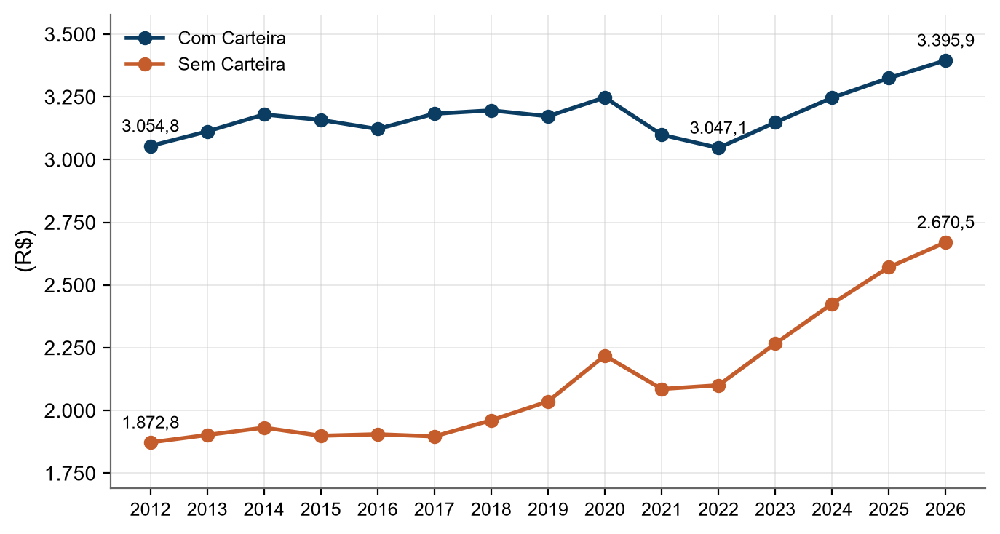
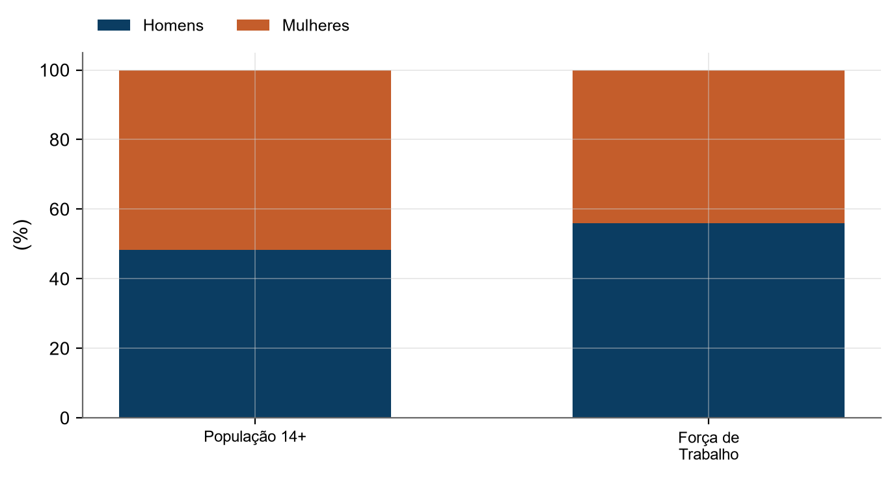
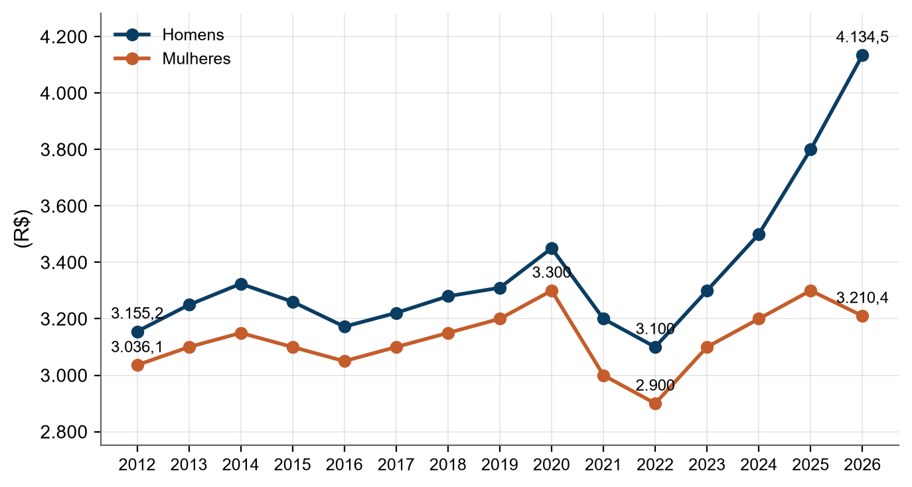
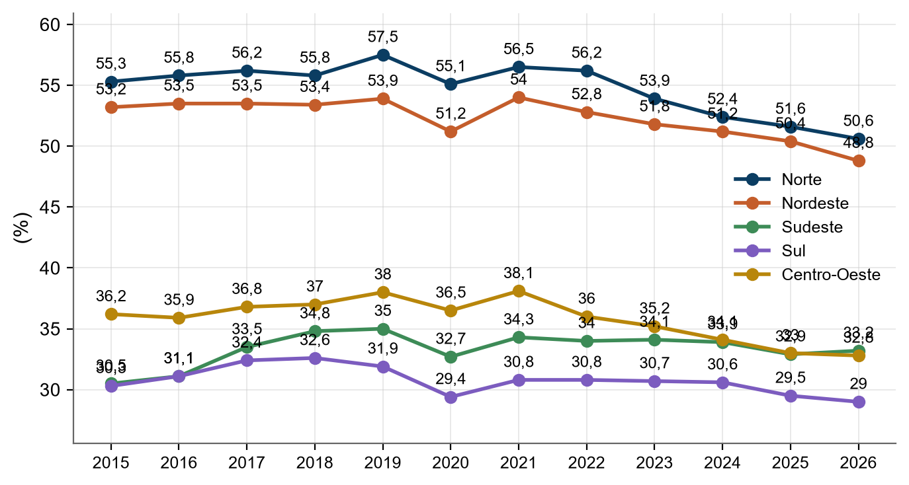
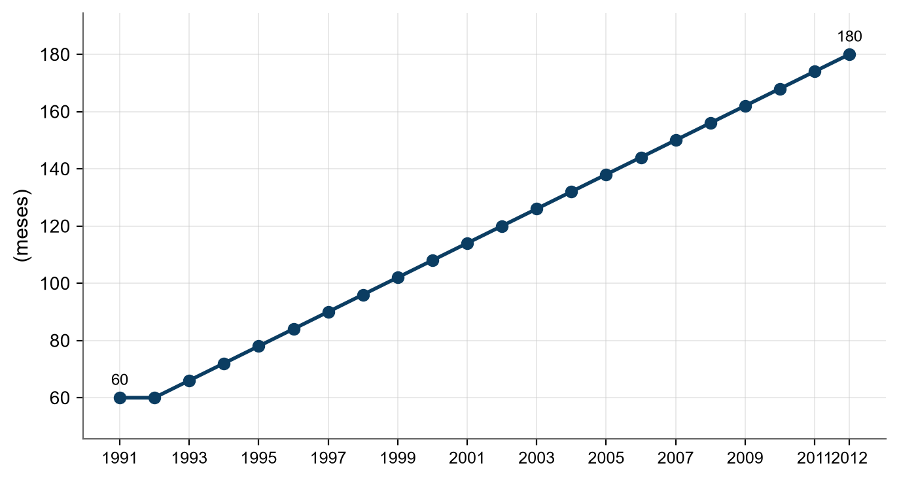
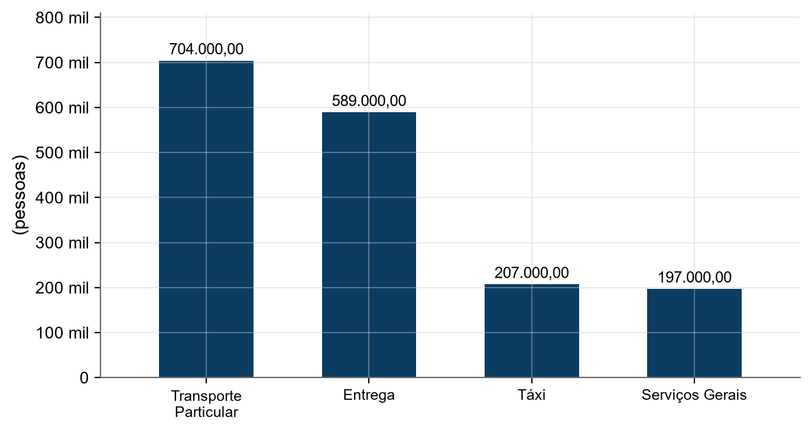
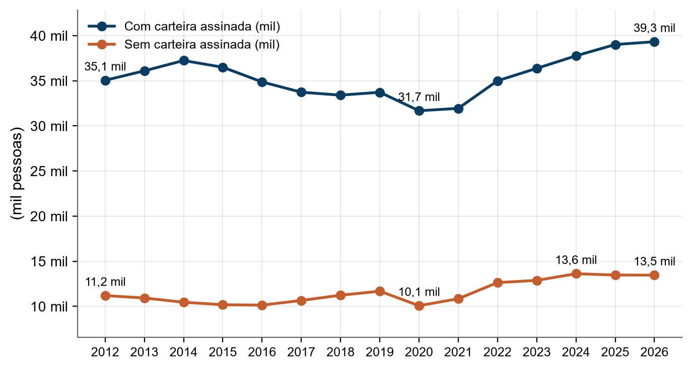
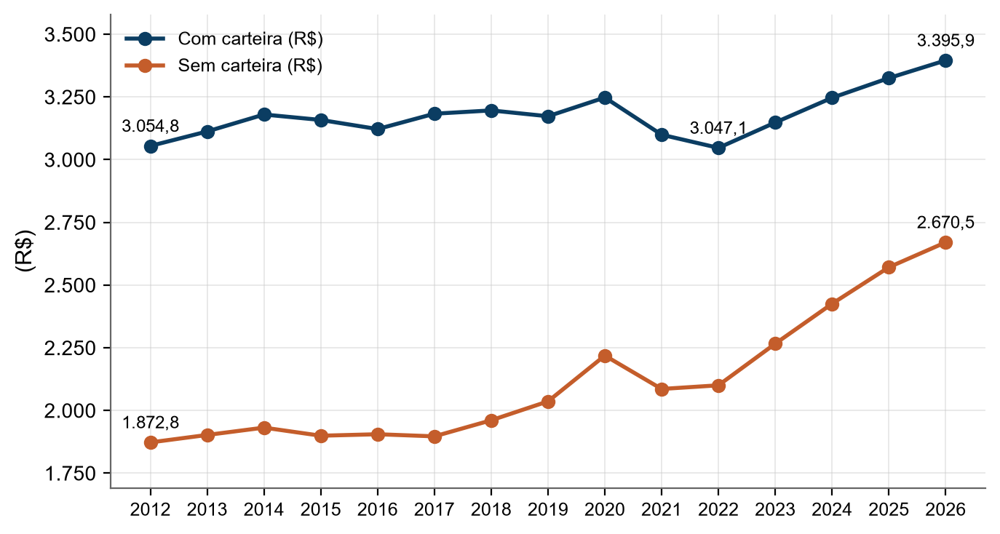
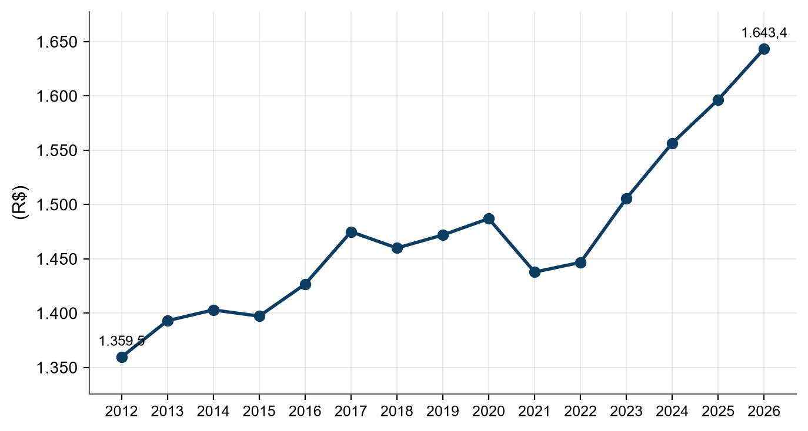

RELATÓRIO

Yago Melo da Costa
<h1 class="capa-titulo">Trabalho no Brasil 2026: Legislação, Modalidades e Tendências</h1>
Relações de trabalho, CLT, PJ, MEI e trabalho informal

Fortaleza, Ceará

2026

## Resumo

O relatório Trabalho no Brasil 2026 apresenta uma análise abrangente do mercado laboral brasileiro, integrando dados estatísticos do IBGE/PNAD Contínua aos fundamentos jurídicos vigentes. A obra examina os princípios constitucionais dos direitos sociais, a estrutura da CLT e os requisitos essenciais para a configuração do vínculo de emprego, com especial atenção à subordinação algorítmica e às interpretações do TST e STF. O documento detalha as modalidades de trabalho com e sem vínculo empregatício, estabelecendo comparativos objetivos entre a contratação via CLT e a pejotização, além de analisar o regime do MEI e a realidade do trabalho informal. A análise socioeconômica abrange a relação entre renda média e o custo da cesta básica nas cinco grandes regiões brasileiras, avaliando o poder de compra real do trabalhador. São discutidos ainda o sistema previdenciário regido pela Lei 8.212/1991, a dinâmica do trabalho por plataformas digitais e as proposições legislativas em tramitação no Congresso Nacional para o ano de 2026. Por fim, o relatório aborda a gestão de riscos ocupacionais, normas de saúde e segurança, e o combate ao assédio conforme a Lei 14.457, consolidando as informações em quadros comparativos de custos, direitos e deveres para orientar a tomada de decisão de empresas e trabalhadores.

Palavras-chave: Direito do Trabalho; CLT; Mercado de Trabalho; Vínculo Empregatício; Previdência Social.

## Sumário

1. [Panorama do trabalho no Brasil em 2026](#1-panorama-do-trabalho-no-brasil-em-2026)
2. [Princípios constitucionais do trabalho](#2-princípios-constitucionais-do-trabalho)
3. [CLT: estrutura, história e direitos essenciais](#3-clt-estrutura-história-e-direitos-essenciais)
4. [Vínculo de emprego: os 4 requisitos e a subordinação algorítmica](#4-vínculo-de-emprego-os-4-requisitos-e-a-subordinação-algorítmica)
5. [Modalidades de trabalho com vínculo empregatício](#5-modalidades-de-trabalho-com-vínculo-empregatício)
6. [Modalidades de trabalho sem vínculo empregatício](#6-modalidades-de-trabalho-sem-vínculo-empregatício)
7. [PJ versus CLT: comparação objetiva](#7-pj-versus-clt-comparação-objetiva)
8. [MEI e trabalho informal](#8-mei-e-trabalho-informal)
9. [Informal x formal: o que os dados oficiais dizem sobre quem ganha mais](#9-informal-x-formal-o-que-os-dados-oficiais-dizem-sobre-quem-ganha-mais)
10. [Cesta básica e poder de compra nas cinco Grandes Regiões](#10-cesta-básica-e-poder-de-compra-nas-cinco-grandes-regiões)
11. [Previdência e tributos do trabalhador](#11-previdência-e-tributos-do-trabalhador)
12. [Trabalho por plataformas digitais](#12-trabalho-por-plataformas-digitais)
13. [Mudanças em tramitação no Congresso em 2026](#13-mudanças-em-tramitação-no-congresso-em-2026)
14. [Riscos e como se proteger](#14-riscos-e-como-se-proteger)
15. [Quadro resumo e conclusões](#15-quadro-resumo-e-conclusões)
A. [Apêndice A - Legislação citada e o que ela muda na prática]
R. [Referências](#referências)

## 1. Panorama do trabalho no Brasil em 2026

O mercado de trabalho brasileiro em 2026 apresenta uma trajetória de redução na desocupação e crescimento no volume de pessoas ocupadas [(IBGE, 2026d)](https://www.ibge.gov.br/estatisticas/sociais/trabalho/17270-pnad-continua.html). A taxa de desocupação, que atingiu seu pico anual em 2020 com 13,8%, declinou consistentemente até atingir 5,8% em 2026 [(IBGE, 2026d)](https://www.ibge.gov.br/estatisticas/sociais/trabalho/17270-pnad-continua.html). Paralelamente, o número de pessoas ocupadas na semana de referência expandiu de 89,2 milhões em 2012 para 102,5 milhões em 2026 [(IBGE, 2026d)](https://www.ibge.gov.br/estatisticas/sociais/trabalho/17270-pnad-continua.html).

<figure class="figura"><figcaption><strong>Figura 1 – Taxa de Desocupação Nacional (2012-2026).</strong> <em>Fonte: [(IBGE, 2026d)](https://www.ibge.gov.br/estatisticas/sociais/trabalho/17270-pnad-continua.html).</em> A taxa de desocupação atingiu seu ápice em 2020 e apresenta queda sustentada até 2026.</figcaption></figure>

<figure class="figura"><figcaption><strong>Figura 2 – Pessoas Ocupadas no Brasil (2012-2026).</strong> <em>Fonte: [(IBGE, 2026d)](https://www.ibge.gov.br/estatisticas/sociais/trabalho/17270-pnad-continua.html).</em> O volume de ocupados cresceu significativamente, superando a marca de 100 milhões de pessoas a partir de 2024.</figcaption></figure>

O rendimento médio mensal real do trabalho principal acompanhou essa tendência de recuperação, saindo de R$ 3.191,30 em 2012 para R$ 3.777,50 em 2026 [(IBGE, 2026d)](https://www.ibge.gov.br/estatisticas/sociais/trabalho/17270-pnad-continua.html).

<figure class="figura"><figcaption><strong>Figura 3 – Rendimento Médio Mensal Real (2012-2026).</strong> <em>Fonte: [(IBGE, 2026d)](https://www.ibge.gov.br/estatisticas/sociais/trabalho/17270-pnad-continua.html).</em> O rendimento médio real apresenta volatilidade, com recuperação expressiva entre 2022 e 2026.</figcaption></figure>

A estrutura do mercado divide-se entre trabalhadores com carteira assinada, que possuem maior proteção social, e informais, que englobam autônomos e MEIs [(IPEA, 2026a)](https://www.ipeadata.gov.br/). A taxa de informalidade no Brasil registrou 40,8% em 2019, caiu para 38,4% em 2020 e manteve trajetória de queda até atingir 37,3% em 2026 [(IPEA, 2026a)](https://www.ipeadata.gov.br/).

<figure class="figura"><figcaption><strong>Figura 4 – Taxa de Informalidade Nacional (2015-2026).</strong> <em>Fonte: [(IPEA, 2026a)](https://www.ipeadata.gov.br/).</em> A informalidade apresenta tendência de queda gradual a partir de 2019.</figcaption></figure>

A saúde do trabalhador varia conforme sua situação ocupacional. A Pesquisa Nacional de Saúde (PNS) é uma pesquisa quinquenal, com edições realizadas em 2013 e 2019, sendo que a terceira edição (PNS 2026) encontra-se em fase de coleta em 2026 [(IBGE, 2019)](https://www.ibge.gov.br/estatisticas/sociais/saude/9160-pesquisa-nacional-de-saude.html). Por essa razão, a série de saúde autoavaliada contempla apenas os anos de 2013 e 2019 [(IBGE, 2019)](https://www.ibge.gov.br/estatisticas/sociais/saude/9160-pesquisa-nacional-de-saude.html).

Trabalhadores ocupados reportaram a melhor percepção de saúde, com 73,8% avaliando-a como boa ou muito boa em 2019, contra 51,3% daqueles que estão fora da força de trabalho no mesmo ano [(IBGE, 2019)](https://www.ibge.gov.br/estatisticas/sociais/saude/9160-pesquisa-nacional-de-saude.html).

<figure class="figura"><figcaption><strong>Figura 5 – Saúde Autoavaliada (Boa ou Muito Boa) por Situação Ocupacional.</strong> <em>Fonte: [(IBGE, 2019)](https://www.ibge.gov.br/estatisticas/sociais/saude/9160-pesquisa-nacional-de-saude.html).</em> Pessoas ocupadas mantêm a melhor percepção de saúde, enquanto quem está fora da força de trabalho apresenta os menores índices.</figcaption></figure>

A desigualdade na saúde também é evidente por renda e cor. Em 2019, a percepção de saúde boa ou muito boa foi de 86,4% para quem recebe mais de 5 salários mínimos, comparado a 55,5% para quem recebe até 1/4 do salário mínimo [(IBGE, 2019)](https://www.ibge.gov.br/estatisticas/sociais/saude/9160-pesquisa-nacional-de-saude.html). Por cor ou raça, em 2019, a taxa foi de 71,0% para brancos, 62,9% para pretos e 62,1% para pardos [(IBGE, 2019)](https://www.ibge.gov.br/estatisticas/sociais/saude/9160-pesquisa-nacional-de-saude.html).

<figure class="figura">

<h4>Cor/Raça</h4><ul><li>Branca</li><li>Preta</li><li>Parda</li></ul>

<h4>Saúde Boa/Muito Boa (%)</h4><ul><li>71.0</li><li>62.9</li><li>62.1</li></ul>

<figcaption><strong>Figura 6 – Saúde Autoavaliada por Cor ou Raça (2019).</strong> <em>Fonte: [(IBGE, 2019)](https://www.ibge.gov.br/estatisticas/sociais/saude/9160-pesquisa-nacional-de-saude.html).</em> A população branca reporta maior percepção de saúde do que a população preta e parda.</figcaption></figure>

A política de salário mínimo é regida pela Lei 14.663/2023, que estabelece o reajuste com base no INPC acrescido do crescimento do PIB [(SENADO FEDERAL, 2026b)](https://www12.senado.leg.br/noticias/materias/2023/08/31/novo-arcabouco-fiscal-entra-em-vigencia-no-brasil). O arcabouço fiscal, instituído pela Lei Complementar 200/2023 e a Emenda Constitucional 126/2022, impõe limites às despesas primárias para garantir a sustentabilidade da dívida pública [(SENADO FEDERAL, 2026b)](https://www12.senado.leg.br/noticias/materias/2023/08/31/novo-arcabouco-fiscal-entra-em-vigencia-no-brasil). O salário mínimo para 2026 foi fixado em R$ 1.621,00 [(SENADO FEDERAL, 2026c)](https://www12.senado.leg.br/radio/1/noticia/2025/12/19/congresso-nacional-aprova-o-orcamento-de-2026-com-salario-minimo-de-r-1-621-a-partir-de-janeiro). Sem a limitação do arcabouço fiscal, esse valor teria sido R$ 10,00 maior [(SENADO FEDERAL, 2026c)](https://www12.senado.leg.br/radio/1/noticia/2025/12/19/congresso-nacional-aprova-o-orcamento-de-2026-com-salario-minimo-de-r-1-621-a-partir-de-janeiro).

A análise do poder de compra revela que, embora o rendimento médio real tenha crescido para R$ 3.777,50 em 2026 [(IBGE, 2026d)](https://www.ibge.gov.br/estatisticas/sociais/trabalho/17270-pnad-continua.html), a inflação (IPCA) impacta a capacidade de consumo. O IPCA médio anual subiu de 3.500,7 em 2012 para 7.592,0 em 2026 [(IPEA, 2026a)](https://www.ipeadata.gov.br/).

<figure class="figura"><figcaption><strong>Figura 7 – Salário Mínimo Real vs Rendimento Médio Real.</strong> <em>Fonte: [(IPEA, 2026a)](https://www.ipeadata.gov.br/).</em> O gap entre trabalhadores com e sem carteira permanece elevado, embora a renda dos sem carteira tenha crescido proporcionalmente mais.</figcaption></figure>

Sobre a suficiência da renda, o salário mínimo e o rendimento médio são insuficientes para cobrir as necessidades básicas. O DIEESE define o "salário mínimo necessário" com base no custo da cesta básica de maior valor entre as capitais, multiplicado por 3 (para família de quatro pessoas) e dividido pela participação orçamentária da alimentação de 35,71% [(DIEESE, 2026b)](https://www.dieese.org.br/analisecestabasica/salarioMinimo.html). Este cálculo visa suprir alimentação, moradia, saúde, educação, vestuário, higiene, transporte, lazer e previdência, conforme o art. 7º, IV da Constituição Federal [(DIEESE, 2026b)](https://www.dieese.org.br/analisecestabasica/salarioMinimo.html).

Em setembro de 2026, o salário mínimo nominal era de R$ 1.621,00, enquanto o salário mínimo necessário era de R$ 7.750,01 [(DIEESE, 2026b)](https://www.dieese.org.br/analisecestabasica/salarioMinimo.html). Isso significa que o valor pago é apenas 20,9% do necessário, ou que o necessário é 4,78 vezes o mínimo nominal [(DIEESE, 2026b)](https://www.dieese.org.br/analisecestabasica/salarioMinimo.html).

<figure class="figura"><figcaption><strong>Figura 8 – Salário Mínimo Nominal vs Necessário (2012-2026).</strong> <em>Fonte: [(DIEESE, 2026b)](https://www.dieese.org.br/analisecestabasica/salarioMinimo.html).</em> A distância entre o salário mínimo pago e o necessário para a cesta constitucional aumentou drasticamente ao longo da série.</figcaption></figure>

<figure class="figura"><figcaption><strong>Figura 9 – Rendimento Médio Nominal vs Salário Necessário (2012-2026).</strong> <em>Fonte: [(IBGE, 2026d)](https://www.ibge.gov.br/estatisticas/sociais/trabalho/17270-pnad-continua.html).</em> Mesmo o rendimento médio do brasileiro não atinge metade do valor necessário para suprir a cesta constitucional em 2026.</figcaption></figure>

Em São Paulo, a cesta básica de alimentos custou R$ 922,51 em setembro de 2026 [(DIEESE, 2026c)](https://www.dieese.org.br/analisecestabasica/2026/202609cestabasica.pdf). Para adquiri-la, o trabalhador que recebe o salário mínimo precisou de 125 horas e 12 minutos de trabalho, o que representa 61,52% de sua renda líquida após o desconto de 7,5% da Previdência [(DIEESE, 2026c)](https://www.dieese.org.br/analisecestabasica/2026/202609cestabasica.pdf).

Conclusão numérica: para atingir o salário mínimo necessário de R$ 7.750,01, faltam R$ 6.129,01 para quem recebe o mínimo (R$ 1.621,00) e R$ 3.972,51 para quem recebe o rendimento médio nominal (R$ 3.777,50) [(DIEESE, 2026b)](https://www.dieese.org.br/analisecestabasica/salarioMinimo.html); [(IBGE, 2026d)](https://www.ibge.gov.br/estatisticas/sociais/trabalho/17270-pnad-continua.html). O salário que efetivamente satisfaria a cesta constitucional é o de R$ 7.750,01 [(DIEESE, 2026b)](https://www.dieese.org.br/analisecestabasica/salarioMinimo.html).

Quanto ao gênero, as mulheres representam aproximadamente metade da população de 14 anos ou mais, mas são minoria na força de trabalho [(IPEA, 2026a)](https://www.ipeadata.gov.br/). Em 2026, a composição da população de 14 anos ou mais era de 48,2% homens e 51,8% mulheres, enquanto na força de trabalho a proporção era de 56,0% homens e 44,0% mulheres [(IPEA, 2026a)](https://www.ipeadata.gov.br/).

<figure class="figura"><figcaption><strong>Figura 10 – Composição por Sexo: População vs Força de Trabalho (2026).</strong> <em>Fonte: [(IPEA, 2026a)](https://www.ipeadata.gov.br/).</em> As mulheres são maioria na população, mas minoria na força de trabalho.</figcaption></figure>

O gap salarial persiste. Em 2012, o rendimento médio real mensal era de R$ 3.155,20 para homens e R$ 3.036,10 para mulheres [(IPEA, 2026a)](https://www.ipeadata.gov.br/). Em 2026, os homens recebiam R$ 4.134,50 e as mulheres R$ 3.210,40 [(IPEA, 2026a)](https://www.ipeadata.gov.br/). A diferença nominal em 2026 é de R$ 924,10, significando que as mulheres ganham aproximadamente 22,3% menos que os homens [(IPEA, 2026a)](https://www.ipeadata.gov.br/).

<figure class="figura"><figcaption><strong>Figura 11 – Rendimento Médio Real por Sexo (2012-2026).</strong> <em>Fonte: [(IPEA, 2026a)](https://www.ipeadata.gov.br/).</em> O gap salarial entre homens e mulheres ampliou-se ao longo da série histórica.</figcaption></figure>

Regionalmente, o Sudeste e o Sul apresentam as menores taxas de desocupação e informalidade, enquanto o Norte e Nordeste lideram esses indicadores [(IPEA, 2026a)](https://www.ipeadata.gov.br/). Em 2026, a taxa de desocupação foi de 3,4% no Sul (menor) e 8,0% no Nordeste (maior) [(IPEA, 2026a)](https://www.ipeadata.gov.br/). A informalidade foi de 29,0% no Sul e 50,6% no Norte [(IPEA, 2026a)](https://www.ipeadata.gov.br/).

<figure class="figura"><figcaption><strong>Figura 12 – Taxa de Desocupação por Região (2012-2026).</strong> <em>Fonte: [(IPEA, 2026a)](https://www.ipeadata.gov.br/).</em> O Sul mantém a menor taxa de desocupação, enquanto o Nordeste apresenta a maior.</figcaption></figure>

<figure class="figura"><figcaption><strong>Figura 13 – Taxa de Informalidade por Região (2015-2026).</strong> <em>Fonte: [(IPEA, 2026a)](https://www.ipeadata.gov.br/).</em> A informalidade é significativamente maior nas regiões Norte e Nordeste.</figcaption></figure>

O rendimento médio real também reflete a desigualdade regional. Em 2026, o Centro-Oeste liderou com R$ 4.288,00, seguido pelo Sul (R$ 4.134,50) e Sudeste (R$ 4.043,00), enquanto o Nordeste fechou a lista com R$ 2.549,00 [(IPEA, 2026a)](https://www.ipeadata.gov.br/). A distância entre o maior (Centro-Oeste) e o menor (Nordeste) rendimento é de R$ 1.739,00 [(IPEA, 2026a)](https://www.ipeadata.gov.br/).

<figure class="figura"><figcaption><strong>Figura 14 – Rendimento Médio Real por Região (2012-2026).</strong> <em>Fonte: [(IPEA, 2026a)](https://www.ipeadata.gov.br/).</em> A hierarquia regional de rendimentos mantém-se estável, com Centro-Oeste e Sul no topo.</figcaption></figure>

<figure class="figura"><figcaption><strong>Figura 15 – Nivel de ocupacao da populacao por grupo de idade (2o trimestre de 2026).</strong> <em>Fonte: [(IBGE, 2026d)](https://www.ibge.gov.br/estatisticas/sociais/trabalho/17270-pnad-continua.html).</em> Percentual da populacao de cada grupo etario que esta ocupada, calculado pelo IBGE na tabela SIDRA 4094 (PNAD Continua). O nivel de ocupacao e minimo entre 14 e 17 anos por causa dos estudos, atinge o pico entre 25 e 39 anos e cai a partir dos 60 anos, quando a maioria se aposenta ou sai da forca de trabalho.</figcaption></figure>

<figure class="figura"><figcaption><strong>Figura 16 – Composicao da populacao por condicao e grupo de idade (2o trimestre de 2026).</strong> <em>Fonte: [(IBGE, 2026d)](https://www.ibge.gov.br/estatisticas/sociais/trabalho/17270-pnad-continua.html).</em> Populacao de 14 anos ou mais por condicao de ocupacao e grupo etario, em milhoes (tabela SIDRA 4094). A populacao idosa (60 anos ou mais) concentra a maior parte das pessoas fora da forca de trabalho, e os jovens de 14 a 17 anos somam uma forca de trabalho ainda em formacao.</figcaption></figure>

**Em termos simples:** o ponto central desta secao esta nos numeros oficiais apresentados acima [(IBGE, 2026d)](https://www.ibge.gov.br/estatisticas/sociais/trabalho/17270-pnad-continua.html).

## 2. Princípios constitucionais do trabalho

A República Federativa do Brasil estabelece, entre seus fundamentos, os valores sociais do trabalho e da livre iniciativa [(BRASIL, 1988, art. 1º, IV)](https://www.planalto.gov.br/ccivil_03/constituicao/constituicao.htm). O trabalho é classificado como um direito social, integrando um conjunto de garantias que incluem a educação, a saúde, a alimentação, a moradia, o lazer, a segurança, a previdência social, a proteção à maternidade e à infância, além da assistência aos desamparados [(BRASIL, 1988, art. 6º)](https://www.planalto.gov.br/ccivil_03/constituicao/constituicao.htm).

O ordenamento jurídico brasileiro adota o Princípio da Proteção aos Direitos do Trabalhador para equilibrar a relação entre empregador e empregado (CHAGAS, 2018). Este princípio visa mitigar a fragilidade das relações trabalhistas, especialmente diante de fenômenos como a "pejotização", que pode comprometer a aplicação de moldes tradicionais de contratação de mão de obra (CHAGAS, 2018). [(BRASIL, 1988)](https://www.planalto.gov.br/ccivil_03/constituicao/constituicao.htm)

No âmbito da propriedade, a Constituição Federal determina que a propriedade deve atender a sua função social [(BRASIL, 1988, art. 5º, XXIII)](https://www.planalto.gov.br/ccivil_03/constituicao/constituicao.htm). Como exemplo de proteção específica, a pequena propriedade rural, desde que trabalhada pela família, não pode ser objeto de penhora para pagamento de débitos decorrentes de sua atividade produtiva [(BRASIL, 1988, art. 5º, XXVI)](https://www.planalto.gov.br/ccivil_03/constituicao/constituicao.htm).

A liberdade de associação profissional ou sindical é assegurada ao trabalhador [(BRASIL, 1943, art. 6º, XXVI)](https://www.planalto.gov.br/ccivil_03/decreto-lei/del5452.htm). Isso inclui o direito de não sofrer descontos salariais estabelecidos em convenção ou acordo coletivo sem anuência expressa e prévia [(BRASIL, 1943, art. 6º, XXVI)](https://www.planalto.gov.br/ccivil_03/decreto-lei/del5452.htm). O direito de greve também é garantido, cabendo aos trabalhadores a decisão sobre a oportunidade de seu exercício e os interesses a serem defendidos [(BRASIL, 1943, art. 6º, XXVII)](https://www.planalto.gov.br/ccivil_03/decreto-lei/del5452.htm).

<strong>Tabela 1 – Direitos Sociais e Garantias do Trabalhador.</strong> <em>Fonte: [(BRASIL, 1988)](https://www.planalto.gov.br/ccivil_03/constituicao/constituicao.htm).</em>

| Direito | Descrição Legal | Base Legal [(BRASIL, 1988)](https://www.planalto.gov.br/ccivil_03/constituicao/constituicao.htm) |
| :--- | :--- | :--- |
| Jornada de Trabalho | Normal não superior a 8 horas diárias e 44 semanais | [(BRASIL, 1988, art. 7º, XIII)](https://www.planalto.gov.br/ccivil_03/constituicao/constituicao.htm) |
| Salário Mínimo | Garantia de remuneração nunca inferior ao mínimo | [(BRASIL, 1988, art. 7º, VII)](https://www.planalto.gov.br/ccivil_03/constituicao/constituicao.htm) |
| Irredutibilidade | Salário irredutível, salvo convenção ou acordo coletivo | [(BRASIL, 1988, art. 7º, VI)](https://www.planalto.gov.br/ccivil_03/constituicao/constituicao.htm) |
| Trabalho Noturno | Remuneração superior à do trabalho diurno | [(BRASIL, 1988, art. 7º, IX)](https://www.planalto.gov.br/ccivil_03/constituicao/constituicao.htm) |
| Proteção ao Menor | Proibição de trabalho noturno, perigoso ou insalubre a menores de 18 anos | [(BRASIL, 1988, art. 7º, XXXIII)](https://www.planalto.gov.br/ccivil_03/constituicao/constituicao.htm) |
| Trabalho Infantil | Proibição de qualquer trabalho a menores de 16 anos, salvo aprendiz a partir de 14 | [(BRASIL, 1988, art. 7º, XXXIII)](https://www.planalto.gov.br/ccivil_03/constituicao/constituicao.htm) |

<figure class="figura">

<h4>Direitos Individuais</h4><ul><li>Décimo terceiro salário [(BRASIL, 1988, art. 7º, VIII)](https://www.planalto.gov.br/ccivil_03/constituicao/constituicao.htm)</li><li>Participação nos lucros ou resultados [(BRASIL, 1988, art. 7º, XI)](https://www.planalto.gov.br/ccivil_03/constituicao/constituicao.htm)</li><li>Salário-família para dependentes [(BRASIL, 1988, art. 7º, XII)](https://www.planalto.gov.br/ccivil_03/constituicao/constituicao.htm)</li></ul>

<h4>Direitos Coletivos</h4><ul><li>Liberdade de associação sindical [(BRASIL, 1943, art. 6º, XXVI)](https://www.planalto.gov.br/ccivil_03/decreto-lei/del5452.htm)</li><li>Direito de greve [(BRASIL, 1943, art. 6º, XXVII)](https://www.planalto.gov.br/ccivil_03/decreto-lei/del5452.htm)</li><li>Definição de serviços essenciais em greve [(BRASIL, 1943, art. 6º, XXVIII)](https://www.planalto.gov.br/ccivil_03/decreto-lei/del5452.htm)</li></ul>

<figcaption><strong>Figura 17 – Garantias Constitucionais e Sindicais.</strong> <em>Fonte: [(BRASIL, 1988)](https://www.planalto.gov.br/ccivil_03/constituicao/constituicao.htm).</em> O sistema brasileiro divide as proteções entre garantias remuneratórias individuais e a liberdade de organização coletiva.</figcaption></figure>

A proteção ao trabalho humano estende-se a categorias específicas. Aos trabalhadores domésticos, são assegurados diversos direitos previstos no art. 7º da Constituição, incluindo a integração à previdência social [(BRASIL, 1988, art. 7º, parágrafo único)](https://www.planalto.gov.br/ccivil_03/constituicao/constituicao.htm). Da mesma forma, é estabelecida a igualdade de direitos entre o trabalhador com vínculo empregatício permanente e o trabalhador avulso [(BRASIL, 1988, art. 7º, XXXIV)](https://www.planalto.gov.br/ccivil_03/constituicao/constituicao.htm).

<figure class="figura">

<h4>Menores de Idade</h4><ul><li>Proibição de trabalho insalubre < 18 anos [(BRASIL, 1988, art. 7º, XXXIII)](https://www.planalto.gov.br/ccivil_03/constituicao/constituicao.htm)</li><li>Aprendizagem permitida a partir de 14 anos [(BRASIL, 1988, art. 7º, XXXIII)](https://www.planalto.gov.br/ccivil_03/constituicao/constituicao.htm)</li></ul>

<h4>Trabalhadores Específicos</h4><ul><li>Igualdade para trabalhador avulso [(BRASIL, 1988, art. 7º, XXXIV)](https://www.planalto.gov.br/ccivil_03/constituicao/constituicao.htm)</li><li>Direitos assegurados ao doméstico [(BRASIL, 1988, art. 7º, parágrafo único)](https://www.planalto.gov.br/ccivil_03/constituicao/constituicao.htm)</li></ul>

<figcaption><strong>Figura 18 – Proteção a Grupos Vulneráveis.</strong> <em>Fonte: [(BRASIL, 1988)](https://www.planalto.gov.br/ccivil_03/constituicao/constituicao.htm).</em> A Constituição Federal cria camadas de proteção adicionais para menores e categorias com vínculos diferenciados.</figcaption></figure>

**Em termos simples:** A lei brasileira trata o trabalho como um direito básico de todo cidadão [(BRASIL, 1988, art. 6º)](https://www.planalto.gov.br/ccivil_03/constituicao/constituicao.htm). Para evitar que o trabalhador seja prejudicado por ser a parte mais fraca na relação com o patrão, existem regras que protegem o salário, limitam a jornada de trabalho e garantem a liberdade de criar sindicatos e fazer greves [(BRASIL, 1943, art. 6º)](https://www.planalto.gov.br/ccivil_03/decreto-lei/del5452.htm).

Fontes consultadas:
* [(BRASIL, 1988)](https://www.planalto.gov.br/ccivil_03/constituicao/constituicao.htm)
* [(BRASIL, 1943)](https://www.planalto.gov.br/ccivil_03/decreto-lei/del5452.htm)
* (CHAGAS, 2018)

## 3. CLT: estrutura, história e direitos essenciais

A Consolidação das Leis do Trabalho (CLT) foi estabelecida pelo Decreto-Lei 5.452/1943 [(BRASIL, 1943)](https://www.planalto.gov.br/ccivil_03/decreto-lei/del5452.htm). Ela estrutura a regulação das relações individuais e coletivas de trabalho no Brasil, consolidando normas que visam a proteção do trabalhador [(BRASIL, 1943)](https://www.planalto.gov.br/ccivil_03/decreto-lei/del5452.htm).

### 3.1 Direitos Essenciais e Jornada de Trabalho

A Constituição Federal e a CLT definem a duração normal do trabalho como não superior a 8 horas diárias e 44 horas semanais [(BRASIL, 1988)](https://www.planalto.gov.br/ccivil_03/constituicao/constituicao.htm). O serviço extraordinário deve ter remuneração superior, no mínimo, em 50% à do normal [(BRASIL, 1988)](https://www.planalto.gov.br/ccivil_03/constituicao/constituicao.htm).

A jornada excepcional permite que o trabalhador ultrapasse as 8 horas diárias mediante a previsão de horas extras [(BRASIL, 1943, art. 59)](https://www.planalto.gov.br/ccivil_03/decreto-lei/del5452.htm). O limite legal para a jornada diária, incluindo as horas extras, é de 10 horas [(BRASIL, 1943)](https://www.planalto.gov.br/ccivil_03/decreto-lei/del5452.htm).

Outros direitos essenciais incluem:
* Férias anuais remuneradas com acréscimo de, no mínimo, um terço do salário normal [(BRASIL, 1988)](https://www.planalto.gov.br/ccivil_03/constituicao/constituicao.htm).
* Aviso prévio proporcional ao tempo de serviço, com mínimo de 30 dias [(BRASIL, 1988)](https://www.planalto.gov.br/ccivil_03/constituicao/constituicao.htm).
* Adicional de remuneração para atividades penosas, insalubres ou perigosas [(BRASIL, 1988)](https://www.planalto.gov.br/ccivil_03/constituicao/constituicao.htm).
* Décimo terceiro salário e salário mínimo [(BRASIL, 1988)](https://www.planalto.gov.br/ccivil_03/constituicao/constituicao.htm).
* Licença-maternidade de 120 dias e licença-paternidade [(BRASIL, 1988)](https://www.planalto.gov.br/ccivil_03/constituicao/constituicao.htm).

<strong>Tabela 2 – Regras de Jornada e Remuneração.</strong> <em>Fonte: [(BRASIL, 1988)](https://www.planalto.gov.br/ccivil_03/constituicao/constituicao.htm).</em>

| Item | Regra Legal | Valor/Limite |
| :--- | :--- | :--- |
| Jornada Diária | Limite Normal | 8 horas [(BRASIL, 1988)](https://www.planalto.gov.br/ccivil_03/constituicao/constituicao.htm) |
| Jornada Semanal | Limite Normal | 44 horas [(BRASIL, 1988)](https://www.planalto.gov.br/ccivil_03/constituicao/constituicao.htm) |
| Hora Extra | Adicional Mínimo | 50% [(BRASIL, 1988)](https://www.planalto.gov.br/ccivil_03/constituicao/constituicao.htm) |
| Férias | Adicional Constitucional | 1/3 do salário [(BRASIL, 1988)](https://www.planalto.gov.br/ccivil_03/constituicao/constituicao.htm) |

### 3.2 Reforma Trabalhista de 2017 (Lei 13.467/2017)

A Lei 13.467/2017 alterou a dinâmica da CLT, priorizando a negociação sobre a lei em diversos pontos [(BRASIL, LEI 13.467/2017)](https://www.planalto.gov.br/ccivil_03/_ato2015-2018/2017/lei/l13467.htm).

As principais mudanças práticas incluem:
* **Negociação:** Acordos e convenções coletivas podem prevalecer sobre a lei em pontos específicos [(BRASIL, 1943, arts. 611-A e 611-B)](https://www.planalto.gov.br/ccivil_03/decreto-lei/del5452.htm).
* **Trabalho Intermitente:** Introdução do contrato onde a prestação de serviços não é contínua, com remuneração proporcional ao período trabalhado [(BRASIL, 1943, art. 452-A)](https://www.planalto.gov.br/ccivil_03/decreto-lei/del5452.htm).
* **Teletrabalho:** Regulamentação das atividades realizadas fora das dependências do empregador [(BRASIL, 1943, arts. 75-A a 75-F)](https://www.planalto.gov.br/ccivil_03/decreto-lei/del5452.htm).
* **Jornada e Compensação:** O banco de horas e acordos de compensação podem ser firmados individualmente; a prestação de horas extras habituais não descaracteriza esses acordos [(BRASIL, 1943, art. 59-B)](https://www.planalto.gov.br/ccivil_03/decreto-lei/del5452.htm).
* **Rescisão:** Possibilidade de dispensa por acordo comum, com a multa do FGTS reduzida para 20% [(BRASIL, 1943, art. 484-A)](https://www.planalto.gov.br/ccivil_03/decreto-lei/del5452.htm).
* **Intervalo Intrajornada:** A não concessão do intervalo implica no pagamento apenas do período suprimido com natureza indenizatória [(BRASIL, 1943)](https://www.planalto.gov.br/ccivil_03/decreto-lei/del5452.htm).

Essa flexibilização é apontada como fator de crescimento de modalidades como PJ e MEI, pois reduz o custo e a complexidade do vínculo empregatício tradicional frente a tributações simplificadas [(BRASIL, LEI 13.467/2017)](https://www.planalto.gov.br/ccivil_03/_ato2015-2018/2017/lei/l13467.htm).

<figure class="figura">

<h4>Antes da Reforma</h4><ul><li>Prevalência da Lei sobre o Acordo</li><li>Contrato Intermitente inexistente</li><li>Banco de horas via Sindicato</li></ul>

<h4>Depois da Reforma</h4><ul><li>Acordado sobre o Legislado</li><li>Criação do Trabalho Intermitente</li><li>Banco de horas individual</li></ul>

<figcaption><strong>Figura 19 – Impactos da Reforma Trabalhista de 2017.</strong> <em>Fonte: [(BRASIL, LEI 13.467/2017)](https://www.planalto.gov.br/ccivil_03/_ato2015-2018/2017/lei/l13467.htm).</em> A reforma de 2017 deslocou o eixo de decisão do legislativo para a negociação direta entre partes.</figcaption></figure>

### 3.3 Previdência e Fiscalização

A EC 103/2019 estabeleceu novas regras previdenciárias aplicáveis aos trabalhadores, impactando a aposentadoria e contribuições [(BRASIL, 1988)](https://www.planalto.gov.br/ccivil_03/constituicao/constituicao.htm). O Estado aplica a CLT através da Auditoria-Fiscal do Trabalho, que monitora o cumprimento das normas de saúde, higiene e segurança [(BRASIL, 1988)](https://www.planalto.gov.br/ccivil_03/constituicao/constituicao.htm).

<figure class="figura"><figcaption><strong>Figura 20 – Adicionais de Remuneração Mínimos.</strong> <em>Fonte: [(BRASIL, 1988)](https://www.planalto.gov.br/ccivil_03/constituicao/constituicao.htm).</em> O adicional de hora extra é fixado em no mínimo 50% sobre a hora normal.</figcaption></figure>

**Em termos simples:** A CLT é o livro de regras do trabalho no Brasil. Ela garante que você não trabalhe mais de 8 horas por dia (ou 44 por semana) sem receber extra (com 50% a mais) e assegura direitos como férias com um terço a mais e 13º salário [(BRASIL, 1988)](https://www.planalto.gov.br/ccivil_03/constituicao/constituicao.htm). A reforma de 2017 deixou as regras mais flexíveis, permitindo que patrão e empregado combinem algumas coisas diretamente, sem precisar seguir a lei ao pé da letra em tudo, o que acabou incentivando a contratação de MEIs e PJs [(BRASIL, LEI 13.467/2017)](https://www.planalto.gov.br/ccivil_03/_ato2015-2018/2017/lei/l13467.htm).

Fontes consultadas:
* [(BRASIL, 1988)](https://www.planalto.gov.br/ccivil_03/constituicao/constituicao.htm)
* [(BRASIL, 1943)](https://www.planalto.gov.br/ccivil_03/decreto-lei/del5452.htm)
* [(BRASIL, LEI 13.467/2017)](https://www.planalto.gov.br/ccivil_03/_ato2015-2018/2017/lei/l13467.htm)

## 4. Vínculo de emprego: os 4 requisitos e a subordinação algorítmica

A caracterização do vínculo empregatício no Brasil depende da coexistência de pressupostos específicos. A legislação define que a relação de emprego ocorre quando o trabalho é prestado por pessoa física, com habitualidade, onerosidade, pessoalidade e subordinação [(BRASIL, 1943, art. 3º)](https://www.planalto.gov.br/ccivil_03/decreto-lei/del5452.htm).

A subordinação jurídica é o ponto central para a distinção entre o empregado e o trabalhador autônomo (FONSECA, 2022). No contexto do trabalho por aplicativos, discute-se a subordinação algorítmica, onde os meios telemáticos e informatizados de comando, controle e supervisão são equiparados aos meios pessoais e diretos de supervisão do trabalho [(BRASIL, 1943, art. 6º, parágrafo único)](https://www.planalto.gov.br/ccivil_03/decreto-lei/del5452.htm).

<strong>Tabela 3 – Requisitos do Vínculo Empregatício.</strong> <em>Fonte: [(BRASIL, 1943)](https://www.planalto.gov.br/ccivil_03/decreto-lei/del5452.htm).</em>

| Passo | Requisito | Base Legal |
| :--- | :--- | :--- |
| 1 | Pessoa Física | [(BRASIL, 1943, art. 3º)](https://www.planalto.gov.br/ccivil_03/decreto-lei/del5452.htm) |
| 2 | Habitualidade | [(BRASIL, LC 123/2006, art. 3º, § 4º, XI)](https://www.planalto.gov.br/ccivil_03/leis/lcp/lcp123.htm) |
| 3 | Onerosidade | [(BRASIL, 1943, art. 3º)](https://www.planalto.gov.br/ccivil_03/decreto-lei/del5452.htm) |
| 4 | Pessoalidade | [(BRASIL, LC 123/2006, art. 3º, § 4º, XI)](https://www.planalto.gov.br/ccivil_03/leis/lcp/lcp123.htm) |
| 5 | Subordinação | [(BRASIL, 1943, art. 6º, parágrafo único)](https://www.planalto.gov.br/ccivil_03/decreto-lei/del5452.htm) |

A jurisprudência analisa a licitude de diferentes modelos de contratação. O Tribunal Superior do Trabalho (TST) já afastou o vínculo empregatício em casos onde existia contrato de prestação de serviços na modalidade de franquia [(STF, 2026b)](https://noticias.stf.jus.br/postsnoticias/stf-retira-suspensao-de-processos-sobre-pejotizacao-na-primeira-instancia-e-nos-trts). Por outro lado, a contratação de autônomo, desde que cumpridas as formalidades legais, afasta a qualidade de empregado, mesmo que a atividade seja relacionada ao negócio da empresa [(BRASIL, LEI 13.467/2017, art. 442-B)](https://www.planalto.gov.br/ccivil_03/_ato2015-2018/2017/lei/l13467.htm).

A "pejotização" ocorre quando um trabalhador é contratado por meio de uma pessoa jurídica constituída para a prestação de serviços [(STF, 2026b)](https://noticias.stf.jus.br/postsnoticias/stf-retira-suspensao-de-processos-sobre-pejotizacao-na-primeira-instancia-e-nos-trts). Essa prática é comum em setores como tecnologia da informação, saúde, advocacia associada e serviços de entrega [(STF, 2026b)](https://noticias.stf.jus.br/postsnoticias/stf-retira-suspensao-de-processos-sobre-pejotizacao-na-primeira-instancia-e-nos-trts). A pejotização é considerada abusiva quando mascara a relação de emprego para evitar encargos trabalhistas, podendo resultar em reconhecimento de vínculo e pagamentos retroativos [(CAMARA DOS DEPUTADOS, PL 3406/2026)](https://www.camara.leg.br/proposicoesWeb/fichadetramitacao?idProposicao=2636199).

O Supremo Tribunal Federal (STF) determinou a retirada da suspensão de processos que discutem a licitude da pejotização na primeira instância e nos Tribunais Regionais do Trabalho (TRTs) para evitar o represamento de ações [(STF, 2026c)](https://noticias.stf.jus.br/postsnoticias/stf-retira-suspensao-de-processos-sobre-pejotizacao-na-primeira-instancia-e-nos-trts/). Contudo, após o julgamento nos TRTs, os processos devem permanecer suspensos até a fixação da tese vinculante pelo STF [(STF, 2026c)](https://noticias.stf.jus.br/postsnoticias/stf-retira-suspensao-de-processos-sobre-pejotizacao-na-primeira-instancia-e-nos-trts/).

<figure class="figura">

<h4>Empregado (Art. 3º)</h4><ul><li>Subordinação Jurídica</li><li>Pessoalidade</li><li>Habitualidade</li><li>Onerosidade</li></ul>

<h4>Autônomo (Art. 442-B)</h4><ul><li>Ausência de Subordinação</li><li>Formalidades Legais</li><li>Com ou sem exclusividade</li><li>Contínua ou não</li></ul>

<figcaption><strong>Figura 21 – Distinção entre Modelos de Contratação.</strong> <em>Fonte: [(BRASIL, LEI 13.467/2017)](https://www.planalto.gov.br/ccivil_03/_ato2015-2018/2017/lei/l13467.htm).</em> A presença de subordinação jurídica é o fator determinante para o reconhecimento do vínculo empregatício.</figcaption></figure>

A distinção entre emprego e trabalho autônomo é reforçada pela Lei 13.467/2017, que prevê que o autônomo não possui a qualidade de empregado se cumprir as formalidades legais [(BRASIL, LEI 13.467/2017, art. 442-B)](https://www.planalto.gov.br/ccivil_03/_ato2015-2018/2017/lei/l13467.htm). No caso de cooperados, a natureza da relação difere do vínculo de emprego por não haver a subordinação característica da CLT [(BRASIL, LC 123/2006, art. 3º, § 4º, VI)](https://www.planalto.gov.br/ccivil_03/leis/lcp/lcp123.htm).

**Em termos simples:** Para ser considerado empregado, o trabalhador precisa preencher cinco requisitos: ser pessoa física, trabalhar com frequência, receber pagamento, não poder ser substituído por outro e obedecer às ordens do patrão [(BRASIL, 1943)](https://www.planalto.gov.br/ccivil_03/decreto-lei/del5452.htm). A "pejotização" é quando a empresa pede para o trabalhador abrir um CNPJ para trabalhar como se fosse empresa, mas na prática ele continua sendo um empregado subordinado, o que pode ser considerado fraude na Justiça [(STF, 2026b)](https://noticias.stf.jus.br/postsnoticias/stf-retira-suspensao-de-processos-sobre-pejotizacao-na-primeira-instancia-e-nos-trts).

Fontes consultadas:
* [(STF, 2026b)](https://noticias.stf.jus.br/postsnoticias/stf-retira-suspensao-de-processos-sobre-pejotizacao-na-primeira-instancia-e-nos-trts)
* [(BRASIL, 1943)](https://www.planalto.gov.br/ccivil_03/decreto-lei/del5452.htm)
* [(BRASIL, LC 123/2006)](https://www.planalto.gov.br/ccivil_03/leis/lcp/lcp123.htm)
* (FONSECA, 2022)
* [(BRASIL, LEI 13.467/2017)](https://www.planalto.gov.br/ccivil_03/_ato2015-2018/2017/lei/l13467.htm)
* [(CAMARA DOS DEPUTADOS, PL 3406/2026)](https://www.camara.leg.br/proposicoesWeb/fichadetramitacao?idProposicao=2636199)
* [(STF, 2026c)](https://noticias.stf.jus.br/postsnoticias/stf-retira-suspensao-de-processos-sobre-pejotizacao-na-primeira-instancia-e-nos-trts/)

## 5. Modalidades de trabalho com vínculo empregatício

### 5.1 CLT tempo indeterminado (padrão)

O contrato por tempo indeterminado é a modalidade clássica de emprego, onde não há uma data fixada para o término da relação laboral [(BRASIL, 1943, art. 442)](https://www.planalto.gov.br/ccivil_03/decreto-lei/del5452.htm). Na prática, o trabalhador é admitido para compor o quadro permanente da empresa, com jornada definida e salário mensal, permanecendo no posto até que ocorra a demissão por justa causa, pedido de demissão ou dispensa imotivada [(BRASIL, 1943, art. 442)](https://www.planalto.gov.br/ccivil_03/decreto-lei/del5452.htm).

Segundo a legislação, o contrato individual de trabalho é o acordo tácito ou expresso que corresponde à relação de emprego [(BRASIL, 1943, art. 442)](https://www.planalto.gov.br/ccivil_03/decreto-lei/del5452.htm). Esta modalidade garante a estabilidade relativa do vínculo, sendo a regra geral para a contratação de mão de obra no Brasil [(BRASIL, 1943, art. 442)](https://www.planalto.gov.br/ccivil_03/decreto-lei/del5452.htm).

<strong>Tabela 4 – Direitos e Deveres - CLT Indeterminado.</strong> <em>Fonte: [(BRASIL, 1943)](https://www.planalto.gov.br/ccivil_03/decreto-lei/del5452.htm).</em>

| Direitos do trabalhador | Deveres (trabalhador e contratante) |
| :--- | :--- |
| Remuneração pactuada [(BRASIL, 1943, art. 442)](https://www.planalto.gov.br/ccivil_03/decreto-lei/del5452.htm) | Cumprimento da jornada de trabalho [(BRASIL, 1943, art. 442)](https://www.planalto.gov.br/ccivil_03/decreto-lei/del5452.htm) |
| Registro em CTPS [(BRASIL, 1943, art. 442)](https://www.planalto.gov.br/ccivil_03/decreto-lei/del5452.htm) | Pagamento pontual de salários [(BRASIL, 1943, art. 442)](https://www.planalto.gov.br/ccivil_03/decreto-lei/del5452.htm) |
| Descanso semanal remunerado [(BRASIL, 1943, art. 442)](https://www.planalto.gov.br/ccivil_03/decreto-lei/del5452.htm) | Observância das normas de segurança [(BRASIL, 1943, art. 442)](https://www.planalto.gov.br/ccivil_03/decreto-lei/del5452.htm) |

O contratante deve garantir a correta anotação do contrato, o recolhimento de encargos previdenciários e o fornecimento de condições adequadas de higiene e segurança [(BRASIL, 1943, art. 442)](https://www.planalto.gov.br/ccivil_03/decreto-lei/del5452.htm).

O Estado monitora esses vínculos através da Secretaria de Inspeção do Trabalho do Ministério do Trabalho e Emprego [(MTE, 2026b)](https://www.gov.br/trabalho-e-emprego/pt-br/assuntos/inspecao-do-trabalho). A fiscalização é exercida por Auditores-Fiscais do Trabalho, cujas competências são organizadas pela Lei 10.593/2002 [(BRASIL, LEI 10.593/2002)](https://www.planalto.gov.br/ccivil_03/leis/2002/l10593.htm). O registro deve ser efetuado via eSocial, sistema de declarações digitais [(ESOCIAL, 2026a)](https://www.esocial.gov.br/). Irregularidades apuradas por denúncias ou ações fiscais resultam em autos de infração e multas administrativas previstas no Livro V da CLT [(BRASIL, 1943)](https://www.planalto.gov.br/ccivil_03/decreto-lei/del5452.htm).

**Em termos simples:** É o emprego "com carteira assinada" comum, onde você entra para trabalhar sem saber quando vai sair, com todos os direitos garantidos por lei [(BRASIL, 1943)](https://www.planalto.gov.br/ccivil_03/decreto-lei/del5452.htm).

### 5.2 CLT tempo determinado e contrato de experiência

O contrato por tempo determinado é utilizado para atividades transitórias ou substituições, enquanto o de experiência serve para testar a aptidão do empregado [(BRASIL, LC 150/2015, art. 4º)](https://www.planalto.gov.br/ccivil_03/leis/lcp/lcp150.htm). Na prática, as partes concordam com uma data de término ou um evento final, e o salário é pago conforme a jornada acordada [(BRASIL, LC 150/2015, art. 5º)](https://www.planalto.gov.br/ccivil_03/leis/lcp/lcp150.htm).

Legalmente, o contrato de experiência não pode exceder 90 dias [(BRASIL, LC 150/2015, art. 5º)](https://www.planalto.gov.br/ccivil_03/leis/lcp/lcp150.htm). Ele pode ser prorrogado uma única vez, desde que a soma dos dois períodos não ultrapasse o limite de 90 dias [(BRASIL, LC 150/2015, art. 5º, § 1º)](https://www.planalto.gov.br/ccivil_03/leis/lcp/lcp150.htm). Caso o serviço continue após esse prazo sem nova formalização, o contrato passa a vigorar por tempo indeterminado [(BRASIL, LC 150/2015, art. 5º, § 2º)](https://www.planalto.gov.br/ccivil_03/leis/lcp/lcp150.htm).

<strong>Tabela 5 – Direitos e Deveres - Tempo Determinado/Experiência.</strong> <em>Fonte: [(BRASIL, LC 150/2015)](https://www.planalto.gov.br/ccivil_03/leis/lcp/lcp150.htm).</em>

| Direitos do trabalhador | Deveres (trabalhador e contratante) |
| :--- | :--- |
| Salário proporcional ao período [(BRASIL, LC 150/2015, art. 5º)](https://www.planalto.gov.br/ccivil_03/leis/lcp/lcp150.htm) | Cumprimento do prazo estipulado [(BRASIL, LC 150/2015, art. 5º)](https://www.planalto.gov.br/ccivil_03/leis/lcp/lcp150.htm) |
| Verbas rescisórias ao término do prazo [(BRASIL, LC 150/2015, art. 6º)](https://www.planalto.gov.br/ccivil_03/leis/lcp/lcp150.htm) | Registro do prazo de experiência [(BRASIL, LC 150/2015, art. 5º)](https://www.planalto.gov.br/ccivil_03/leis/lcp/lcp150.htm) |

O contratante deve observar rigorosamente o limite de 90 dias para a experiência, sob pena de converter o vínculo automaticamente para tempo indeterminado [(BRASIL, LC 150/2015, art. 5º, § 2º)](https://www.planalto.gov.br/ccivil_03/leis/lcp/lcp150.htm).

A fiscalização é realizada pela Auditoria-Fiscal do Trabalho [(BRASIL, LEI 10.593/2002)](https://www.planalto.gov.br/ccivil_03/leis/2002/l10593.htm), que verifica se a modalidade determinada não está sendo usada para fraudar a continuidade do vínculo [(MTE, 2026b)](https://www.gov.br/trabalho-e-emprego/pt-br/assuntos/inspecao-do-trabalho). O controle de datas é feito via eSocial [(ESOCIAL, 2026a)](https://www.esocial.gov.br/). O descumprimento dos prazos legais gera sanções administrativas e multas [(BRASIL, 1943)](https://www.planalto.gov.br/ccivil_03/decreto-lei/del5452.htm).

**Em termos simples:** É aquele período de teste (até 3 meses) para ver se o funcionário serve para a vaga ou contratos com data certa para acabar [(BRASIL, LC 150/2015)](https://www.planalto.gov.br/ccivil_03/leis/lcp/lcp150.htm).

### 5.3 Trabalho intermitente

O trabalho intermitente funciona por meio de convocações. O trabalhador não tem jornada fixa, sendo chamado pelo empregador para prestar serviços em períodos específicos [(BRASIL, 1943, art. 452-A)](https://www.planalto.gov.br/ccivil_03/decreto-lei/del5452.htm). O pagamento ocorre ao final de cada ciclo de prestação de serviço [(BRASIL, 1943, art. 452-A)](https://www.planalto.gov.br/ccivil_03/decreto-lei/del5452.htm).

Conforme o art. 452-A da CLT, o empregador deve convocar o trabalhador com antecedência, e este possui o prazo de 3 dias para responder se aceita ou não a chamada [(BRASIL, 1943, art. 452-A)](https://www.planalto.gov.br/ccivil_03/decreto-lei/del5452.htm). A recusa da convocação não caracteriza insubordinação [(BRASIL, 1943, art. 452-A)](https://www.planalto.gov.br/ccivil_03/decreto-lei/del5452.htm).

<strong>Tabela 6 – Direitos e Deveres - Trabalho Intermitente.</strong> <em>Fonte: [(BRASIL, 1943)](https://www.planalto.gov.br/ccivil_03/decreto-lei/del5452.htm).</em>

| Direitos do trabalhador | Deveres (trabalhador e contratante) |
| :--- | :--- |
| Remuneração por hora/dia trabalhado [(BRASIL, 1943, art. 452-A)](https://www.planalto.gov.br/ccivil_03/decreto-lei/del5452.htm) | Responder à convocação em até 3 dias [(BRASIL, 1943, art. 452-A)](https://www.planalto.gov.br/ccivil_03/decreto-lei/del5452.htm) |
| Férias e 13º proporcionais ao ciclo [(BRASIL, 1943, art. 452-A)](https://www.planalto.gov.br/ccivil_03/decreto-lei/del5452.htm) | Formalizar a convocação por escrito/digital [(BRASIL, 1943, art. 452-A)](https://www.planalto.gov.br/ccivil_03/decreto-lei/del5452.htm) |

O contratante deve realizar o pagamento imediato das verbas ao final de cada período de prestação de serviço, incluindo a parte proporcional de férias e 13º salário [(BRASIL, 1943, art. 452-A)](https://www.planalto.gov.br/ccivil_03/decreto-lei/del5452.htm).

O Estado fiscaliza a modalidade para evitar que o intermitente seja usado como substituto do contrato regular sem a devida formalização [(MTE, 2026b)](https://www.gov.br/trabalho-e-emprego/pt-br/assuntos/inspecao-do-trabalho). O registro e as convocações devem ser espelhados no eSocial [(ESOCIAL, 2026a)](https://www.esocial.gov.br/). A Auditoria-Fiscal do Trabalho [(BRASIL, LEI 10.593/2002)](https://www.planalto.gov.br/ccivil_03/leis/2002/l10593.htm) aplica multas caso a empresa não respeite a liberdade de recusa do trabalhador [(BRASIL, 1943)](https://www.planalto.gov.br/ccivil_03/decreto-lei/del5452.htm).

**Em termos simples:** É o trabalho "por chamada"; a empresa liga, você tem 3 dias para dizer se pode ir, trabalha aquele período e recebe por isso [(BRASIL, 1943)](https://www.planalto.gov.br/ccivil_03/decreto-lei/del5452.htm).

### 5.4 Trabalho em tempo parcial

Esta modalidade prevê uma jornada reduzida em comparação ao regime integral [(BRASIL, 1943, art. 58-A)](https://www.planalto.gov.br/ccivil_03/decreto-lei/del5452.htm). O pagamento é proporcional à jornada cumprida, mantendo-se o valor do salário-hora igual ao dos empregados em tempo integral [(BRASIL, 1943, art. 58-A)](https://www.planalto.gov.br/ccivil_03/decreto-lei/del5452.htm).

A base legal está no art. 58-A da CLT, que define os limites de jornada e a possibilidade de horas suplementares, desde que não excedam a jornada integral permitida por lei [(BRASIL, 1943, art. 58-A)](https://www.planalto.gov.br/ccivil_03/decreto-lei/del5452.htm).

<strong>Tabela 7 – Direitos e Deveres - Tempo Parcial.</strong> <em>Fonte: [(BRASIL, 1943)](https://www.planalto.gov.br/ccivil_03/decreto-lei/del5452.htm).</em>

| Direitos do trabalhador | Deveres (trabalhador e contratante) |
| :--- | :--- |
| Salário proporcional à jornada [(BRASIL, 1943, art. 58-A)](https://www.planalto.gov.br/ccivil_03/decreto-lei/del5452.htm) | Cumprimento rigoroso da carga horária [(BRASIL, 1943, art. 58-A)](https://www.planalto.gov.br/ccivil_03/decreto-lei/del5452.htm) |
| Direitos trabalhistas integrais (proporcionais) [(BRASIL, 1943, art. 58-A)](https://www.planalto.gov.br/ccivil_03/decreto-lei/del5452.htm) | Pagamento de horas extras se houver acordo [(BRASIL, 1943, art. 58-A)](https://www.planalto.gov.br/ccivil_03/decreto-lei/del5452.htm) |

O contratante deve formalizar a jornada reduzida no contrato de trabalho e garantir que a remuneração por hora não seja inferior à dos demais funcionários da mesma função [(BRASIL, 1943, art. 58-A)](https://www.planalto.gov.br/ccivil_03/decreto-lei/del5452.htm).

A fiscalização ocorre via Auditoria-Fiscal do Trabalho [(BRASIL, LEI 10.593/2002)](https://www.planalto.gov.br/ccivil_03/leis/2002/l10593.htm), verificando se a jornada real não excede os limites do regime parcial [(MTE, 2026b)](https://www.gov.br/trabalho-e-emprego/pt-br/assuntos/inspecao-do-trabalho). O controle de ponto e a folha de pagamento são auditados através do eSocial [(ESOCIAL, 2026a)](https://www.esocial.gov.br/). Sanções administrativas são aplicadas em caso de fraude na jornada [(BRASIL, 1943)](https://www.planalto.gov.br/ccivil_03/decreto-lei/del5452.htm).

**Em termos simples:** É o emprego de "meio período", onde você trabalha menos horas e recebe um salário proporcional a esse tempo [(BRASIL, 1943)](https://www.planalto.gov.br/ccivil_03/decreto-lei/del5452.htm).

### 5.5 Trabalho temporário

O trabalho temporário é prestado por pessoa física a uma empresa para atender necessidade transitória de substituição de pessoal ou acréscimo extraordinário de serviços [(BRASIL, LEI 6.019/1974, art. 2º)](https://www.planalto.gov.br/ccivil_03/leis/l6019.htm). O trabalhador é contratado por uma empresa de trabalho temporário, que o coloca à disposição de uma empresa tomadora [(BRASIL, LEI 6.019/1974, art. 2º)](https://www.planalto.gov.br/ccivil_03/leis/l6019.htm).

Segundo a Lei 6.019/1974, o contrato com o mesmo empregador não pode exceder 180 dias, consecutivos ou não [(BRASIL, LEI 6.019/1974, art. 10, § 1º)](https://www.planalto.gov.br/ccivil_03/leis/l6019.htm). Pode ser prorrogado por mais 90 dias se comprovada a manutenção das condições que justificaram a contratação [(BRASIL, LEI 6.019/1974, art. 10, § 2º)](https://www.planalto.gov.br/ccivil_03/leis/l6019.htm). Não se aplica o contrato de experiência ao trabalhador temporário [(BRASIL, LEI 6.019/1974, art. 10, § 4º)](https://www.planalto.gov.br/ccivil_03/leis/l6019.htm).

<strong>Tabela 8 – Direitos e Deveres - Trabalho Temporário.</strong> <em>Fonte: [(BRASIL, LEI 6.019/1974)](https://www.planalto.gov.br/ccivil_03/leis/l6019.htm).</em>

| Direitos do trabalhador | Deveres (trabalhador e contratante) |
| :--- | :--- |
| Remuneração equivalente à da tomadora [(BRASIL, LEI 6.019/1974, art. 10)](https://www.planalto.gov.br/ccivil_03/leis/l6019.htm) | Empresa temporária deve ter capital de R$ 100.000,00 [(BRASIL, LEI 6.019/1974, art. 6º)](https://www.planalto.gov.br/ccivil_03/leis/l6019.htm) |
| Segurança e saúde no trabalho [(BRASIL, LEI 6.019/1974, art. 9º)](https://www.planalto.gov.br/ccivil_03/leis/l6019.htm) | Tomadora deve garantir higiene e salubridade [(BRASIL, LEI 6.019/1974, art. 9º, § 1º)](https://www.planalto.gov.br/ccivil_03/leis/l6019.htm) |

A empresa tomadora é subsidiariamente responsável pelas obrigações trabalhistas do período [(BRASIL, LEI 6.019/1974, art. 10, § 7º)](https://www.planalto.gov.br/ccivil_03/leis/l6019.htm).

O Estado fiscaliza a regularidade da empresa de trabalho temporário (registro na Junta Comercial e capital social) e o cumprimento dos prazos [(MTE, 2026b)](https://www.gov.br/trabalho-e-emprego/pt-br/assuntos/inspecao-do-trabalho). A Auditoria-Fiscal do Trabalho [(BRASIL, LEI 10.593/2002)](https://www.planalto.gov.br/ccivil_03/leis/2002/l10593.htm) atua para evitar que a modalidade seja usada para preencher vagas permanentes. O vínculo é registrado no eSocial [(ESOCIAL, 2026a)](https://www.esocial.gov.br/).

**Em termos simples:** Você é contratado por uma agência para trabalhar em outra empresa por um tempo curto (até 6 meses, podendo chegar a 9), geralmente para cobrir férias ou datas de muita venda [(BRASIL, LEI 6.019/1974)](https://www.planalto.gov.br/ccivil_03/leis/l6019.htm).

### 5.6 Teletrabalho/trabalho remoto e híbrido

O teletrabalho é a prestação de serviços fora das dependências do empregador, com a utilização de tecnologias de informação e comunicação [(BRASIL, 1943, art. 75-A a 75-F)](https://www.planalto.gov.br/ccivil_03/decreto-lei/del5452.htm). O regime híbrido combina dias de trabalho remoto e presenciais.

A base legal está nos artigos 75-A a 75-F da CLT, que exigem a formalização do regime no contrato individual de trabalho, especificando as responsabilidades por equipamentos e infraestrutura [(BRASIL, 1943, art. 75-A a 75-F)](https://www.planalto.gov.br/ccivil_03/decreto-lei/del5452.htm).

<strong>Tabela 9 – Direitos e Deveres - Teletrabalho.</strong> <em>Fonte: [(BRASIL, 1943)](https://www.planalto.gov.br/ccivil_03/decreto-lei/del5452.htm).</em>

| Direitos do trabalhador | Deveres (trabalhador e contratante) |
| :--- | :--- |
| Respeito à jornada (se houver controle) [(BRASIL, 1943, art. 75-A a 75-F)](https://www.planalto.gov.br/ccivil_03/decreto-lei/del5452.htm) | Manutenção dos equipamentos acordados [(BRASIL, 1943, art. 75-A a 75-F)](https://www.planalto.gov.br/ccivil_03/decreto-lei/del5452.htm) |
| Reembolso de despesas (se pactuado) [(BRASIL, 1943, art. 75-A a 75-F)](https://www.planalto.gov.br/ccivil_03/decreto-lei/del5452.htm) | Cumprimento das metas e horários [(BRASIL, 1943, art. 75-A a 75-F)](https://www.planalto.gov.br/ccivil_03/decreto-lei/del5452.htm) |

O contratante deve definir claramente no contrato quem arcará com a internet, energia e equipamentos, além de estabelecer a política de segurança de dados [(BRASIL, 1943, art. 75-A a 75-F)](https://www.planalto.gov.br/ccivil_03/decreto-lei/del5452.htm).

A fiscalização da Auditoria-Fiscal do Trabalho [(BRASIL, LEI 10.593/2002)](https://www.planalto.gov.br/ccivil_03/leis/2002/l10593.htm) foca na saúde mental e ergonomia do trabalhador remoto [(MTE, 2026b)](https://www.gov.br/trabalho-e-emprego/pt-br/assuntos/inspecao-do-trabalho). O registro da modalidade de teletrabalho deve constar obrigatoriamente no eSocial [(ESOCIAL, 2026a)](https://www.esocial.gov.br/).

**Em termos simples:** É o famoso "home office", onde você trabalha de casa ou de qualquer lugar usando internet, com as regras de quem paga a luz e a internet escritas no contrato [(BRASIL, 1943)](https://www.planalto.gov.br/ccivil_03/decreto-lei/del5452.htm).

### 5.7 Trabalhador avulso

O trabalhador avulso presta serviços a diversas empresas, sem vínculo empregatício direto com elas, mas com intermediação de um órgão gestor de mão de obra ou sindicato [(BRASIL, LEI 13.467/2017, art. 25)](https://www.planalto.gov.br/ccivil_03/_ato2015-2018/2017/lei/l13467.htm). É comum no setor portuário [(BRASIL, LEI 13.467/2017, art. 25)](https://www.planalto.gov.br/ccivil_03/_ato2015-2018/2017/lei/l13467.htm).

A Lei 12.545/2011 e a Lei 13.467/2017 asseguram a igualdade de direitos entre o trabalhador com vínculo permanente e o trabalhador avulso [(BRASIL, LEI 13.467/2017, art. 25)](https://www.planalto.gov.br/ccivil_03/_ato2015-2018/2017/lei/l13467.htm).

<strong>Tabela 10 – Direitos e Deveres - Trabalhador Avulso.</strong> <em>Fonte: [(BRASIL, LEI 13.467/2017)](https://www.planalto.gov.br/ccivil_03/_ato2015-2018/2017/lei/l13467.htm).</em>

| Direitos do trabalhador | Deveres (trabalhador e contratante) |
| :--- | :--- |
| Igualdade de direitos com o vínculo permanente [(BRASIL, LEI 13.467/2017, art. 25)](https://www.planalto.gov.br/ccivil_03/_ato2015-2018/2017/lei/l13467.htm) | Disponibilidade para a escala do órgão gestor [(BRASIL, LEI 13.467/2017, art. 25)](https://www.planalto.gov.br/ccivil_03/_ato2015-2018/2017/lei/l13467.htm) |
| Acesso a benefícios previdenciários [(BRASIL, LEI 8.213/1991, art. 34)](https://www.planalto.gov.br/ccivil_03/leis/l8213cons.htm) | Recolhimento de contribuições via órgão gestor [(BRASIL, LEI 8.213/1991, art. 34)](https://www.planalto.gov.br/ccivil_03/leis/l8213cons.htm) |

O contratante (tomador) deve pagar a remuneração ao órgão gestor, que então distribui os valores ao trabalhador [(BRASIL, LEI 13.467/2017, art. 25)](https://www.planalto.gov.br/ccivil_03/_ato2015-2018/2017/lei/l13467.htm).

O Estado fiscaliza a regularidade da intermediação e o pagamento dos direitos básicos [(MTE, 2026b)](https://www.gov.br/trabalho-e-emprego/pt-br/assuntos/inspecao-do-trabalho). A Auditoria-Fiscal do Trabalho [(BRASIL, LEI 10.593/2002)](https://www.planalto.gov.br/ccivil_03/leis/2002/l10593.htm) atua nos portos e terminais. As contribuições previdenciárias são monitoradas para garantir a aposentadoria do avulso [(BRASIL, LEI 8.213/1991, art. 34)](https://www.planalto.gov.br/ccivil_03/leis/l8213cons.htm).

**Em termos simples:** É o trabalhador que não tem um único patrão, mas é chamado por um sindicato ou órgão para fazer serviços rápidos (como carregar navios) e recebe os mesmos direitos de quem é fixo [(BRASIL, LEI 13.467/2017)](https://www.planalto.gov.br/ccivil_03/_ato2015-2018/2017/lei/l13467.htm).

### 5.8 Trabalhador doméstico

O trabalhador doméstico é aquele que presta serviços de natureza não lucrativa à pessoa ou família, no âmbito residencial destas [(BRASIL, LC 150/2015)](https://www.planalto.gov.br/ccivil_03/leis/lcp/lcp150.htm). A modalidade é regida pela Emenda Constitucional 72/2013 e pela Lei Complementar 150/2015.

A lei permite a contratação por prazo determinado via contrato de experiência (não superior a 90 dias) ou para necessidades familiares transitórias (limite de 2 anos) [(BRASIL, LC 150/2015, art. 4º e 5º)](https://www.planalto.gov.br/ccivil_03/leis/lcp/lcp150.htm).

<strong>Tabela 11 – Direitos e Deveres - Trabalhador Doméstico.</strong> <em>Fonte: [(BRASIL, LC 150/2015)](https://www.planalto.gov.br/ccivil_03/leis/lcp/lcp150.htm).</em>

| Direitos do trabalhador | Deveres (trabalhador e contratante) |
| :--- | :--- |
| Jornada máxima e horas extras [(BRASIL, LC 150/2015, art. 2º)](https://www.planalto.gov.br/ccivil_03/leis/lcp/lcp150.htm) | Registro obrigatório em CTPS [(BRASIL, LC 150/2015)](https://www.planalto.gov.br/ccivil_03/leis/lcp/lcp150.htm) |
| Férias proporcionais ao regime parcial [(BRASIL, LC 150/2015, art. 3º)](https://www.planalto.gov.br/ccivil_03/leis/lcp/lcp150.htm) | Pagamento de FGTS e INSS [(BRASIL, LC 150/2015)](https://www.planalto.gov.br/ccivil_03/leis/lcp/lcp150.htm) |

O contratante deve utilizar o sistema eSocial Doméstico para a gestão da folha, recolhimento de tributos e emissão de guias [(ESOCIAL, 2026a)](https://www.esocial.gov.br/).

A fiscalização é feita pela Auditoria-Fiscal do Trabalho [(BRASIL, LEI 10.593/2002)](https://www.planalto.gov.br/ccivil_03/leis/2002/l10593.htm), embora a entrada em residências dependa de regras específicas de domicílio [(MTE, 2026b)](https://www.gov.br/trabalho-e-emprego/pt-br/assuntos/inspecao-do-trabalho). O descumprimento das obrigações gera multas administrativas [(BRASIL, 1943)](https://www.planalto.gov.br/ccivil_03/decreto-lei/del5452.htm).

**Em termos simples:** É quem trabalha na casa das pessoas (faxineira, babá, motorista) sem que o patrão ganhe dinheiro com esse serviço, com direitos garantidos por lei própria [(BRASIL, LC 150/2015)](https://www.planalto.gov.br/ccivil_03/leis/lcp/lcp150.htm).

### 5.9 Trabalhador rural

O trabalhador rural é aquele que presta serviços em propriedade rural ou empresa rural, com finalidade agropecuária [(BRASIL, LEI 5.889/1973)](https://www.planalto.gov.br/ccivil_03/leis/l5889.htm). A modalidade possui regras específicas de jornada e moradia.

A base legal é a Lei 5.889/1973, que disciplina as relações de trabalho no campo, garantindo a maioria dos direitos da CLT, mas com adaptações à natureza da atividade rural [(BRASIL, LEI 5.889/1973)](https://www.planalto.gov.br/ccivil_03/leis/l5889.htm).

<strong>Tabela 12 – Direitos e Deveres - Trabalhador Rural.</strong> <em>Fonte: [(BRASIL, LEI 5.889/1973)](https://www.planalto.gov.br/ccivil_03/leis/l5889.htm).</em>

| Direitos do trabalhador | Deveres (trabalhador e contratante) |
| :--- | :--- |
| Salário mínimo rural [(BRASIL, LEI 5.889/1973)](https://www.planalto.gov.br/ccivil_03/leis/l5889.htm) | Registro do vínculo empregatício [(BRASIL, LEI 5.889/1973)](https://www.planalto.gov.br/ccivil_03/leis/l5889.htm) |
| Proteção contra trabalho análogo à escravidão [(BRASIL, LEI 5.889/1973)](https://www.planalto.gov.br/ccivil_03/leis/l5889.htm) | Fornecimento de condições dignas de moradia [(BRASIL, LEI 5.889/1973)](https://www.planalto.gov.br/ccivil_03/leis/l5889.htm) |

O contratante deve observar as normas de segurança do trabalho rural e garantir que não haja exploração infantil ou trabalho forçado [(BRASIL, LEI 5.889/1973)](https://www.planalto.gov.br/ccivil_03/leis/l5889.htm).

O Estado age intensamente através de operações da Auditoria-Fiscal do Trabalho [(BRASIL, LEI 10.593/2002)](https://www.planalto.gov.br/ccivil_03/leis/2002/l10593.htm) para combater o trabalho escravo e infantil no campo [(MTE, 2026b)](https://www.gov.br/trabalho-e-emprego/pt-br/assuntos/inspecao-do-trabalho). O registro deve ser feito via eSocial [(ESOCIAL, 2026a)](https://www.esocial.gov.br/).

**Em termos simples:** É quem trabalha na roça ou em fazendas, com leis que protegem contra abusos comuns no campo e garantem o salário mínimo [(BRASIL, LEI 5.889/1973)](https://www.planalto.gov.br/ccivil_03/leis/l5889.htm).

### 5.10 Estágio

O estágio não é um vínculo de emprego, mas um ato educativo escolar supervisionado [(BRASIL, LEI 11.788/2008)](https://www.planalto.gov.br/ccivil_03/_ato2007-2010/2008/lei/l11788.htm). O estudante aprende na prática a profissão enquanto cursa a escola ou faculdade.

A Lei 11.788/2008 exige a celebração de um Termo de Compromisso entre o estudante, a instituição de ensino e a empresa. O estágio deve ter acompanhamento de um supervisor na empresa e um professor na escola [(BRASIL, LEI 11.788/2008)](https://www.planalto.gov.br/ccivil_03/_ato2007-2010/2008/lei/l11788.htm).

<strong>Tabela 13 – Direitos e Deveres - Estagiário.</strong> <em>Fonte: [(BRASIL, LEI 11.788/2008)](https://www.planalto.gov.br/ccivil_03/_ato2007-2010/2008/lei/l11788.htm).</em>

| Direitos do estagiário | Deveres (estagiário e empresa) |
| :--- | :--- |
| Bolsa-auxílio (se não for obrigatório) [(BRASIL, LEI 11.788/2008)](https://www.planalto.gov.br/ccivil_03/_ato2007-2010/2008/lei/l11788.htm) | Frequência escolar comprovada [(BRASIL, LEI 11.788/2008)](https://www.planalto.gov.br/ccivil_03/_ato2007-2010/2008/lei/l11788.htm) |
| Recesso remunerado (férias) [(BRASIL, LEI 11.788/2008)](https://www.planalto.gov.br/ccivil_03/_ato2007-2010/2008/lei/l11788.htm) | Elaboração de relatório de atividades [(BRASIL, LEI 11.788/2008)](https://www.planalto.gov.br/ccivil_03/_ato2007-2010/2008/lei/l11788.htm) |

A empresa deve garantir que as atividades do estagiário sejam compatíveis com o curso que ele está estudando [(BRASIL, LEI 11.788/2008)](https://www.planalto.gov.br/ccivil_03/_ato2007-2010/2008/lei/l11788.htm).

A Auditoria-Fiscal do Trabalho [(BRASIL, LEI 10.593/2002)](https://www.planalto.gov.br/ccivil_03/leis/2002/l10593.htm) fiscaliza se o estágio não está sendo usado para substituir funcionários regulares (fraude ao vínculo). Se a empresa descumprir a Lei 11.788/2008, o vínculo é reconhecido como emprego comum com todas as multas da CLT [(BRASIL, 1943)](https://www.planalto.gov.br/ccivil_03/decreto-lei/del5452.htm).

**Em termos simples:** É quando o estudante trabalha para aprender a profissão; não tem carteira assinada como empregado, mas tem uma bolsa e precisa estar estudando [(BRASIL, LEI 11.788/2008)](https://www.planalto.gov.br/ccivil_03/_ato2007-2010/2008/lei/l11788.htm).

### 5.11 Aprendiz

O contrato de aprendizagem é um contrato de trabalho especial, ajustado por escrito e por prazo determinado, destinado a quem busca formação técnico-profissional [(BRASIL, 1943, art. 428)](https://www.planalto.gov.br/ccivil_03/decreto-lei/del5452.htm).

O contrato extingue-se quando o aprendiz completa 24 anos, salvo para pessoas com deficiência [(BRASIL, 1943, art. 433)](https://www.planalto.gov.br/ccivil_03/decreto-lei/del5452.htm). O contrato também pode ser encerrado antecipadamente por desempenho insuficiente, falta disciplinar grave ou ausência injustificada à escola que implique perda do ano letivo [(BRASIL, 1943, art. 433)](https://www.planalto.gov.br/ccivil_03/decreto-lei/del5452.htm).

<strong>Tabela 14 – Direitos e Deveres - Aprendiz.</strong> <em>Fonte: [(BRASIL, 1943)](https://www.planalto.gov.br/ccivil_03/decreto-lei/del5452.htm).</em>

| Direitos do aprendiz | Deveres (aprendiz e empresa) |
| :--- | :--- |
| Salário mínimo hora [(BRASIL, 1943, art. 428)](https://www.planalto.gov.br/ccivil_03/decreto-lei/del5452.htm) | Frequência obrigatória no curso técnico [(BRASIL, 1943, art. 433)](https://www.planalto.gov.br/ccivil_03/decreto-lei/del5452.htm) |
| Registro em CTPS e FGTS [(BRASIL, 1943, art. 428)](https://www.planalto.gov.br/ccivil_03/decreto-lei/del5452.htm) | Matrícula em programa de aprendizagem [(BRASIL, 1943, art. 428)](https://www.planalto.gov.br/ccivil_03/decreto-lei/del5452.htm) |

A empresa deve garantir que o aprendiz dedique parte da jornada à formação teórica em instituição qualificada [(BRASIL, 1943, art. 428)](https://www.planalto.gov.br/ccivil_03/decreto-lei/del5452.htm).

O Estado fiscaliza a cota obrigatória de aprendizes nas empresas através da Auditoria-Fiscal do Trabalho [(BRASIL, LEI 10.593/2002)](https://www.planalto.gov.br/ccivil_03/leis/2002/l10593.htm). O registro é feito via eSocial [(ESOCIAL, 2026a)](https://www.esocial.gov.br/). O descumprimento da cota gera multas administrativas pesadas [(BRASIL, 1943)](https://www.planalto.gov.br/ccivil_03/decreto-lei/del5452.htm).

**Em termos simples:** É um emprego para jovens aprenderem uma profissão enquanto estudam, com a empresa sendo obrigada a contratar uma porcentagem de aprendizes [(BRASIL, 1943)](https://www.planalto.gov.br/ccivil_03/decreto-lei/del5452.htm).

<figure class="figura"><figcaption><strong>Figura 22 – Limites Legais de Prazo em Dias.</strong> <em>Fonte: [(BRASIL, LC 150/2015)](https://www.planalto.gov.br/ccivil_03/leis/lcp/lcp150.htm), [(BRASIL, LEI 6.019/1974)](https://www.planalto.gov.br/ccivil_03/leis/l6019.htm), [(BRASIL, 1943)](https://www.planalto.gov.br/ccivil_03/decreto-lei/del5452.htm).</em> O gráfico compara os prazos máximos de experiência, a duração base do temporário e o tempo de resposta do intermitente.</figcaption></figure>

<figure class="figura">

<h4>Limite Mínimo</h4><ul><li>5% do quadro</li></ul>

<h4>Limite Máximo</h4><ul><li>15% do quadro</li></ul>

<figcaption><strong>Figura 23 – Cota de Aprendizagem.</strong> <em>Fonte: [(BRASIL, 1943)](https://www.planalto.gov.br/ccivil_03/decreto-lei/del5452.htm).</em> A cota de aprendizes deve variar entre 5% e 15% das funções que demandem formação profissional.</figcaption></figure>

**Em termos simples:** Existem várias formas de ser contratado: desde o emprego fixo e o teste de 3 meses, até o trabalho por chamada, o home office e o contrato de aprendiz para jovens. Cada um tem suas regras de tempo e direitos, e o governo fiscaliza tudo pelo eSocial e por auditores do trabalho [(BRASIL, 1943)](https://www.planalto.gov.br/ccivil_03/decreto-lei/del5452.htm); [(BRASIL, LEI 6.019/1974)](https://www.planalto.gov.br/ccivil_03/leis/l6019.htm); [(BRASIL, LC 150/2015)](https://www.planalto.gov.br/ccivil_03/leis/lcp/lcp150.htm).

Fontes consultadas:
* [(BRASIL, 1943)](https://www.planalto.gov.br/ccivil_03/decreto-lei/del5452.htm)
* [(BRASIL, LEI 10.593/2002)](https://www.planalto.gov.br/ccivil_03/leis/2002/l10593.htm)
* [(MTE, 2026b)](https://www.gov.br/trabalho-e-emprego/pt-br/assuntos/inspecao-do-trabalho)
* [(ESOCIAL, 2026a)](https://www.esocial.gov.br/)
* [(BRASIL, LEI 6.019/1974)](https://www.planalto.gov.br/ccivil_03/leis/l6019.htm)
* [(BRASIL, LEI 13.467/2017)](https://www.planalto.gov.br/ccivil_03/_ato2015-2018/2017/lei/l13467.htm)
* [(BRASIL, LC 150/2015)](https://www.planalto.gov.br/ccivil_03/leis/lcp/lcp150.htm)
* [(BRASIL, LEI 8.213/1991)](https://www.planalto.gov.br/ccivil_03/leis/l8213cons.htm)

## 6. Modalidades de trabalho sem vínculo empregatício

### 6.1 Trabalhador autônomo

**Como funciona na prática:**
O trabalhador autônomo atua por conta própria, prestando serviços a terceiros sem subordinação jurídica [(BRASIL, LEI 10.406/2002)](https://www.planalto.gov.br/ccivil_03/leis/2002/l10406.htm). A contratação ocorre geralmente via contrato de prestação de serviços, onde o pagamento é feito por tarefa ou período acordado, e o prestador assume os riscos de sua própria atividade [(BRASIL, 1943)](https://www.planalto.gov.br/ccivil_03/decreto-lei/del5452.htm).

**Como deveria funcionar segundo a lei:**
A base legal reside no Código Civil, especificamente nos artigos 593 e seguintes, que regulam a prestação de serviço [(BRASIL, LEI 10.406/2002)](https://www.planalto.gov.br/ccivil_03/leis/2002/l10406.htm). Também encontra respaldo na CLT, art. 603, para a regulação de contratos de natureza civil [(BRASIL, 1943)](https://www.planalto.gov.br/ccivil_03/decreto-lei/del5452.htm). A modalidade deixa de ser legal quando surgem os elementos do vínculo empregatício: habitualidade, onerosidade, pessoalidade e, principalmente, a subordinação [(BRASIL, 1943)](https://www.planalto.gov.br/ccivil_03/decreto-lei/del5452.htm).

**Direitos e deveres:** [(BRASIL, 1943)](https://www.planalto.gov.br/ccivil_03/decreto-lei/del5452.htm)

<strong>Tabela 15 – Direitos e Deveres do Autônomo.</strong> <em>Fonte: [(BRASIL, LEI 10.406/2002)](https://www.planalto.gov.br/ccivil_03/leis/2002/l10406.htm).</em>

| Direitos/garantias do prestador | Deveres (prestador e contratante) [(BRASIL, 1943)](https://www.planalto.gov.br/ccivil_03/decreto-lei/del5452.htm) |
| :--- | :--- |
| Recebimento da remuneração pactuada [(BRASIL, LEI 10.406/2002, art. 593)](https://www.planalto.gov.br/ccivil_03/leis/2002/l10406.htm) | Execução do serviço conforme especificações [(BRASIL, LEI 10.406/2002, art. 594)](https://www.planalto.gov.br/ccivil_03/leis/2002/l10406.htm) |
| Autonomia na condução técnica do trabalho [(BRASIL, LEI 10.406/2002)](https://www.planalto.gov.br/ccivil_03/leis/2002/l10406.htm) | Pagamento do preço ajustado no prazo [(BRASIL, LEI 10.406/2002, art. 596)](https://www.planalto.gov.br/ccivil_03/leis/2002/l10406.htm) |

O contratante deve respeitar a autonomia do profissional, abstendo-se de exercer poder diretivo ou disciplinar sobre a forma de execução do serviço [(BRASIL, LEI 10.406/2002)](https://www.planalto.gov.br/ccivil_03/leis/2002/l10406.htm).

**Como o Estado enxerga e age:**
A fiscalização é realizada pela Auditoria-Fiscal do Trabalho, vinculada ao MTE, conforme a Lei 10.593/2002 [(BRASIL, LEI 10.593/2002)](https://www.planalto.gov.br/ccivil_03/leis/2002/l10593.htm). O Estado apura a "pejotização" ou o uso indevido do autônomo para mascarar vínculo, verificando a subordinação real [(BRASIL, LEI 10.593/2002)](https://www.planalto.gov.br/ccivil_03/leis/2002/l10593.htm). As sanções incluem a anotação retroativa na CTPS, envio de dados ao eSocial e aplicação de multas previstas no Livro V da CLT [(BRASIL, 1943)](https://www.planalto.gov.br/ccivil_03/decreto-lei/del5452.htm).

**Em termos simples:**
É o profissional "freela" que manda no próprio horário e modo de trabalhar, recebendo pelo serviço entregue sem ter carteira assinada [(BRASIL, LEI 10.406/2002)](https://www.planalto.gov.br/ccivil_03/leis/2002/l10406.htm).

### 6.2 PJ (ME, EPP, Simples Nacional, Lucro Presumido e Lucro Real)

**Como funciona na prática:**
A contratação ocorre entre duas pessoas jurídicas (B2B), onde o prestador emite nota fiscal para receber seus honorários [(BRASIL, LC 123/2006)](https://www.planalto.gov.br/ccivil_03/leis/lcp/lcp123.htm). O profissional deve manter contabilidade regular e observar as obrigações tributárias de sua categoria [(BRASIL, LEI 9.249/1995)](https://planalto.gov.br/ccivil_03/leis/l9249.htm).

**Como deveria funcionar segundo a lei:**
As Microempresas (ME) e Empresas de Pequeno Porte (EPP) são regidas pela Lei Complementar 123/2006 [(BRASIL, LC 123/2006)](https://www.planalto.gov.br/ccivil_03/leis/lcp/lcp123.htm). A tributação pode ocorrer via Simples Nacional (Anexos I a IV), Lucro Presumido ou Lucro Real [(BRASIL, LEI 9.249/1995)](https://planalto.gov.br/ccivil_03/leis/l9249.htm). No Lucro Presumido, a base de cálculo do IRPJ é presumida sobre a receita bruta [(BRASIL, LEI 9.249/1995)](https://planalto.gov.br/ccivil_03/leis/l9249.htm). A modalidade é ilegal quando a PJ é utilizada apenas para evitar encargos trabalhistas de um funcionário subordinado [(BRASIL, 1943)](https://www.planalto.gov.br/ccivil_03/decreto-lei/del5452.htm).

**Direitos e deveres:** [(BRASIL, 1943)](https://www.planalto.gov.br/ccivil_03/decreto-lei/del5452.htm)

<strong>Tabela 16 – Direitos e Deveres da Pessoa Jurídica.</strong> <em>Fonte: [(BRASIL, LC 123/2006)](https://www.planalto.gov.br/ccivil_03/leis/lcp/lcp123.htm).</em>

| Direitos/garantias do prestador | Deveres (prestador e contratante) [(BRASIL, 1943)](https://www.planalto.gov.br/ccivil_03/decreto-lei/del5452.htm) |
| :--- | :--- |
| Regime tributário simplificado para ME/EPP [(BRASIL, LC 123/2006)](https://www.planalto.gov.br/ccivil_03/leis/lcp/lcp123.htm) | Emissão obrigatória de Nota Fiscal [(BRASIL, LC 123/2006)](https://www.planalto.gov.br/ccivil_03/leis/lcp/lcp123.htm) |
| Distribuição de lucros isentos [(BRASIL, LEI 9.249/1995)](https://planalto.gov.br/ccivil_03/leis/l9249.htm) | Manutenção de escrituração contábil [(BRASIL, LEI 9.249/1995)](https://planalto.gov.br/ccivil_03/leis/l9249.htm) |

O contratante deve realizar o pagamento à conta da empresa e evitar a gestão direta do cotidiano do sócio da PJ [(BRASIL, LC 123/2006)](https://www.planalto.gov.br/ccivil_03/leis/lcp/lcp123.htm).

**Como o Estado enxerga e age:**
A Receita Federal e o Comitê Gestor do Simples Nacional fiscalizam o enquadramento e o faturamento [(BRASIL, LC 123/2006)](https://www.planalto.gov.br/ccivil_03/leis/lcp/lcp123.htm). A Auditoria-Fiscal do Trabalho (Lei 10.593/2002) atua na caracterização de vínculo encoberto [(BRASIL, LEI 10.593/2002)](https://www.planalto.gov.br/ccivil_03/leis/2002/l10593.htm). Se comprovada a fraude, há a exigência de verbas retroativas e responsabilização solidária [(BRASIL, 1943)](https://www.planalto.gov.br/ccivil_03/decreto-lei/del5452.htm).

**Em termos simples:**
É quando o trabalhador abre uma empresa para prestar serviços para outra empresa, pagando seus próprios impostos e emitindo nota [(BRASIL, LC 123/2006)](https://www.planalto.gov.br/ccivil_03/leis/lcp/lcp123.htm).

### 6.3 MEI (Microempreendedor Individual)

**Como funciona na prática:**
O MEI é um regime simplificado onde o profissional formaliza seu negócio com um CNPJ e paga um valor fixo mensal via guia DAS [(BRASIL, LC 123/2006)](https://www.planalto.gov.br/ccivil_03/leis/lcp/lcp123.htm). Ele pode ter no máximo um empregado contratado [(BRASIL, LC 123/2006)](https://www.planalto.gov.br/ccivil_03/leis/lcp/lcp123.htm).

**Como deveria funcionar segundo a lei:**
Regido pela LC 123/2006, o MEI possui limite de faturamento anual e lista de atividades permitidas [(BRASIL, LC 123/2006)](https://www.planalto.gov.br/ccivil_03/leis/lcp/lcp123.htm). O pagamento do DAS engloba a contribuição previdenciária e impostos [(BRASIL, LC 123/2006)](https://www.planalto.gov.br/ccivil_03/leis/lcp/lcp123.htm). A lei proíbe que o MEI seja utilizado para mascarar relação de emprego subordinada [(BRASIL, 1943)](https://www.planalto.gov.br/ccivil_03/decreto-lei/del5452.htm).

**Direitos e deveres:** [(BRASIL, 1943)](https://www.planalto.gov.br/ccivil_03/decreto-lei/del5452.htm)

<strong>Tabela 17 – Direitos e Deveres do MEI.</strong> <em>Fonte: [(BRASIL, LC 123/2006)](https://www.planalto.gov.br/ccivil_03/leis/lcp/lcp123.htm).</em>

| Direitos/garantias do prestador | Deveres (prestador e contratante) [(BRASIL, 1943)](https://www.planalto.gov.br/ccivil_03/decreto-lei/del5452.htm) |
| :--- | :--- |
| Acesso a benefícios previdenciários [(BRASIL, LC 123/2006)](https://www.planalto.gov.br/ccivil_03/leis/lcp/lcp123.htm) | Pagamento mensal da guia DAS [(BRASIL, LC 123/2006)](https://www.planalto.gov.br/ccivil_03/leis/lcp/lcp123.htm) |
| Formalização com CNPJ e CNAE [(BRASIL, LC 123/2006)](https://www.planalto.gov.br/ccivil_03/leis/lcp/lcp123.htm) | Respeito ao limite de faturamento [(BRASIL, LC 123/2006)](https://www.planalto.gov.br/ccivil_03/leis/lcp/lcp123.htm) |

O contratante deve tratar o MEI como fornecedor externo, sem impor horários rígidos ou subordinação hierárquica [(BRASIL, LC 123/2006)](https://www.planalto.gov.br/ccivil_03/leis/lcp/lcp123.htm).

**Como o Estado enxerga e age:**
A Receita Federal monitora o excesso de sublimite e a natureza das atividades [(BRASIL, LC 123/2006)](https://www.planalto.gov.br/ccivil_03/leis/lcp/lcp123.htm). A Auditoria-Fiscal do Trabalho (Lei 10.593/2002) intervém quando o MEI é "criado" pela empresa contratante para evitar a CLT [(BRASIL, LEI 10.593/2002)](https://www.planalto.gov.br/ccivil_03/leis/2002/l10593.htm). As sanções incluem a descaracterização do regime e multas do Livro V da CLT [(BRASIL, 1943)](https://www.planalto.gov.br/ccivil_03/decreto-lei/del5452.htm).

**Em termos simples:**
É a forma mais fácil de ter um CNPJ, pagando um valor fixo por mês para estar legalizado e ter direito à aposentadoria [(BRASIL, LC 123/2006)](https://www.planalto.gov.br/ccivil_03/leis/lcp/lcp123.htm).

### 6.4 Cooperado

**Como funciona na prática:**
O cooperado é um sócio de uma cooperativa de trabalho, unindo-se a outros profissionais para prestar serviços a tomadores [(BRASIL, LEI 12.690/2012)](https://www.planalto.gov.br/ccivil_03/_ato2011-2014/2012/lei/l12690.htm). O pagamento é feito à cooperativa, que distribui as sobras aos cooperados [(BRASIL, LEI 12.690/2012)](https://www.planalto.gov.br/ccivil_03/_ato2011-2014/2012/lei/l12690.htm).

**Como deveria funcionar segundo a lei:**
A Lei 12.690/2012 exige a gestão democrática da entidade e a observância do estatuto social [(BRASIL, LEI 12.690/2012)](https://www.planalto.gov.br/ccivil_03/_ato2011-2014/2012/lei/l12690.htm). Configura fraude quando a cooperativa é usada apenas como intermediária para reduzir custos trabalhistas, mantendo a subordinação do trabalhador ao tomador [(BRASIL, 1943)](https://www.planalto.gov.br/ccivil_03/decreto-lei/del5452.htm).

**Direitos e deveres:** [(BRASIL, 1943)](https://www.planalto.gov.br/ccivil_03/decreto-lei/del5452.htm)

<strong>Tabela 18 – Direitos e Deveres do Cooperado.</strong> <em>Fonte: [(BRASIL, LEI 12.690/2012)](https://www.planalto.gov.br/ccivil_03/_ato2011-2014/2012/lei/l12690.htm).</em>

| Direitos/garantias do prestador | Deveres (prestador e contratante) [(BRASIL, 1943)](https://www.planalto.gov.br/ccivil_03/decreto-lei/del5452.htm) |
| :--- | :--- |
| Participação nos resultados da cooperativa [(BRASIL, LEI 12.690/2012)](https://www.planalto.gov.br/ccivil_03/_ato2011-2014/2012/lei/l12690.htm) | Contribuição para o fundo de reserva [(BRASIL, LEI 12.690/2012)](https://www.planalto.gov.br/ccivil_03/_ato2011-2014/2012/lei/l12690.htm) |
| Gestão democrática da entidade [(BRASIL, LEI 12.690/2012)](https://www.planalto.gov.br/ccivil_03/_ato2011-2014/2012/lei/l12690.htm) | Observância do estatuto social [(BRASIL, LEI 12.690/2012)](https://www.planalto.gov.br/ccivil_03/_ato2011-2014/2012/lei/l12690.htm) |

O tomador do serviço deve contratar a cooperativa e não o indivíduo diretamente, respeitando a natureza societária da relação [(BRASIL, LEI 12.690/2012)](https://www.planalto.gov.br/ccivil_03/_ato2011-2014/2012/lei/l12690.htm).

**Como o Estado enxerga e age:**
A Auditoria-Fiscal do Trabalho (Lei 10.593/2002) fiscaliza se a cooperativa é real ou se é uma "cooperativa de fachada" para fraudar a CLT [(BRASIL, LEI 10.593/2002)](https://www.planalto.gov.br/ccivil_03/leis/2002/l10593.htm). A sanção é o reconhecimento do vínculo empregatício direto com o tomador e multas administrativas [(BRASIL, 1943)](https://www.planalto.gov.br/ccivil_03/decreto-lei/del5452.htm).

**Em termos simples:**
O trabalhador se junta a outros em uma sociedade (cooperativa) para conseguir contratos, dividindo os lucros no final [(BRASIL, LEI 12.690/2012)](https://www.planalto.gov.br/ccivil_03/_ato2011-2014/2012/lei/l12690.htm).

### 6.5 Contribuinte individual previdenciário

**Como funciona na prática:**
É a pessoa física que exerce atividade remunerada por conta própria e recolhe a contribuição previdenciária para garantir aposentadoria e auxílios [(BRASIL, LEI 8.212/1991)](https://www.planalto.gov.br/ccivil_03/leis/l8212cons.htm).

**Como deveria funcionar segundo a lei:**
Baseado na Lei 8.212/1991, o contribuinte individual deve recolher a alíquota previdenciária sobre seu rendimento [(BRASIL, LEI 8.212/1991)](https://www.planalto.gov.br/ccivil_03/leis/l8212cons.htm). A lei define as regras de recolhimento para quem não possui vínculo de emprego [(BRASIL, LEI 8.212/1991)](https://www.planalto.gov.br/ccivil_03/leis/l8212cons.htm).

**Direitos e deveres:** [(BRASIL, 1943)](https://www.planalto.gov.br/ccivil_03/decreto-lei/del5452.htm)

<strong>Tabela 19 – Direitos e Deveres do Contribuinte Individual.</strong> <em>Fonte: [(BRASIL, LEI 8.212/1991)](https://www.planalto.gov.br/ccivil_03/leis/l8212cons.htm).</em>

| Direitos/garantias do prestador | Deveres (prestador e contratante) [(BRASIL, 1943)](https://www.planalto.gov.br/ccivil_03/decreto-lei/del5452.htm) |
| :--- | :--- |
| Aposentadoria e auxílio-doença [(BRASIL, LEI 8.212/1991)](https://www.planalto.gov.br/ccivil_03/leis/l8212cons.htm) | Recolhimento da alíquota previdenciária [(BRASIL, LEI 8.212/1991)](https://www.planalto.gov.br/ccivil_03/leis/l8212cons.htm) |
| Salário-maternidade [(BRASIL, LEI 8.212/1991)](https://www.planalto.gov.br/ccivil_03/leis/l8212cons.htm) | Pagamento tempestivo das contribuições [(BRASIL, LEI 8.212/1991)](https://www.planalto.gov.br/ccivil_03/leis/l8212cons.htm) |

O contratante, em certos casos, deve reter a quota previdenciária do prestador e repassá-la à Previdência Social [(BRASIL, LEI 8.212/1991)](https://www.planalto.gov.br/ccivil_03/leis/l8212cons.htm).

**Como o Estado enxerga e age:**
A Receita Federal fiscaliza a regularidade dos recolhimentos previdenciários [(BRASIL, LEI 8.212/1991)](https://www.planalto.gov.br/ccivil_03/leis/l8212cons.htm). A falta de recolhimento gera multas e a perda de qualidade de segurado para o trabalhador [(BRASIL, LEI 8.212/1991)](https://www.planalto.gov.br/ccivil_03/leis/l8212cons.htm).

**Em termos simples:**
É quem paga o INSS por conta própria para não ficar desamparado na velhice ou em caso de doença [(BRASIL, LEI 8.212/1991)](https://www.planalto.gov.br/ccivil_03/leis/l8212cons.htm).

### 6.6 Trabalho voluntário

**Como funciona na prática:**
Atividade não remunerada prestada a entidades públicas ou instituições sem fins lucrativos, com a finalidade de fins cívicos, culturais, educacionais ou assistenciais [(BRASIL, LEI 9.608/1998)](https://www.planalto.gov.br/ccivil_03/leis/l9608.htm).

**Como deveria funcionar segundo a lei:**
Regido pela Lei 9.608/1998, exige-se a assinatura de um Termo de Adesão [(BRASIL, LEI 9.608/1998)](https://www.planalto.gov.br/ccivil_03/leis/l9608.htm). O trabalho voluntário não gera vínculo empregatício nem obrigação de natureza trabalhista [(BRASIL, LEI 9.608/1998)](https://www.planalto.gov.br/ccivil_03/leis/l9608.htm).

**Direitos e deveres:** [(BRASIL, 1943)](https://www.planalto.gov.br/ccivil_03/decreto-lei/del5452.htm)

<strong>Tabela 20 – Direitos e Deveres do Voluntário.</strong> <em>Fonte: [(BRASIL, LEI 9.608/1998)](https://www.planalto.gov.br/ccivil_03/leis/l9608.htm).</em>

| Direitos/garantias do prestador | Deveres (prestador e contratante) [(BRASIL, 1943)](https://www.planalto.gov.br/ccivil_03/decreto-lei/del5452.htm) |
| :--- | :--- |
| Ressarcimento de despesas autorizadas [(BRASIL, LEI 9.608/1998)](https://www.planalto.gov.br/ccivil_03/leis/l9608.htm) | Cumprimento do Termo de Adesão [(BRASIL, LEI 9.608/1998)](https://www.planalto.gov.br/ccivil_03/leis/l9608.htm) |
| Certificado de atividade voluntária [(BRASIL, LEI 9.608/1998)](https://www.planalto.gov.br/ccivil_03/leis/l9608.htm) | Atuação sem expectativa de remuneração [(BRASIL, LEI 9.608/1998)](https://www.planalto.gov.br/ccivil_03/leis/l9608.htm) |

A entidade contratante deve zelar pela segurança do voluntário e fornecer os meios necessários para a execução da tarefa [(BRASIL, LEI 9.608/1998)](https://www.planalto.gov.br/ccivil_03/leis/l9608.htm).

**Como o Estado enxerga e age:**
A Auditoria-Fiscal do Trabalho (Lei 10.593/2002) verifica se o "voluntariado" não é, na verdade, trabalho gratuito mascarado para evitar salários [(BRASIL, LEI 10.593/2002)](https://www.planalto.gov.br/ccivil_03/leis/2002/l10593.htm). Se houver remuneração habitual ou subordinação típica de emprego, o vínculo é reconhecido [(BRASIL, 1943)](https://www.planalto.gov.br/ccivil_03/decreto-lei/del5452.htm).

**Em termos simples:**
É trabalhar de graça para ajudar uma causa ou instituição, apenas com o reembolso de gastos se for combinado [(BRASIL, LEI 9.608/1998)](https://www.planalto.gov.br/ccivil_03/leis/l9608.htm).

### 6.7 Trabalho informal

**Como funciona na prática:**
Engloba atividades sem qualquer registro legal ou contribuição previdenciária, como "bicos", ajuda familiar e conta própria não registrada [(IBGE, 2026a)](https://agenciadenoticias.ibge.gov.br/media/com_mediaibge/arquivos/71016b2eb0a5feb8f7685271b1233db7.pdf). O trabalhador não possui garantias legais e depende exclusivamente da renda imediata [(IBGE, 2026a)](https://agenciadenoticias.ibge.gov.br/media/com_mediaibge/arquivos/71016b2eb0a5feb8f7685271b1233db7.pdf).

**Como deveria funcionar segundo a lei:**
O Estado busca a formalização através de regimes como o MEI [(BRASIL, LC 123/2006)](https://www.planalto.gov.br/ccivil_03/leis/lcp/lcp123.htm). A informalidade é vista como uma vulnerabilidade social e econômica, pois retira do trabalhador a proteção da seguridade social [(IBGE, 2026a)](https://agenciadenoticias.ibge.gov.br/media/com_mediaibge/arquivos/71016b2eb0a5feb8f7685271b1233db7.pdf).

**Direitos e deveres:** [(BRASIL, 1943)](https://www.planalto.gov.br/ccivil_03/decreto-lei/del5452.htm)

<strong>Tabela 21 – Riscos e Garantias na Informalidade.</strong> <em>Fonte: [(IBGE, 2026a)](https://agenciadenoticias.ibge.gov.br/media/com_mediaibge/arquivos/71016b2eb0a5feb8f7685271b1233db7.pdf).</em>

| Garantias (ausentes ou limitadas) | Riscos/Deveres [(BRASIL, 1943)](https://www.planalto.gov.br/ccivil_03/decreto-lei/del5452.htm) |
| :--- | :--- |
| Ausência de FGTS e Seguro-Desemprego [(IBGE, 2026a)](https://agenciadenoticias.ibge.gov.br/media/com_mediaibge/arquivos/71016b2eb0a5feb8f7685271b1233db7.pdf) | Inexistência de proteção previdenciária [(IBGE, 2026a)](https://agenciadenoticias.ibge.gov.br/media/com_mediaibge/arquivos/71016b2eb0a5feb8f7685271b1233db7.pdf) |
| Rendimentos instáveis [(IBGE, 2026a)](https://agenciadenoticias.ibge.gov.br/media/com_mediaibge/arquivos/71016b2eb0a5feb8f7685271b1233db7.pdf) | Vulnerabilidade a riscos de saúde mental [(OLIVEIRA, 2026b)](https://doi.org/10.5216/ree.v12i2.10354) |

O trabalhador informal assume todos os riscos da atividade, sem qualquer amparo legal do contratante eventual [(IBGE, 2026a)](https://agenciadenoticias.ibge.gov.br/media/com_mediaibge/arquivos/71016b2eb0a5feb8f7685271b1233db7.pdf).

**Como o Estado enxerga e age:**
O Estado monitora a informalidade via PNAD Contínua para formular políticas públicas [(IBGE, 2026a)](https://agenciadenoticias.ibge.gov.br/media/com_mediaibge/arquivos/71016b2eb0a5feb8f7685271b1233db7.pdf). A Auditoria-Fiscal do Trabalho atua na repressão ao trabalho análogo ao escravo ou infantil dentro do setor informal [(BRASIL, LEI 10.593/2002)](https://www.planalto.gov.br/ccivil_03/leis/2002/l10593.htm).

**Análise Detalhada da Informalidade:**
A população ocupada em ocupações informais manteve-se acima de 40% em 2024 [(IBGE, 2026a)](https://agenciadenoticias.ibge.gov.br/media/com_mediaibge/arquivos/71016b2eb0a5feb8f7685271b1233db7.pdf). As categorias incluem empregados e domésticos sem carteira, trabalhadores por conta própria e empregadores que não contribuem para a previdência, além de trabalhadores familiares auxiliares [(IBGE, 2026a)](https://agenciadenoticias.ibge.gov.br/media/com_mediaibge/arquivos/71016b2eb0a5feb8f7685271b1233db7.pdf).

A informalidade apresenta recortes estruturais:
- **Regiões:** Maior incidência no Norte (58,9%) e Nordeste (56,6%), e menor no Sul (27,4%) e Sudeste (34,7%) [(IBGE, 2026a)](https://agenciadenoticias.ibge.gov.br/media/com_mediaibge/arquivos/71016b2eb0a5feb8f7685271b1233db7.pdf).
- **Idade:** Pessoas idosas apresentam menor taxa de formalização (44,3%) que a média geral (59,4%), com 55,7% dos idosos em ocupações informais [(IBGE, 2026a)](https://agenciadenoticias.ibge.gov.br/media/com_mediaibge/arquivos/71016b2eb0a5feb8f7685271b1233db7.pdf).
- **Cor/Raça:** Entre idosos pretos e pardos, apenas 38,8% estão na formalidade, contra 61,2% na informalidade [(IBGE, 2026a)](https://agenciadenoticias.ibge.gov.br/media/com_mediaibge/arquivos/71016b2eb0a5feb8f7685271b1233db7.pdf).

Diferencia-se a **Conta Própria Informal** do **MEI**: enquanto o MEI é formalizado, possui CNPJ, CNAE e paga o DAS, o informal não possui registro nem contribuição [(BRASIL, LC 123/2006)](https://www.planalto.gov.br/ccivil_03/leis/lcp/lcp123.htm); [(IBGE, 2026a)](https://agenciadenoticias.ibge.gov.br/media/com_mediaibge/arquivos/71016b2eb0a5feb8f7685271b1233db7.pdf).

A força de trabalho subutilizada compreende desocupados, subocupados por insuficiência de horas e a força de trabalho potencial [(IBGE, 2026a)](https://agenciadenoticias.ibge.gov.br/media/com_mediaibge/arquivos/71016b2eb0a5feb8f7685271b1233db7.pdf). A força de trabalho potencial é composta por quem procurou trabalho mas não estava disponível, ou quem gostaria de trabalhar mas não procurou [(IBGE, 2026a)](https://agenciadenoticias.ibge.gov.br/media/com_mediaibge/arquivos/71016b2eb0a5feb8f7685271b1233db7.pdf).

Quanto à saúde, trabalhadores informais recorrem menos a cuidados de saúde mental devido à precariedade financeira. Estudos indicam riscos elevados de depressão, ansiedade e alcoolismo, utilizando escalas como o SRQ-20 para identificação de transtornos mentais [(OLIVEIRA, 2026b)](https://doi.org/10.5216/ree.v12i2.10354).

<figure class="figura"><figcaption><strong>Figura 24 – Taxa de Formalização por Grupo - 2024.</strong> <em>Fonte: [(IBGE, 2026a)](https://agenciadenoticias.ibge.gov.br/media/com_mediaibge/arquivos/71016b2eb0a5feb8f7685271b1233db7.pdf).</em> A formalização é significativamente menor entre idosos, especialmente os de cor preta ou parda.</figcaption></figure>

**Em termos simples:**
É quem trabalha sem registro, sem contrato e sem INSS, ficando totalmente desprotegido se ficar doente ou quiser se aposentar [(IBGE, 2026a)](https://agenciadenoticias.ibge.gov.br/media/com_mediaibge/arquivos/71016b2eb0a5feb8f7685271b1233db7.pdf).

### 6.8 Serviço via aplicativos/plataformas

**Como funciona na prática:**
O prestador utiliza uma plataforma digital para conectar-se a clientes, sendo remunerado por tarefa (corrida, entrega) via algoritmo [(IBGE, 2026a)](https://agenciadenoticias.ibge.gov.br/media/com_mediaibge/arquivos/71016b2eb0a5feb8f7685271b1233db7.pdf).

**Como deveria funcionar segundo a lei:**
Atualmente, a relação é tratada como autônoma, mas há intensa disputa jurídica sobre a subordinação algorítmica [(BRASIL, 1943)](https://www.planalto.gov.br/ccivil_03/decreto-lei/del5452.htm). A ausência de legislação específica deixa a modalidade em zona cinzenta entre o autônomo e o empregado [(BRASIL, 1943)](https://www.planalto.gov.br/ccivil_03/decreto-lei/del5452.htm).

**Direitos e deveres:**

<strong>Tabela 22 – Dinâmica de Plataformas.</strong> <em>Fonte: [(IBGE, 2026a)](https://agenciadenoticias.ibge.gov.br/media/com_mediaibge/arquivos/71016b2eb0a5feb8f7685271b1233db7.pdf).</em>

| Garantias do prestador | Deveres (prestador e plataforma) |
| :--- | :--- |
| Flexibilidade de horários [(IBGE, 2026a)](https://agenciadenoticias.ibge.gov.br/media/com_mediaibge/arquivos/71016b2eb0a5feb8f7685271b1233db7.pdf) | Manutenção do veículo/equipamento [(IBGE, 2026a)](https://agenciadenoticias.ibge.gov.br/media/com_mediaibge/arquivos/71016b2eb0a5feb8f7685271b1233db7.pdf) |
| Acesso a demanda de clientes [(IBGE, 2026a)](https://agenciadenoticias.ibge.gov.br/media/com_mediaibge/arquivos/71016b2eb0a5feb8f7685271b1233db7.pdf) | Cumprimento dos termos de uso da App [(IBGE, 2026a)](https://agenciadenoticias.ibge.gov.br/media/com_mediaibge/arquivos/71016b2eb0a5feb8f7685271b1233db7.pdf) |

A plataforma deve garantir a transparência nos pagamentos e a segurança básica do sistema de conexão [(IBGE, 2026a)](https://agenciadenoticias.ibge.gov.br/media/com_mediaibge/arquivos/71016b2eb0a5feb8f7685271b1233db7.pdf).

**Como o Estado enxerga e age:**
A Auditoria-Fiscal do Trabalho (Lei 10.593/2002) analisa a dependência econômica e a subordinação ao algoritmo para caracterizar vínculo [(BRASIL, LEI 10.593/2002)](https://www.planalto.gov.br/ccivil_03/leis/2002/l10593.htm). Decisões judiciais têm variado entre manter a autonomia ou reconhecer a relação de emprego [(BRASIL, 1943)](https://www.planalto.gov.br/ccivil_03/decreto-lei/del5452.htm).

**Em termos simples:**
É o trabalho via App, onde a pessoa é "parceira" da plataforma, mas muitas vezes depende totalmente dela para ganhar a vida [(IBGE, 2026a)](https://agenciadenoticias.ibge.gov.br/media/com_mediaibge/arquivos/71016b2eb0a5feb8f7685271b1233db7.pdf).

### 6.9 Comparativo: Autônomo Legítimo vs. Vínculo Encoberto (Pejotização)

<figure class="figura">

<h4>Autônomo Legítimo</h4><ul><li>Ausência de subordinação [(BRASIL, LEI 10.406/2002)](https://www.planalto.gov.br/ccivil_03/leis/2002/l10406.htm)</li><li>Assume riscos do negócio [(BRASIL, 1943)](https://www.planalto.gov.br/ccivil_03/decreto-lei/del5452.htm)</li><li>Define método de trabalho [(BRASIL, LEI 10.406/2002)](https://www.planalto.gov.br/ccivil_03/leis/2002/l10406.htm)</li><li>Relação civil/comercial [(BRASIL, LEI 10.406/2002)](https://www.planalto.gov.br/ccivil_03/leis/2002/l10406.htm)</li></ul>

<h4>Vínculo Encoberto (Fraude)</h4><ul><li>Subordinação hierárquica [(BRASIL, 1943)](https://www.planalto.gov.br/ccivil_03/decreto-lei/del5452.htm)</li><li>Risco assumido pelo contratante [(BRASIL, 1943)](https://www.planalto.gov.br/ccivil_03/decreto-lei/del5452.htm)</li><li>Controle de jornada e ordens [(BRASIL, 1943)](https://www.planalto.gov.br/ccivil_03/decreto-lei/del5452.htm)</li><li>Relação de emprego mascarada [(BRASIL, 1943)](https://www.planalto.gov.br/ccivil_03/decreto-lei/del5452.htm)</li></ul>

<figcaption><strong>Figura 25 – Diferenciação entre Trabalho Autônomo e Pejotização.</strong> <em>Fonte: [(BRASIL, 1943)](https://www.planalto.gov.br/ccivil_03/decreto-lei/del5452.htm).</em> O Estado distingue as modalidades principalmente pela presença de subordinação e controle do tomador.</figcaption></figure>

**Consequências do Encobrimento:**
Quando o Estado identifica a pejotização fraudulenta, as consequências são severas:
1. **Reconhecimento de Vínculo:** O contrato de PJ é anulado e substituído pelo vínculo CLT [(BRASIL, 1943)](https://www.planalto.gov.br/ccivil_03/decreto-lei/del5452.htm).
2. **Verbas Retroativas:** Pagamento de FGTS, férias + 1/3, 13º salário e aviso prévio de todo o período [(BRASIL, 1943)](https://www.planalto.gov.br/ccivil_03/decreto-lei/del5452.htm).
3. **Multas Administrativas:** Aplicação de sanções previstas no Livro V da CLT pela Auditoria-Fiscal do Trabalho [(BRASIL, 1943)](https://www.planalto.gov.br/ccivil_03/decreto-lei/del5452.htm); [(BRASIL, LEI 10.593/2002)](https://www.planalto.gov.br/ccivil_03/leis/2002/l10593.htm).
4. **Responsabilidade Previdenciária:** Cobrança de todas as contribuições ao INSS não recolhidas [(BRASIL, LEI 8.212/1991)](https://www.planalto.gov.br/ccivil_03/leis/l8212cons.htm).

**Em termos simples:** o ponto central desta secao esta nos numeros oficiais apresentados acima [(BRASIL, 1943)](https://www.planalto.gov.br/ccivil_03/decreto-lei/del5452.htm).

**Fontes consultadas:**
* [(IBGE, 2026a)](https://agenciadenoticias.ibge.gov.br/media/com_mediaibge/arquivos/71016b2eb0a5feb8f7685271b1233db7.pdf)
* [(BRASIL, LC 123/2006)](https://www.planalto.gov.br/ccivil_03/leis/lcp/lcp123.htm)
* [(BRASIL, 1943)](https://www.planalto.gov.br/ccivil_03/decreto-lei/del5452.htm)
* [(BRASIL, LEI 10.406/2002)](https://www.planalto.gov.br/ccivil_03/leis/2002/l10406.htm)
* [(BRASIL, LEI 10.593/2002)](https://www.planalto.gov.br/ccivil_03/leis/2002/l10593.htm)
* [(BRASIL, LEI 9.249/1995)](https://planalto.gov.br/ccivil_03/leis/l9249.htm)
* [(BRASIL, LEI 12.690/2012)](https://www.planalto.gov.br/ccivil_03/_ato2011-2014/2012/lei/l12690.htm)
* [(BRASIL, LEI 8.212/1991)](https://www.planalto.gov.br/ccivil_03/leis/l8212cons.htm)
* [(BRASIL, LEI 9.608/1998)](https://www.planalto.gov.br/ccivil_03/leis/l9608.htm)
* [(OLIVEIRA, 2026b)](https://doi.org/10.5216/ree.v12i2.10354)

## 7. PJ versus CLT: comparação objetiva

A contratação via CLT (Consolidação das Leis do Trabalho) impõe à empresa custos superiores devido a encargos sociais e direitos garantidos [(BRASIL, 1943)](https://www.planalto.gov.br/ccivil_03/decreto-lei/del5452.htm). O regime PJ (Pessoa Jurídica) reduz a carga tributária imediata da empresa, mas transfere a responsabilidade previdenciária e tributária para o prestador [(BRASIL, LC 123/2006)](https://www.planalto.gov.br/ccivil_03/leis/lcp/lcp123.htm).

<strong>Tabela 23 – Comparativo de Direitos e Custos CLT vs PJ.</strong> <em>Fonte: [(BRASIL, 1943)](https://www.planalto.gov.br/ccivil_03/decreto-lei/del5452.htm), [(BRASIL, LEI 8.036/1990)](https://www.planalto.gov.br/ccivil_03/leis/l8036consol.htm), [(BRASIL, LEI 15.270/2025)](https://www.gov.br/receitafederal/pt-br/assuntos/meu-imposto-de-renda/tabelas/2026).</em>

| Item | CLT (Empregado) | PJ (Prestador) |
| :--- | :--- | :--- |
| FGTS | 8% mensal [(BRASIL, LEI 8.036/1990)](https://www.planalto.gov.br/ccivil_03/leis/l8036consol.htm) | Não possui [(BRASIL, LEI 8.036/1990)](https://www.planalto.gov.br/ccivil_03/leis/l8036consol.htm) |
| 13º Salário | Garantido [(BRASIL, 1943)](https://www.planalto.gov.br/ccivil_03/decreto-lei/del5452.htm) | Não possui [(BRASIL, 1943)](https://www.planalto.gov.br/ccivil_03/decreto-lei/del5452.htm) |
| Férias + 1/3 | Garantido [(BRASIL, 1943)](https://www.planalto.gov.br/ccivil_03/decreto-lei/del5452.htm) | Não possui [(BRASIL, 1943)](https://www.planalto.gov.br/ccivil_03/decreto-lei/del5452.htm) |
| Aviso Prévio | Mínimo 30 dias p/ >12 meses [(BRASIL, 1943)](https://www.planalto.gov.br/ccivil_03/decreto-lei/del5452.htm) | Conforme contrato civil [(BRASIL, 1943)](https://www.planalto.gov.br/ccivil_03/decreto-lei/del5452.htm) |
| INSS | Retido em folha [(BRASIL, LEI 15.270/2025)](https://www.gov.br/receitafederal/pt-br/assuntos/meu-imposto-de-renda/tabelas/2026) | Pago via DAS/Guia PJ [(BRASIL, LC 123/2006)](https://www.planalto.gov.br/ccivil_03/leis/lcp/lcp123.htm) |
| Horas Extras | Remuneradas [(BRASIL, 1943)](https://www.planalto.gov.br/ccivil_03/decreto-lei/del5452.htm) | Não aplicável [(BRASIL, 1943)](https://www.planalto.gov.br/ccivil_03/decreto-lei/del5452.htm) |

A "pejotização" configura fraude quando a empresa utiliza o regime PJ para mascarar a relação de emprego, mantendo subordinação, habitualidade e pessoalidade [(BRASIL, LEI 8.036/1990)](https://www.planalto.gov.br/ccivil_03/leis/l8036consol.htm). Em casos de fraude ou simulação, as multas podem ser duplicadas [(BRASIL, LEI 8.036/1990)](https://www.planalto.gov.br/ccivil_03/leis/l8036consol.htm).

A reforma tributária, via EC 132/2023 e LC 214/2025, institui o IBS e a CBS sob o princípio da neutralidade [(BRASIL, EC 132/2023)](https://www.planalto.gov.br/ccivil_03/constituicao/emendas/emc/emc132.htm), [(BRASIL, LC 214/2025)](https://www.planalto.gov.br/ccivil_03/leis/lcp/lcp214.htm). O cronograma de transição entre 2026 e 2033 impactará a arrecadação de bens e serviços, alterando a dinâmica de custos para MEIs e PJs [(BRASIL, LC 214/2025)](https://www.planalto.gov.br/ccivil_03/leis/lcp/lcp214.htm).

<figure class="figura"><figcaption><strong>Figura 26 – Crescimento Real da Renda no T1 2026 por Categoria.</strong> <em>Fonte: [(IPEA, 2026b)](https://www.ipea.gov.br/cartadeconjuntura/index.php/category/mercado-de-trabalho/).</em> Trabalhadores sem vínculo formal apresentaram maior crescimento real de renda no início de 2026.</figcaption></figure>

<figure class="figura"><figcaption><strong>Figura 27 – Expansão de Ocupados em 12 Meses.</strong> <em>Fonte: [(IPEA, 2026b)](https://www.ipea.gov.br/cartadeconjuntura/index.php/category/mercado-de-trabalho/).</em> O emprego formal cresceu mais que o dobro do setor informal no período analisado.</figcaption></figure>

A categoria "sem carteira" é heterogênea e não se confunde apenas com "conta própria" [(IBGE, 2026a)](https://agenciadenoticias.ibge.gov.br/media/com_mediaibge/arquivos/71016b2eb0a5feb8f7685271b1233db7.pdf). Ela engloba:
1. Trabalhadores por conta própria informais [(IBGE, 2026a)](https://agenciadenoticias.ibge.gov.br/media/com_mediaibge/arquivos/71016b2eb0a5feb8f7685271b1233db7.pdf).
2. MEIs, que possuem registro (DAS), mas não vínculo empregatício [(BRASIL, LC 123/2006)](https://www.planalto.gov.br/ccivil_03/leis/lcp/lcp123.htm).
3. Empregados sem registro em carteira [(IBGE, 2026a)](https://agenciadenoticias.ibge.gov.br/media/com_mediaibge/arquivos/71016b2eb0a5feb8f7685271b1233db7.pdf).
4. Trabalhadores familiares auxiliares [(IBGE, 2026a)](https://agenciadenoticias.ibge.gov.br/media/com_mediaibge/arquivos/71016b2eb0a5feb8f7685271b1233db7.pdf).

A confusão entre esses termos distorce a leitura da informalidade, pois mistura quem empreende legalmente (MEI) com quem está em situação de precariedade total [(IBGE, 2026a)](https://agenciadenoticias.ibge.gov.br/media/com_mediaibge/arquivos/71016b2eb0a5feb8f7685271b1233db7.pdf).

<figure class="figura">

<h4>Com Carteira</h4><ul><li>Rendimento Médio: R$ 3.176,00</li><li>Equivalente Anual: R$ 38.650,53</li></ul>

<h4>Sem Carteira</h4><ul><li>Rendimento Médio: R$ 2.493,00</li><li>Equivalente Anual: R$ 29.916,00</li></ul>

<figcaption><strong>Figura 28 – Rendimento e Jornada: Com vs Sem Vínculo (2025).</strong> <em>Fonte: [(BRASIL, LEI 15.270/2025)](https://www.gov.br/receitafederal/pt-br/assuntos/meu-imposto-de-renda/tabelas/2026).</em> O trabalhador com carteira possui rendimento mensal superior e um ganho anual significativamente maior devido aos encargos e benefícios.</figcaption></figure>

A diferença de rendimento existe porque o trabalhador formal possui estabilidade e benefícios como 13º e FGTS [(BRASIL, LEI 15.270/2025)](https://www.gov.br/receitafederal/pt-br/assuntos/meu-imposto-de-renda/tabelas/2026). Na prática, quem escolhe o regime PJ ou informal abdica dessas garantias em troca de, eventualmente, um valor bruto maior, embora a média da PNAD mostre que o informal ganha menos mesmo sem descontos [(BRASIL, LEI 15.270/2025)](https://www.gov.br/receitafederal/pt-br/assuntos/meu-imposto-de-renda/tabelas/2026).

**Em termos simples:** o ponto central desta secao esta nos numeros oficiais apresentados acima [(BRASIL, 1943)](https://www.planalto.gov.br/ccivil_03/decreto-lei/del5452.htm).

Fontes consultadas:
* [(BRASIL, 1943)](https://www.planalto.gov.br/ccivil_03/decreto-lei/del5452.htm)
* [(IPEA, 2026b)](https://www.ipea.gov.br/cartadeconjuntura/index.php/category/mercado-de-trabalho/)
* [(BRASIL, LC 123/2006)](https://www.planalto.gov.br/ccivil_03/leis/lcp/lcp123.htm)
* [(BRASIL, LC 214/2025)](https://www.planalto.gov.br/ccivil_03/leis/lcp/lcp214.htm)
* [(BRASIL, EC 132/2023)](https://www.planalto.gov.br/ccivil_03/constituicao/emendas/emc/emc132.htm)
* [(BRASIL, LEI 15.270/2025)](https://www.gov.br/receitafederal/pt-br/assuntos/meu-imposto-de-renda/tabelas/2026)
* [(BRASIL, LEI 8.036/1990)](https://www.planalto.gov.br/ccivil_03/leis/l8036consol.htm)
* [(IBGE, 2026a)](https://agenciadenoticias.ibge.gov.br/media/com_mediaibge/arquivos/71016b2eb0a5feb8f7685271b1233db7.pdf)

## 8. MEI e trabalho informal

O Microempreendedor Individual (MEI) é um regime simplificado de formalização para trabalhadores autônomos [(SENADO FEDERAL, 2026k)](https://www12.senado.leg.br/noticias/materias/2026/10/15/senado-aprova-aumento-do-teto-para-mei-e-perdao-de-dividas). A formalização permite a emissão de notas fiscais via portal e garante autonomia de horário [(SENADO FEDERAL, 2026k)](https://www12.senado.leg.br/noticias/materias/2026/10/15/senado-aprova-aumento-do-teto-para-mei-e-perdao-de-dividas). O MEI está dispensado de apresentar a Relação Anual de Informações Sociais (Rais) e de declarar ausência de fato gerador para a Caixa Econômica Federal referente ao FGTS [(BRASIL, LC 123/2006)](https://www.planalto.gov.br/ccivil_03/leis/lcp/lcp123.htm).

### 8.1 Tributação e Vantagens do MEI

O recolhimento mensal ocorre via Documento de Arrecadação do Simples Nacional (DAS), que possui custo fixo e baixo [(SENADO FEDERAL, 2026k)](https://www12.senado.leg.br/noticias/materias/2026/10/15/senado-aprova-aumento-do-teto-para-mei-e-perdao-de-dividas). Em janeiro de 2026, os valores do DAS são compostos por R$ 81,05 de INSS (5% do salário-mínimo de R$ 1.621,00), R$ 5,00 de ISS e R$ 1,00 de ICMS, dependendo da atividade [(BRASIL, 2026a)](https://www8.receita.fazenda.gov.br/simplesnacional/noticias/NoticiaCompleta.aspx?id=c3b2044c-ff97-432a-b33c-ecf2a3df6dc3). Para transportadores autônomos de cargas, o INSS é de R$ 194,52 (12% do salário-mínimo) [(BRASIL, 2026a)](https://www8.receita.fazenda.gov.br/simplesnacional/noticias/NoticiaCompleta.aspx?id=c3b2044c-ff97-432a-b33c-ecf2a3df6dc3).

A preferência pelo MEI em relação à CLT ou PJ comum deve-se à baixa burocracia e ao custo mensal previsível [(SENADO FEDERAL, 2026k)](https://www12.senado.leg.br/noticias/materias/2026/10/15/senado-aprova-aumento-do-teto-para-mei-e-perdao-de-dividas). Contudo, ao abrir mão do vínculo empregatício, o trabalhador perde direitos como FGTS, aviso prévio, horas extras, adicional noturno, multa rescisória e estabilidade [(BRASIL, LEI 15.270/2025)](https://www.gov.br/receitafederal/pt-br/assuntos/meu-imposto-de-renda/tabelas/2026).

<strong>Tabela 24 – Comparativo de Rendimentos Mensais e Anuais (2025).</strong> <em>Fonte: [(BRASIL, LEI 15.270/2025)](https://www.gov.br/receitafederal/pt-br/assuntos/meu-imposto-de-renda/tabelas/2026).</em>

| Categoria | Rendimento Médio Mensal | Equivalente Anual (com benefícios) |
| :--- | :--- | :--- |
| Empregado com carteira | R$ 3.176,00 [(BRASIL, LEI 15.270/2025)](https://www.gov.br/receitafederal/pt-br/assuntos/meu-imposto-de-renda/tabelas/2026) | R$ 38.650,53 [(BRASIL, LEI 15.270/2025)](https://www.gov.br/receitafederal/pt-br/assuntos/meu-imposto-de-renda/tabelas/2026) |
| Trabalhador sem carteira | R$ 2.493,00 [(BRASIL, LEI 15.270/2025)](https://www.gov.br/receitafederal/pt-br/assuntos/meu-imposto-de-renda/tabelas/2026) | R$ 29.916,00 [(BRASIL, LEI 15.270/2025)](https://www.gov.br/receitafederal/pt-br/assuntos/meu-imposto-de-renda/tabelas/2026) |

### 8.2 Limites de Faturamento e Evolução

O teto de faturamento do MEI, fixado em R$ 81.000,00 desde 2016, passará por atualizações conforme o PLP 186/2026 aprovado no Senado [(SENADO FEDERAL, 2026k)](https://www12.senado.leg.br/noticias/materias/2026/10/15/senado-aprova-aumento-do-teto-para-mei-e-perdao-de-dividas). O projeto também amplia a contratação de empregados de um para até dois e permite o perdão de débitos com a União [(SENADO FEDERAL, 2026k)](https://www12.senado.leg.br/noticias/materias/2026/10/15/senado-aprova-aumento-do-teto-para-mei-e-perdao-de-dividas).

<strong>Tabela 25 – Cronograma de Evolução do Teto de Faturamento MEI.</strong> <em>Fonte: [(SENADO FEDERAL, 2026k)](https://www12.senado.leg.br/noticias/materias/2026/10/15/senado-aprova-aumento-do-teto-para-mei-e-perdao-de-dividas).</em>

| Ano | Limite de Receita Bruta Anual | Limite Mensal (Início de Atividade) |
| :--- | :--- | :--- |
| 2016 a 2026 | R$ 81.000,00 [(SENADO FEDERAL, 2026k)](https://www12.senado.leg.br/noticias/materias/2026/10/15/senado-aprova-aumento-do-teto-para-mei-e-perdao-de-dividas) | N/A [(SENADO FEDERAL, 2026k)](https://www12.senado.leg.br/noticias/materias/2026/10/15/senado-aprova-aumento-do-teto-para-mei-e-perdao-de-dividas) |
| 2027 | R$ 110.000,00 [(SENADO FEDERAL, 2026k)](https://www12.senado.leg.br/noticias/materias/2026/10/15/senado-aprova-aumento-do-teto-para-mei-e-perdao-de-dividas) | R$ 9.166,67 [(SENADO FEDERAL, 2026k)](https://www12.senado.leg.br/noticias/materias/2026/10/15/senado-aprova-aumento-do-teto-para-mei-e-perdao-de-dividas) |
| 2028 | R$ 140.000,00 [(SENADO FEDERAL, 2026k)](https://www12.senado.leg.br/noticias/materias/2026/10/15/senado-aprova-aumento-do-teto-para-mei-e-perdao-de-dividas) | R$ 11.666,67 [(SENADO FEDERAL, 2026k)](https://www12.senado.leg.br/noticias/materias/2026/10/15/senado-aprova-aumento-do-teto-para-mei-e-perdao-de-dividas) |

### 8.3 Benefícios Previdenciários e Trabalho Informal

O MEI tem acesso a benefícios da Lei 8.213/1991, como auxílio-doença e aposentadoria, exceto a aposentadoria por tempo de contribuição, a menos que realize a complementação previdenciária [(BRASIL, LC 123/2006)](https://www.planalto.gov.br/ccivil_03/leis/lcp/lcp123.htm) [(BRASIL, LEI 8.213/1991)](https://www.planalto.gov.br/ccivil_03/leis/l8213cons.htm). A inadimplência do DAS resulta na não contagem da competência para fins de carência [(BRASIL, LC 123/2006)](https://www.planalto.gov.br/ccivil_03/leis/lcp/lcp123.htm).

O trabalhador informal é aquele que atua sem registro ou formalização, enfrentando riscos como a ausência de INSS e FGTS [(BRASIL, LEI 15.270/2025)](https://www.gov.br/receitafederal/pt-br/assuntos/meu-imposto-de-renda/tabelas/2026). Programas como o Seguro Defeso protegem categorias específicas, permitindo atividade remunerada por até 120 dias no ano civil sem perder a condição de segurado especial [(BRASIL, LEI 8.213/1991)](https://www.planalto.gov.br/ccivil_03/leis/l8213cons.htm).

<figure class="figura">

<h4>MEI Formalizado</h4><ul><li>Contribuição mensal via DAS [(BRASIL, 2026a)](https://www8.receita.fazenda.gov.br/simplesnacional/noticias/NoticiaCompleta.aspx?id=c3b2044c-ff97-432a-b33c-ecf2a3df6dc3)</li><li>Acesso a auxílio-doença e aposentadoria [(BRASIL, LEI 8.213/1991)](https://www.planalto.gov.br/ccivil_03/leis/l8213cons.htm)</li><li>Emissão de Nota Fiscal [(SENADO FEDERAL, 2026k)](https://www12.senado.leg.br/noticias/materias/2026/10/15/senado-aprova-aumento-do-teto-para-mei-e-perdao-de-dividas)</li><li>CNPJ ativo [(SENADO FEDERAL, 2026k)](https://www12.senado.leg.br/noticias/materias/2026/10/15/senado-aprova-aumento-do-teto-para-mei-e-perdao-de-dividas)</li></ul>

<h4>Trabalho Informal</h4><ul><li>Ausência de contribuição obrigatória [(BRASIL, LEI 15.270/2025)](https://www.gov.br/receitafederal/pt-br/assuntos/meu-imposto-de-renda/tabelas/2026)</li><li>Sem cobertura previdenciária automática [(BRASIL, LEI 15.270/2025)](https://www.gov.br/receitafederal/pt-br/assuntos/meu-imposto-de-renda/tabelas/2026)</li><li>Impossibilidade de emitir NF [(SENADO FEDERAL, 2026k)](https://www12.senado.leg.br/noticias/materias/2026/10/15/senado-aprova-aumento-do-teto-para-mei-e-perdao-de-dividas)</li><li>Inexistência de registro jurídico [(SENADO FEDERAL, 2026k)](https://www12.senado.leg.br/noticias/materias/2026/10/15/senado-aprova-aumento-do-teto-para-mei-e-perdao-de-dividas)</li></ul>

<figcaption><strong>Figura 29 – MEI Formalizado vs Trabalho Informal.</strong> <em>Fonte: [(BRASIL, LC 123/2006)](https://www.planalto.gov.br/ccivil_03/leis/lcp/lcp123.htm).</em> O MEI transforma a informalidade em atividade jurídica com proteção previdenciária básica.</figcaption></figure>

<figure class="figura"><figcaption><strong>Figura 30 – Composição do DAS MEI (Janeiro 2026).</strong> <em>Fonte: [(BRASIL, 2026a)](https://www8.receita.fazenda.gov.br/simplesnacional/noticias/NoticiaCompleta.aspx?id=c3b2044c-ff97-432a-b33c-ecf2a3df6dc3).</em> A maior parte do custo do MEI é destinada à previdência social (INSS).</figcaption></figure>

**Em termos simples:** O MEI é um jeito barato e fácil de sair da informalidade, pagando um valor fixo por mês (o DAS) para ter um CNPJ e direito a aposentadoria e auxílio-doença, mas sem ter os benefícios da carteira assinada, como FGTS e 13º [(SENADO FEDERAL, 2026k)](https://www12.senado.leg.br/noticias/materias/2026/10/15/senado-aprova-aumento-do-teto-para-mei-e-perdao-de-dividas) [(BRASIL, 2026a)](https://www8.receita.fazenda.gov.br/simplesnacional/noticias/NoticiaCompleta.aspx?id=c3b2044c-ff97-432a-b33c-ecf2a3df6dc3).

Fontes consultadas:
* [(BRASIL, LC 123/2006, 2026)](https://www.planalto.gov.br/ccivil_03/leis/lcp/lcp123.htm)
* [(BRASIL, 2026a, 2026)](https://www8.receita.fazenda.gov.br/simplesnacional/noticias/NoticiaCompleta.aspx?id=c3b2044c-ff97-432a-b33c-ecf2a3df6dc3)
* [(SENADO FEDERAL, 2026k, 2026)](https://www12.senado.leg.br/noticias/materias/2026/10/15/senado-aprova-aumento-do-teto-para-mei-e-perdao-de-dividas)
* [(BRASIL, LEI 8.213/1991, 2026)](https://www.planalto.gov.br/ccivil_03/leis/l8213cons.htm)
* [(BRASIL, LEI 15.270/2025, 2026)](https://www.gov.br/receitafederal/pt-br/assuntos/meu-imposto-de-renda/tabelas/2026)

## 9. Informal x formal: o que os dados oficiais dizem sobre quem ganha mais

A análise dos rendimentos médios mensais reais revela que a percepção de que o trabalho informal é financeiramente mais vantajoso não se sustenta para a maioria dos trabalhadores [(IBGE, 2026d)](https://www.ibge.gov.br/estatisticas/sociais/trabalho/17270-pnad-continua.html). A diferença de renda bruta entre quem possui vínculo formal e quem não possui é significativa e persistente ao longo da última década [(IBGE, 2026d)](https://www.ibge.gov.br/estatisticas/sociais/trabalho/17270-pnad-continua.html).

### 9.1 Quem ganha mais: a disparidade de rendimentos

A comparação entre o primeiro ano da série (2012) e o ano mais recente (2025) demonstra que o empregado do setor privado com carteira assinada mantém uma vantagem financeira substancial sobre o trabalhador sem carteira [(IBGE, 2026d)](https://www.ibge.gov.br/estatisticas/sociais/trabalho/17270-pnad-continua.html). Em 2012, o rendimento médio do trabalhador com carteira era de R$ 2.932,00, enquanto o sem carteira recebia R$ 1.803,00 [(IBGE, 2026d)](https://www.ibge.gov.br/estatisticas/sociais/trabalho/17270-pnad-continua.html). Em 2025, esses valores subiram para R$ 3.176,00 e R$ 2.493,00, respectivamente [(IBGE, 2026d)](https://www.ibge.gov.br/estatisticas/sociais/trabalho/17270-pnad-continua.html).

No ano mais recente (2025), o empregado com carteira assinada ganha, em média, R$ 683,00 a mais por mês do que o trabalhador sem carteira, o que representa uma vantagem de 27,4% [(IBGE, 2026d)](https://www.ibge.gov.br/estatisticas/sociais/trabalho/17270-pnad-continua.html). O gap de rendimentos permaneceu elevado durante toda a série histórica, evidenciando que a formalidade está associada a salários brutos superiores [(IBGE, 2026d)](https://www.ibge.gov.br/estatisticas/sociais/trabalho/17270-pnad-continua.html).

A composição da força de trabalho também mostra estabilidade nas proporções. Em 2012, os empregados do setor privado com carteira representavam 39,2% dos ocupados, número que se manteve em 38,3% em 2026 [(IBGE, 2026d)](https://www.ibge.gov.br/estatisticas/sociais/trabalho/17270-pnad-continua.html). Já os trabalhadores do setor privado sem carteira saltaram de 12,5% em 2012 para 13,1% em 2026 [(IBGE, 2026d)](https://www.ibge.gov.br/estatisticas/sociais/trabalho/17270-pnad-continua.html). É fundamental destacar que a categoria "sem carteira" não é sinônimo estrito de "informal", pois engloba desde empregados sem registro até conta própria informal e Microempreendedores Individuais (MEIs) [(IBGE, 2026d)](https://www.ibge.gov.br/estatisticas/sociais/trabalho/17270-pnad-continua.html).

<figure class="figura"><figcaption><strong>Figura 31 – Rendimento Médio: Conta Própria com CNPJ vs Sem CNPJ.</strong> <em>Fonte: [(IBGE, 2026d)](https://www.ibge.gov.br/estatisticas/sociais/trabalho/17270-pnad-continua.html).</em> A formalização da atividade (CNPJ) está correlacionada a rendimentos significativamente superiores para quem trabalha por conta própria.</figcaption></figure>

<figure class="figura"><figcaption><strong>Figura 32 – Rendimento Médio: Doméstico com Carteira vs Sem Carteira.</strong> <em>Fonte: [(IBGE, 2026d)](https://www.ibge.gov.br/estatisticas/sociais/trabalho/17270-pnad-continua.html).</em> Diferente do setor privado geral, no trabalho doméstico o rendimento médio sem carteira superou o com carteira nos anos recentes.</figcaption></figure>

<strong>Tabela 26 – Teste do argumento informal x formal com os dados oficiais mais recentes.</strong> <em>Fonte: [(IBGE, 2026)](https://agenciadenoticias.ibge.gov.br/media/com_mediaibge/arquivos/71016b2eb0a5feb8f7685271b1233db7.pdf); [(BRASIL, 2026)](https://www8.receita.fazenda.gov.br/simplesnacional/noticias/NoticiaCompleta.aspx?id=c3b2044c-ff97-432a-b33c-ecf2a3df6dc3).</em>

| Indicador | Com carteira (CLT) | Sem carteira (informal) |
|---|---|---|
| Rendimento medio mensal real (2025) | R$ 3.176,00 | R$ 2.493,00 |
| Desconto de INSS | R$ 270,37 | R$ 0,00 |
| Desconto de IRRF | R$ 0,00 | R$ 0,00 |
| Receita no mes | R$ 2.905,63 | R$ 2.493,00 |
| Equivalente anual (12 meses + 13o + ferias + 1/3 + FGTS) | R$ 38.650,53 | R$ 29.916,00 |
| Vantagem do empregado com carteira | R$ 683,00 por mes (27,4%) | - |

<strong>Tabela 27 – Rendimento medio mensal real por categoria de emprego (2012 e 2025).</strong> <em>Fonte: [(IBGE, 2026)](https://agenciadenoticias.ibge.gov.br/media/com_mediaibge/arquivos/71016b2eb0a5feb8f7685271b1233db7.pdf).</em>

| Categoria de emprego | 2012 (R$) | 2025 (R$) |
|---|---|---|
| Privado com carteira | R$ 2.932,00 | R$ 3.176,00 |
| Privado sem carteira | R$ 1.803,00 | R$ 2.493,00 |
| Trabalhador doméstico | R$ 1.137,00 | R$ 1.367,00 |
| Conta própria | R$ 2.427,00 | R$ 3.011,00 |
| Conta própria com CNPJ | sem serie | R$ 5.233,00 |
| Conta própria sem CNPJ | sem serie | R$ 2.184,00 |
| Servidor público | R$ 4.597,00 | R$ 5.301,00 |
| Militar e estatutário | R$ 5.278,00 | R$ 6.266,00 |
| Empregador | R$ 8.686,00 | R$ 8.639,00 |
| Empregador com CNPJ | sem serie | R$ 9.509,00 |
| Empregador sem CNPJ | sem serie | R$ 4.912,00 |

<figure class="figura"><figcaption><strong>Figura 33 – Rendimento medio mensal real por categoria de emprego (2012-2025).</strong> <em>Fonte: [(IBGE, 2026)](https://agenciadenoticias.ibge.gov.br/media/com_mediaibge/arquivos/71016b2eb0a5feb8f7685271b1233db7.pdf).</em> Media anual do rendimento medio mensal real habitual do trabalho principal por posicao na ocupacao e categoria do emprego (tabela SIDRA 4659). O empregado com carteira recebe mais que o empregado sem carteira em toda a serie.</figcaption></figure>

<figure class="figura"><figcaption><strong>Figura 34 – Participacao de cada categoria de emprego no total de ocupados (2012-2026).</strong> <em>Fonte: [(IBGE, 2026)](https://agenciadenoticias.ibge.gov.br/media/com_mediaibge/arquivos/71016b2eb0a5feb8f7685271b1233db7.pdf).</em> Media anual da distribuicao percentual das pessoas ocupadas por categoria do emprego (tabela SIDRA 4097). O trabalho sem carteira e a conta propria perderam espaco para o emprego com carteira ao longo da serie.</figcaption></figure>

<figure class="figura"><figcaption><strong>Figura 35 – Para onde vai o salario bruto do empregado com carteira (2026).</strong> <em>Fonte: [(BRASIL, 2026)](https://www8.receita.fazenda.gov.br/simplesnacional/noticias/NoticiaCompleta.aspx?id=c3b2044c-ff97-432a-b33c-ecf2a3df6dc3).</em> INSS pela tabela progressiva de 2026 (Portaria MPS/MF 13/2026) e IRRF pelas tabelas de 2026 da Receita Federal, ja com o redutor da Lei 15.270/2025 (imposto zero ate R$ 5.000,00). O desconto total cai com a renda: no salario minimo ele fica em R$ 121,58 (7,5%).</figcaption></figure>

<figure class="figura"><figcaption><strong>Figura 36 – Renda anual equivalente: empregado com carteira x trabalhador sem carteira (2025).</strong> <em>Fonte: [(IBGE, 2026)](https://agenciadenoticias.ibge.gov.br/media/com_mediaibge/arquivos/71016b2eb0a5feb8f7685271b1233db7.pdf).</em> Calculo com os rendimentos medios reais de 2025 (tabela SIDRA 4659) e as tabelas de INSS e IRRF de 2026: o empregado com carteira recebe mais mesmo depois dos descontos, e ainda soma 13o, ferias com 1/3 e FGTS.</figcaption></figure>

**Em termos simples:** Quem tem carteira assinada no setor privado ganha, em média, quase 30% a mais por mês do que quem não tem [(IBGE, 2026d)](https://www.ibge.gov.br/estatisticas/sociais/trabalho/17270-pnad-continua.html).

### 9.2 O que de fato é descontado do salário formal

O argumento de que o informal "ganha mais porque não tem descontos" ignora a progressividade do sistema tributário e previdenciário de 2026 [(BRASIL, LEI 15.270/2025)](https://www.gov.br/receitafederal/pt-br/assuntos/meu-imposto-de-renda/tabelas/2026). O desconto do INSS segue uma tabela progressiva: 7,5% até R$ 1.621,00; 9% de R$ 1.621,01 a R$ 2.902,84; 12% de R$ 2.902,85 a R$ 4.354,27; e 14% de R$ 4.354,28 até o teto de R$ 8.475,55 [(SERASA EXPERIAN, 2026a)](https://www.serasaexperian.com.br/carreiras/blog-carreiras/teto-inss/).

Quanto ao Imposto de Renda Retido na Fonte (IRRF), a isenção alcança rendimentos até R$ 2.428,80 [(BRASIL, LEI 15.270/2025)](https://www.gov.br/receitafederal/pt-br/assuntos/meu-imposto-de-renda/tabelas/2026). Além disso, o redutor da Lei 15.270/2025 garante imposto zero para rendimentos até R$ 5.000,00 [(BRASIL, LEI 15.270/2025)](https://www.gov.br/receitafederal/pt-br/assuntos/meu-imposto-de-renda/tabelas/2026).

O impacto real desses descontos varia conforme a faixa salarial [(BRASIL, LEI 15.270/2025)](https://www.gov.br/receitafederal/pt-br/assuntos/meu-imposto-de-renda/tabelas/2026):
*   **Salário Mínimo (R$ 1.621,00):** O desconto de INSS é de R$ 121,58 e o IRRF é zero, resultando em um líquido de R$ 1.499,42 [(BRASIL, LEI 15.270/2025)](https://www.gov.br/receitafederal/pt-br/assuntos/meu-imposto-de-renda/tabelas/2026).
*   **Salário de R$ 3.500,00:** O desconto de INSS é de R$ 309,25 e o IRRF é zero, resultando em um líquido de R$ 3.190,75 [(BRASIL, LEI 15.270/2025)](https://www.gov.br/receitafederal/pt-br/assuntos/meu-imposto-de-renda/tabelas/2026).
*   **Salário de R$ 7.000,00:** O desconto de INSS é de R$ 782,17 e o IRRF é de R$ 754,57, resultando em um líquido de R$ 5.463,26 [(BRASIL, LEI 15.270/2025)](https://www.gov.br/receitafederal/pt-br/assuntos/meu-imposto-de-renda/tabelas/2026).

É importante ressaltar que esses valores não são "perdas". O INSS é a contribuição que constrói a previdência social do trabalhador [(BRASIL, LEI 8.212/1991)](https://www.planalto.gov.br/ccivil_03/leis/l8212cons.htm), enquanto o IRRF financia serviços públicos [(BRASIL, LEI 15.270/2025)](https://www.gov.br/receitafederal/pt-br/assuntos/meu-imposto-de-renda/tabelas/2026). Além disso, o IRPF também atinge a renda do trabalhador informal; aquele que declara seus rendimentos paga imposto seguindo a mesma tabela progressiva [(BRASIL, LEI 15.270/2025)](https://www.gov.br/receitafederal/pt-br/assuntos/meu-imposto-de-renda/tabelas/2026).

**Em termos simples:** Para quem ganha até R$ 5.000,00, o único desconto real é o do INSS, que garante a aposentadoria; o Imposto de Renda é zero para essa faixa [(BRASIL, LEI 15.270/2025)](https://www.gov.br/receitafederal/pt-br/assuntos/meu-imposto-de-renda/tabelas/2026).

### 9.3 O que o trabalhador informal deixa de receber

A ausência de vínculo formal implica a renúncia a um pacote de benefícios e proteções garantidos pela CLT e pela legislação previdenciária [(BRASIL, 1943)](https://www.planalto.gov.br/ccivil_03/decreto-lei/del5452.htm); [(BRASIL, LEI 8.212/1991)](https://www.planalto.gov.br/ccivil_03/leis/l8212cons.htm). O trabalhador informal deixa de ter:

1.  **FGTS:** Depósito mensal de 8% sobre o salário [(BRASIL, 1943)](https://www.planalto.gov.br/ccivil_03/decreto-lei/del5452.htm).
2.  **13º Salário:** Gratificação natalina equivalente a 1/12 do salário por mês trabalhado [(BRASIL, 1943)](https://www.planalto.gov.br/ccivil_03/decreto-lei/del5452.htm).
3.  **Férias:** Descanso anual remunerado com acréscimo de 1/3 constitucional [(BRASIL, 1943)](https://www.planalto.gov.br/ccivil_03/decreto-lei/del5452.htm).
4.  **Segurança Jurídica:** Aviso prévio e estabilidades provisórias [(BRASIL, 1943)](https://www.planalto.gov.br/ccivil_03/decreto-lei/del5452.htm).
5.  **Proteção Social:** Seguro-desemprego em caso de perda do posto de trabalho [(BRASIL, 1943)](https://www.planalto.gov.br/ccivil_03/decreto-lei/del5452.htm).
6.  **Previdência:** O informal não possui recolhimento automático. Embora possa contribuir como contribuinte individual, ele perde o direito à aposentadoria por tempo de contribuição e depende de recolhimentos manuais para acessar benefícios [(BRASIL, LEI 8.212/1991)](https://www.planalto.gov.br/ccivil_03/leis/l8212cons.htm).

Sem a cobertura coletiva do vínculo formal, o trabalhador informal assume sozinho os custos de sua saúde e a reserva para a velhice, pagando por esses serviços no mercado privado ou dependendo exclusivamente da assistência social [(BRASIL, LEI 8.212/1991)](https://www.planalto.gov.br/ccivil_03/leis/l8212cons.htm).

**Em termos simples:** O informal "economiza" no desconto mensal, mas perde o 13º, as férias pagas, o fundo de garantia (FGTS) e o seguro-desemprego [(BRASIL, 1943)](https://www.planalto.gov.br/ccivil_03/decreto-lei/del5452.htm).

### 9.4 Conclusão: O argumento "informal paga mais" se sustenta?

Os dados oficiais demonstram que o argumento de que "vale mais a pena trabalhar informal" **não se sustenta** para o trabalhador médio [(IBGE, 2026d)](https://www.ibge.gov.br/estatisticas/sociais/trabalho/17270-pnad-continua.html); [(BRASIL, LEI 15.270/2025)](https://www.gov.br/receitafederal/pt-br/assuntos/meu-imposto-de-renda/tabelas/2026).

Ao analisar a conta completa com base nos rendimentos médios de 2025, a diferença é clara:
*   **Empregado com carteira:** Recebe R$ 3.176,00 brutos [(IBGE, 2026d)](https://www.ibge.gov.br/estatisticas/sociais/trabalho/17270-pnad-continua.html). Após o desconto de INSS de R$ 270,37 e IRRF de R$ 0,00, o líquido mensal é de R$ 2.905,63 [(BRASIL, LEI 15.270/2025)](https://www.gov.br/receitafederal/pt-br/assuntos/meu-imposto-de-renda/tabelas/2026). Somando-se o 13º, as férias com 1/3 e o FGTS, o pacote anual equivalente é de **R$ 38.650,53** [(BRASIL, LEI 15.270/2025)](https://www.gov.br/receitafederal/pt-br/assuntos/meu-imposto-de-renda/tabelas/2026).
*   **Empregado sem carteira:** Recebe R$ 2.493,00 mensais [(IBGE, 2026d)](https://www.ibge.gov.br/estatisticas/sociais/trabalho/17270-pnad-continua.html). Como não possui 13º, férias remuneradas nem FGTS, seu pacote anual equivalente é de **R$ 29.916,00** [(BRASIL, LEI 15.270/2025)](https://www.gov.br/receitafederal/pt-br/assuntos/meu-imposto-de-renda/tabelas/2026).

A vantagem financeira do trabalho formal é, portanto, de R$ 8.734,53 por ano para o trabalhador médio [(BRASIL, LEI 15.270/2025)](https://www.gov.br/receitafederal/pt-br/assuntos/meu-imposto-de-renda/tabelas/2026).

A inversão dessa lógica ocorre apenas em casos específicos:
1.  **Alta Qualificação e Autonomia:** Empregadores ou conta própria com CNPJ, que possuem rendimentos médios muito superiores (R$ 8.639,00 e R$ 5.233,00, respectivamente) [(IBGE, 2026d)](https://www.ibge.gov.br/estatisticas/sociais/trabalho/17270-pnad-continua.html).
2.  **Necessidade de Flexibilidade:** Quando a autonomia de horários compensa a perda de renda e benefícios.
3.  **Subocupação:** Quando o trabalhador aceita trabalhar mais horas por menos renda devido à falta de opções no mercado.

A vantagem real do trabalho informal reside na **imediatez do recebimento** e na **flexibilidade**, mas não na renda média ou no ganho financeiro total [(IBGE, 2026d)](https://www.ibge.gov.br/estatisticas/sociais/trabalho/17270-pnad-continua.html); [(BRASIL, LEI 15.270/2025)](https://www.gov.br/receitafederal/pt-br/assuntos/meu-imposto-de-renda/tabelas/2026).

**Em termos simples:** No final do ano, quem tem carteira ganha muito mais por causa do 13º, férias e FGTS, mesmo com os descontos do INSS [(BRASIL, LEI 15.270/2025)](https://www.gov.br/receitafederal/pt-br/assuntos/meu-imposto-de-renda/tabelas/2026).

Fontes consultadas:
* [(IBGE, 2026d)](https://www.ibge.gov.br/estatisticas/sociais/trabalho/17270-pnad-continua.html)
* [(BRASIL, LEI 15.270/2025)](https://www.gov.br/receitafederal/pt-br/assuntos/meu-imposto-de-renda/tabelas/2026)
* [(BRASIL, LEI 8.212/1991)](https://www.planalto.gov.br/ccivil_03/leis/l8212cons.htm)
* [(SERASA EXPERIAN, 2026a)](https://www.serasaexperian.com.br/carreiras/blog-carreiras/teto-inss/)
* [(BRASIL, 1943)](https://www.planalto.gov.br/ccivil_03/decreto-lei/del5452.htm)

## 10. Cesta básica e poder de compra nas cinco Grandes Regiões

A análise do custo de vida regional no Brasil baseia-se no monitoramento dos preços de alimentos essenciais e na projeção do orçamento necessário para a manutenção de uma família [(DIEESE, 2026a)](https://www.dieese.org.br/analisecestabasica/). O custo da cesta básica varia significativamente entre as regiões, impactando diretamente o poder de compra do trabalhador [(DIEESE, 2026c)](https://www.dieese.org.br/analisecestabasica/2026/202609cestabasica.pdf).

### 10.1 Metodologia de Cálculo Regional

O cálculo dos custos regionais apresentados nesta seção segue a lógica da Pesquisa Nacional da Cesta Básica do DIEESE/Conab, que mede o custo dos alimentos nas capitais brasileiras [(DIEESE, 2026a)](https://www.dieese.org.br/analisecestabasica/). Para a composição dos dados regionais, a cesta média de cada região é obtida através da média aritmética simples dos valores registrados nas capitais acompanhadas em cada localidade [(DIEESE, 2026a)](https://www.dieese.org.br/analisecestabasica/).

O Salário Mínimo Necessário (SMN) regional é derivado da aplicação da metodologia do DIEESE sobre a média regional [(DIEESE, 2026d)](https://www.dieese.org.br/metodologia/metodologiaCestaBasica2025/10.html). O cálculo consiste em multiplicar o valor da cesta média da região por 3, considerando a alimentação de uma família de quatro pessoas [(DIEESE, 2026d)](https://www.dieese.org.br/metodologia/metodologiaCestaBasica2025/10.html). Esse resultado é então dividido por 0,3571, que representa a participação de 35,71% dos gastos com alimentação no orçamento total de famílias de baixa renda, conforme a Pesquisa de Orçamento Familiar (POF) [(DIEESE, 2026d)](https://www.dieese.org.br/metodologia/metodologiaCestaBasica2025/10.html).

É fundamental ressaltar que os números consolidados por região são de elaboração própria para fins de análise, não constituindo números oficiais publicados pelo DIEESE [(DIEESE, 2026a)](https://www.dieese.org.br/analisecestabasica/). Além disso, a série histórica apresenta quebras de comparabilidade, pois o DIEESE alterou a composição dos produtos da cesta e a lista de capitais monitoradas ao longo do tempo, transitando de 17 capitais na maior parte da série para 27 capitais nos boletins mais recentes [(DIEESE, 2026a)](https://www.dieese.org.br/analisecestabasica/).

<strong>Tabela 28 – Cesta basica, salario necessario e renda por Grande Regiao.</strong> <em>Fonte: [(DIEESE, 2026)](https://www.dieese.org.br/analisecestabasica/); [(IPEA, 2026)](https://www.ipeadata.gov.br/).</em>

| Grande Regiao | Cesta basica media (R$) | Salario minimo necessario (R$) | Rendimento medio real (R$) | Capitais |
|---|---|---|---|---|
| Norte | 707,12 | 5.940,52 | R$ 2.834,50 (2026) | 7 |
| Nordeste | 664,94 | 5.586,16 | R$ 2.549,00 (2026) | 9 |
| Sudeste | 867,03 | 7.283,88 | R$ 4.043,00 (2026) | 4 |
| Sul | 882,23 | 7.411,65 | R$ 4.134,50 (2026) | 3 |
| Centro-Oeste | 819,90 | 6.887,97 | R$ 4.288,00 (2026) | 4 |

<figure class="figura"><figcaption><strong>Figura 37 – Cesta basica media por Grande Regiao (2015-2026).</strong> <em>Fonte: [(DIEESE, 2026)](https://www.dieese.org.br/analisecestabasica/).</em> Elaboracao propria: media do custo da cesta basica nas capitais de cada regiao (base fixa: Norte: Belem; Nordeste: Aracaju, Fortaleza, Joao Pessoa, Natal, Recife, Salvador; Sudeste: Belo Horizonte, Rio de Janeiro, Sao Paulo, Vitoria; Sul: Curitiba, Florianopolis, Porto Alegre; Centro-Oeste: Brasilia, Campo Grande, Goiania). O DIEESE mudou a composicao da cesta e a lista de capitais acompanhadas ao longo do periodo, portanto a serie indica tendencia, nao valores estritamente comparaveis ano a ano.</figcaption></figure>

<figure class="figura"><figcaption><strong>Figura 38 – Salario minimo necessario por Grande Regiao (2015-2026).</strong> <em>Fonte: [(DIEESE, 2026)](https://www.dieese.org.br/analisecestabasica/).</em> Elaboracao propria: cesta media da regiao x 3 (familia de quatro pessoas) / 35,71% (participacao da alimentacao na cesta, POF), metodologia do DIEESE aplicada a media regional. Valor necessario para cobrir a cesta constitucional, nao salario pago.</figcaption></figure>

<figure class="figura"><figcaption><strong>Figura 39 – Rendimento medio real da regiao x salario minimo necessario da regiao (valores reais).</strong> <em>Fonte: [(IPEA, 2026)](https://www.ipeadata.gov.br/); [(DIEESE, 2026)](https://www.dieese.org.br/analisecestabasica/).</em> Rendimento medio real por regiao (Ipea, PNAD Continua) confrontado com o salario minimo necessario regional, deflacionado pelo IPCA para o mesmo ano de referencia. A barra menor indica renda que nao alcanca o custo de vida regional.</figcaption></figure>

<figure class="figura"><figcaption><strong>Figura 40 – Percentual do salario minimo consumido pela cesta basica por regiao.</strong> <em>Fonte: [(DIEESE, 2026)](https://www.dieese.org.br/analisecestabasica/).</em> Media regional do percentual do salario minimo liquido apurado pelo DIEESE em 2026-09; percentual maior significa cesta mais cara em relacao ao piso salarial.</figcaption></figure>

**Em termos simples:** Para saber quanto custa viver em cada região, pegamos a média do preço da comida nas capitais. Para chegar ao "salário ideal", multiplicamos esse valor para alimentar 4 pessoas e somamos os outros gastos (aluguel, luz, saúde), baseando-se em pesquisas de orçamento familiar [(DIEESE, 2026d)](https://www.dieese.org.br/metodologia/metodologiaCestaBasica2025/10.html).

### 10.2 Comparativo de Custos Regionais

A distribuição dos custos de alimentação e do salário mínimo necessário revela disparidades geográficas acentuadas [(DIEESE, 2026a)](https://www.dieese.org.br/analisecestabasica/). Em setembro de 2026, a Região Sul apresentou a cesta básica média mais cara, com R$ 882,23, seguida pelo Sudeste, com R$ 867,03 [(DIEESE, 2026a)](https://www.dieese.org.br/analisecestabasica/). A Região Nordeste registrou a cesta média mais barata, no valor de R$ 664,94 [(DIEESE, 2026a)](https://www.dieese.org.br/analisecestabasica/).

O Salário Mínimo Necessário regional acompanha essa tendência de preços. No Sul, o valor necessário para a subsistência familiar é de R$ 7.411,65, enquanto no Nordeste esse valor é de R$ 5.586,16 [(DIEESE, 2026a)](https://www.dieese.org.br/analisecestabasica/). Quando comparados ao salário mínimo nominal de R$ 1.621,00, observa-se que o SMN do Sul equivale a aproximadamente 4,57 vezes o piso nacional, enquanto no Nordeste equivale a 3,44 vezes [(DIEESE, 2026a)](https://www.dieese.org.br/analisecestabasica/); [(DIEESE, 2026b)](https://www.dieese.org.br/analisecestabasica/salarioMinimo.html).

As diferenças de preços não estão vinculadas exclusivamente ao nível de renda local, mas sim a fatores de precificação regional [(DIEESE, 2026a)](https://www.dieese.org.br/analisecestabasica/). Isso explica por que as cestas do Sul e Sudeste são mais caras que a do Nordeste, mesmo nessas regiões havendo rendimentos médios superiores [(DIEESE, 2026a)](https://www.dieese.org.br/analisecestabasica/).

<strong>Tabela 29 – Extremos de custo da cesta básica por capital (Setembro/2026).</strong> <em>Fonte: [(DIEESE, 2026a)](https://www.dieese.org.br/analisecestabasica/).</em>

| Região | Capital Mais Cara (R$) | Capital Mais Barata (R$) | SMN Regional (R$) |
| :--- | :--- | :--- | :--- |
| Norte | R$ 752,68 [(DIEESE, 2026a)](https://www.dieese.org.br/analisecestabasica/) | R$ 676,18 [(DIEESE, 2026a)](https://www.dieese.org.br/analisecestabasica/) | R$ 5.940,52 [(DIEESE, 2026a)](https://www.dieese.org.br/analisecestabasica/) |
| Nordeste | R$ 779,96 [(DIEESE, 2026a)](https://www.dieese.org.br/analisecestabasica/) | R$ 587,76 [(DIEESE, 2026a)](https://www.dieese.org.br/analisecestabasica/) | R$ 5.586,16 [(DIEESE, 2026a)](https://www.dieese.org.br/analisecestabasica/) |
| Sudeste | R$ 922,51 [(DIEESE, 2026a)](https://www.dieese.org.br/analisecestabasica/) | R$ 802,99 [(DIEESE, 2026a)](https://www.dieese.org.br/analisecestabasica/) | R$ 7.283,88 [(DIEESE, 2026a)](https://www.dieese.org.br/analisecestabasica/) |
| Sul | R$ 915,62 [(DIEESE, 2026a)](https://www.dieese.org.br/analisecestabasica/) | R$ 841,93 [(DIEESE, 2026a)](https://www.dieese.org.br/analisecestabasica/) | R$ 7.411,65 [(DIEESE, 2026a)](https://www.dieese.org.br/analisecestabasica/) |
| Centro-Oeste | R$ 891,24 [(DIEESE, 2026a)](https://www.dieese.org.br/analisecestabasica/) | R$ 773,78 [(DIEESE, 2026a)](https://www.dieese.org.br/analisecestabasica/) | R$ 6.887,97 [(DIEESE, 2026a)](https://www.dieese.org.br/analisecestabasica/) |

<figure class="figura"><figcaption><strong>Figura 41 – Custo da Cesta Básica: Capitais Mais Caras e Mais Baratas por Região (Set/2026).</strong> <em>Fonte: [(DIEESE, 2026a)](https://www.dieese.org.br/analisecestabasica/).</em> O Sudeste possui a capital com a cesta mais cara (São Paulo) e o Nordeste a capital com a cesta mais barata (Aracaju).</figcaption></figure>

<figure class="figura"><figcaption><strong>Figura 42 – Múltiplos do Salário Mínimo Nominal (R$ 1.621) para atingir o SMN Regional.</strong> <em>Fonte: [(DIEESE, 2026a)](https://www.dieese.org.br/analisecestabasica/).</em> O trabalhador do Sul precisaria de mais de 4,5 salários mínimos para cobrir as despesas básicas familiares.</figcaption></figure>

**Em termos simples:** O Sul e o Sudeste são as regiões onde a comida é mais cara. No Sul, por exemplo, o salário mínimo necessário para sustentar a família é quase 4,6 vezes maior do que o salário mínimo que o governo paga [(DIEESE, 2026a)](https://www.dieese.org.br/analisecestabasica/).

### 10.3 Poder de Compra e Defasagem de Renda

A análise do poder de compra confronta o Salário Mínimo Necessário (SMN) regional com o rendimento médio real do trabalho principal em cada região [(IPEA, 2026a)](https://www.ipeadata.gov.br/). O SMN não contempla apenas a cesta de alimentos, mas inclui moradia, saúde, educação, transporte, lazer e previdência [(DIEESE, 2026d)](https://www.dieese.org.br/metodologia/metodologiaCestaBasica2025/10.html).

No Norte, a base fixa da série histórica foi Belém, pois o DIEESE deixou de acompanhar Manaus na série de 17 capitais [(DIEESE, 2026a)](https://www.dieese.org.br/analisecestabasica/). Contudo, o boletim mais recente, que expandiu a amostra para 27 capitais, traz a média regional completa de R$ 707,12 para a cesta e R$ 5.940,52 para o SMN [(DIEESE, 2026a)](https://www.dieese.org.br/analisecestabasica/).

A defasagem entre a renda média real e o SMN é generalizada em todas as regiões. O brasileiro médio não consegue cobrir a cesta básica e as demais despesas essenciais de sua própria região com o rendimento médio do trabalho principal [(IPEA, 2026a)](https://www.ipeadata.gov.br/); [(DIEESE, 2026a)](https://www.dieese.org.br/analisecestabasica/). A defasagem é mais crítica nas regiões onde o custo de vida é mais elevado e a renda não acompanha a inflação dos alimentos [(DIEESE, 2026c)](https://www.dieese.org.br/analisecestabasica/2026/202609cestabasica.pdf).

O percentual do salário mínimo consumido apenas pela cesta de alimentos varia por região [(DIEESE, 2026c)](https://www.dieese.org.br/analisecestabasica/2026/202609cestabasica.pdf). Em capitais como Curitiba, o trabalhador compromete 56,15% da renda líquida apenas com a cesta [(DIEESE, 2026c)](https://www.dieese.org.br/analisecestabasica/2026/202609cestabasica.pdf), enquanto em Aracaju esse comprometimento é de 39,20% [(DIEESE, 2026c)](https://www.dieese.org.br/analisecestabasica/2026/202609cestabasica.pdf).

**Em termos simples:** Mesmo quem ganha a média de salário da sua região não consegue pagar tudo o que é básico (comida, aluguel, saúde). Em Curitiba, metade do salário líquido vai só para a comida, sobrando quase nada para o resto [(DIEESE, 2026c)](https://www.dieese.org.br/analisecestabasica/2026/202609cestabasica.pdf).

### 10.4 Considerações sobre o Custo de Vida

É imperativo diferenciar a "Cesta Básica de Alimentos" do "Salário Mínimo Necessário" [(DIEESE, 2026d)](https://www.dieese.org.br/metodologia/metodologiaCestaBasica2025/10.html). A cesta de alimentos é apenas uma fração do custo de vida [(DIEESE, 2026d)](https://www.dieese.org.br/metodologia/metodologiaCestaBasica2025/10.html). Itens como moradia, saúde, educação, transporte e lazer são integrados no cálculo do SMN, mas não estão presentes no valor da cesta de alimentos [(DIEESE, 2026d)](https://www.dieese.org.br/metodologia/metodologiaCestaBasica2025/10.html).

A análise do tempo de trabalho também evidencia a perda de poder de compra [(DIEESE, 2026c)](https://www.dieese.org.br/analisecestabasica/2026/202609cestabasica.pdf). Em setembro de 2026, o tempo médio necessário para adquirir a cesta básica nas 27 capitais foi de 102 horas e 11 minutos [(DIEESE, 2026c)](https://www.dieese.org.br/analisecestabasica/2026/202609cestabasica.pdf). Esse valor é superior ao registrado em agosto de 2026 (98 horas e 37 minutos) e em setembro de 2025 (99 horas e 53 minutos), indicando que o trabalhador precisa dedicar mais horas de sua jornada para comprar a mesma quantidade de alimentos [(DIEESE, 2026c)](https://www.dieese.org.br/analisecestabasica/2026/202609cestabasica.pdf).

**Em termos simples:** Não confunda o preço da cesta com o custo de vida. A cesta é só a comida; o salário necessário inclui tudo, como aluguel e remédios. Além disso, o trabalhador está gastando mais horas de trabalho para comprar a mesma comida de um ano atrás [(DIEESE, 2026c)](https://www.dieese.org.br/analisecestabasica/2026/202609cestabasica.pdf).

**Fontes consultadas:**
* [(DIEESE, 2026a)](https://www.dieese.org.br/analisecestabasica/)
* [(DIEESE, 2026b)](https://www.dieese.org.br/analisecestabasica/salarioMinimo.html)
* [(DIEESE, 2026c)](https://www.dieese.org.br/analisecestabasica/2026/202609cestabasica.pdf)
* [(DIEESE, 2026d)](https://www.dieese.org.br/metodologia/metodologiaCestaBasica2025/10.html)
* [(IPEA, 2026a)](https://www.ipeadata.gov.br/)

## 11. Previdência e tributos do trabalhador

A organização da seguridade social brasileira define diferentes formas de contribuição previdenciária conforme o vínculo do trabalhador [(BRASIL, LEI 8.212/1991)](https://www.planalto.gov.br/ccivil_03/leis/l8212cons.htm). Para o segurado empregado, inclusive o doméstico, e o trabalhador avulso, a contribuição é calculada sobre o salário-de-contribuição mensal de forma não cumulativa [(BRASIL, LEI 8.212/1991)](https://www.planalto.gov.br/ccivil_03/leis/l8212cons.htm).

No caso do emprego doméstico, o recolhimento é feito via documento único, abrangendo a contribuição do empregado (entre 8% e 11%), a contribuição patronal de 8%, o seguro contra acidentes de trabalho (0,8%), o FGTS (8%) e a antecipação indenizatória (3,2%) [(BRASIL, LC 150/2015)](https://www.planalto.gov.br/ccivil_03/leis/lcp/lcp150.htm).

Para os contribuintes individuais, como empresários e trabalhadores autônomos, a alíquota geral de contribuição é de 20% sobre o salário-de-contribuição mensal [(BRASIL, LEI 8.212/1991)](https://www.planalto.gov.br/ccivil_03/leis/l8212cons.htm). O Microempreendedor Individual (MEI) possui regime diferenciado, sendo dispensado de apresentar a Rais e de declarar ausência de fato gerador para a Caixa Econômica Federal para emissão de Certidão de Regularidade Fiscal perante o FGTS [(BRASIL, LC 123/2006)](https://www.planalto.gov.br/ccivil_03/leis/lcp/lcp123.htm).

<strong>Tabela 30 – Alíquotas de contribuição previdenciária (Empregado).</strong> <em>Fonte: [(BRASIL, LEI 8.212/1991)](https://www.planalto.gov.br/ccivil_03/leis/l8212cons.htm).</em>

| Salário-de-contribuição | Alíquota (%) | Fonte |
| :--- | :--- | :--- |
| Até R$ 324,45 | 8,00% | [(BRASIL, LEI 8.212/1991)](https://www.planalto.gov.br/ccivil_03/leis/l8212cons.htm) |
| De R$ 324,46 até R$ 540,75 | 9,00% | [(BRASIL, LEI 8.212/1991)](https://www.planalto.gov.br/ccivil_03/leis/l8212cons.htm) |
| De R$ 540,76 até R$ 1.081,50 | 11,00% | [(BRASIL, LEI 8.212/1991)](https://www.planalto.gov.br/ccivil_03/leis/l8212cons.htm) |

<figure class="figura"><figcaption><strong>Figura 43 – Alíquotas de Contribuição por Categoria.</strong> <em>Fonte: [(BRASIL, LEI 8.212/1991)](https://www.planalto.gov.br/ccivil_03/leis/l8212cons.htm).</em> A alíquota para autônomos e empresários é significativamente superior à do trabalhador CLT.</figcaption></figure>

A carência para aposentadorias por idade, tempo de serviço e especial seguiu uma progressão anual de meses de contribuição exigidos desde 1991 [(BRASIL, LEI 8.213/1991)](https://www.planalto.gov.br/ccivil_03/leis/l8213cons.htm). O patamar de 180 meses de contribuição foi atingido em 2012 e permanece como referência [(BRASIL, LEI 8.213/1991)](https://www.planalto.gov.br/ccivil_03/leis/l8213cons.htm).

<figure class="figura"><figcaption><strong>Figura 44 – Evolução da Carência do INSS (1991-2012).</strong> <em>Fonte: [(BRASIL, LEI 8.213/1991)](https://www.planalto.gov.br/ccivil_03/leis/l8213cons.htm).</em> A carência exigida cresceu linearmente até estabilizar em 180 meses a partir de 2012.</figcaption></figure>

A Reforma da Previdência (EC 103/2019) estabeleceu que a aposentadoria concedida com tempo de contribuição de cargo, emprego ou função pública acarreta o rompimento do vínculo que gerou esse tempo [(BRASIL, EC 103/2019)](https://www.planalto.gov.br/ccivil_03/constituicao/emendas/emc/emc103.htm).

No âmbito tributário, a Reforma Tributária instituiu o Imposto sobre Bens e Serviços (IBS), de competência compartilhada entre Estados, Municípios e Distrito Federal, e a Contribuição Social sobre Bens e Serviços (CBS), de competência da União [(BRASIL, LC 214/2025)](https://www.planalto.gov.br/ccivil_03/leis/lcp/lcp214.htm). Ambos são regidos pelo princípio da neutralidade para evitar distorções no consumo e na organização econômica [(BRASIL, LC 214/2025)](https://www.planalto.gov.br/ccivil_03/leis/lcp/lcp214.htm).

A comparação entre rendimentos reais de 2025 demonstra que o empregado com carteira possui rendimento médio de R$ 3.176,00, enquanto o trabalhador sem carteira recebe R$ 2.493,00 [(BRASIL, LEI 15.270/2025)](https://www.gov.br/receitafederal/pt-br/assuntos/meu-imposto-de-renda/tabelas/2026). Embora o informal não sofra retenção de INSS, ele deixa de receber 13º salário, férias acrescidas de 1/3 e FGTS [(BRASIL, LEI 15.270/2025)](https://www.gov.br/receitafederal/pt-br/assuntos/meu-imposto-de-renda/tabelas/2026).

**Em termos simples:** O trabalhador com carteira tem descontos mensais no salário para o INSS, mas garante direitos como FGTS e 13º, enquanto o autônomo paga uma porcentagem maior (20%) por conta própria para ter a aposentadoria [(BRASIL, LEI 8.212/1991)](https://www.planalto.gov.br/ccivil_03/leis/l8212cons.htm).

Fontes consultadas:
* [(BRASIL, LEI 8.212/1991, 2026)](https://www.planalto.gov.br/ccivil_03/leis/l8212cons.htm)
* [(BRASIL, LEI 8.213/1991, 2026)](https://www.planalto.gov.br/ccivil_03/leis/l8213cons.htm)
* [(BRASIL, EC 103/2019, 2026)](https://www.planalto.gov.br/ccivil_03/constituicao/emendas/emc/emc103.htm)
* [(BRASIL, LC 214/2025, 2026)](https://www.planalto.gov.br/ccivil_03/leis/lcp/lcp214.htm)
* [(BRASIL, LC 123/2006, 2026)](https://www.planalto.gov.br/ccivil_03/leis/lcp/lcp123.htm)
* [(BRASIL, LC 150/2015, 2026)](https://www.planalto.gov.br/ccivil_03/leis/lcp/lcp150.htm)
* [(BRASIL, LEI 15.270/2025, 2026)](https://www.gov.br/receitafederal/pt-br/assuntos/meu-imposto-de-renda/tabelas/2026)

## 12. Trabalho por plataformas digitais

O trabalho por meio de plataformas digitais no Brasil abrange a utilização de aplicativos para a obtenção de clientes e prestação de serviços [(IBGE, 2026b)](https://www.ibge.gov.br/biblioteca/visualizacao/livros/liv102035_informativo.pdf). Em 2025, aproximadamente 2 milhões de pessoas utilizaram essas ferramentas como principal fonte de renda, o que representa 1,9% do total de ocupados no país [(IBGE, 2026g)](https://agenciabrasil.ebc.com.br/radioagencia-nacional/economia/audio/2026-09/brasil-tem-2-milhoes-de-trabalhadores-por-aplicativos-diz-ibge).

As atividades dividem-se em quatro categorias principais: transporte particular de passageiros (exclusive táxi), com 704 mil pessoas; entrega de comida e produtos, com 589 mil pessoas; aplicativos de táxi, com 207 mil pessoas; e prestação de serviços gerais ou profissionais, com 197 mil pessoas [(IBGE, 2026b)](https://www.ibge.gov.br/biblioteca/visualizacao/livros/liv102035_informativo.pdf).

O perfil sociodemográfico revela que a força de trabalho é majoritariamente masculina, com 51,2% de homens e 48,8% de mulheres [(IBGE, 2026b)](https://www.ibge.gov.br/biblioteca/visualizacao/livros/liv102035_informativo.pdf). Quanto à escolaridade, 61,3% possuem nível médio completo ou superior incompleto [(IBGE, 2026b)](https://www.ibge.gov.br/biblioteca/visualizacao/livros/liv102035_informativo.pdf). A categoria de emprego predominante é a de conta própria, abrangendo 77,1% dos trabalhadores [(IBGE, 2026b)](https://www.ibge.gov.br/biblioteca/visualizacao/livros/liv102035_informativo.pdf).

A dependência em relação às plataformas varia conforme a atividade. No transporte particular de passageiros, 97,3% dos trabalhadores afirmam que o valor a ser recebido por tarefa é determinado pelo aplicativo [(IBGE, 2026b)](https://www.ibge.gov.br/biblioteca/visualizacao/livros/liv102035_informativo.pdf). Para entregadores, esse índice é de 84,3%, enquanto para taxistas é de 79,9% [(IBGE, 2026b)](https://www.ibge.gov.br/biblioteca/visualizacao/livros/liv102035_informativo.pdf). Já nos serviços gerais ou profissionais, a dependência é menor, com apenas 31,9% [(IBGE, 2026b)](https://www.ibge.gov.br/biblioteca/visualizacao/livros/liv102035_informativo.pdf).

<figure class="figura"><figcaption><strong>Figura 45 – Volume de Trabalhadores por Tipo de Aplicativo.</strong> <em>Fonte: [(IBGE, 2026b)](https://www.ibge.gov.br/biblioteca/visualizacao/livros/liv102035_informativo.pdf).</em> O transporte particular de passageiros é a atividade plataformizada mais comum no Brasil.</figcaption></figure>

A jornada de trabalho é influenciada por mecanismos de controle. No transporte particular, 63,2% relatam influência via incentivos e bônus, e 42,3% por ameaças de punições ou bloqueios [(IBGE, 2026b)](https://www.ibge.gov.br/biblioteca/visualizacao/livros/liv102035_informativo.pdf). Apesar disso, 83,8% desses profissionais afirmam ter autonomia para escolher dias e horários [(IBGE, 2026b)](https://www.ibge.gov.br/biblioteca/visualizacao/livros/liv102035_informativo.pdf).

<strong>Tabela 31 – Ciclo de dependência no trabalho plataformizado.</strong> <em>Fonte: [(IBGE, 2026b)](https://www.ibge.gov.br/biblioteca/visualizacao/livros/liv102035_informativo.pdf).</em>

| Etapa do Ciclo | Nível de Dependência (Transporte Particular) | Nível de Dependência (Serviços Gerais) |
| :--- | :--- | :--- |
| 1. Definição do Valor | 97,3% [(IBGE, 2026b)](https://www.ibge.gov.br/biblioteca/visualizacao/livros/liv102035_informativo.pdf) | 31,9% [(IBGE, 2026b)](https://www.ibge.gov.br/biblioteca/visualizacao/livros/liv102035_informativo.pdf) |
| 2. Escolha do Cliente | 87,2% [(IBGE, 2026b)](https://www.ibge.gov.br/biblioteca/visualizacao/livros/liv102035_informativo.pdf) | 35,8% [(IBGE, 2026b)](https://www.ibge.gov.br/biblioteca/visualizacao/livros/liv102035_informativo.pdf) |
| 3. Prazo da Tarefa | 67,5% [(IBGE, 2026b)](https://www.ibge.gov.br/biblioteca/visualizacao/livros/liv102035_informativo.pdf) | 27,8% [(IBGE, 2026b)](https://www.ibge.gov.br/biblioteca/visualizacao/livros/liv102035_informativo.pdf) |
| 4. Forma de Pagamento | 82,9% [(IBGE, 2026b)](https://www.ibge.gov.br/biblioteca/visualizacao/livros/liv102035_informativo.pdf) | 28,8% [(IBGE, 2026b)](https://www.ibge.gov.br/biblioteca/visualizacao/livros/liv102035_informativo.pdf) |

No aspecto previdenciário, a contribuição é reduzida. Apenas 22,3% dos plataformizados contribuem para institutos de previdência, contra 39,8% dos não plataformizados [(IBGE, 2026b)](https://www.ibge.gov.br/biblioteca/visualizacao/livros/liv102035_informativo.pdf). O rendimento médio mensal real dos trabalhadores por plataforma é de R$ 1.784,00, valor inferior aos R$ 2.210,00 recebidos por quem não utiliza essas ferramentas [(IBGE, 2026b)](https://www.ibge.gov.br/biblioteca/visualizacao/livros/liv102035_informativo.pdf).

**Em termos simples:** O trabalho por app no Brasil é feito principalmente por homens e pessoas que trabalham por conta própria, especialmente motoristas e entregadores [(IBGE, 2026b)](https://www.ibge.gov.br/biblioteca/visualizacao/livros/liv102035_informativo.pdf). Embora haja flexibilidade de horário, a plataforma é quem manda no preço e em quem o trabalhador deve atender, e a maioria não paga a previdência [(IBGE, 2026b)](https://www.ibge.gov.br/biblioteca/visualizacao/livros/liv102035_informativo.pdf).

Fontes consultadas:
* [(IBGE, 2026b)](https://www.ibge.gov.br/biblioteca/visualizacao/livros/liv102035_informativo.pdf)
* [(IBGE, 2026g)](https://agenciabrasil.ebc.com.br/radioagencia-nacional/economia/audio/2026-09/brasil-tem-2-milhoes-de-trabalhadores-por-aplicativos-diz-ibge)

## 13. Mudanças em tramitação no Congresso em 2026

O cenário legislativo de 2026 é marcado por intensas discussões sobre a jornada de trabalho e a regulação de novas modalidades contratuais [(G1, 2026e)](https://g1.globo.com/politica/noticia/2026/10/14/senado-aprova-pec-do-fim-da-escala-6x1.ghtml). O Congresso Nacional processa propostas que variam entre a ampliação de direitos sociais e a flexibilização de vínculos para a economia digital [(CAMARA DOS DEPUTADOS, PL 2768/2022)](https://www.camara.leg.br/proposicoesWeb/fichadetramitacao?idProposicao=2337417).

<strong>Tabela 32 – Principais proposições em tramitação.</strong> <em>Fonte: [(CAMARA DOS DEPUTADOS, PL 2911/2025)](https://www.camara.leg.br/proposicoesWeb/fichadetramitacao?idProposicao=2525925), [(SENADO FEDERAL, 2026f)](https://www25.senado.leg.br/web/atividade/materias/-/materia/174042), [(CAMARA DOS DEPUTADOS, PL 2768/2022)](https://www.camara.leg.br/proposicoesWeb/fichadetramitacao?idProposicao=2337417), [(SENADO FEDERAL, 2026k)](https://www12.senado.leg.br/noticias/materias/2026/10/15/senado-aprova-aumento-do-teto-para-mei-e-perdao-de-dividas).</em>

| Proposição | Ementa Resumida | Situação | Apoio | Prejudicado [(CAMARA DOS DEPUTADOS, PL 2911/2025)](https://www.camara.leg.br/proposicoesWeb/fichadetramitacao?idProposicao=2525925) |
| :--- | :--- | :--- | :--- | :--- |
| PL 2911/2025 | Obrigatoriedade de pontos de apoio para trabalhadores de apps [(CAMARA DOS DEPUTADOS, PL 2911/2025)](https://www.camara.leg.br/proposicoesWeb/fichadetramitacao?idProposicao=2525925) | Em tramitação [(CAMARA DOS DEPUTADOS, PL 2911/2025)](https://www.camara.leg.br/proposicoesWeb/fichadetramitacao?idProposicao=2525925) | Trabalhadores de entrega e transporte [(CAMARA DOS DEPUTADOS, PL 2911/2025)](https://www.camara.leg.br/proposicoesWeb/fichadetramitacao?idProposicao=2525925) | Plataformas digitais [(CAMARA DOS DEPUTADOS, PL 2911/2025)](https://www.camara.leg.br/proposicoesWeb/fichadetramitacao?idProposicao=2525925) |
| REQ 00044/2026 | Audiência pública sobre regulação e segurança no trabalho por apps [(SENADO FEDERAL, 2026f)](https://www25.senado.leg.br/web/atividade/materias/-/materia/174042) | Requerimento de audiência [(SENADO FEDERAL, 2026f)](https://www25.senado.leg.br/web/atividade/materias/-/materia/174042) | Reguladores e trabalhadores [(SENADO FEDERAL, 2026f)](https://www25.senado.leg.br/web/atividade/materias/-/materia/174042) | Setores que preferem a desregulamentação [(SENADO FEDERAL, 2026f)](https://www25.senado.leg.br/web/atividade/materias/-/materia/174042) |
| PL 2768/2022 | Organização e operação de plataformas digitais no Brasil [(CAMARA DOS DEPUTADOS, PL 2768/2022)](https://www.camara.leg.br/proposicoesWeb/fichadetramitacao?idProposicao=2337417) | Em tramitação [(CAMARA DOS DEPUTADOS, PL 2768/2022)](https://www.camara.leg.br/proposicoesWeb/fichadetramitacao?idProposicao=2337417) | Estado e usuários [(CAMARA DOS DEPUTADOS, PL 2768/2022)](https://www.camara.leg.br/proposicoesWeb/fichadetramitacao?idProposicao=2337417) | Operadoras de plataformas [(CAMARA DOS DEPUTADOS, PL 2768/2022)](https://www.camara.leg.br/proposicoesWeb/fichadetramitacao?idProposicao=2337417) |
| PLP 186/2026 | Aumento do teto para MEI e perdão de dívidas [(SENADO FEDERAL, 2026k)](https://www12.senado.leg.br/noticias/materias/2026/10/15/senado-aprova-aumento-do-teto-para-mei-e-perdao-de-dividas) | Aprovado no Senado / Para sanção [(SENADO FEDERAL, 2026k)](https://www12.senado.leg.br/noticias/materias/2026/10/15/senado-aprova-aumento-do-teto-para-mei-e-perdao-de-dividas) | Microempreendedores Individuais [(SENADO FEDERAL, 2026k)](https://www12.senado.leg.br/noticias/materias/2026/10/15/senado-aprova-aumento-do-teto-para-mei-e-perdao-de-dividas) | Arrecadação tributária imediata [(SENADO FEDERAL, 2026k)](https://www12.senado.leg.br/noticias/materias/2026/10/15/senado-aprova-aumento-do-teto-para-mei-e-perdao-de-dividas) |

### 13.1 Cenário Pós-Aprovação: Fim da Escala 6x1 e Redução da Jornada

A promulgação da Emenda Constitucional que extingue a escala 6x1 e reduz a jornada semanal de 44 para 40 horas altera a estrutura de descanso e trabalho no Brasil [(CAMARA DOS DEPUTADOS, 2026b)](https://www.camara.leg.br/noticias/1311797-congresso-promulga-emenda-que-acaba-com-escala-6x1-e-estabelece-jornada-maxima-de-40-horas-semanais). A medida garante dois dias de folga remunerada por semana, sendo um deles preferencialmente aos domingos [(G1, 2026e)](https://g1.globo.com/politica/noticia/2026/10/14/senado-aprova-pec-do-fim-da-escala-6x1.ghtml).

A implementação ocorre de forma progressiva para mitigar impactos econômicos [(CAMARA DOS DEPUTADOS, 2026b)](https://www.camara.leg.br/noticias/1311797-congresso-promulga-emenda-que-acaba-com-escala-6x1-e-estabelece-jornada-maxima-de-40-horas-semanais). Em dois meses após a promulgação, os dois dias de descanso semanal já passam a valer, e a carga horária para trabalhadores CLT é reduzida para 42 horas semanais [(CAMARA DOS DEPUTADOS, 2026b)](https://www.camara.leg.br/noticias/1311797-congresso-promulga-emenda-que-acaba-com-escala-6x1-e-estabelece-jornada-maxima-de-40-horas-semanais). O prazo final para a consolidação da jornada de 40 horas semanais é de 14 meses após a promulgação [(CAMARA DOS DEPUTADOS, 2026b)](https://www.camara.leg.br/noticias/1311797-congresso-promulga-emenda-que-acaba-com-escala-6x1-e-estabelece-jornada-maxima-de-40-horas-semanais).

Quanto à operacionalização, a jornada diária será de até oito horas [(CAMARA DOS DEPUTADOS, 2026b)](https://www.camara.leg.br/noticias/1311797-congresso-promulga-emenda-que-acaba-com-escala-6x1-e-estabelece-jornada-maxima-de-40-horas-semanais). Existe a possibilidade de compensação de horários e redução adicional da jornada via acordo ou convenção coletiva [(CAMARA DOS DEPUTADOS, 2026b)](https://www.camara.leg.br/noticias/1311797-congresso-promulga-emenda-que-acaba-com-escala-6x1-e-estabelece-jornada-maxima-de-40-horas-semanais). Durante o primeiro ano de transição, acordos coletivos podem ampliar a duração diária além de 8 horas para viabilizar a carga de 42 horas, desde que respeitados os dois dias de repouso [(CAMARA DOS DEPUTADOS, 2026b)](https://www.camara.leg.br/noticias/1311797-congresso-promulga-emenda-que-acaba-com-escala-6x1-e-estabelece-jornada-maxima-de-40-horas-semanais).

Um ponto central da norma é a proibição de redução salarial em decorrência da diminuição da jornada [(G1, 2026e)](https://g1.globo.com/politica/noticia/2026/10/14/senado-aprova-pec-do-fim-da-escala-6x1.ghtml). A proporcionalidade salarial foi mantida, impedindo que a redução de horas resulte em perda de rendimentos para o trabalhador [(G1, 2026e)](https://g1.globo.com/politica/noticia/2026/10/14/senado-aprova-pec-do-fim-da-escala-6x1.ghtml).

<strong>Tabela 33 – Tramitação da PEC do Fim da Escala 6x1.</strong> <em>Fonte: [(G1, 2026e)](https://g1.globo.com/politica/noticia/2026/10/14/senado-aprova-pec-do-fim-da-escala-6x1.ghtml), [(CAMARA DOS DEPUTADOS, 2026b)](https://www.camara.leg.br/noticias/1311797-congresso-promulga-emenda-que-acaba-com-escala-6x1-e-estabelece-jornada-maxima-de-40-horas-semanais).</em>

| Etapa | Ação | Detalhe [(CAMARA DOS DEPUTADOS, PL 2911/2025)](https://www.camara.leg.br/proposicoesWeb/fichadetramitacao?idProposicao=2525925) |
| :--- | :--- | :--- |
| 1 | Aprovação no Senado | Aprovada por 75 votos a favor e 1 contrário em dois turnos [(G1, 2026e)](https://g1.globo.com/politica/noticia/2026/10/14/senado-aprova-pec-do-fim-da-escala-6x1.ghtml) |
| 2 | Aprovação na Câmara | Aprovada em dois turnos com jornada máxima de 40 horas [(CAMARA DOS DEPUTADOS, 2026b)](https://www.camara.leg.br/noticias/1311797-congresso-promulga-emenda-que-acaba-com-escala-6x1-e-estabelece-jornada-maxima-de-40-horas-semanais) |
| 3 | Promulgação | Ato final para entrada em vigor da Emenda Constitucional [(CAMARA DOS DEPUTADOS, 2026b)](https://www.camara.leg.br/noticias/1311797-congresso-promulga-emenda-que-acaba-com-escala-6x1-e-estabelece-jornada-maxima-de-40-horas-semanais) |
| 4 | Transição (2 meses) | Implementação de 2 folgas semanais e jornada de 42 horas [(CAMARA DOS DEPUTADOS, 2026b)](https://www.camara.leg.br/noticias/1311797-congresso-promulga-emenda-que-acaba-com-escala-6x1-e-estabelece-jornada-maxima-de-40-horas-semanais) |
| 5 | Consolidação (14 meses) | Implementação definitiva da jornada de 40 horas semanais [(CAMARA DOS DEPUTADOS, 2026b)](https://www.camara.leg.br/noticias/1311797-congresso-promulga-emenda-que-acaba-com-escala-6x1-e-estabelece-jornada-maxima-de-40-horas-semanais) |

### 13.2 Atuação do STF em 2026

O Supremo Tribunal Federal (STF) desempenha papel crucial na definição da legalidade de modelos de contratação. Em junho de 2026, o ministro Gilmar Mendes retirou a suspensão de processos sobre "pejotização" na primeira instância e nos Tribunais Regionais do Trabalho (TRTs) [(STF, 2026c)](https://noticias.stf.jus.br/postsnoticias/stf-retira-suspensao-de-processos-sobre-pejotizacao-na-primeira-instancia-e-nos-trts/).

Na prática, essa decisão permite que denúncias e ações trabalhistas que discutem a licitude da contratação de autônomos ou PJs voltem a tramitar nas instâncias ordinárias [(STF, 2026b)](https://noticias.stf.jus.br/postsnoticias/stf-retira-suspensao-de-processos-sobre-pejotizacao-na-primeira-instancia-e-nos-trts). O objetivo é evitar o represamento de processos em fase de instrução e produção de provas [(STF, 2026b)](https://noticias.stf.jus.br/postsnoticias/stf-retira-suspensao-de-processos-sobre-pejotizacao-na-primeira-instancia-e-nos-trts). Contudo, a suspensão retorna após o julgamento nos TRTs, permanecendo os casos travados até que o STF fixe a tese vinculante definitiva sobre a matéria [(STF, 2026b)](https://noticias.stf.jus.br/postsnoticias/stf-retira-suspensao-de-processos-sobre-pejotizacao-na-primeira-instancia-e-nos-trts).

No Plenário de outubro de 2026, a pauta inclui a discussão sobre as regras para o fretamento de ônibus por aplicativo [(STF, 2026a)](https://noticias.stf.jus.br/postsnoticias/confira-destaques-da-pauta-do-plenario-para-outubro/). O julgamento impacta a definição de vínculos e a regulação do transporte privado via plataformas, afetando empresas de fretamento e motoristas [(STF, 2026a)](https://noticias.stf.jus.br/postsnoticias/confira-destaques-da-pauta-do-plenario-para-outubro/).

### 13.3 Flexibilização do Trabalho no Legislativo e Judiciário

Há uma tensão evidente entre as propostas de flexibilização do Legislativo e as decisões de regulação do Judiciário. [(CAMARA DOS DEPUTADOS, PL 2911/2025)](https://www.camara.leg.br/proposicoesWeb/fichadetramitacao?idProposicao=2525925)

**No campo Legislativo**, as proposições dividem-se em dois eixos: [(CAMARA DOS DEPUTADOS, PL 2911/2025)](https://www.camara.leg.br/proposicoesWeb/fichadetramitacao?idProposicao=2525925)

1.  **Flexibilização:** Destacam-se medidas que ampliam a autonomia contratual e reduzem encargos, como o PLP 186/2026, que aumenta o teto do MEI e perdoa dívidas, facilitando a manutenção de modelos de autoemprego [(SENADO FEDERAL, 2026k)](https://www12.senado.leg.br/noticias/materias/2026/10/15/senado-aprova-aumento-do-teto-para-mei-e-perdao-de-dividas).
2.  **Reforço e Regulação:** Incluem-se a PEC do fim da escala 6x1, que reduz a jornada para 40 horas [(CAMARA DOS DEPUTADOS, 2026b)](https://www.camara.leg.br/noticias/1311797-congresso-promulga-emenda-que-acaba-com-escala-6x1-e-estabelece-jornada-maxima-de-40-horas-semanais), e a discussão sobre a Convenção 193 da OIT, que visa estabelecer direitos mínimos para trabalhadores de plataformas digitais [(MIGALHAS, 2026d)](https://www.migalhas.com.br/depeso/459285/trabalho-em-plataformas-e-a-convencao-oit-193-26-no-brasil).

**No campo Judiciário**, o STF e o TST lidam com a materialidade do vínculo empregatício. Enquanto o Legislativo propõe a expansão do MEI [(SENADO FEDERAL, 2026k)](https://www12.senado.leg.br/noticias/materias/2026/10/15/senado-aprova-aumento-do-teto-para-mei-e-perdao-de-dividas), o STF permite que a Justiça do Trabalho continue instruindo processos de pejotização para verificar se há fraude na contratação de PJs [(STF, 2026b)](https://noticias.stf.jus.br/postsnoticias/stf-retira-suspensao-de-processos-sobre-pejotizacao-na-primeira-instancia-e-nos-trts).

Essa divergência gera insegurança jurídica: empresas adotam modelos flexíveis baseados em tendências legislativas, mas enfrentam riscos de condenações nos TRTs caso a subordinação seja comprovada na instrução processual [(STF, 2026b)](https://noticias.stf.jus.br/postsnoticias/stf-retira-suspensao-de-processos-sobre-pejotizacao-na-primeira-instancia-e-nos-trts).

<figure class="figura">

<h4>Eixo de Reforço/Regulação</h4><ul><li>Fim da Escala 6x1 (Jornada 40h)</li><li>Convenção OIT 193 (Plataformas)</li><li>Pontos de Apoio para Apps</li></ul>

<h4>Eixo de Flexibilização</h4><ul><li>Aumento do Teto MEI</li><li>Perdão de Dívidas MEI</li><li>Contratação via PJ (Pejotização)</li></ul>

<figcaption><strong>Figura 46 – Tendências de Regulação do Trabalho 2026.</strong> <em>Fonte: [(CAMARA DOS DEPUTADOS, 2026b, SENADO FEDERAL, 2026k, MIGALHAS, 2026d)](https://www.camara.leg.br/noticias/1311797-congresso-promulga-emenda-que-acaba-com-escala-6x1-e-estabelece-jornada-maxima-de-40-horas-semanais).</em> O cenário de 2026 apresenta forças opostas entre a proteção da jornada e a expansão de modelos de contratação autônoma.</figcaption></figure>

**Em termos simples:** O governo e o Congresso aprovaram o fim daquela escala cansativa de trabalhar 6 dias para folgar 1, baixando a jornada para 40 horas por semana sem cortar o salário [(G1, 2026e)](https://g1.globo.com/politica/noticia/2026/10/14/senado-aprova-pec-do-fim-da-escala-6x1.ghtml). Ao mesmo tempo, o STF liberou que processos contra empresas que contratam "PJ" para fugir da CLT voltem a andar nos tribunais [(STF, 2026b)](https://noticias.stf.jus.br/postsnoticias/stf-retira-suspensao-de-processos-sobre-pejotizacao-na-primeira-instancia-e-nos-trts), enquanto o Senado facilita a vida de quem é MEI aumentando o limite de faturamento [(SENADO FEDERAL, 2026k)](https://www12.senado.leg.br/noticias/materias/2026/10/15/senado-aprova-aumento-do-teto-para-mei-e-perdao-de-dividas).

Fontes consultadas:
* [(MIGALHAS, 2026d)](https://www.migalhas.com.br/depeso/459285/trabalho-em-plataformas-e-a-convencao-oit-193-26-no-brasil)
* [(STF, 2026a)](https://noticias.stf.jus.br/postsnoticias/confira-destaques-da-pauta-do-plenario-para-outubro/)
* [(STF, 2026b)](https://noticias.stf.jus.br/postsnoticias/stf-retira-suspensao-de-processos-sobre-pejotizacao-na-primeira-instancia-e-nos-trts)
* [(STF, 2026c)](https://noticias.stf.jus.br/postsnoticias/stf-retira-suspensao-de-processos-sobre-pejotizacao-na-primeira-instancia-e-nos-trts/)
* [(CAMARA DOS DEPUTADOS, PL 2911/2025)](https://www.camara.leg.br/proposicoesWeb/fichadetramitacao?idProposicao=2525925)
* [(CAMARA DOS DEPUTADOS, PL 2768/2022)](https://www.camara.leg.br/proposicoesWeb/fichadetramitacao?idProposicao=2337417)
* [(CAMARA DOS DEPUTADOS, 2026b)](https://www.camara.leg.br/noticias/1311797-congresso-promulga-emenda-que-acaba-com-escala-6x1-e-estabelece-jornada-maxima-de-40-horas-semanais)
* [(SENADO FEDERAL, 2026f)](https://www25.senado.leg.br/web/atividade/materias/-/materia/174042)
* [(SENADO FEDERAL, 2026k)](https://www12.senado.leg.br/noticias/materias/2026/10/15/senado-aprova-aumento-do-teto-para-mei-e-perdao-de-dividas)
* [(G1, 2026e)](https://g1.globo.com/politica/noticia/2026/10/14/senado-aprova-pec-do-fim-da-escala-6x1.ghtml)

## 14. Riscos e como se proteger

A gestão de riscos no ambiente laboral divide-se entre a proteção da integridade física do trabalhador e a segurança jurídica da empresa. Para o empregado CLT, a Constituição Federal estabelece a redução dos riscos inerentes ao trabalho por meio de normas de saúde, higiene e segurança [(BRASIL, 1988)](https://www.planalto.gov.br/ccivil_03/constituicao/constituicao.htm).

### 14.1 Saúde, Segurança e Equipamentos (EPI)

A empresa é legalmente obrigada a fornecer, de forma gratuita, Equipamentos de Proteção Individual (EPI) adequados ao risco e em perfeito estado de conservação [(BRASIL, 1943, art. 166)](https://www.planalto.gov.br/ccivil_03/decreto-lei/del5452.htm). O uso desses equipamentos é obrigatório para os empregados [(BRASIL, 1943, art. 165)](https://www.planalto.gov.br/ccivil_03/decreto-lei/del5452.htm).

O fornecimento de EPIs ocorre quando as medidas de ordem geral não oferecem proteção completa contra acidentes ou danos à saúde [(BRASIL, 1943, art. 166)](https://www.planalto.gov.br/ccivil_03/decreto-lei/del5452.htm). Exemplos de itens obrigatórios incluem óculos, luvas, máscaras, capacetes, cintos de segurança, calçados e roupas especiais [(BRASIL, 1943, art. 165)](https://www.planalto.gov.br/ccivil_03/decreto-lei/del5452.htm). Além disso, a ventilação artificial é obrigatória sempre que a natural não preencher as condições exigidas [(BRASIL, 1943, art. 166)](https://www.planalto.gov.br/ccivil_03/decreto-lei/del5452.htm).

A negligência nessas normas gera consequências graves:
*   A empresa é responsável pela adoção de medidas coletivas e individuais de proteção [(BRASIL, LEI 8.213/1991, art. 19, § 1º)](https://www.planalto.gov.br/ccivil_03/leis/l8213cons.htm).
*   Deixar de cumprir normas de segurança e higiene do trabalho constitui contravenção penal punível com multa [(BRASIL, LEI 8.213/1991, art. 19, § 2º)](https://www.planalto.gov.br/ccivil_03/leis/l8213cons.htm).
*   O Ministério do Trabalho e da Previdência Social é o órgão encarregado de fiscalizar o cumprimento dessas normas [(BRASIL, LEI 8.213/1991, art. 19, § 4º)](https://www.planalto.gov.br/ccivil_03/leis/l8213cons.htm).

**Em termos simples:** A empresa deve dar de graça todo equipamento de segurança (como botas e capacetes) e garantir que o local seja seguro. Se não fizer isso, o patrão pode levar multa e até responder criminalmente [(BRASIL, 1943)](https://www.planalto.gov.br/ccivil_03/decreto-lei/del5452.htm); [(BRASIL, LEI 8.213/1991)](https://www.planalto.gov.br/ccivil_03/leis/l8213cons.htm).

### 14.2 Assédio, Fraudes e Fiscalização

A Lei 14.457/2022 instituiu medidas para a prevenção ao assédio e violência no trabalho, com foco especial no Programa Emprega + Mulheres [(BRASIL, LEI 14.457/2022)](https://www.planalto.gov.br/ccivil_03/_ato2019-2022/2022/lei/l14457.htm). No âmbito da fiscalização, o Ministério do Trabalho e Emprego (MTE) atua através da Inspeção do Trabalho, recebendo denúncias, solicitações e sugestões de trabalhadores e empregadores [(MTE, 2026b)](https://www.gov.br/trabalho-e-emprego/pt-br/assuntos/inspecao-do-trabalho).

Para microempresas e empresas de pequeno porte, a fiscalização trabalhista e de segurança deve ter natureza prioritariamente orientadora, desde que o risco da atividade seja compatível com esse procedimento [(BRASIL, LC 123/2006, art. 55)](https://www.planalto.gov.br/ccivil_03/leis/lcp/lcp123.htm).

Quanto à fraude trabalhista e vínculo:
*   O abuso da personalidade jurídica, caracterizado por desvio de finalidade ou confusão patrimonial, permite que o juiz estenda as obrigações da empresa aos bens particulares de sócios ou administradores [(BRASIL, LEI 10.406/2002, art. 50)](https://www.planalto.gov.br/ccivil_03/leis/2002/l10406.htm).
*   Trabalhadores de plataformas digitais enfrentam riscos à saúde devido a condições de trabalho exaustivas e a corrosão da legislação protetora [(ENGELMANN, 2026)](https://openalex.org/W7215382595).

<strong>Tabela 34 – Riscos e Proteções por Modalidade.</strong> <em>Fonte: [(BRASIL, 1943)](https://www.planalto.gov.br/ccivil_03/decreto-lei/del5452.htm); [(BRASIL, LEI 14.457/2022)](https://www.planalto.gov.br/ccivil_03/_ato2019-2022/2022/lei/l14457.htm); [(BRASIL, LC 123/2006)](https://www.planalto.gov.br/ccivil_03/leis/lcp/lcp123.htm).</em>

| Modalidade | Principais Riscos | Mecanismos de Proteção |
| :--- | :--- | :--- |
| **Trabalhador CLT** | Acidentes e Assédio [(BRASIL, 1988)](https://www.planalto.gov.br/ccivil_03/constituicao/constituicao.htm) | EPIs gratuitos e Lei 14.457/2022 [(BRASIL, 1943)](https://www.planalto.gov.br/ccivil_03/decreto-lei/del5452.htm); [(BRASIL, LEI 14.457/2022)](https://www.planalto.gov.br/ccivil_03/_ato2019-2022/2022/lei/l14457.htm) |
| **Empresa (Geral)** | Multas e Reintegração [(BRASIL, 1943)](https://www.planalto.gov.br/ccivil_03/decreto-lei/del5452.htm) | Cumprimento de NRs e Fiscalização MTE [(MTE, 2026b)](https://www.gov.br/trabalho-e-emprego/pt-br/assuntos/inspecao-do-trabalho) |
| **MEI / Microempresa** | Inconformidades Legais [(BRASIL, LC 123/2006)](https://www.planalto.gov.br/ccivil_03/leis/lcp/lcp123.htm) | Fiscalização Prioritariamente Orientadora [(BRASIL, LC 123/2006)](https://www.planalto.gov.br/ccivil_03/leis/lcp/lcp123.htm) |
| **Plataformas/App** | Trabalho Exaustivo [(ENGELMANN, 2026)](https://openalex.org/W7215382595) | Ações Judiciais e Fiscalização [(MTE, 2026b)](https://www.gov.br/trabalho-e-emprego/pt-br/assuntos/inspecao-do-trabalho) |

**Em termos simples:** Existem leis para evitar assédio e acidentes. Se a empresa tentar "esconder" dinheiro ou fraudar a lei, o juiz pode pegar os bens pessoais dos donos para pagar a dívida [(BRASIL, LEI 10.406/2002)](https://www.planalto.gov.br/ccivil_03/leis/2002/l10406.htm); [(BRASIL, LEI 14.457/2022)](https://www.planalto.gov.br/ccivil_03/_ato2019-2022/2022/lei/l14457.htm).

### 14.3 Migração de Modalidade e Apoio Jurídico

Para quem migra entre CLT e PJ/MEI, é fundamental observar a natureza da relação. Demandas trabalhistas podem ser submetidas a Comissões de Conciliação Prévia, instituídas em empresas ou sindicatos, para tentativa de acordo antes da via judicial [(BRASIL, 1943, art. 625-D)](https://www.planalto.gov.br/ccivil_03/decreto-lei/del5452.htm).

<figure class="figura">

<h4>Dever da Empresa</h4><ul><li>Adoção de medidas coletivas e individuais de proteção (art. 19, § 1º)</li><li>Prestar informações pormenorizadas sobre riscos da operação (art. 19, § 3º)</li></ul>

<h4>Papel da Fiscalização/Sindicato</h4><ul><li>MTE fiscaliza o cumprimento das normas (art. 19, § 4º)</li><li>Sindicatos acompanham o fiel cumprimento das normas (art. 19, § 4º)</li></ul>

<figcaption><strong>Figura 47 – Responsabilidades de Segurança e Saúde.</strong> <em>Fonte: [(BRASIL, LEI 8.213/1991)](https://www.planalto.gov.br/ccivil_03/leis/l8213cons.htm).</em> A lei divide a responsabilidade entre a execução da segurança pela empresa e a vigilância por órgãos fiscais e sindicais.</figcaption></figure>

<strong>Tabela 35 – Checklist para Migração de Modalidade.</strong> <em>Fonte: [(BRASIL, 1943)](https://www.planalto.gov.br/ccivil_03/decreto-lei/del5452.htm); [(BRASIL, LC 123/2006)](https://www.planalto.gov.br/ccivil_03/leis/lcp/lcp123.htm).</em>

| Passo | Ação Necessária | Base Legal/Referência |
| :--- | :--- | :--- |
| 1 | Verificar se há subordinação e controle (risco de vínculo) | Justiça do Trabalho [(BRASIL, 1943)](https://www.planalto.gov.br/ccivil_03/decreto-lei/del5452.htm) |
| 2 | Analisar enquadramento como MEI ou Microempresa | Lei Complementar 123/2006 [(BRASIL, LC 123/2006)](https://www.planalto.gov.br/ccivil_03/leis/lcp/lcp123.htm) |
| 3 | Definir responsabilidade por EPIs e Seguros | CLT e Lei 8.213/1991 [(BRASIL, 1943)](https://www.planalto.gov.br/ccivil_03/decreto-lei/del5452.htm); [(BRASIL, LEI 8.213/1991)](https://www.planalto.gov.br/ccivil_03/leis/l8213cons.htm) |
| 4 | Consultar Sindicato ou Advocacia para contrato | Art. 625-C da CLT [(BRASIL, 1943)](https://www.planalto.gov.br/ccivil_03/decreto-lei/del5452.htm) |

**Em termos simples:** Se você vai mudar de carteira assinada para PJ, cuidado para não continuar trabalhando como empregado (com chefe e horário fixo), pois isso pode ser considerado fraude. O sindicato e advogados ajudam a fazer contratos seguros [(BRASIL, 1943)](https://www.planalto.gov.br/ccivil_03/decreto-lei/del5452.htm); [(BRASIL, LC 123/2006)](https://www.planalto.gov.br/ccivil_03/leis/lcp/lcp123.htm).

Fontes consultadas:
* [(MTE, 2026b)](https://www.gov.br/trabalho-e-emprego/pt-br/assuntos/inspecao-do-trabalho)
* [(BRASIL, 1943)](https://www.planalto.gov.br/ccivil_03/decreto-lei/del5452.htm)
* [(BRASIL, LEI 14.457/2022)](https://www.planalto.gov.br/ccivil_03/_ato2019-2022/2022/lei/l14457.htm)
* [(BRASIL, LEI 8.213/1991)](https://www.planalto.gov.br/ccivil_03/leis/l8213cons.htm)
* [(BRASIL, LC 123/2006)](https://www.planalto.gov.br/ccivil_03/leis/lcp/lcp123.htm)
* [(ENGELMANN, 2026)](https://openalex.org/W7215382595)
* [(BRASIL, LEI 10.406/2002)](https://www.planalto.gov.br/ccivil_03/leis/2002/l10406.htm)
* [(BRASIL, 1988)](https://www.planalto.gov.br/ccivil_03/constituicao/constituicao.htm)

## 15. Quadro resumo e conclusões

A estrutura do mercado de trabalho brasileiro apresenta modalidades com níveis distintos de proteção e custos. O emprego formal via CLT é regido por normas rígidas de anotação em carteira, limitando-se a dados de salário, admissão, férias e saída [(BRASIL, 1943, art. 423)](https://www.planalto.gov.br/ccivil_03/decreto-lei/del5452.htm). Já o regime de Microempreendedor Individual (MEI) e Simples Nacional oferece tratamento diferenciado no recolhimento de impostos e cumprimento de obrigações previdenciárias [(BRASIL, LC 123/2006, art. 1º)](https://www.planalto.gov.br/ccivil_03/leis/lcp/lcp123.htm).

O trabalho por plataformas digitais expandiu-se aceleradamente durante a pandemia de COVID-19, servindo como alternativa de renda para quem perdeu o emprego [(IBGE, 2026b)](https://www.ibge.gov.br/biblioteca/visualizacao/livros/liv102035_informativo.pdf). No entanto, essa modalidade carece das garantias previstas na CLT, como as regras de segurança e medicina do trabalho aplicadas a estabelecimentos [(BRASIL, 1943, art. 425)](https://www.planalto.gov.br/ccivil_03/decreto-lei/del5452.htm).

<strong>Tabela 36 – Comparativo de Modalidades de Trabalho.</strong> <em>Fonte: [(BRASIL, 1943)](https://www.planalto.gov.br/ccivil_03/decreto-lei/del5452.htm), [(BRASIL, LC 123/2006)](https://www.planalto.gov.br/ccivil_03/leis/lcp/lcp123.htm), [(IBGE, 2026b)](https://www.ibge.gov.br/biblioteca/visualizacao/livros/liv102035_informativo.pdf).</em>

| Critério | Emprego CLT [(BRASIL, 1943)](https://www.planalto.gov.br/ccivil_03/decreto-lei/del5452.htm) | MEI / Simples Nacional [(BRASIL, LC 123/2006)](https://www.planalto.gov.br/ccivil_03/leis/lcp/lcp123.htm) | Plataformas Digitais [(IBGE, 2026b)](https://www.ibge.gov.br/biblioteca/visualizacao/livros/liv102035_informativo.pdf) |
| :--- | :--- | :--- | :--- |
| **Direitos** | Carteira assinada e normas de segurança [(BRASIL, 1943, art. 423 e 425)](https://www.planalto.gov.br/ccivil_03/decreto-lei/del5452.htm) | Regime único de arrecadação e crédito [(BRASIL, LC 123/2006, art. 1º)](https://www.planalto.gov.br/ccivil_03/leis/lcp/lcp123.htm) | Renda variável por aplicativo [(IBGE, 2026b)](https://www.ibge.gov.br/biblioteca/visualizacao/livros/liv102035_informativo.pdf) |
| **Deveres** | Cumprimento de jornada e normas internas [(BRASIL, 1943)](https://www.planalto.gov.br/ccivil_03/decreto-lei/del5452.htm) | Obrigações tributárias e previdenciárias [(BRASIL, LC 123/2006, art. 1º)](https://www.planalto.gov.br/ccivil_03/leis/lcp/lcp123.htm) | Gestão autônoma da atividade [(IBGE, 2026b)](https://www.ibge.gov.br/biblioteca/visualizacao/livros/liv102035_informativo.pdf) |
| **Custo/Risco** | Custo previdenciário e FGTS [(BRASIL, LEI 8.036/1990)](https://www.planalto.gov.br/ccivil_03/leis/l8036consol.htm) | Tributação simplificada [(BRASIL, LC 123/2006, art. 1º)](https://www.planalto.gov.br/ccivil_03/leis/lcp/lcp123.htm) | Risco total da operação pelo trabalhador [(IBGE, 2026b)](https://www.ibge.gov.br/biblioteca/visualizacao/livros/liv102035_informativo.pdf) |
| **Indicação** | Estabilidade e proteção social [(BRASIL, 1943)](https://www.planalto.gov.br/ccivil_03/decreto-lei/del5452.htm) | Empreendedorismo de pequeno porte [(BRASIL, LC 123/2006)](https://www.planalto.gov.br/ccivil_03/leis/lcp/lcp123.htm) | Renda complementar ou flexibilidade [(IBGE, 2026b)](https://www.ibge.gov.br/biblioteca/visualizacao/livros/liv102035_informativo.pdf) |

### 15.1 Cenários Futuros e Impactos (até 2030)

A transição para modelos de jornada reduzida, como a discussão sobre o fim da escala 6x1, pode estimular a produtividade e o uso de tecnologia [(G1, 2026h)](https://g1.globo.com/trabalho-e-carreira/noticia/2026/10/14/quando-comeca-a-valer-o-fim-da-escala-6x1.ghtml). Contudo, empresas com dificuldade de absorver custos podem automatizar atividades ou reduzir contratações [(G1, 2026h)](https://g1.globo.com/trabalho-e-carreira/noticia/2026/10/14/quando-comeca-a-valer-o-fim-da-escala-6x1.ghtml).

No campo tributário, a Lei Complementar 214/2025 estabelece novas regras para o IBS e CBS, impactando a forma de pagamento de saldos a recolher pelos contribuintes [(BRASIL, LC 214/2025, art. 29)](https://www.planalto.gov.br/ccivil_03/leis/lcp/lcp214.htm). A inteligência artificial e a automação tendem a afetar setores intensivos em mão de obra, exigindo que as empresas mapeiem funções e reorganizem operações para evitar dificuldades operacionais [(G1, 2026h)](https://g1.globo.com/trabalho-e-carreira/noticia/2026/10/14/quando-comeca-a-valer-o-fim-da-escala-6x1.ghtml).

A subutilização da força de trabalho permanece como um desafio estrutural, sendo significativamente mais elevada para mulheres de cor ou raça preta ou parda [(IBGE, 2026a)](https://agenciadenoticias.ibge.gov.br/media/com_mediaibge/arquivos/71016b2eb0a5feb8f7685271b1233db7.pdf).

<figure class="figura">

<h4>Faixa de Renda</h4><ul><li>Até R$ 2.428,80</li><li>R$ 2.428,81 a R$ 2.826,65</li><li>R$ 2.826,66 a R$ 3.751,05</li><li>R$ 3.751,06 a R$ 4.664,68</li><li>Acima de R$ 4.664,68</li></ul>

<h4>Alíquota (%)</h4><ul><li>0</li><li>7.5</li><li>15</li><li>22.5</li><li>27.5</li></ul>

<figcaption><strong>Figura 48 – Tributação Mensal IRPF 2026.</strong> <em>Fonte: [(BRASIL, LEI 15.270/2025)](https://www.gov.br/receitafederal/pt-br/assuntos/meu-imposto-de-renda/tabelas/2026).</em> A alíquota do Imposto de Renda cresce progressivamente conforme a base de cálculo mensal aumenta.</figcaption></figure>

**Em termos simples:** O trabalhador com carteira assinada tem mais proteção, mas o custo para a empresa é maior [(BRASIL, 1943)](https://www.planalto.gov.br/ccivil_03/decreto-lei/del5452.htm). O MEI é bom para quem quer abrir o próprio negócio com menos impostos [(BRASIL, LC 123/2006)](https://www.planalto.gov.br/ccivil_03/leis/lcp/lcp123.htm). Já quem trabalha por app tem liberdade, mas não tem as garantias da lei [(IBGE, 2026b)](https://www.ibge.gov.br/biblioteca/visualizacao/livros/liv102035_informativo.pdf). O futuro aponta para menos horas de trabalho e mais uso de máquinas, o que pode tirar vagas de quem faz tarefas repetitivas [(G1, 2026h)](https://g1.globo.com/trabalho-e-carreira/noticia/2026/10/14/quando-comeca-a-valer-o-fim-da-escala-6x1.ghtml).

Fontes consultadas:
* [(BRASIL, 1943)](https://www.planalto.gov.br/ccivil_03/decreto-lei/del5452.htm)
* [(BRASIL, LC 123/2006)](https://www.planalto.gov.br/ccivil_03/leis/lcp/lcp123.htm)
* [(IBGE, 2026b)](https://www.ibge.gov.br/biblioteca/visualizacao/livros/liv102035_informativo.pdf)
* [(BRASIL, LEI 8.036/1990)](https://www.planalto.gov.br/ccivil_03/leis/l8036consol.htm)
* [(G1, 2026h)](https://g1.globo.com/trabalho-e-carreira/noticia/2026/10/14/quando-comeca-a-valer-o-fim-da-escala-6x1.ghtml)
* [(BRASIL, LC 214/2025)](https://www.planalto.gov.br/ccivil_03/leis/lcp/lcp214.htm)
* [(IBGE, 2026a)](https://agenciadenoticias.ibge.gov.br/media/com_mediaibge/arquivos/71016b2eb0a5feb8f7685271b1233db7.pdf)
* [(BRASIL, LEI 15.270/2025)](https://www.gov.br/receitafederal/pt-br/assuntos/meu-imposto-de-renda/tabelas/2026)

## Apêndice A - Legislação citada e o que ela muda na prática

<strong>Tabela 37 – Legislacao consultada e efeitos praticos.</strong> <em>Fonte: [(BRASIL, 1988)](https://www.planalto.gov.br/ccivil_03/constituicao/constituicao.htm).</em>

| Norma | O que regula | Quem protege ou obriga | Onde encontrar |
| :--- | :--- | :--- | :--- |
| Constituição Federal [(BRASIL, 1988)](https://www.planalto.gov.br/ccivil_03/constituicao/constituicao.htm) | Direitos fundamentais do trabalhador | Todos os trabalhadores | Planalto |
| CLT [(BRASIL, 1943)](https://www.planalto.gov.br/ccivil_03/decreto-lei/del5452.htm) | Regras gerais de contratação e trabalho | Empregados e empregadores | Planalto |
| Reforma Trabalhista [(BRASIL, LEI 13.467/2017)](https://www.planalto.gov.br/ccivil_03/_ato2015-2018/2017/lei/l13467.htm) | Atualizações nas leis do trabalho | Empregados e empregadores | Planalto |
| FGTS [(BRASIL, LEI 8.036/1990)](https://www.planalto.gov.br/ccivil_03/leis/l8036consol.htm) | Fundo de garantia do trabalhador | Trabalhadores CLT | Planalto |
| Reforma da Previdência [(BRASIL, EC 103/2019)](https://www.planalto.gov.br/ccivil_03/constituicao/emendas/emc/emc103.htm) | Regras de aposentadoria e pensões | Segurados do INSS | Planalto |
| Simples Nacional e MEI [(BRASIL, LC 123/2006)](https://www.planalto.gov.br/ccivil_03/leis/lcp/lcp123.htm) | Regime tributário para pequenas empresas | Microempreendedores | Planalto |
| Trabalho Doméstico [(BRASIL, LC 150/2015)](https://www.planalto.gov.br/ccivil_03/leis/lcp/lcp150.htm) | Direitos de quem trabalha em casa | Empregados domésticos | Planalto |
| Lei do Estágio [(BRASIL, LEI 11.788/2008)](https://www.planalto.gov.br/ccivil_03/_ato2007-2010/2008/lei/l11788.htm) | Regras para estudantes em estágio | Estagiários e empresas | Planalto |
| Lei do Aprendiz [(BRASIL, LEI 10.097/2000)](https://www.planalto.gov.br/ccivil_03/leis/l10097.htm) | Formação profissional de jovens | Jovens aprendizes | Planalto |
| Igualdade Salarial [(BRASIL, LEI 14.611/2023)](https://www.planalto.gov.br/ccivil_03/_ato2023-2026/2023/lei/l14611.htm) | Salários iguais para homens e mulheres | Trabalhadores e empresas | Planalto |
| Combate ao Assédio [(BRASIL, LEI 14.457/2022)](https://www.planalto.gov.br/ccivil_03/_ato2019-2022/2022/lei/l14457.htm) | Prevenção de violência no trabalho | Todos os trabalhadores | Planalto |
| Salário Mínimo [(BRASIL, LEI 14.663/2023)](https://www.planalto.gov.br/ccivil_03/_ato2023-2026/2023/lei/l14663.htm) | Política de reajuste do mínimo | Todos os trabalhadores | Planalto |
| Imposto de Renda 2026 [(BRASIL, LEI 15.270/2025)](https://www.gov.br/receitafederal/pt-br/assuntos/meu-imposto-de-renda/tabelas/2026) | Faixas de desconto do IR | Contribuintes | Receita Federal |
| Reforma Tributária [(BRASIL, EC 132/2023)](https://www.planalto.gov.br/ccivil_03/constituicao/emendas/emc/emc132.htm) | Mudanças nos impostos nacionais | Empresas e consumidores | Planalto |
| Regras Tributárias [(BRASIL, LC 214/2025)](https://www.planalto.gov.br/ccivil_03/leis/lcp/lcp214.htm) | Detalhes do IBS, CBS e Simples | Empresas e contribuintes | Planalto |
| Trabalho Rural [(BRASIL, LEI 5.889/1973)](https://www.planalto.gov.br/ccivil_03/leis/l5889.htm) | Regras para quem trabalha no campo | Trabalhadores rurais | Planalto |
| Trabalho Temporário [(BRASIL, LEI 6.019/1974)](https://www.planalto.gov.br/ccivil_03/leis/l6019.htm) | Contratações por tempo determinado | Temporários e empresas | Planalto |
| Seguridade Social [(BRASIL, LEI 8.212/1991)](https://www.planalto.gov.br/ccivil_03/leis/l8212cons.htm) | Organização da previdência e saúde | Sociedade e governo | Planalto |
| Benefícios Previdenciários [(BRASIL, LEI 8.213/1991)](https://www.planalto.gov.br/ccivil_03/leis/l8213cons.htm) | Regras para receber auxílios e aposentadoria | Segurados do INSS | Planalto |
| Trabalho Voluntário [(BRASIL, LEI 9.608/1998)](https://www.planalto.gov.br/ccivil_03/leis/l9608.htm) | Atividades sem remuneração | Voluntários e entidades | Planalto |
| Código Civil [(BRASIL, LEI 10.406/2002)](https://www.planalto.gov.br/ccivil_03/leis/2002/l10406.htm) | Prestação de serviços civis | Prestadores e contratantes | Planalto |
| Estatuto Igualdade Racial [(BRASIL, LEI 12.288/2010)](https://www.planalto.gov.br/ccivil_03/_ato2007-2010/2010/lei/l12288.htm) | Combate ao racismo e promoção da igualdade | Cidadãos brasileiros | Planalto |
| Trabalho Portuário [(BRASIL, LEI 12.545/2011)](https://www.planalto.gov.br/ccivil_03/_ato2011-2014/2011/lei/l12545.htm) | Regras para trabalhadores de portos | Portuários e sindicatos | Planalto |
| Cooperativismo [(BRASIL, LEI 12.690/2012)](https://www.planalto.gov.br/ccivil_03/_ato2011-2014/2012/lei/l12690.htm) | Regras para cooperativas de trabalho | Cooperados e cooperativas | Planalto |
| Auditoria do Trabalho [(BRASIL, LEI 10.593/2002)](https://www.planalto.gov.br/ccivil_03/leis/2002/l10593.htm) | Fiscalização do trabalho e previdência | Empresas e governo | Planalto |
| Arcabouço Fiscal [(BRASIL, LC 200/2023)](https://www.planalto.gov.br/ccivil_03/leis/lcp/lcp200.htm) | Limites de gastos e salário mínimo | Governo e sociedade | Planalto |
| Teto de Gastos [(BRASIL, EC 126/2022)](https://www.planalto.gov.br/ccivil_03/constituicao/emendas/emc/emc126.htm) | Controle de despesas públicas | Governo Federal | Planalto |
| Regras BPC [(BRASIL, LEI 15.077/2024)](https://www12.senado.leg.br/noticias/materias/2024/12/30/sancionada-com-veto-lei-que-endurece-regras-do-bpc) | Regras do Benefício de Prestação Continuada | Idosos e deficientes | Senado |
| Lucro Presumido [(BRASIL, LEI 9.249/1995)](https://planalto.gov.br/ccivil_03/leis/l9249.htm) | Tributação de pessoas jurídicas | Empresas | Planalto |

**Em termos simples:** Esta tabela mostra as leis que mandam no dia a dia do trabalho, desde quem garante o salário mínimo e o FGTS até as regras de impostos e aposentadoria [(BRASIL, 1988)](https://www.planalto.gov.br/ccivil_03/constituicao/constituicao.htm).

## Referências

Todas as fontes citadas neste relatório, em formato ABNT (NBR 6023):

* BRASIL. Consolidacao das Leis do Trabalho (Decreto-Lei 5.452/1943). Disponível em: https://www.planalto.gov.br/ccivil_03/decreto-lei/del5452.htm. Acesso em: 21 out. 2026.
* BRASIL. Constituicao Federal 1988 - capitulos dos direitos trabalhistas. Disponível em: https://www.planalto.gov.br/ccivil_03/constituicao/constituicao.htm. Acesso em: 21 out. 2026.
* BRASIL. Emenda Constitucional 103/2019 - reforma da previdencia. Disponível em: https://www.planalto.gov.br/ccivil_03/constituicao/emendas/emc/emc103.htm. Acesso em: 21 out. 2026.
* BRASIL. Emenda Constitucional 126/2022 - Novo Regime Fiscal e teto de gastos ate 2029. Disponível em: https://www.planalto.gov.br/ccivil_03/constituicao/emendas/emc/emc126.htm. Acesso em: 21 out. 2026.
* BRASIL. Emenda Constitucional 132/2023 - reforma tributaria. Disponível em: https://www.planalto.gov.br/ccivil_03/constituicao/emendas/emc/emc132.htm. Acesso em: 21 out. 2026.
* BRASIL. Lei 10.097/2000 - aprendizado e formacao profissional do jovem. Disponível em: https://www.planalto.gov.br/ccivil_03/leis/l10097.htm. Acesso em: 21 out. 2026.
* BRASIL. Lei 10.406/2002 - Codigo Civil (arts. 593 e seguintes: prestacao de servico). Disponível em: https://www.planalto.gov.br/ccivil_03/leis/2002/l10406.htm. Acesso em: 21 out. 2026.
* BRASIL. Lei 10.593/2002 - Auditoria-Fiscal do Trabalho e Seguridade Social. Disponível em: https://www.planalto.gov.br/ccivil_03/leis/2002/l10593.htm. Acesso em: 21 out. 2026.
* BRASIL. Lei 11.788/2008 - estagio de educacao e formacao profissional. Disponível em: https://www.planalto.gov.br/ccivil_03/_ato2007-2010/2008/lei/l11788.htm. Acesso em: 21 out. 2026.
* BRASIL. Lei 12.288/2010 - Estatuto da Igualdade Racial. Disponível em: https://www.planalto.gov.br/ccivil_03/_ato2007-2010/2010/lei/l12288.htm. Acesso em: 21 out. 2026.
* BRASIL. Lei 12.545/2011 - trabalhador portuario avulso e organizacao sindical. Disponível em: https://www.planalto.gov.br/ccivil_03/_ato2011-2014/2011/lei/l12545.htm. Acesso em: 21 out. 2026.
* BRASIL. Lei 12.690/2012 - politica nacional de cooperativismo. Disponível em: https://www.planalto.gov.br/ccivil_03/_ato2011-2014/2012/lei/l12690.htm. Acesso em: 21 out. 2026.
* BRASIL. Lei 13.467/2017 - reforma trabalhista. Disponível em: https://www.planalto.gov.br/ccivil_03/_ato2015-2018/2017/lei/l13467.htm. Acesso em: 21 out. 2026.
* BRASIL. Lei 14.457/2022 - medidas de prevencao a assedio e violencia no trabalho. Disponível em: https://www.planalto.gov.br/ccivil_03/_ato2019-2022/2022/lei/l14457.htm. Acesso em: 21 out. 2026.
* BRASIL. Lei 14.611/2023 - equalizacao salarial entre homens e mulheres. Disponível em: https://www.planalto.gov.br/ccivil_03/_ato2023-2026/2023/lei/l14611.htm. Acesso em: 21 out. 2026.
* BRASIL. Lei 14.663/2023 - politica nacional de salario minimo (INPC + PIB). Disponível em: https://www.planalto.gov.br/ccivil_03/_ato2023-2026/2023/lei/l14663.htm. Acesso em: 21 out. 2026.
* BRASIL. Lei 5.889/1973 - regulamenta o trabalho no campo. Disponível em: https://www.planalto.gov.br/ccivil_03/leis/l5889.htm. Acesso em: 21 out. 2026.
* BRASIL. Lei 6.019/1974 - trabalho temporario e empresas de trabalho temporario. Disponível em: https://www.planalto.gov.br/ccivil_03/leis/l6019.htm. Acesso em: 21 out. 2026.
* BRASIL. Lei 8.036/1990 - FGTS. Disponível em: https://www.planalto.gov.br/ccivil_03/leis/l8036consol.htm. Acesso em: 21 out. 2026.
* BRASIL. Lei 8.212/1991 - organizacao da seguridade social. Disponível em: https://www.planalto.gov.br/ccivil_03/leis/l8212cons.htm. Acesso em: 21 out. 2026.
* BRASIL. Lei 8.213/1991 - beneficios da previdencia social. Disponível em: https://www.planalto.gov.br/ccivil_03/leis/l8213cons.htm. Acesso em: 21 out. 2026.
* BRASIL. Lei 9.249/1995 - tributacao da pessoa juridica (lucro presumido). Disponível em: https://planalto.gov.br/ccivil_03/leis/l9249.htm. Acesso em: 21 out. 2026.
* BRASIL. Lei 9.608/1998 - trabalho voluntario. Disponível em: https://www.planalto.gov.br/ccivil_03/leis/l9608.htm. Acesso em: 21 out. 2026.
* BRASIL. Lei Complementar 123/2006 - Simples Nacional e MEI. Disponível em: https://www.planalto.gov.br/ccivil_03/leis/lcp/lcp123.htm. Acesso em: 21 out. 2026.
* BRASIL. Lei Complementar 150/2015 - regulamenta trabalho domestico (EC 72/2013). Disponível em: https://www.planalto.gov.br/ccivil_03/leis/lcp/lcp150.htm. Acesso em: 21 out. 2026.
* BRASIL. Lei Complementar 200/2023 - regime fiscal sustentavel, limites de despesa e salario minimo. Disponível em: https://www.planalto.gov.br/ccivil_03/leis/lcp/lcp200.htm. Acesso em: 21 out. 2026.
* BRASIL. Lei Complementar 214/2025 - regras da reforma tributaria (IBS, CBS, Simples). Disponível em: https://www.planalto.gov.br/ccivil_03/leis/lcp/lcp214.htm. Acesso em: 21 out. 2026.
* BRASIL. Receita Federal - DAS do MEI 2026 (valores janeiro). Disponível em: https://www8.receita.fazenda.gov.br/simplesnacional/noticias/NoticiaCompleta.aspx?id=c3b2044c-ff97-432a-b33c-ecf2a3df6dc3. Acesso em: 21 out. 2026.
* BRASIL. Receita Federal - tabelas de tributacao do Imposto de Renda 2026 (faixas mensais, aliquotas de 7,5% a 27,5% e redutor da Lei 15.270/2025). Disponível em: https://www.gov.br/receitafederal/pt-br/assuntos/meu-imposto-de-renda/tabelas/2026. Acesso em: 21 out. 2026.
* BRASIL. Senado - sancionada com veto a Lei 15.077/2024 (regras do salario minimo e BPC). Disponível em: https://www12.senado.leg.br/noticias/materias/2024/12/30/sancionada-com-veto-lei-que-endurece-regras-do-bpc. Acesso em: 21 out. 2026.
* CAMARA DOS DEPUTADOS. Camara - Congresso promulga Emenda que acaba com escala 6x1 e estabelece jornada maxima de 40 horas. Disponível em: https://www.camara.leg.br/noticias/1311797-congresso-promulga-emenda-que-acaba-com-escala-6x1-e-estabelece-jornada-maxima-de-40-horas-semanais. Acesso em: 21 out. 2026.
* CAMARA DOS DEPUTADOS. PL 2768/2022. Disponível em: https://www.camara.leg.br/proposicoesWeb/fichadetramitacao?idProposicao=2337417. Acesso em: 21 out. 2026.
* CAMARA DOS DEPUTADOS. PL 2911/2025. Disponível em: https://www.camara.leg.br/proposicoesWeb/fichadetramitacao?idProposicao=2525925. Acesso em: 21 out. 2026.
* CAMARA DOS DEPUTADOS. PL 3406/2026. Disponível em: https://www.camara.leg.br/proposicoesWeb/fichadetramitacao?idProposicao=2636199. Acesso em: 21 out. 2026.
* DIEESE. Metodologia do calculo do Salario Minimo Necessario (cesta mais cara x 3 / 35,71% - POF; inclui moradia, saude, educacao, transporte, lazer e previdencia). Disponível em: https://www.dieese.org.br/metodologia/metodologiaCestaBasica2025/10.html. Acesso em: 21 out. 2026.
* DIEESE. Pesquisa Nacional da Cesta Basica: cesta media e salario minimo necessario nas cinco Grandes Regioes (serie mensal 2015-2026). Disponível em: https://www.dieese.org.br/analisecestabasica/. Acesso em: 21 out. 2026.
* DIEESE. Pesquisa Nacional da Cesta Basica de Alimentos: resultados de setembro de 2026 (custo nas 27 capitais, % do salario minimo e tempo de trabalho). Disponível em: https://www.dieese.org.br/analisecestabasica/2026/202609cestabasica.pdf. Acesso em: 21 out. 2026.
* DIEESE. Salario minimo nominal e necessario: serie mensal 1994-2026 (cesta basica, custo familiar e preceito constitucional). Disponível em: https://www.dieese.org.br/analisecestabasica/salarioMinimo.html. Acesso em: 21 out. 2026.
* ENGELMANN. A face oculta das plataformas digitais: Trabalhadores/as por aplicativo em condições de trabalho exaustivas e o riscos à saúde - Anais de Resumos Expandidos do Seminário Internacional de Pesquisas em Midiatização e Processos Sociais (2025). Disponível em: https://openalex.org/W7215382595. Acesso em: 21 out. 2026.
* ESOCIAL. Sistema de declaracoes digitais trabalhistas e previdenciarias. Disponível em: https://www.esocial.gov.br/. Acesso em: 21 out. 2026.
* G1. Quando começa a valer o fim da escala 6x1 (etapas até 40 horas). Disponível em: https://g1.globo.com/trabalho-e-carreira/noticia/2026/10/14/quando-comeca-a-valer-o-fim-da-escala-6x1.ghtml. Acesso em: 21 out. 2026.
* G1. Senado aprova PEC do fim da escala 6x1 e envia à Câmara. Disponível em: https://g1.globo.com/politica/noticia/2026/10/14/senado-aprova-pec-do-fim-da-escala-6x1.ghtml. Acesso em: 21 out. 2026.
* IBGE. Brasil tem 2 milhões de trabalhadores por aplicativos (agência Brasil). Disponível em: https://agenciabrasil.ebc.com.br/radioagencia-nacional/economia/audio/2026-09/brasil-tem-2-milhoes-de-trabalhadores-por-aplicativos-diz-ibge. Acesso em: 21 out. 2026.
* IBGE. Pesquisa Nacional de Saúde 2019 (PNS) - saúde autoavaliada por situação ocupacional, renda e cor ou raça. Disponível em: https://www.ibge.gov.br/estatisticas/sociais/saude/9160-pesquisa-nacional-de-saude.html. Acesso em: 21 out. 2026.
* IBGE. PNAD Continua: desocupacao, ocupacao e rendimento (series). Disponível em: https://www.ibge.gov.br/estatisticas/sociais/trabalho/17270-pnad-continua.html. Acesso em: 21 out. 2026.
* IBGE. Sintese de Indicadores Sociais: condicoes de vida, informalidade e subutilizacao da forca de trabalho. Disponível em: https://agenciadenoticias.ibge.gov.br/media/com_mediaibge/arquivos/71016b2eb0a5feb8f7685271b1233db7.pdf. Acesso em: 21 out. 2026.
* IBGE. Trabalho por plataformas digitais: perfil dos trabalhadores por aplicativo (sexo, idade, instrucao, cor ou raca). Disponível em: https://www.ibge.gov.br/biblioteca/visualizacao/livros/liv102035_informativo.pdf. Acesso em: 21 out. 2026.
* IPEA. Carta de Conjuntura, tema Mercado de Trabalho (rendimentos, formal e informal). Disponível em: https://www.ipea.gov.br/cartadeconjuntura/index.php/category/mercado-de-trabalho/. Acesso em: 21 out. 2026.
* IPEA. SERIES: formalidade, informalidade e salarios (PNAD Continua). Disponível em: https://www.ipeadata.gov.br/. Acesso em: 21 out. 2026.
* MIGALHAS. Trabalho em plataformas e a Convenção OIT 193/26 no Brasil - Migalhas. Disponível em: https://www.migalhas.com.br/depeso/459285/trabalho-em-plataformas-e-a-convencao-oit-193-26-no-brasil. Acesso em: 21 out. 2026.
* MTE. Inspecao do Trabalho: fiscalizacao e aplicacao da lei. Disponível em: https://www.gov.br/trabalho-e-emprego/pt-br/assuntos/inspecao-do-trabalho. Acesso em: 21 out. 2026.
* OLIVEIRA. Risco para depressão, ansiedade e alcoolismo entre trabalhadores informais - Revista Eletrônica de Enfermagem (2010). Disponível em: https://doi.org/10.5216/ree.v12i2.10354. Acesso em: 21 out. 2026.
* SENADO FEDERAL. REQ 00044/2026. Disponível em: https://www25.senado.leg.br/web/atividade/materias/-/materia/174042. Acesso em: 21 out. 2026.
* SENADO FEDERAL. Senado aprova aumento do teto para MEI e perdão de dívidas. Disponível em: https://www12.senado.leg.br/noticias/materias/2026/10/15/senado-aprova-aumento-do-teto-para-mei-e-perdao-de-dividas. Acesso em: 21 out. 2026.
* SENADO FEDERAL. Senado - novo arcabouco fiscal (LC 200/2023) entra em vigencia. Disponível em: https://www12.senado.leg.br/noticias/materias/2023/08/31/novo-arcabouco-fiscal-entra-em-vigencia-no-brasil. Acesso em: 21 out. 2026.
* SENADO FEDERAL. Senado - Orcamento 2026 aprova salario minimo de R$ 1.621 com limite do arcabouco fiscal. Disponível em: https://www12.senado.leg.br/radio/1/noticia/2025/12/19/congresso-nacional-aprova-o-orcamento-de-2026-com-salario-minimo-de-r-1-621-a-partir-de-janeiro. Acesso em: 21 out. 2026.
* SERASA EXPERIAN. Teto do INSS 2026: valor, tabela e como funciona - Serasa Experian. Disponível em: https://www.serasaexperian.com.br/carreiras/blog-carreiras/teto-inss/. Acesso em: 21 out. 2026.
* STF. Destaques da pauta do Plenario em outubro de 2026 (aplicativos e fretamento). Disponível em: https://noticias.stf.jus.br/postsnoticias/confira-destaques-da-pauta-do-plenario-para-outubro/. Acesso em: 21 out. 2026.
* STF. STF retira suspensao de processos sobre pejotizacao na 1a instancia e nos TRTs. Disponível em: https://noticias.stf.jus.br/postsnoticias/stf-retira-suspensao-de-processos-sobre-pejotizacao-na-primeira-instancia-e-nos-trts. Acesso em: 21 out. 2026.
* STF. STF retira suspensão de processos sobre ‘pejotização’ na primeira instância e nos TRTs - stf noticias. Disponível em: https://noticias.stf.jus.br/postsnoticias/stf-retira-suspensao-de-processos-sobre-pejotizacao-na-primeira-instancia-e-nos-trts/. Acesso em: 21 out. 2026.

## Anexo B – Graficos complementares (IBGE/PNAD/IPEA)

Series historicas complementares coletadas diretamente das APIs oficiais do IBGE (SIDRA) e do Ipea (Series Temporais/Ipeadata), usadas para contextualizar formalidade, informalidade e rendimentos no mercado de trabalho brasileiro. Os dados replicam a PNAD Continua.

<figure class="figura"><figcaption><strong>Figura 49 – Empregados no Setor Privado: Com vs Sem Carteira Assinada (2012-2026).</strong> <em>Fonte: (IPEA, 2026).</em> Medias anuais das series PNADC12_ESPCC12 e PNADC12_ESPSC12.</figcaption></figure>

<figure class="figura"><figcaption><strong>Figura 50 – Taxa de Informalidade no Emprego Urbano (2015-2026).</strong> <em>Fonte: (IPEA, 2026).</em> Media anual da serie PNADCT_TXINFORMUF, territorio Brasil.</figcaption></figure>

<figure class="figura"><figcaption><strong>Figura 51 – Rendimento Real Medio do Trabalho Principal: Com vs Sem Carteira Assinada (2012-2026).</strong> <em>Fonte: (IPEA, 2026).</em> Medias anuais das series PNADC12_RRPHESPCC12 e PNADC12_RRPHESPSC12; valores reais.</figcaption></figure>

<figure class="figura"><figcaption><strong>Figura 52 – Salario Minimo Real (2012-2026).</strong> <em>Fonte: (IPEA, 2026).</em> Media anual da serie GAC12_SALMINRE12; valores reais.</figcaption></figure>
