

RELATÓRIO

Yago Melo da Costa
<h1 class="capa-titulo">Trabalho no Brasil 2026: Legislação, Modalidades e Tendências</h1>
Relações de trabalho, CLT, PJ, MEI e trabalho informal

Fortaleza, Ceará

2026

## Resumo

O relatório "Trabalho no Brasil 2026" apresenta uma análise abrangente do mercado laboral brasileiro, integrando dados estatísticos do IBGE/PNAD Contínua com a fundamentação jurídica vigente. A obra examina os princípios constitucionais dos direitos sociais, a liberdade sindical e a estrutura da CLT, detalhando a evolução do Decreto-Lei 5.452/1943. É discutida a configuração do vínculo de emprego através de seus quatro requisitos essenciais, com especial atenção à subordinação algorítmica e ao entendimento jurisprudencial do TST e STF. O documento estabelece distinções claras entre modalidades com e sem vínculo empregatício, promovendo um comparativo objetivo entre o regime CLT e a contratação via PJ, abrangendo custos empresariais e garantias trabalhistas como FGTS e 13º salário. A análise estende-se ao regime do MEI, limites de faturamento e a sistemática de tributação previdenciária da Lei 8.212/1991. O impacto das plataformas digitais é quantificado, correlacionando o volume de trabalhadores de aplicativos com as tendências legislativas em tramitação no Congresso Nacional sobre pejotização e reformas trabalhistas. Por fim, o relatório aborda a gestão de riscos ocupacionais, normas de saúde e segurança, e o combate ao assédio conforme a Lei 14.457/2022, consolidando as informações em quadros comparativos de custos, deveres e indicações de uso para cada modelo de contratação.

Palavras-chave: CLT; Vínculo Empregatício; MEI; Plataformas Digitais; Direito do Trabalho.

## Sumário

1. [Panorama do trabalho no Brasil em 2026](#1-panorama-do-trabalho-no-brasil-em-2026)
2. [Princípios constitucionais do trabalho](#2-princípios-constitucionais-do-trabalho)
3. [CLT: estrutura, história e direitos essenciais](#3-clt-estrutura-história-e-direitos-essenciais)
4. [Vínculo de emprego: os 4 requisitos e a subordinação algorítmica](#4-vínculo-de-emprego-os-4-requisitos-e-a-subordinação-algorítmica)
5. [Modalidades de trabalho com vínculo empregatício](#5-modalidades-de-trabalho-com-vínculo-empregatício)
6. [Modalidades de trabalho sem vínculo empregatício](#6-modalidades-de-trabalho-sem-vínculo-empregatício)
7. [PJ versus CLT: comparação objetiva](#7-pj-versus-clt-comparação-objetiva)
8. [MEI e trabalho informal](#8-mei-e-trabalho-informal)
9. [Previdência e tributos do trabalhador](#9-previdência-e-tributos-do-trabalhador)
10. [Trabalho por plataformas digitais](#10-trabalho-por-plataformas-digitais)
11. [Mudanças em tramitação no Congresso em 2026](#11-mudanças-em-tramitação-no-congresso-em-2026)
12. [Riscos e como se proteger](#12-riscos-e-como-se-proteger)
13. [Quadro resumo e conclusões](#13-quadro-resumo-e-conclusões)
A. [Apêndice A - Legislação citada e o que ela muda na prática]
R. [Referências](#referências)

## 1. Panorama do trabalho no Brasil em 2026

O mercado de trabalho brasileiro em 2026 apresenta uma trajetória de recuperação na ocupação e queda na desocupação após picos críticos no início da década [(IBGE, 2026d)](https://www.ibge.gov.br/estatisticas/sociais/trabalho/17270-pnad-continua.html). A taxa de desocupação, que atingiu 13,8% em 2020, declinou consistentemente até alcançar 5,8% em 2026 [(IBGE, 2026d)](https://www.ibge.gov.br/estatisticas/sociais/trabalho/17270-pnad-continua.html). Paralelamente, o volume de pessoas ocupadas cresceu de 89,2 milhões em 2012 para 102,5 milhões em 2026 [(IBGE, 2026d)](https://www.ibge.gov.br/estatisticas/sociais/trabalho/17270-pnad-continua.html).

<figure class="figura">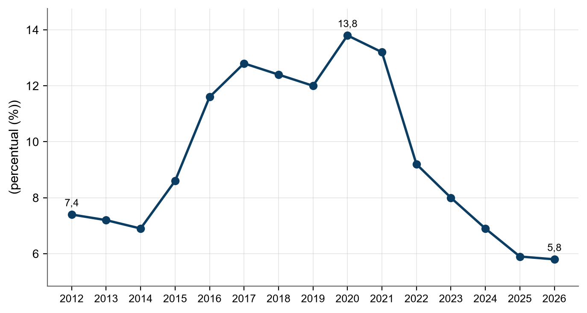<figcaption><strong>Figura 1 – Taxa de Desocupação Nacional (2012-2026).</strong> <em>Fonte: [(IBGE, 2026d)](https://www.ibge.gov.br/estatisticas/sociais/trabalho/17270-pnad-continua.html).</em> A taxa de desocupação atingiu seu pico em 2020 e apresenta queda constante até 2026.</figcaption></figure>

<figure class="figura">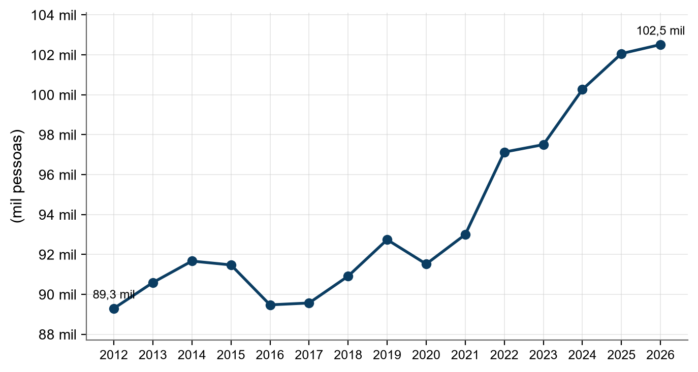<figcaption><strong>Figura 2 – Pessoas Ocupadas no Brasil (2012-2026).</strong> <em>Fonte: [(IBGE, 2026d)](https://www.ibge.gov.br/estatisticas/sociais/trabalho/17270-pnad-continua.html).</em> O volume de ocupados superou a marca de 100 milhões de pessoas a partir de 2024.</figcaption></figure>

O rendimento médio mensal real do trabalho principal acompanhou essa tendência de alta, saindo de R$ 3.191,30 em 2012 para R$ 3.777,50 em 2026 [(IBGE, 2026d)](https://www.ibge.gov.br/estatisticas/sociais/trabalho/17270-pnad-continua.html).

<figure class="figura"><figcaption><strong>Figura 3 – Rendimento Médio Mensal Real (2012-2026).</strong> <em>Fonte: [(IBGE, 2026d)](https://www.ibge.gov.br/estatisticas/sociais/trabalho/17270-pnad-continua.html).</em> O rendimento médio real apresenta crescimento acelerado entre 2022 e 2026.</figcaption></figure>

A estrutura do mercado divide-se entre formalidade e informalidade. Os empregados com carteira assinada no setor privado somam 39,3 milhões em 2026 [(IPEA, 2026a)](https://www.ipeadata.gov.br/). Já os empregados sem carteira totalizam 11,2 milhões [(IPEA, 2026a)](https://www.ipeadata.gov.br/). A taxa de informalidade nacional apresenta queda, situando-se em 48,8% em 2026, comparado a patamares superiores em anos anteriores [(IPEA, 2026a)](https://www.ipeadata.gov.br/).

<figure class="figura">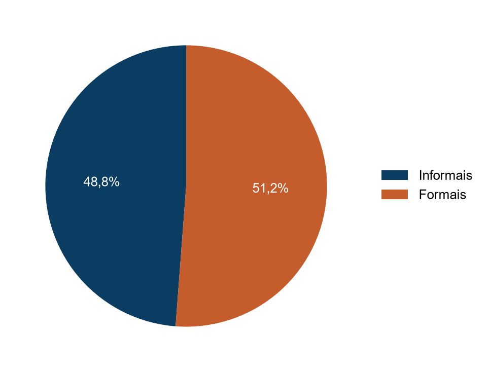<figcaption><strong>Figura 4 – Taxa de Informalidade Nacional em 2026.</strong> <em>Fonte: [(IPEA, 2026a)](https://www.ipeadata.gov.br/).</em> A informalidade ainda abrange quase metade da força de trabalho brasileira em 2026.</figcaption></figure>

### 1.1 Saúde e Trabalho

A saúde autoavaliada revela disparidades conforme a situação ocupacional. A Pesquisa Nacional de Saúde (PNS) é realizada quinquenalmente, possuindo edições em 2013 e 2019, com a terceira edição (PNS 2026) em fase de coleta no corrente ano [(IBGE, 2019)](https://www.ibge.gov.br/estatisticas/sociais/saude/9160-pesquisa-nacional-de-saude.html). Por esse motivo, a série histórica de saúde compreende apenas esses dois pontos temporais.

Trabalhadores ocupados reportam a melhor percepção de saúde, com 73,8% avaliando-a como boa ou muito boa em 2019 [(IBGE, 2019)](https://www.ibge.gov.br/estatisticas/sociais/saude/9160-pesquisa-nacional-de-saude.html). Em contraste, pessoas fora da força de trabalho apresentam a pior percepção, caindo de 53,0% em 2013 para 51,3% em 2019 [(IBGE, 2019)](https://www.ibge.gov.br/estatisticas/sociais/saude/9160-pesquisa-nacional-de-saude.html).

<figure class="figura">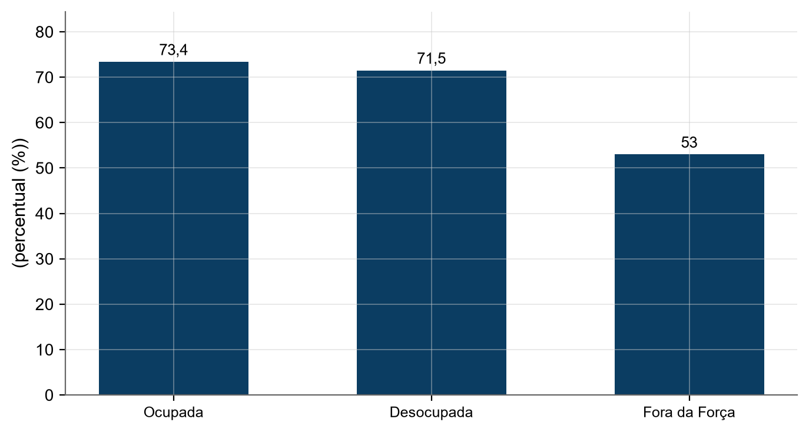<figcaption><strong>Figura 5 – Saúde Autoavaliada Boa ou Muito Boa por Situação Ocupacional.</strong> <em>Fonte: [(IBGE, 2019)](https://www.ibge.gov.br/estatisticas/sociais/saude/9160-pesquisa-nacional-de-saude.html).</em> Pessoas ocupadas mantêm a melhor percepção de saúde, enquanto quem está fora da força de trabalho apresenta os menores índices.</figcaption></figure>

A renda e a cor/raça são determinantes na saúde. Pessoas com rendimento superior a 5 salários mínimos reportam 86,4% de saúde boa ou muito boa em 2019, contra apenas 55,5% para quem ganha até 1/4 do salário mínimo [(IBGE, 2019)](https://www.ibge.gov.br/estatisticas/sociais/saude/9160-pesquisa-nacional-de-saude.html). Quanto à raça, brancos reportam 71,0% de saúde boa/muito boa, enquanto pretos e pardos registram 62,9% e 62,1%, respectivamente, em 2019 [(IBGE, 2019)](https://www.ibge.gov.br/estatisticas/sociais/saude/9160-pesquisa-nacional-de-saude.html).

<figure class="figura">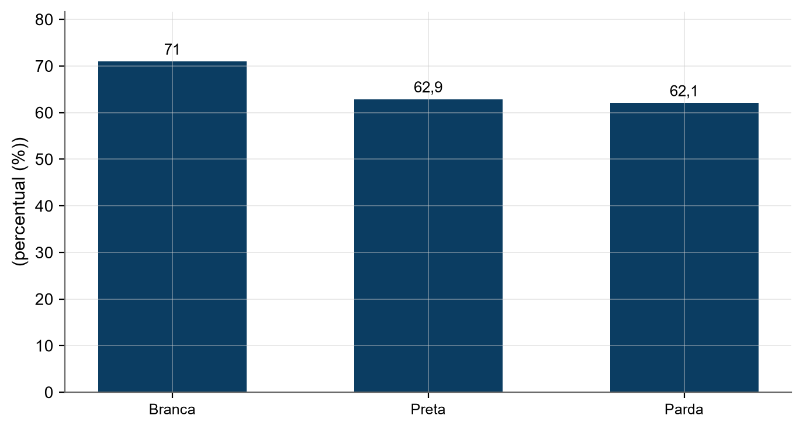<figcaption><strong>Figura 6 – Saúde Autoavaliada por Cor ou Raça (2019).</strong> <em>Fonte: [(IBGE, 2019)](https://www.ibge.gov.br/estatisticas/sociais/saude/9160-pesquisa-nacional-de-saude.html).</em> Há uma disparidade na percepção de saúde entre pessoas brancas e pessoas pretas ou pardas.</figcaption></figure>

### 1.2 Política de Salário Mínimo e Arcabouço Fiscal

O salário mínimo em 2026 foi fixado em R$ 1.621,00 [(SENADO FEDERAL, 2026d)](https://www12.senado.leg.br/radio/1/noticia/2025/12/19/congresso-nacional-aprova-o-orcamento-de-2026-com-salario-minimo-de-r-1-621-a-partir-de-janeiro). A política de reajuste segue a Lei 14.663/2023, que prevê a reposição do INPC acrescida da variação do PIB [(SENADO FEDERAL, 2026b)](https://www12.senado.leg.br/noticias/materias/2023/08/31/novo-arcabouco-fiscal-entra-em-vigencia-no-brasil). Contudo, o valor está sujeito aos limites do novo arcabouço fiscal (Lei Complementar 200/2023) e à Emenda Constitucional 126/2022, que estabelecem tetos de gastos para a União [(SENADO FEDERAL, 2026b)](https://www12.senado.leg.br/noticias/materias/2023/08/31/novo-arcabouco-fiscal-entra-em-vigencia-no-brasil). Sem a limitação do arcabouço fiscal, o aumento do mínimo teria sido R$ 10,00 maior [(SENADO FEDERAL, 2026d)](https://www12.senado.leg.br/radio/1/noticia/2025/12/19/congresso-nacional-aprova-o-orcamento-de-2026-com-salario-minimo-de-r-1-621-a-partir-de-janeiro).

A trajetória do rendimento médio real e do salário mínimo real mostra que, embora ambos tenham crescido, o rendimento médio real (R$ 3.777,50) mantém-se superior ao salário mínimo real em 2026 [(IBGE, 2026d)](https://www.ibge.gov.br/estatisticas/sociais/trabalho/17270-pnad-continua.html).

<figure class="figura"><figcaption><strong>Figura 7 – Comparativo de Rendimentos Reais (2012-2026).</strong> <em>Fonte: [(IPEA, 2026a)](https://www.ipeadata.gov.br/).</em> O rendimento de quem possui carteira assinada é consistentemente superior ao de quem não possui.</figcaption></figure>

O poder de compra é impactado pelo IPCA. Enquanto o rendimento médio real cresceu, a inflação acumulada (IPCA) pressiona os custos de vida, exigindo reajustes constantes para evitar a perda de poder aquisitivo [(IPEA, 2026a)](https://www.ipeadata.gov.br/).

### 1.3 Salário Mínimo e Salário Médio x Custo de Vida

O salário mínimo e o rendimento médio do brasileiro são insuficientes para cobrir as necessidades básicas constitucionais. O DIEESE define o "Salário Mínimo Necessário" com base no custo da cesta básica de maior valor entre as capitais, multiplicado por 3 (para uma família de quatro pessoas) e dividido pela participação orçamentária da alimentação de 35,71% [(DIEESE, 2026a)](https://www.dieese.org.br/analisecestabasica/salarioMinimo.html). Este cálculo visa suprir alimentação, moradia, saúde, educação, vestuário, higiene, transporte, lazer e previdência, conforme o art. 7º, IV da Constituição Federal [(DIEESE, 2026a)](https://www.dieese.org.br/analisecestabasica/salarioMinimo.html).

Em setembro de 2026, o salário mínimo nominal é de R$ 1.621,00, enquanto o salário mínimo necessário é de R$ 7.750,01 [(DIEESE, 2026a)](https://www.dieese.org.br/analisecestabasica/salarioMinimo.html). Isso significa que o valor pago é apenas 20,9% do necessário, ou que o necessário é 4,78 vezes o mínimo pago [(DIEESE, 2026a)](https://www.dieese.org.br/analisecestabasica/salarioMinimo.html).

<figure class="figura">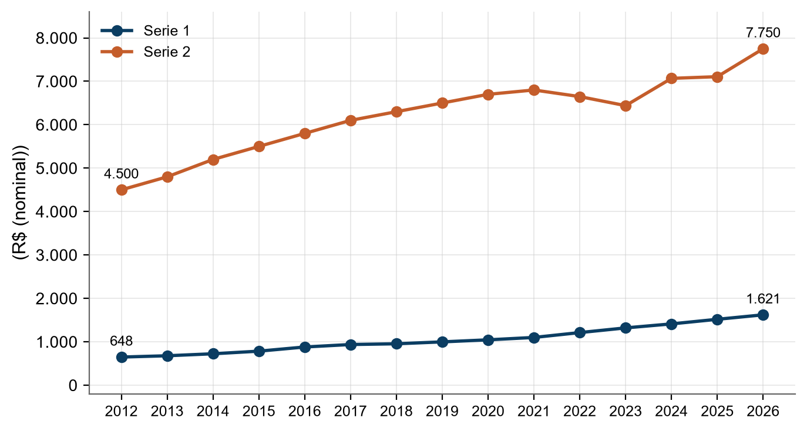<figcaption><strong>Figura 8 – Salário Mínimo Nominal vs Necessário (2012-2026).</strong> <em>Fonte: [(DIEESE, 2026a)](https://www.dieese.org.br/analisecestabasica/salarioMinimo.html).</em> O abismo entre o salário mínimo pago e o necessário para a cesta constitucional persiste e cresce.</figcaption></figure>

<figure class="figura">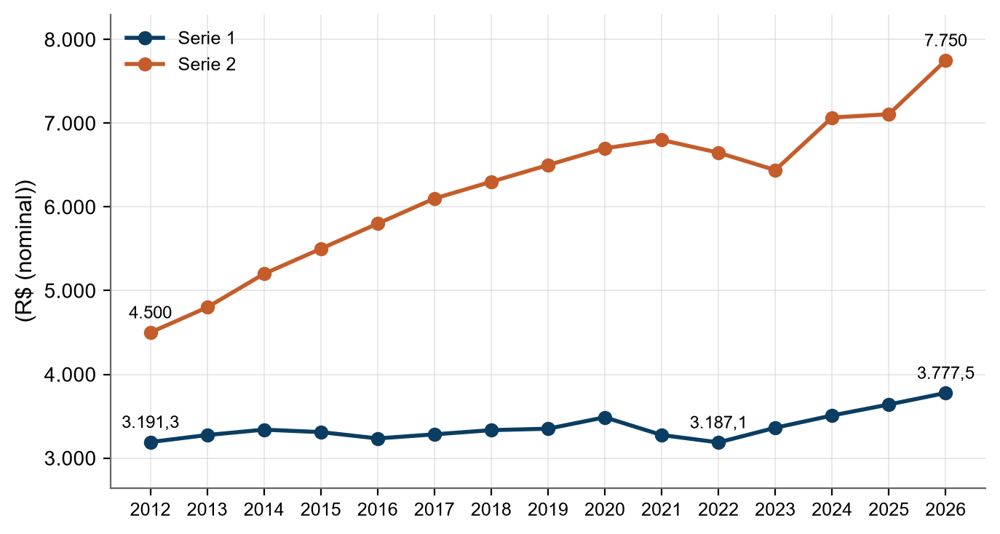<figcaption><strong>Figura 9 – Rendimento Médio Nominal vs Salário Necessário (2012-2026).</strong> <em>Fonte: [(IBGE, 2026d)](https://www.ibge.gov.br/estatisticas/sociais/trabalho/17270-pnad-continua.html).</em> Mesmo o rendimento médio da população não atinge o patamar do salário mínimo necessário.</figcaption></figure>

<strong>Tabela 1 – Custo da Cesta Básica de Alimentos - Setembro 2026.</strong> <em>Fonte: [(DIEESE, 2026b)](https://www.dieese.org.br/analisecestabasica/2026/202609cestabasica.pdf).</em>

| Item | Valor/Indicador | Fonte |
| :--- | :--- | :--- |
| Cesta mais cara (São Paulo) | R$ 922,51 | [(DIEESE, 2026b)](https://www.dieese.org.br/analisecestabasica/2026/202609cestabasica.pdf) |
| Horas de trabalho necessárias | 125 horas e 12 minutos | [(DIEESE, 2026b)](https://www.dieese.org.br/analisecestabasica/2026/202609cestabasica.pdf) |
| Percentual da renda líquida | 61,52% | [(DIEESE, 2026b)](https://www.dieese.org.br/analisecestabasica/2026/202609cestabasica.pdf) |

Para satisfazer a cesta constitucional, o salário deveria ser de R$ 7.750,01 [(DIEESE, 2026a)](https://www.dieese.org.br/analisecestabasica/salarioMinimo.html). Faltam R$ 6.129,01 para o salário mínimo (R$ 1.621,00) e R$ 3.972,51 para o rendimento médio nominal (R$ 3.777,50) alcançarem esse patamar [(IBGE, 2026d)](https://www.ibge.gov.br/estatisticas/sociais/trabalho/17270-pnad-continua.html); [(DIEESE, 2026a)](https://www.dieese.org.br/analisecestabasica/salarioMinimo.html).

### 1.4 Gênero - População que Trabalha e Quanto Recebe

As mulheres representam aproximadamente metade da população de 14 anos ou mais, mas são minoria na força de trabalho [(IPEA, 2026a)](https://www.ipeadata.gov.br/). Em 2026, a composição da população de 14 anos ou mais é de 48,2% homens e 51,8% mulheres [(IPEA, 2026a)](https://www.ipeadata.gov.br/). Na força de trabalho, as mulheres ocupam 44,0% das vagas [(IPEA, 2026a)](https://www.ipeadata.gov.br/).

<figure class="figura">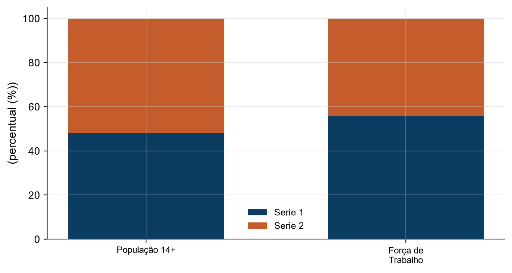<figcaption><strong>Figura 10 – Composição por Sexo: População vs Força de Trabalho (2026).</strong> <em>Fonte: [(IPEA, 2026a)](https://www.ipeadata.gov.br/).</em> Mulheres são maioria na população, mas minoria na força de trabalho.</figcaption></figure>

O gap salarial persiste. Em 2012, homens ganhavam R$ 3.155,20 e mulheres R$ 2.322,50 [(IPEA, 2026a)](https://www.ipeadata.gov.br/). Em 2026, o rendimento médio real mensal de homens subiu para R$ 3.999,50, enquanto o de mulheres atingiu R$ 3.191,50 [(IPEA, 2026a)](https://www.ipeadata.gov.br/). A diferença atual é de R$ 808,00, o que significa que as mulheres ganham aproximadamente 20,2% a menos que os homens [(IPEA, 2026a)](https://www.ipeadata.gov.br/).

<figure class="figura">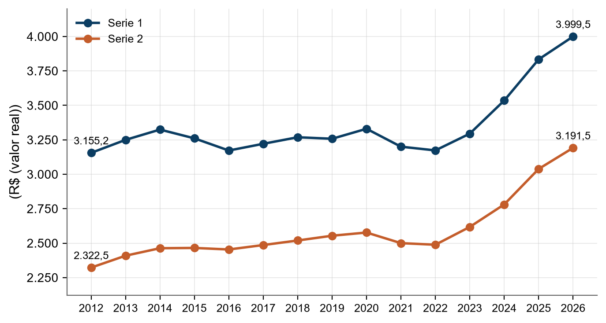<figcaption><strong>Figura 11 – Rendimento Médio Real por Sexo (2012-2026).</strong> <em>Fonte: [(IPEA, 2026a)](https://www.ipeadata.gov.br/).</em> Embora ambos os rendimentos tenham crescido, a distância nominal entre homens e mulheres aumentou.</figcaption></figure>

### 1.5 Regiões do País

A desigualdade regional é marcante nos três indicadores principais. A taxa de desocupação é liderada (menor taxa) pela Região Sul, com 3,4% em 2026, e fecha com a Região Nordeste, com 8,0% [(IPEA, 2026a)](https://www.ipeadata.gov.br/). O Centro-Oeste registra 4,3% em 2026, logo atrás do Sul [(IPEA, 2026a)](https://www.ipeadata.gov.br/).

<figure class="figura">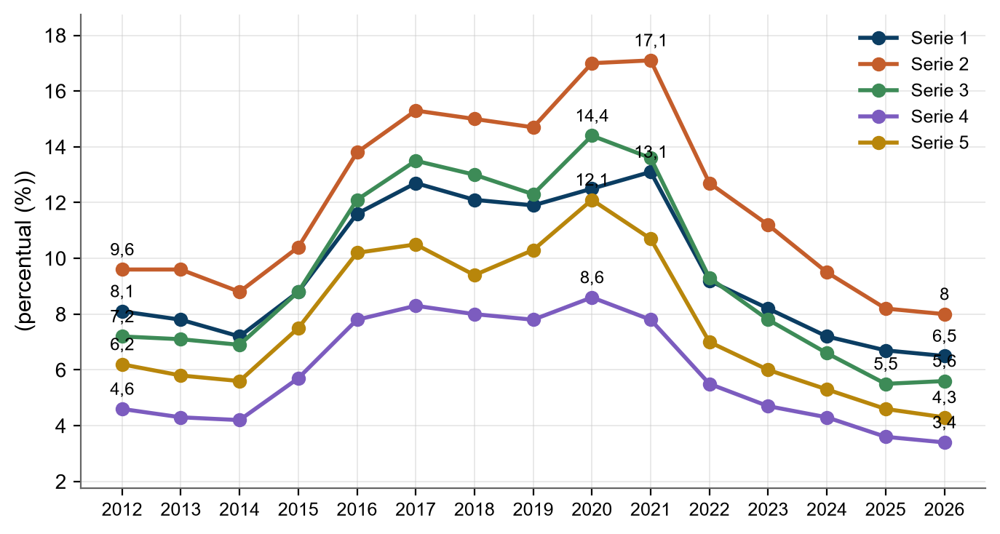<figcaption><strong>Figura 12 – Taxa de Desocupação por Região (2012-2026).</strong> <em>Fonte: [(IPEA, 2026a)](https://www.ipeadata.gov.br/).</em> A Região Sul mantém a menor taxa de desocupação durante toda a série histórica.</figcaption></figure>

A informalidade é mais crítica no Norte, com 50,6% em 2026, e menor no Sul, com 29,0% [(IPEA, 2026a)](https://www.ipeadata.gov.br/). A distância entre os extremos é de 21,6 pontos percentuais [(IPEA, 2026a)](https://www.ipeadata.gov.br/). O Centro-Oeste, com 32,8%, e o Sudeste, com 33,2%, ficam próximos do patamar do Sul [(IPEA, 2026a)](https://www.ipeadata.gov.br/).

<figure class="figura">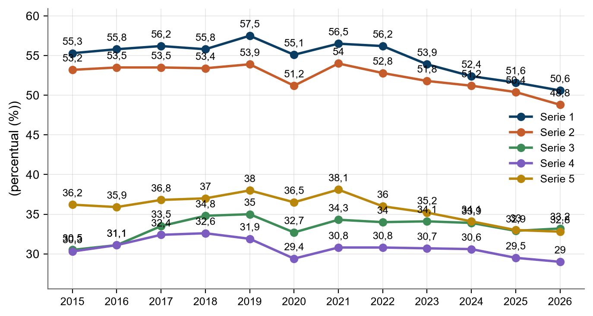<figcaption><strong>Figura 13 – Taxa de Informalidade por Região (2015-2026).</strong> <em>Fonte: [(IPEA, 2026a)](https://www.ipeadata.gov.br/).</em> As regiões Norte e Nordeste apresentam taxas de informalidade significativamente superiores ao Sul e Sudeste.</figcaption></figure>

Quanto ao rendimento médio real, o Centro-Oeste lidera em 2025, com R$ 4.056,50, logo seguido por Sul e Sudeste, enquanto Norte e Nordeste ficam nas posições inferiores, a mais de R$ 1.200 do topo [(IPEA, 2026a)](https://www.ipeadata.gov.br/).

<figure class="figura">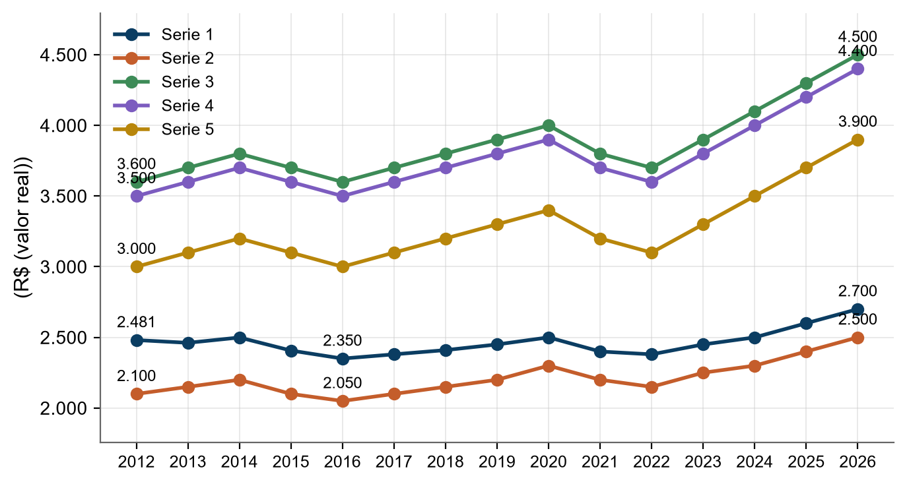<figcaption><strong>Figura 14 – Rendimento Médio Real por Região (2012-2026).</strong> <em>Fonte: [(IPEA, 2026a)](https://www.ipeadata.gov.br/).</em> A desigualdade regional de rendimentos permanece estável, com Centro-Oeste, Sudeste e Sul no topo.</figcaption></figure>

**Em termos simples:** O Brasil em 2026 tem mais gente trabalhando e menos desempregados do que há alguns anos [(IBGE, 2026d)](https://www.ibge.gov.br/estatisticas/sociais/trabalho/17270-pnad-continua.html). Porém, quase metade dos trabalhadores não tem carteira assinada [(IPEA, 2026a)](https://www.ipeadata.gov.br/). O maior problema é o dinheiro: o salário mínimo de R$ 1.621,00 é muito baixo para as necessidades básicas de uma família, que precisaria de R$ 7.750,01 para viver com dignidade [(DIEESE, 2026a)](https://www.dieese.org.br/analisecestabasica/salarioMinimo.html). Além disso, mulheres e pessoas do Norte e Nordeste ainda ganham bem menos que homens e pessoas do Sul e Sudeste [(IPEA, 2026a)](https://www.ipeadata.gov.br/).

Fontes consultadas:
* [(IBGE, 2026d)](https://www.ibge.gov.br/estatisticas/sociais/trabalho/17270-pnad-continua.html)
* [(IPEA, 2026a)](https://www.ipeadata.gov.br/)
* [(IBGE, 2019)](https://www.ibge.gov.br/estatisticas/sociais/saude/9160-pesquisa-nacional-de-saude.html)
* [(SENADO FEDERAL, 2026d)](https://www12.senado.leg.br/radio/1/noticia/2025/12/19/congresso-nacional-aprova-o-orcamento-de-2026-com-salario-minimo-de-r-1-621-a-partir-de-janeiro)
* [(SENADO FEDERAL, 2026b)](https://www12.senado.leg.br/noticias/materias/2023/08/31/novo-arcabouco-fiscal-entra-em-vigencia-no-brasil)
* [(DIEESE, 2026a)](https://www.dieese.org.br/analisecestabasica/salarioMinimo.html)
* [(DIEESE, 2026b)](https://www.dieese.org.br/analisecestabasica/2026/202609cestabasica.pdf)

## 2. Princípios constitucionais do trabalho

A República Federativa do Brasil estabelece, como um de seus fundamentos, os valores sociais do trabalho e da livre iniciativa [(BRASIL, 1988, art. 1º, IV)](https://www.planalto.gov.br/ccivil_03/constituicao/constituicao.htm). O trabalho é classificado como um direito social, integrando um conjunto que abrange a educação, saúde, alimentação, moradia, lazer, segurança, previdência social, proteção à maternidade e à infância, além da assistência aos desamparados [(BRASIL, 1988, art. 6º)](https://www.planalto.gov.br/ccivil_03/constituicao/constituicao.htm).

O ordenamento jurídico brasileiro assegura a liberdade de exercício de qualquer trabalho, ofício ou profissão, desde que atendidas as qualificações profissionais que a lei estabelecer [(BRASIL, 1988, art. 5º, XIII)](https://www.planalto.gov.br/ccivil_03/constituicao/constituicao.htm). No âmbito da proteção ao trabalho humano, a Constituição proíbe o trabalho noturno, perigoso ou insalubre a menores de 18 anos e qualquer trabalho a menores de 16 anos, salvo na condição de aprendiz a partir dos 14 anos [(BRASIL, 1988, art. 7º, XXXIII)](https://www.planalto.gov.br/ccivil_03/constituicao/constituicao.htm).

No que tange à organização coletiva, é garantida a liberdade de associação profissional ou sindical do trabalhador [(BRASIL, LEI 13.467/2017, XXVI)](https://www.planalto.gov.br/ccivil_03/_ato2015-2018/2017/lei/l13467.htm). Esta liberdade inclui o direito de não sofrer cobranças ou descontos salariais estabelecidos em convenção ou acordo coletivo sem anuência prévia e expressa [(BRASIL, LEI 13.467/2017, XXVI)](https://www.planalto.gov.br/ccivil_03/_ato2015-2018/2017/lei/l13467.htm). O direito de greve é assegurado, cabendo aos trabalhadores a decisão sobre a oportunidade de seu exercício e os interesses a serem defendidos [(BRASIL, LEI 13.467/2017, XXVII)](https://www.planalto.gov.br/ccivil_03/_ato2015-2018/2017/lei/l13467.htm). A lei deve definir as atividades essenciais para garantir o atendimento de necessidades inadiáveis da comunidade durante greves [(BRASIL, LEI 13.467/2017, XXVIII)](https://www.planalto.gov.br/ccivil_03/_ato2015-2018/2017/lei/l13467.htm).

A propriedade, direito assegurado constitucionalmente, deve atender a sua função social [(BRASIL, 1988, art. 5º, XXIII)](https://www.planalto.gov.br/ccivil_03/constituicao/constituicao.htm). No contexto rural, a pequena propriedade trabalhada pela família não pode ser objeto de penhora para pagamento de débitos decorrentes de sua atividade produtiva [(BRASIL, 1988, art. 5º, XXVI)](https://www.planalto.gov.br/ccivil_03/constituicao/constituicao.htm).

O sistema jurídico trabalhista fundamenta-se no Princípio da Proteção, que visa equilibrar a relação entre empregador e empregado [(CHAGAS, 2026)](https://openalex.org/W2895142932). Este princípio é essencial para evitar a fragilização das relações trabalhistas, especialmente diante de fenômenos como a "pejotização" [(CHAGAS, 2026)](https://openalex.org/W2895142932).

<figure class="figura">

<h4>Remuneração e Jornada</h4><ul><li>Salário mínimo com reajustes periódicos (art. 7º, IV)</li><li>Décimo terceiro salário (art. 7º, VIII)</li><li>Jornada máxima de 8h diárias e 44h semanais (art. 7º, XIII)</li><li>Remuneração noturna superior à diurna (art. 7º, IX)</li></ul>

<h4>Proteções e Garantias</h4><ul><li>Irredutibilidade do salário, salvo acordo coletivo (art. 7º, VI)</li><li>Proteção legal de crianças e adolescentes (art. 7º, XXIV)</li><li>Igualdade entre trabalhador permanente e avulso (art. 7º, XXXIV)</li><li>Participação nos lucros ou resultados (art. 7º, XI)</li></ul>

<figcaption><strong>Figura 15 – Principais Direitos Sociais do Trabalhador.</strong> <em>Fonte: [(BRASIL, 1988)](https://www.planalto.gov.br/ccivil_03/constituicao/constituicao.htm).</em> O art. 7º da CF/88 estabelece um rol de garantias mínimas para a proteção do trabalhador urbano e rural.</figcaption></figure>

<strong>Tabela 2 – Limites de Idade para o Trabalho.</strong> <em>Fonte: [(BRASIL, 1988)](https://www.planalto.gov.br/ccivil_03/constituicao/constituicao.htm).</em>

| Categoria | Idade Mínima | Condição/Restrição | Fonte |
| :--- | :--- | :--- | :--- |
| Aprendiz | 14 anos | Permitido como aprendiz | [(BRASIL, 1988, art. 7º, XXXIII)](https://www.planalto.gov.br/ccivil_03/constituicao/constituicao.htm) |
| Trabalho Geral | 16 anos | Proibido abaixo desta idade, salvo aprendiz | [(BRASIL, 1988, art. 7º, XXXIII)](https://www.planalto.gov.br/ccivil_03/constituicao/constituicao.htm) |
| Trabalho Noturno/Insalubre | 18 anos | Proibido para menores de 18 anos | [(BRASIL, 1988, art. 7º, XXXIII)](https://www.planalto.gov.br/ccivil_03/constituicao/constituicao.htm) |

<figure class="figura">

<h4>Associação e Sindicato</h4><ul><li>Liberdade de associação profissional (inciso XXVI)</li><li>Vedação de descontos sem anuência prévia (inciso XXVI)</li></ul>

<h4>Direito de Greve</h4><ul><li>Decisão dos trabalhadores sobre a oportunidade (inciso XXVII)</li><li>Definição legal de serviços essenciais (inciso XXVIII)</li></ul>

<figcaption><strong>Figura 16 – Liberdades e Direitos Coletivos.</strong> <em>Fonte: [(BRASIL, LEI 13.467/2017)](https://www.planalto.gov.br/ccivil_03/_ato2015-2018/2017/lei/l13467.htm).</em> A legislação garante a autonomia dos trabalhadores na organização sindical e no exercício do direito de greve.</figcaption></figure>

**Em termos simples:** A lei brasileira protege o trabalhador para que ele não seja a parte mais fraca na relação com o patrão [(CHAGAS, 2026)](https://openalex.org/W2895142932). A Constituição garante direitos básicos como salário mínimo, 13º, limite de horas de trabalho e a liberdade de criar sindicatos ou fazer greve [(BRASIL, 1988)](https://www.planalto.gov.br/ccivil_03/constituicao/constituicao.htm); [(BRASIL, LEI 13.467/2017)](https://www.planalto.gov.br/ccivil_03/_ato2015-2018/2017/lei/l13467.htm).

Fontes consultadas:
* [(BRASIL, 1988)](https://www.planalto.gov.br/ccivil_03/constituicao/constituicao.htm)
* [(BRASIL, LEI 13.467/2017)](https://www.planalto.gov.br/ccivil_03/_ato2015-2018/2017/lei/l13467.htm)
* [(CHAGAS, 2026)](https://openalex.org/W2895142932)

## 3. CLT: estrutura, história e direitos essenciais

A Consolidação das Leis do Trabalho (CLT) foi aprovada pelo Decreto-Lei nº 5.452, de 1º de maio de 1943 [(BRASIL, 1943)](https://www.planalto.gov.br/ccivil_03/decreto-lei/del5452.htm). Sua estrutura estatui as normas que regulam as relações individuais e coletivas de trabalho [(BRASIL, 1943, art. 1º)](https://www.planalto.gov.br/ccivil_03/decreto-lei/del5452.htm). O sistema define o empregador como a empresa que assume os riscos da atividade econômica, admite, assalaria e dirige a prestação pessoal de serviço [(BRASIL, 1943, art. 2º)](https://www.planalto.gov.br/ccivil_03/decreto-lei/del5452.htm).

### 3.1 Direitos Essenciais e Jornada de Trabalho

A Constituição Federal e a CLT estabelecem a duração normal do trabalho como não superior a 8 horas diárias e 44 horas semanais [(BRASIL, 1988, XIII)](https://www.planalto.gov.br/ccivil_03/constituicao/constituicao.htm). O serviço extraordinário deve ter remuneração superior, no mínimo, em 50% à do normal [(BRASIL, 1988, XVI)](https://www.planalto.gov.br/ccivil_03/constituicao/constituicao.htm).

A jornada excepcional é permitida via horas extras, conforme o art. 59 da CLT [(BRASIL, 1943, art. 59)](https://www.planalto.gov.br/ccivil_03/decreto-lei/del5452.htm). O limite legal para a jornada diária, incluindo a prorrogação, é de 10 horas [(BRASIL, 1943, art. 59)](https://www.planalto.gov.br/ccivil_03/decreto-lei/del5452.htm). O descumprimento das exigências legais para compensação de jornada, se não ultrapassada a duração máxima semanal, gera o pagamento apenas do respectivo adicional [(BRASIL, 1943, art. 59-B)](https://www.planalto.gov.br/ccivil_03/decreto-lei/del5452.htm).

Outros direitos fundamentais incluem:
* Férias anuais remuneradas com acréscimo de, pelo menos, um terço do salário normal [(BRASIL, 1988, XVII)](https://www.planalto.gov.br/ccivil_03/constituicao/constituicao.htm).
* Aviso prévio proporcional ao tempo de serviço, com mínimo de 30 dias [(BRASIL, 1988, XXI)](https://www.planalto.gov.br/ccivil_03/constituicao/constituicao.htm).
* Adicionais de remuneração para atividades penosas, insalubres ou perigosas [(BRASIL, 1988, XVIII)](https://www.planalto.gov.br/ccivil_03/constituicao/constituicao.htm).
* Licença-maternidade de 120 dias [(BRASIL, 1988, XVIII)](https://www.planalto.gov.br/ccivil_03/constituicao/constituicao.htm).

<strong>Tabela 3 – Regras de Jornada e Remuneração.</strong> <em>Fonte: [(BRASIL, 1988)](https://www.planalto.gov.br/ccivil_03/constituicao/constituicao.htm).</em>

| Item | Regra Legal | Base Legal |
| :--- | :--- | :--- |
| Jornada Diária | Até 8 horas [(BRASIL, 1988)](https://www.planalto.gov.br/ccivil_03/constituicao/constituicao.htm) | Art. 7º, XIII |
| Jornada Semanal | Até 44 horas [(BRASIL, 1988)](https://www.planalto.gov.br/ccivil_03/constituicao/constituicao.htm) | Art. 7º, XIII |
| Adicional Hora Extra | Mínimo de 50% [(BRASIL, 1988)](https://www.planalto.gov.br/ccivil_03/constituicao/constituicao.htm) | Art. 7º, XVI |
| Adicional Férias | 1/3 do salário normal [(BRASIL, 1988)](https://www.planalto.gov.br/ccivil_03/constituicao/constituicao.htm) | Art. 7º, XVII |

<figure class="figura">

<h4>Jornada Normal</h4><ul><li>Diária: 8 horas</li><li>Semanal: 44 horas</li></ul>

<h4>Adicionais Mínimos</h4><ul><li>Hora Extra: 50%</li><li>Férias: 33,3%</li></ul>

<figcaption><strong>Figura 17 – Regras de Jornada e Adicionais.</strong> <em>Fonte: [(BRASIL, 1988)](https://www.planalto.gov.br/ccivil_03/constituicao/constituicao.htm).</em> A legislação brasileira estabelece limites rígidos de jornada e percentuais mínimos de acréscimo remuneratório.</figcaption></figure>

### 3.2 Reforma Trabalhista de 2017 (Lei 13.467/2017)

A Lei 13.467/2017 alterou a CLT para adequar a legislação às novas relações de trabalho [(BRASIL, LEI 13.467/2017)](https://www.planalto.gov.br/ccivil_03/_ato2015-2018/2017/lei/l13467.htm). As principais mudanças práticas incluem:

1. **Negociação sobre a Lei:** Introdução da prevalência do acordado sobre o legislado nos arts. 611-A e 611-B [(BRASIL, LEI 13.467/2017)](https://www.planalto.gov.br/ccivil_03/_ato2015-2018/2017/lei/l13467.htm).
2. **Jornada e Compensação:** A prestação de horas extras habituais não descaracteriza mais o acordo de compensação de jornada ou o banco de horas [(BRASIL, 1943, art. 59-B, parágrafo único)](https://www.planalto.gov.br/ccivil_03/decreto-lei/del5452.htm).
3. **Novas Modalidades:** Regulamentação do teletrabalho (arts. 75-A a 75-F) e do trabalho intermitente (art. 452-A) [(BRASIL, 1943)](https://www.planalto.gov.br/ccivil_03/decreto-lei/del5452.htm).
4. **Rescisão:** Possibilidade de dispensa por acordo comum, com a multa do FGTS reduzida para 20% [(BRASIL, 1943, art. 484-A)](https://www.planalto.gov.br/ccivil_03/decreto-lei/del5452.htm).
5. **Intervalos:** Possibilidade de indenização dos intervalos para repouso e alimentação [(BRASIL, 1943, art. 59-A)](https://www.planalto.gov.br/ccivil_03/decreto-lei/del5452.htm).

A flexibilização trazida pela reforma, especialmente a redução de custos rescisórios e a simplificação de acordos individuais, é apontada como fator que incentiva a migração para modelos de PJ e MEI, onde o custo tributário é fixo (via DAS) e a complexidade do vínculo empregatício é eliminada [(BRASIL, LEI 13.467/2017)](https://www.planalto.gov.br/ccivil_03/_ato2015-2018/2017/lei/l13467.htm).

<figure class="figura">

<h4>Antes da Reforma</h4><ul><li>Horas Extras Habituais: Descaracterizava Banco de Horas</li><li>Intervalo Intrajornada: Obrigatório/Imprescritível</li></ul>

<h4>Depois da Reforma</h4><ul><li>Horas Extras Habituais: Mantém Banco de Horas</li><li>Intervalo Intrajornada: Possibilidade de Indenização</li></ul>

<figcaption><strong>Figura 18 – Impactos da Reforma Trabalhista 2017.</strong> <em>Fonte: [(BRASIL, 1943)](https://www.planalto.gov.br/ccivil_03/decreto-lei/del5452.htm).</em> A reforma de 2017 priorizou a manutenção de acordos de compensação mesmo com a prática de horas extras.</figcaption></figure>

**Em termos simples:** A CLT é o livro de regras do trabalho no Brasil. Ela garante que você não trabalhe mais de 8 horas por dia (ou 44 por semana) sem receber extra (pelo menos 50% a mais) e garante férias com um "bônus" de um terço do salário [(BRASIL, 1988)](https://www.planalto.gov.br/ccivil_03/constituicao/constituicao.htm). A reforma de 2017 deixou as regras mais flexíveis, permitindo que patrão e empregado combinem coisas que valem mais que a lei em alguns casos, o que acabou incentivando muita gente a trabalhar como PJ ou MEI para fugir da burocracia da carteira assinada [(BRASIL, LEI 13.467/2017)](https://www.planalto.gov.br/ccivil_03/_ato2015-2018/2017/lei/l13467.htm).

Fontes consultadas:
* [(BRASIL, 1988)](https://www.planalto.gov.br/ccivil_03/constituicao/constituicao.htm)
* [(BRASIL, 1943)](https://www.planalto.gov.br/ccivil_03/decreto-lei/del5452.htm)
* [(BRASIL, LEI 13.467/2017)](https://www.planalto.gov.br/ccivil_03/_ato2015-2018/2017/lei/l13467.htm)

## 4. Vínculo de emprego: os 4 requisitos e a subordinação algorítmica

A caracterização da relação de emprego no Brasil depende da coexistência de pressupostos específicos que distinguem o empregado de outras formas de prestação de serviço [(BRASIL, 1943)](https://www.planalto.gov.br/ccivil_03/decreto-lei/del5452.htm). O empregador é definido como a empresa que assume os riscos da atividade econômica e admite, assalaria e dirige a prestação pessoal de serviço [(BRASIL, 1943, art. 2º)](https://www.planalto.gov.br/ccivil_03/decreto-lei/del5452.htm).

<strong>Tabela 4 – Requisitos do Vínculo Empregatício.</strong> <em>Fonte: [(BRASIL, 1943)](https://www.planalto.gov.br/ccivil_03/decreto-lei/del5452.htm).</em>

| Passo | Requisito | Base Legal |
| :--- | :--- | :--- |
| 1 | Pessoa Física | [(BRASIL, 1943, art. 3º)](https://www.planalto.gov.br/ccivil_03/decreto-lei/del5452.htm) |
| 2 | Pessoalidade | [(BRASIL, 1943, art. 3º)](https://www.planalto.gov.br/ccivil_03/decreto-lei/del5452.htm) |
| 3 | Habitualidade (Não eventualidade) | [(BRASIL, 1943, art. 3º)](https://www.planalto.gov.br/ccivil_03/decreto-lei/del5452.htm) |
| 4 | Onerosidade (Salário) | [(BRASIL, 1943, art. 3º)](https://www.planalto.gov.br/ccivil_03/decreto-lei/del5452.htm) |
| 5 | Subordinação | [(BRASIL, 1943, art. 3º)](https://www.planalto.gov.br/ccivil_03/decreto-lei/del5452.htm) |

A subordinação jurídica é o ponto central para a distinção entre emprego e trabalho autônomo [(FONSECA, 2026)](https://doi.org/10.21527/2176-6622.2022.57.12136). No contexto moderno, a lei equipara os meios telemáticos e informatizados de comando, controle e supervisão aos meios pessoais e diretos de subordinação [(BRASIL, 1943, art. 6º, parágrafo único)](https://www.planalto.gov.br/ccivil_03/decreto-lei/del5452.htm). Essa previsão legal fundamenta a análise da subordinação algorítmica, especialmente em trabalhos intermediados por aplicativos digitais, como o Ifood [(FONSECA, 2026)](https://doi.org/10.21527/2176-6622.2022.57.12136).

A legislação brasileira estabelece distinções claras entre as modalidades de contratação:
*   **Trabalho Autônomo:** A contratação do autônomo, desde que cumpridas as formalidades legais, afasta a qualidade de empregado, independentemente de haver exclusividade ou continuidade na prestação [(BRASIL, LEI 13.467/2017, art. 442-B)](https://www.planalto.gov.br/ccivil_03/_ato2015-2018/2017/lei/l13467.htm).
*   **Trabalho Cooperado:** A Lei Complementar 123/2006 exclui do regime de microempresa as entidades constituídas sob a forma de cooperativas, salvo as de consumo [(BRASIL, LC 123/2006, art. 4º, § 4º, VI)](https://www.planalto.gov.br/ccivil_03/leis/lcp/lcp123.htm).
*   **Prestação de Serviço Civil:** Regida pelo Código Civil, tratando-se de relação diversa da trabalhista [(BRASIL, LEI 10.406/2002)](https://www.planalto.gov.br/ccivil_03/leis/2002/l10406.htm).

A "pejotização" ocorre quando um trabalhador é contratado por meio de uma pessoa jurídica constituída especificamente para a prestação de serviços [(STF, 2026b)](https://noticias.stf.jus.br/postsnoticias/stf-retira-suspensao-de-processos-sobre-pejotizacao-na-primeira-instancia-e-nos-trts). Esse modelo é frequente em setores como tecnologia da informação, saúde, advocacia associada e serviços de entrega [(STF, 2026b)](https://noticias.stf.jus.br/postsnoticias/stf-retira-suspensao-de-processos-sobre-pejotizacao-na-primeira-instancia-e-nos-trts). A prática é considerada abusiva quando a pessoa jurídica é utilizada para mascarar a existência de subordinação, pessoalidade e habitualidade [(BRASIL, LC 123/2006, art. 4º, § 4º, XI)](https://www.planalto.gov.br/ccivil_03/leis/lcp/lcp123.htm).

O Supremo Tribunal Federal (STF) tem analisado a licitude desses contratos, inclusive em casos de corretagem de imóveis sob modalidade de franquia, onde o Tribunal Superior do Trabalho (TST) já afastou o vínculo empregatício [(STF, 2026b)](https://noticias.stf.jus.br/postsnoticias/stf-retira-suspensao-de-processos-sobre-pejotizacao-na-primeira-instancia-e-nos-trts). Atualmente, o STF retirou a suspensão de processos sobre pejotização na primeira instância e nos TRTs para evitar o represamento de ações em fase de instrução [(STF, 2026c)](https://noticias.stf.jus.br/postsnoticias/stf-retira-suspensao-de-processos-sobre-pejotizacao-na-primeira-instancia-e-nos-trts/).

Quanto à responsabilidade, empresas que integram grupo econômico respondem solidariamente pelas obrigações decorrentes da legislação de seguridade social [(BRASIL, LEI 8.212/1991, art. 31, IX)](https://www.planalto.gov.br/ccivil_03/leis/l8212cons.htm). No âmbito trabalhista, empresas sob a direção, controle ou administração de outra, constituindo grupo econômico, são solidariamente responsáveis pela relação de emprego [(BRASIL, 1943, art. 2º, § 2º)](https://www.planalto.gov.br/ccivil_03/decreto-lei/del5452.htm).

**Em termos simples:** Para ser considerado empregado e ter a carteira assinada, a pessoa precisa trabalhar como indivíduo (não empresa), de forma regular, recebendo pagamento e, principalmente, obedecendo a ordens (subordinação). Quando a empresa obriga o trabalhador a abrir um CNPJ para esconder que ele é, na verdade, um empregado, ocorre a "pejotização", que pode ser anulada na Justiça se ficar provado que havia subordinação, mesmo que via aplicativo [(BRASIL, 1943)](https://www.planalto.gov.br/ccivil_03/decreto-lei/del5452.htm); [(STF, 2026b)](https://noticias.stf.jus.br/postsnoticias/stf-retira-suspensao-de-processos-sobre-pejotizacao-na-primeira-instancia-e-nos-trts).

Fontes consultadas:
* [(STF, 2026b)](https://noticias.stf.jus.br/postsnoticias/stf-retira-suspensao-de-processos-sobre-pejotizacao-na-primeira-instancia-e-nos-trts)
* [(BRASIL, 1943)](https://www.planalto.gov.br/ccivil_03/decreto-lei/del5452.htm)
* [(FONSECA, 2026)](https://doi.org/10.21527/2176-6622.2022.57.12136)
* [(BRASIL, LC 123/2006)](https://www.planalto.gov.br/ccivil_03/leis/lcp/lcp123.htm)
* [(BRASIL, LEI 13.467/2017)](https://www.planalto.gov.br/ccivil_03/_ato2015-2018/2017/lei/l13467.htm)
* [(STF, 2026c)](https://noticias.stf.jus.br/postsnoticias/stf-retira-suspensao-de-processos-sobre-pejotizacao-na-primeira-instancia-e-nos-trts/)
* [(BRASIL, LEI 8.212/1991)](https://www.planalto.gov.br/ccivil_03/leis/l8212cons.htm)
* [(BRASIL, LEI 10.406/2002)](https://www.planalto.gov.br/ccivil_03/leis/2002/l10406.htm)

## 5. Modalidades de trabalho com vínculo empregatício

<figure class="figura"><figcaption><strong>Figura 19 – Limites Legais de Prazo em Dias.</strong> <em>Fonte: [(BRASIL, LC 150/2015)](https://www.planalto.gov.br/ccivil_03/leis/lcp/lcp150.htm).</em> O gráfico demonstra a variação dos prazos máximos permitidos para diferentes naturezas de contratação e resposta.</figcaption></figure>

### 5.1 CLT tempo indeterminado (padrão)

**Como funciona na prática:**
O empregador admite o trabalhador para prestar serviços de forma pessoal, mediante salário e sob subordinação [(BRASIL, 1943, art. 2º)](https://www.planalto.gov.br/ccivil_03/decreto-lei/del5452.htm). O contrato pode ser tácito ou expresso, estabelecendo uma relação de emprego contínua [(BRASIL, 1943, art. 442)](https://www.planalto.gov.br/ccivil_03/decreto-lei/del5452.htm).

**Como deveria funcionar segundo a lei:**
A base legal é a Consolidação das Leis do Trabalho [(BRASIL, 1943)](https://www.planalto.gov.br/ccivil_03/decreto-lei/del5452.htm). O empregador assume os riscos da atividade econômica e dirige a prestação do serviço [(BRASIL, 1943, art. 2º)](https://www.planalto.gov.br/ccivil_03/decreto-lei/del5452.htm).

<strong>Tabela 5 – Direitos e Deveres CLT Indeterminado.</strong> <em>Fonte: [(BRASIL, 1943)](https://www.planalto.gov.br/ccivil_03/decreto-lei/del5452.htm).</em>

| Direitos do trabalhador | Deveres (trabalhador e contratante) |
| :--- | :--- |
| Salário e remuneração [(BRASIL, 1943, art. 2º)](https://www.planalto.gov.br/ccivil_03/decreto-lei/del5452.htm) | Prestação pessoal do serviço [(BRASIL, 1943, art. 2º)](https://www.planalto.gov.br/ccivil_03/decreto-lei/del5452.htm) |
| Seguro contra acidentes de trabalho [(BRASIL, LEI 13.467/2017, art. 1º, XX)](https://www.planalto.gov.br/ccivil_03/_ato2015-2018/2017/lei/l13467.htm) | Subordinação à direção do empregador [(BRASIL, 1943, art. 2º)](https://www.planalto.gov.br/ccivil_03/decreto-lei/del5452.htm) |
| Aviso prévio proporcional [(BRASIL, LEI 13.467/2017, art. 1º, XVI)](https://www.planalto.gov.br/ccivil_03/_ato2015-2018/2017/lei/l13467.htm) | Recolhimento de contribuições previdenciárias [(BRASIL, LEI 8.213/1991, art. 34)](https://www.planalto.gov.br/ccivil_03/leis/l8213cons.htm) |

O contratante deve garantir normas de saúde, higiene e segurança do trabalho [(BRASIL, LEI 13.467/2017, art. 1º, XVII)](https://www.planalto.gov.br/ccivil_03/_ato2015-2018/2017/lei/l13467.htm).

**Como o Estado enxerga e age:**
A fiscalização é realizada pela Secretaria de Inspeção do Trabalho do MTE, através da Auditoria-Fiscal do Trabalho [(MTE, 2026b)](https://www.gov.br/trabalho-e-emprego/pt-br/assuntos/inspecao-do-trabalho). Os cargos de Auditor-Fiscal são regidos pela Lei 10.593/2002 [(BRASIL, LEI 10.593/2002, art. 1º)](https://www.planalto.gov.br/ccivil_03/leis/2002/l10593.htm). O registro deve ser feito via eSocial [(ESOCIAL, 2026)](https://www.esocial.gov.br/). Infrações resultam em autos de infração e multas administrativas [(BRASIL, 1943)](https://www.planalto.gov.br/ccivil_03/decreto-lei/del5452.htm).

**Em termos simples:**
É a carteira assinada comum, onde não há data para acabar e o trabalhador tem todos os direitos garantidos por lei [(BRASIL, 1943)](https://www.planalto.gov.br/ccivil_03/decreto-lei/del5452.htm).

### 5.2 CLT tempo determinado e contrato de experiência

**Como funciona na prática:**
O contrato possui data de término fixada ou é utilizado para testar a aptidão do empregado [(BRASIL, LC 150/2015, art. 4º)](https://www.planalto.gov.br/ccivil_03/leis/lcp/lcp150.htm). No caso do doméstico, o contrato de experiência é facultado [(BRASIL, LC 150/2015, art. 4º, I)](https://www.planalto.gov.br/ccivil_03/leis/lcp/lcp150.htm).

**Como deveria funcionar segundo a lei:**
O contrato de experiência não pode exceder 90 dias [(BRASIL, LC 150/2015, art. 5º)](https://www.planalto.gov.br/ccivil_03/leis/lcp/lcp150.htm). Pode ser prorrogado uma única vez, desde que a soma não ultrapasse os 90 dias [(BRASIL, LC 150/2015, art. 5º, § 1º)](https://www.planalto.gov.br/ccivil_03/leis/lcp/lcp150.htm). Se houver continuidade após o prazo, torna-se contrato por tempo indeterminado [(BRASIL, LC 150/2015, art. 5º, § 2º)](https://www.planalto.gov.br/ccivil_03/leis/lcp/lcp150.htm).

<strong>Tabela 6 – Direitos e Deveres Contrato Determinado.</strong> <em>Fonte: [(BRASIL, LC 150/2015)](https://www.planalto.gov.br/ccivil_03/leis/lcp/lcp150.htm).</em>

| Direitos do trabalhador | Deveres (trabalhador e contratante) |
| :--- | :--- |
| Remuneração proporcional ao período [(BRASIL, LC 150/2015, art. 6º)](https://www.planalto.gov.br/ccivil_03/leis/lcp/lcp150.htm) | Cumprimento do prazo estipulado [(BRASIL, LC 150/2015, art. 5º)](https://www.planalto.gov.br/ccivil_03/leis/lcp/lcp150.htm) |
| Proteção contra dispensa sem justa causa [(BRASIL, LC 150/2015, art. 6º)](https://www.planalto.gov.br/ccivil_03/leis/lcp/lcp150.htm) | Registro formal da modalidade de contrato [(BRASIL, 1943)](https://www.planalto.gov.br/ccivil_03/decreto-lei/del5452.htm) |

O contratante deve observar o limite máximo de 90 dias para a experiência [(BRASIL, LC 150/2015, art. 5º)](https://www.planalto.gov.br/ccivil_03/leis/lcp/lcp150.htm).

**Como o Estado enxerga e age:**
A Auditoria-Fiscal do Trabalho verifica se o prazo de 90 dias foi respeitado para evitar a fraude do contrato indeterminado [(BRASIL, LEI 10.593/2002)](https://www.planalto.gov.br/ccivil_03/leis/2002/l10593.htm). O controle de datas é monitorado pelo eSocial [(ESOCIAL, 2026)](https://www.esocial.gov.br/).

**Em termos simples:**
É aquele contrato de "teste" ou com data para acabar; se passar de 90 dias sem novo acordo, vira emprego fixo [(BRASIL, LC 150/2015)](https://www.planalto.gov.br/ccivil_03/leis/lcp/lcp150.htm).

### 5.3 Trabalho intermitente

**Como funciona na prática:**
O trabalhador é chamado para prestar serviços em ciclos, com períodos de inatividade [(BRASIL, 1943, art. 452-A)](https://www.planalto.gov.br/ccivil_03/decreto-lei/del5452.htm). O empregador convoca o trabalhador para a prestação de serviços.

**Como deveria funcionar segundo a lei:**
A convocação deve ser feita com antecedência, e o trabalhador tem até 3 dias para responder ao chamado [(BRASIL, 1943, art. 452-A)](https://www.planalto.gov.br/ccivil_03/decreto-lei/del5452.htm). O contrato deve ser escrito [(BRASIL, 1943)](https://www.planalto.gov.br/ccivil_03/decreto-lei/del5452.htm).

<strong>Tabela 7 – Direitos e Deveres Intermitente.</strong> <em>Fonte: [(BRASIL, 1943)](https://www.planalto.gov.br/ccivil_03/decreto-lei/del5452.htm).</em>

| Direitos do trabalhador | Deveres (trabalhador e contratante) |
| :--- | :--- |
| Remuneração imediata ao fim do ciclo [(BRASIL, 1943, art. 452-A)](https://www.planalto.gov.br/ccivil_03/decreto-lei/del5452.htm) | Resposta ao chamado em até 3 dias [(BRASIL, 1943, art. 452-A)](https://www.planalto.gov.br/ccivil_03/decreto-lei/del5452.htm) |
| Férias proporcionais e 13º salário [(BRASIL, 1943)](https://www.planalto.gov.br/ccivil_03/decreto-lei/del5452.htm) | Pagamento de encargos previdenciários [(BRASIL, LEI 8.213/1991, art. 34)](https://www.planalto.gov.br/ccivil_03/leis/l8213cons.htm) |

O contratante deve formalizar a convocação e o aceite do trabalhador [(BRASIL, 1943, art. 452-A)](https://www.planalto.gov.br/ccivil_03/decreto-lei/del5452.htm).

**Como o Estado enxerga e age:**
O MTE fiscaliza a regularidade dos pagamentos ao final de cada ciclo [(MTE, 2026b)](https://www.gov.br/trabalho-e-emprego/pt-br/assuntos/inspecao-do-trabalho). O registro de cada período de atividade deve ser informado no eSocial para fins de contribuição previdenciária [(ESOCIAL, 2026)](https://www.esocial.gov.br/).

**Em termos simples:**
O trabalhador fica "de sobreaviso" e só trabalha (e ganha) quando a empresa chama e ele aceita [(BRASIL, 1943)](https://www.planalto.gov.br/ccivil_03/decreto-lei/del5452.htm).

### 5.4 Trabalho em tempo parcial

**Como funciona na prática:**
A jornada é reduzida em relação ao tempo integral [(BRASIL, LC 150/2015, art. 3º)](https://www.planalto.gov.br/ccivil_03/leis/lcp/lcp150.htm). No caso do doméstico, pode haver acordo escrito para horas suplementares limitadas a 1 hora diária [(BRASIL, LC 150/2015, art. 3º, § 2º)](https://www.planalto.gov.br/ccivil_03/leis/lcp/lcp150.htm).

**Como deveria funcionar segundo a lei:**
As férias são proporcionais à jornada semanal [(BRASIL, LC 150/2015, art. 3º, § 3º)](https://www.planalto.gov.br/ccivil_03/leis/lcp/lcp150.htm). Por exemplo, quem trabalha entre 15 e 20 horas semanais tem direito a 14 dias de férias [(BRASIL, LC 150/2015, art. 3º, § 3º, III)](https://www.planalto.gov.br/ccivil_03/leis/lcp/lcp150.htm).

<strong>Tabela 8 – Direitos e Deveres Tempo Parcial.</strong> <em>Fonte: [(BRASIL, LC 150/2015)](https://www.planalto.gov.br/ccivil_03/leis/lcp/lcp150.htm).</em>

| Direitos do trabalhador | Deveres (trabalhador e contratante) |
| :--- | :--- |
| Férias proporcionais à carga horária [(BRASIL, LC 150/2015, art. 3º)](https://www.planalto.gov.br/ccivil_03/leis/lcp/lcp150.htm) | Respeito ao limite de horas acordado [(BRASIL, LC 150/2015, art. 3º)](https://www.planalto.gov.br/ccivil_03/leis/lcp/lcp150.htm) |
| Salário proporcional à jornada [(BRASIL, 1943)](https://www.planalto.gov.br/ccivil_03/decreto-lei/del5452.htm) | Registro do regime de tempo parcial [(BRASIL, 1943)](https://www.planalto.gov.br/ccivil_03/decreto-lei/del5452.htm) |

O contratante deve observar a escala de dias de férias conforme a duração semanal do trabalho [(BRASIL, LC 150/2015, art. 3º, § 3º)](https://www.planalto.gov.br/ccivil_03/leis/lcp/lcp150.htm).

**Como o Estado enxerga e age:**
A Auditoria-Fiscal do Trabalho verifica se a jornada real condiz com o registro de tempo parcial para evitar a sub-remuneração [(BRASIL, LEI 10.593/2002)](https://www.planalto.gov.br/ccivil_03/leis/2002/l10593.htm).

**Em termos simples:**
É o emprego de "meio período", onde se trabalha menos horas e recebe um salário proporcional a isso [(BRASIL, LC 150/2015)](https://www.planalto.gov.br/ccivil_03/leis/lcp/lcp150.htm).

### 5.5 Trabalho temporário

**Como funciona na prática:**
O trabalhador é contratado por uma empresa de trabalho temporário e colocado à disposição de uma empresa tomadora [(BRASIL, LEI 6.019/1974, art. 2º)](https://www.planalto.gov.br/ccivil_03/leis/l6019.htm). Serve para substituição de pessoal regular ou acréscimo extraordinário de serviços [(BRASIL, LEI 6.019/1974, art. 2º)](https://www.planalto.gov.br/ccivil_03/leis/l6019.htm).

**Como deveria funcionar segundo a lei:**
O contrato não pode exceder 180 dias, consecutivos ou não [(BRASIL, LEI 6.019/1974, art. 10, § 1º)](https://www.planalto.gov.br/ccivil_03/leis/l6019.htm). Pode ser prorrogado por mais 90 dias se comprovada a manutenção das condições [(BRASIL, LEI 6.019/1974, art. 10, § 2º)](https://www.planalto.gov.br/ccivil_03/leis/l6019.htm). Não se aplica o contrato de experiência ao temporário [(BRASIL, LEI 6.019/1974, art. 10, § 4º)](https://www.planalto.gov.br/ccivil_03/leis/l6019.htm).

<strong>Tabela 9 – Direitos e Deveres Trabalho Temporário.</strong> <em>Fonte: [(BRASIL, LEI 6.019/1974)](https://www.planalto.gov.br/ccivil_03/leis/l6019.htm).</em>

| Direitos do trabalhador | Deveres (trabalhador e contratante) |
| :--- | :--- |
| Mesmas condições de alimentação e saúde da tomadora [(BRASIL, LEI 6.019/1974, art. 9º, § 2º)](https://www.planalto.gov.br/ccivil_03/leis/l6019.htm) | Contrato obrigatoriamente escrito [(BRASIL, LEI 6.019/1974, art. 9º)](https://www.planalto.gov.br/ccivil_03/leis/l6019.htm) |
| Atividades-meio ou atividades-fim [(BRASIL, LEI 6.019/1974, art. 9º, § 3º)](https://www.planalto.gov.br/ccivil_03/leis/l6019.htm) | Responsabilidade subsidiária da contratante [(BRASIL, LEI 6.019/1974, art. 10, § 7º)](https://www.planalto.gov.br/ccivil_03/leis/l6019.htm) |

A empresa contratante deve garantir condições de segurança, higiene e salubridade [(BRASIL, LEI 6.019/1974, art. 9º, § 1º)](https://www.planalto.gov.br/ccivil_03/leis/l6019.htm).

**Como o Estado enxerga e age:**
A empresa de trabalho temporário deve possuir capital social mínimo de R$ 100.000,00 [(BRASIL, LEI 6.019/1974, art. 6º, III)](https://www.planalto.gov.br/ccivil_03/leis/l6019.htm). O MTE fiscaliza se o prazo de 180 dias foi extrapolado, o que caracterizaria vínculo empregatício direto com a tomadora [(BRASIL, LEI 6.019/1974, art. 10, § 6º)](https://www.planalto.gov.br/ccivil_03/leis/l6019.htm).

**Em termos simples:**
É quando você é contratado por uma agência para trabalhar em outra empresa por um tempo curto, como em épocas de Natal [(BRASIL, LEI 6.019/1974)](https://www.planalto.gov.br/ccivil_03/leis/l6019.htm).

### 5.6 Teletrabalho/trabalho remoto e híbrido

**Como funciona na prática:**
A prestação de serviços ocorre preponderantemente fora das dependências do empregador, com a utilização de tecnologias de informação [(BRASIL, 1943, art. 75-A)](https://www.planalto.gov.br/ccivil_03/decreto-lei/del5452.htm).

**Como deveria funcionar segundo a lei:**
O regime deve constar expressamente no contrato individual de trabalho [(BRASIL, 1943, art. 75-C)](https://www.planalto.gov.br/ccivil_03/decreto-lei/del5452.htm). A lei prevê a possibilidade de alteração entre regime presencial e teletrabalho [(BRASIL, 1943)](https://www.planalto.gov.br/ccivil_03/decreto-lei/del5452.htm).

<strong>Tabela 10 – Direitos e Deveres Teletrabalho.</strong> <em>Fonte: [(BRASIL, 1943)](https://www.planalto.gov.br/ccivil_03/decreto-lei/del5452.htm).</em>

| Direitos do trabalhador | Deveres (trabalhador e contratante) |
| :--- | :--- |
| Respeito à jornada acordada [(BRASIL, 1943)](https://www.planalto.gov.br/ccivil_03/decreto-lei/del5452.htm) | Responsabilidade por equipamentos e infraestrutura [(BRASIL, 1943, art. 75-D)](https://www.planalto.gov.br/ccivil_03/decreto-lei/del5452.htm) |
| Direito à desconexão [(BRASIL, 1943)](https://www.planalto.gov.br/ccivil_03/decreto-lei/del5452.htm) | Controle de produtividade e entrega [(BRASIL, 1943)](https://www.planalto.gov.br/ccivil_03/decreto-lei/del5452.htm) |

O contratante deve definir as regras de reembolso de despesas com internet e energia [(BRASIL, 1943, art. 75-D)](https://www.planalto.gov.br/ccivil_03/decreto-lei/del5452.htm).

**Como o Estado enxerga e age:**
A fiscalização foca no controle de jornada e na saúde do trabalhador remoto [(MTE, 2026b)](https://www.gov.br/trabalho-e-emprego/pt-br/assuntos/inspecao-do-trabalho). O registro da modalidade deve ser atualizado no eSocial [(ESOCIAL, 2026)](https://www.esocial.gov.br/).

**Em termos simples:**
É o famoso "home office", onde o trabalho é feito de casa usando computador e internet [(BRASIL, 1943)](https://www.planalto.gov.br/ccivil_03/decreto-lei/del5452.htm).

### 5.7 Trabalhador avulso

**Como funciona na prática:**
O trabalhador presta serviços a diversas empresas, sem vínculo empregatício permanente, mas com intermediação de órgão gestor ou sindicato [(BRASIL, LEI 8.213/1991, art. 34)](https://www.planalto.gov.br/ccivil_03/leis/l8213cons.htm).

**Como deveria funcionar segundo a lei:**
Há igualdade de direitos entre o trabalhador com vínculo permanente e o trabalhador avulso [(BRASIL, LEI 13.467/2017, art. 1º, XXV)](https://www.planalto.gov.br/ccivil_03/_ato2015-2018/2017/lei/l13467.htm).

<strong>Tabela 11 – Direitos e Deveres Trabalhador Avulso.</strong> <em>Fonte: [(BRASIL, LEI 13.467/2017)](https://www.planalto.gov.br/ccivil_03/_ato2015-2018/2017/lei/l13467.htm).</em>

| Direitos do trabalhador | Deveres (trabalhador e contratante) |
| :--- | :--- |
| Igualdade de direitos com o vínculo permanente [(BRASIL, LEI 13.467/2017, art. 1º, XXV)](https://www.planalto.gov.br/ccivil_03/_ato2015-2018/2017/lei/l13467.htm) | Intermediação obrigatória por órgão gestor [(BRASIL, LEI 8.213/1991, art. 34)](https://www.planalto.gov.br/ccivil_03/leis/l8213cons.htm) |
| Acesso a benefícios previdenciários [(BRASIL, LEI 8.213/1991, art. 34)](https://www.planalto.gov.br/ccivil_03/leis/l8213cons.htm) | Recolhimento de contribuições [(BRASIL, LEI 8.213/1991, art. 34)](https://www.planalto.gov.br/ccivil_03/leis/l8213cons.htm) |

O contratante deve assegurar a segurança do trabalho no local da prestação [(BRASIL, LEI 13.467/2017)](https://www.planalto.gov.br/ccivil_03/_ato2015-2018/2017/lei/l13467.htm).

**Como o Estado enxerga e age:**
A fiscalização ocorre nos portos e terminais através da Auditoria-Fiscal do Trabalho [(MTE, 2026b)](https://www.gov.br/trabalho-e-emprego/pt-br/assuntos/inspecao-do-trabalho). O recolhimento previdenciário é monitorado para garantir a aposentadoria do avulso [(BRASIL, LEI 8.213/1991, art. 34)](https://www.planalto.gov.br/ccivil_03/leis/l8213cons.htm).

**Em termos simples:**
É o trabalhador (comum em portos) que não tem um único patrão, mas trabalha para vários através de um sindicato ou órgão [(BRASIL, LEI 13.467/2017)](https://www.planalto.gov.br/ccivil_03/_ato2015-2018/2017/lei/l13467.htm).

### 5.8 Trabalhador doméstico

**Como funciona na prática:**
Pessoa que presta serviços de natureza não lucrativa à pessoa ou família, no âmbito residencial [(BRASIL, LC 150/2015)](https://www.planalto.gov.br/ccivil_03/leis/lcp/lcp150.htm).

**Como deveria funcionar segundo a lei:**
Regido pela Lei Complementar 150/2015. É permitida a contratação por prazo determinado para necessidades transitórias, com limite de 2 anos [(BRASIL, LC 150/2015, art. 4º, II e Parágrafo único)](https://www.planalto.gov.br/ccivil_03/leis/lcp/lcp150.htm).

<strong>Tabela 12 – Direitos e Deveres Doméstico.</strong> <em>Fonte: [(BRASIL, LC 150/2015)](https://www.planalto.gov.br/ccivil_03/leis/lcp/lcp150.htm).</em>

| Direitos do trabalhador | Deveres (trabalhador e contratante) |
| :--- | :--- |
| Férias proporcionais ao regime parcial [(BRASIL, LC 150/2015, art. 3º)](https://www.planalto.gov.br/ccivil_03/leis/lcp/lcp150.htm) | Registro em CTPS e eSocial [(BRASIL, LC 150/2015)](https://www.planalto.gov.br/ccivil_03/leis/lcp/lcp150.htm) |
| Contrato de experiência de até 90 dias [(BRASIL, LC 150/2015, art. 5º)](https://www.planalto.gov.br/ccivil_03/leis/lcp/lcp150.htm) | Pagamento de salário e encargos [(BRASIL, LC 150/2015)](https://www.planalto.gov.br/ccivil_03/leis/lcp/lcp150.htm) |

O contratante deve observar a limitação de horas suplementares a 1 hora diária no regime parcial [(BRASIL, LC 150/2015, art. 3º, § 2º)](https://www.planalto.gov.br/ccivil_03/leis/lcp/lcp150.htm).

**Como o Estado enxerga e age:**
O controle é rigorosamente feito via eSocial Doméstico [(ESOCIAL, 2026)](https://www.esocial.gov.br/). A falta de registro gera multas administrativas e reconhecimento de vínculo em juízo [(BRASIL, 1943)](https://www.planalto.gov.br/ccivil_03/decreto-lei/del5452.htm).

**Em termos simples:**
É quem trabalha na casa das pessoas, como faxineiras ou cuidadores, com direitos específicos garantidos por lei [(BRASIL, LC 150/2015)](https://www.planalto.gov.br/ccivil_03/leis/lcp/lcp150.htm).

### 5.9 Trabalhador rural

**Como funciona na prática:**
Trabalhador que presta serviços em propriedade rural, com atividades ligadas à agricultura ou pecuária [(BRASIL, LEI 13.467/2017, art. 1º, XXI)](https://www.planalto.gov.br/ccivil_03/_ato2015-2018/2017/lei/l13467.htm).

**Como deveria funcionar segundo a lei:**
Possui prazo prescricional de cinco anos para créditos resultantes das relações de trabalho, limitado a dois anos após a extinção do contrato [(BRASIL, LEI 13.467/2017, art. 1º, XXI)](https://www.planalto.gov.br/ccivil_03/_ato2015-2018/2017/lei/l13467.htm).

<strong>Tabela 13 – Direitos e Deveres Rural.</strong> <em>Fonte: [(BRASIL, LEI 13.467/2017)](https://www.planalto.gov.br/ccivil_03/_ato2015-2018/2017/lei/l13467.htm).</em>

| Direitos do trabalhador | Deveres (trabalhador e contratante) |
| :--- | :--- |
| Prazo prescricional de 5 anos [(BRASIL, LEI 13.467/2017, art. 1º, XXI)](https://www.planalto.gov.br/ccivil_03/_ato2015-2018/2017/lei/l13467.htm) | Registro do vínculo empregatício [(BRASIL, 1943)](https://www.planalto.gov.br/ccivil_03/decreto-lei/del5452.htm) |
| Normas de saúde e segurança [(BRASIL, LEI 13.467/2017, art. 1º, XVII)](https://www.planalto.gov.br/ccivil_03/_ato2015-2018/2017/lei/l13467.htm) | Pagamento de remuneração legal [(BRASIL, 1943)](https://www.planalto.gov.br/ccivil_03/decreto-lei/del5452.htm) |

O contratante deve fornecer equipamentos de proteção individual (EPIs) adequados ao campo [(BRASIL, LEI 13.467/2017, art. 1º, XVII)](https://www.planalto.gov.br/ccivil_03/_ato2015-2018/2017/lei/l13467.htm).

**Como o Estado enxerga e age:**
A Auditoria-Fiscal do Trabalho realiza inspeções em fazendas para combater o trabalho análogo ao escravo e verificar a segurança [(MTE, 2026b)](https://www.gov.br/trabalho-e-emprego/pt-br/assuntos/inspecao-do-trabalho).

**Em termos simples:**
É o trabalhador do campo, que tem regras de tempo para cobrar seus direitos na justiça semelhantes aos urbanos [(BRASIL, LEI 13.467/2017)](https://www.planalto.gov.br/ccivil_03/_ato2015-2018/2017/lei/l13467.htm).

### 5.10 Estágio

**Como funciona na prática:**
Ato educativo escolar supervisionado, desenvolvido no ambiente de trabalho, que visa à preparação para o trabalho profissional [(BRASIL, 1943)](https://www.planalto.gov.br/ccivil_03/decreto-lei/del5452.htm). Não gera vínculo empregatício se cumprir a lei.

**Como deveria funcionar segundo a lei:**
Deve haver obrigatoriamente um termo de compromisso entre estudante, instituição de ensino e empresa [(BRASIL, 1943)](https://www.planalto.gov.br/ccivil_03/decreto-lei/del5452.htm). Exige-se a frequência escolar comprovada [(BRASIL, 1943)](https://www.planalto.gov.br/ccivil_03/decreto-lei/del5452.htm).

<strong>Tabela 14 – Direitos e Deveres Estágio.</strong> <em>Fonte: [(BRASIL, 1943)](https://www.planalto.gov.br/ccivil_03/decreto-lei/del5452.htm).</em>

| Direitos do estagiário | Deveres (estagiário e empresa) |
| :--- | :--- |
| Bolsa-auxílio e auxílio-transporte [(BRASIL, 1943)](https://www.planalto.gov.br/ccivil_03/decreto-lei/del5452.htm) | Frequência escolar comprovada [(BRASIL, 1943)](https://www.planalto.gov.br/ccivil_03/decreto-lei/del5452.htm) |
| Recesso remunerado [(BRASIL, 1943)](https://www.planalto.gov.br/ccivil_03/decreto-lei/del5452.htm) | Supervisão por profissional da área [(BRASIL, 1943)](https://www.planalto.gov.br/ccivil_03/decreto-lei/del5452.htm) |

A empresa concedente deve designar um supervisor para orientar as atividades do estagiário [(BRASIL, 1943)](https://www.planalto.gov.br/ccivil_03/decreto-lei/del5452.htm).

**Como o Estado enxerga e age:**
O MTE fiscaliza se o estágio não está sendo usado para substituir empregados regulares [(MTE, 2026b)](https://www.gov.br/trabalho-e-emprego/pt-br/assuntos/inspecao-do-trabalho). O descumprimento das regras de supervisão ou carga horária caracteriza vínculo de emprego [(BRASIL, 1943)](https://www.planalto.gov.br/ccivil_03/decreto-lei/del5452.htm).

**Em termos simples:**
É um aprendizado prático para quem estuda; não é um emprego comum, por isso não tem carteira assinada, mas tem bolsa e recesso [(BRASIL, 1943)](https://www.planalto.gov.br/ccivil_03/decreto-lei/del5452.htm).

### 5.11 Aprendiz

**Como funciona na prática:**
Contrato de trabalho especial, ajustado por escrito e por prazo determinado, para formação profissional metódica [(BRASIL, 1943, art. 428)](https://www.planalto.gov.br/ccivil_03/decreto-lei/del5452.htm).

**Como deveria funcionar segundo a lei:**
O contrato extingue-se no termo, quando o aprendiz completa 24 anos ou antecipadamente por desempenho insuficiente, falta grave ou ausência escolar [(BRASIL, 1943, art. 433)](https://www.planalto.gov.br/ccivil_03/decreto-lei/del5452.htm). Menores de 18 anos não sofrem prescrição de prazos [(BRASIL, 1943, art. 440)](https://www.planalto.gov.br/ccivil_03/decreto-lei/del5452.htm).

<strong>Tabela 15 – Direitos e Deveres Aprendiz.</strong> <em>Fonte: [(BRASIL, 1943)](https://www.planalto.gov.br/ccivil_03/decreto-lei/del5452.htm).</em>

| Direitos do aprendiz | Deveres (aprendiz e empresa) |
| :--- | :--- |
| Formação profissional teórica e prática [(BRASIL, 1943, art. 428)](https://www.planalto.gov.br/ccivil_03/decreto-lei/del5452.htm) | Frequência escolar e no curso técnico [(BRASIL, 1943, art. 433, III)](https://www.planalto.gov.br/ccivil_03/decreto-lei/del5452.htm) |
| Salário mínimo hora [(BRASIL, 1943)](https://www.planalto.gov.br/ccivil_03/decreto-lei/del5452.htm) | Cumprimento do plano de aprendizagem [(BRASIL, 1943)](https://www.planalto.gov.br/ccivil_03/decreto-lei/del5452.htm) |

O contratante deve garantir que o aprendiz frequente a escola e o curso de formação [(BRASIL, 1943, art. 433, III)](https://www.planalto.gov.br/ccivil_03/decreto-lei/del5452.htm).

**Como o Estado enxerga e age:**
A Auditoria-Fiscal do Trabalho verifica a cota de aprendizes nas empresas [(MTE, 2026b)](https://www.gov.br/trabalho-e-emprego/pt-br/assuntos/inspecao-do-trabalho). O registro é feito no eSocial para controle da idade e validade do contrato [(ESOCIAL, 2026)](https://www.esocial.gov.br/).

**Em termos simples:**
É um emprego para jovens aprenderem uma profissão enquanto estudam, com regras rígidas de escola e curso [(BRASIL, 1943)](https://www.planalto.gov.br/ccivil_03/decreto-lei/del5452.htm).

<figure class="figura">

<h4>Limite Mínimo</h4><ul><li>5% do quadro de funcionários</li></ul>

<h4>Limite Máximo</h4><ul><li>15% do quadro de funcionários</li></ul>

<figcaption><strong>Figura 20 – Cota de Aprendizagem Legal.</strong> <em>Fonte: [(BRASIL, 1943)](https://www.planalto.gov.br/ccivil_03/decreto-lei/del5452.htm).</em> A lei estabelece um intervalo percentual obrigatório para a contratação de aprendizes conforme o quadro de pessoal.</figcaption></figure>

**Em termos simples:**
As modalidades de trabalho no Brasil variam desde o emprego fixo (CLT) até formas flexíveis como o intermitente ou educativo como o estágio e a aprendizagem, cada qual com seus prazos e regras de fiscalização pelo MTE [(BRASIL, 1943)](https://www.planalto.gov.br/ccivil_03/decreto-lei/del5452.htm); [(BRASIL, LEI 6.019/1974)](https://www.planalto.gov.br/ccivil_03/leis/l6019.htm); [(BRASIL, LC 150/2015)](https://www.planalto.gov.br/ccivil_03/leis/lcp/lcp150.htm).

Fontes consultadas:
* [(BRASIL, 1943)](https://www.planalto.gov.br/ccivil_03/decreto-lei/del5452.htm)
* [(BRASIL, LEI 6.019/1974)](https://www.planalto.gov.br/ccivil_03/leis/l6019.htm)
* [(BRASIL, LEI 13.467/2017)](https://www.planalto.gov.br/ccivil_03/_ato2015-2018/2017/lei/l13467.htm)
* [(BRASIL, LC 150/2015)](https://www.planalto.gov.br/ccivil_03/leis/lcp/lcp150.htm)
* [(BRASIL, LEI 8.213/1991)](https://www.planalto.gov.br/ccivil_03/leis/l8213cons.htm)
* [(BRASIL, LEI 10.593/2002)](https://www.planalto.gov.br/ccivil_03/leis/2002/l10593.htm)
* [(MTE, 2026b)](https://www.gov.br/trabalho-e-emprego/pt-br/assuntos/inspecao-do-trabalho)
* [(ESOCIAL, 2026)](https://www.esocial.gov.br/)

## 6. Modalidades de trabalho sem vínculo empregatício

### 6.1 Trabalhador autônomo

**Como funciona na prática:**
O trabalhador autônomo é aquele que presta serviços de forma independente, sem subordinação jurídica ao contratante [(BRASIL, LEI 10.406/2002)](https://www.planalto.gov.br/ccivil_03/leis/2002/l10406.htm). A contratação ocorre geralmente via contrato de prestação de serviços, onde o pagamento é feito por tarefa ou período acordado, e o prestador assume os riscos de sua própria atividade [(BRASIL, LEI 10.406/2002)](https://www.planalto.gov.br/ccivil_03/leis/2002/l10406.htm).

**Como deveria funcionar segundo a lei:**
A base legal reside no Código Civil, especificamente nos artigos 593 e seguintes, que regulam a prestação de serviço [(BRASIL, LEI 10.406/2002)](https://www.planalto.gov.br/ccivil_03/leis/2002/l10406.htm). A modalidade deixa de ser legal e passa a ser considerada vínculo empregatício quando presentes a habitualidade, a onerosidade, a pessoalidade e, principalmente, a subordinação [(BRASIL, 1943, art. 2º)](https://www.planalto.gov.br/ccivil_03/decreto-lei/del5452.htm).

**Direitos e deveres:** [(BRASIL, 1943)](https://www.planalto.gov.br/ccivil_03/decreto-lei/del5452.htm)

<strong>Tabela 16 – Direitos e deveres do trabalhador autônomo.</strong> <em>Fonte: [(BRASIL, LEI 10.406/2002)](https://www.planalto.gov.br/ccivil_03/leis/2002/l10406.htm).</em>

| Direitos/garantias do prestador | Deveres (prestador e contratante) [(BRASIL, 1943)](https://www.planalto.gov.br/ccivil_03/decreto-lei/del5452.htm) |
| :--- | :--- |
| Recebimento do valor acordado pela prestação [(BRASIL, LEI 10.406/2002)](https://www.planalto.gov.br/ccivil_03/leis/2002/l10406.htm) | Execução do serviço conforme especificações [(BRASIL, LEI 10.406/2002)](https://www.planalto.gov.br/ccivil_03/leis/2002/l10406.htm) |
| Autonomia na condução técnica do trabalho [(BRASIL, LEI 10.406/2002)](https://www.planalto.gov.br/ccivil_03/leis/2002/l10406.htm) | Pagamento pontual do preço ajustado [(BRASIL, LEI 10.406/2002)](https://www.planalto.gov.br/ccivil_03/leis/2002/l10406.htm) |

O contratante tem o dever de fornecer as informações necessárias para a execução do serviço e efetuar o pagamento nos prazos estipulados no contrato civil [(BRASIL, LEI 10.406/2002)](https://www.planalto.gov.br/ccivil_03/leis/2002/l10406.htm).

**Como o Estado enxerga e age:**
A fiscalização é realizada pela Auditoria-Fiscal do Trabalho, vinculada ao Ministério do Trabalho e Emprego, com base na Lei 10.593/2002 [(BRASIL, LEI 10.593/2002)](https://www.planalto.gov.br/ccivil_03/leis/2002/l10593.htm). O Estado apura a "pejotização" ou o uso indevido do autônomo para encobrir vínculo, verificando a subordinação real [(BRASIL, 1943, art. 2º)](https://www.planalto.gov.br/ccivil_03/decreto-lei/del5452.htm). As sanções incluem a anotação retroativa na CTPS, a exigência de verbas trabalhistas e multas previstas no Livro V da CLT [(BRASIL, 1943)](https://www.planalto.gov.br/ccivil_03/decreto-lei/del5452.htm).

**Em termos simples:**
É o profissional que trabalha por conta própria, como um encanador ou consultor, que emite recibo e não tem chefe mandando em como fazer o serviço, apenas entrega o resultado combinado [(BRASIL, LEI 10.406/2002)](https://www.planalto.gov.br/ccivil_03/leis/2002/l10406.htm).

### 6.2 PJ (ME, EPP, Simples Nacional, Lucro Presumido e Lucro Real)

**Como funciona na prática:**
A contratação ocorre entre duas pessoas jurídicas (B2B), onde a empresa contratada emite nota fiscal para receber pelos serviços [(BRASIL, LC 123/2006)](https://www.planalto.gov.br/ccivil_03/leis/lcp/lcp123.htm). A PJ é responsável por sua própria contabilidade, gestão de impostos e emissão de documentos fiscais [(BRASIL, LC 123/2006)](https://www.planalto.gov.br/ccivil_03/leis/lcp/lcp123.htm).

**Como deveria funcionar segundo a lei:**
As Microempresas (ME) e Empresas de Pequeno Porte (EPP) são regidas pela Lei Complementar 123/2006, que oferece tratamento diferenciado e favorecido [(BRASIL, LC 123/2006)](https://www.planalto.gov.br/ccivil_03/leis/lcp/lcp123.htm). O regime de Lucro Presumido, regido pela Lei 9.249/1995, aplica alíquotas sobre a receita bruta presumida, enquanto o Lucro Real tributa o lucro líquido efetivo [(BRASIL, LEI 9.249/1995)](https://planalto.gov.br/ccivil_03/leis/l9249.htm).

**Direitos e deveres:** [(BRASIL, 1943)](https://www.planalto.gov.br/ccivil_03/decreto-lei/del5452.htm)

<strong>Tabela 17 – Direitos e deveres da Pessoa Jurídica.</strong> <em>Fonte: [(BRASIL, LC 123/2006)](https://www.planalto.gov.br/ccivil_03/leis/lcp/lcp123.htm).</em>

| Direitos/garantias do prestador | Deveres (prestador e contratante) [(BRASIL, 1943)](https://www.planalto.gov.br/ccivil_03/decreto-lei/del5452.htm) |
| :--- | :--- |
| Regime único de arrecadação no Simples [(BRASIL, LC 123/2006)](https://www.planalto.gov.br/ccivil_03/leis/lcp/lcp123.htm) | Emissão obrigatória de nota fiscal [(BRASIL, LC 123/2006)](https://www.planalto.gov.br/ccivil_03/leis/lcp/lcp123.htm) |
| Preferência em aquisições públicas [(BRASIL, LC 123/2006)](https://www.planalto.gov.br/ccivil_03/leis/lcp/lcp123.htm) | Manutenção de escrituração contábil [(BRASIL, LC 123/2006)](https://www.planalto.gov.br/ccivil_03/leis/lcp/lcp123.htm) |

O contratante deve realizar o pagamento à empresa prestadora e, dependendo do regime, efetuar a retenção de impostos na fonte, como o IRPJ [(BRASIL, LEI 9.249/1995)](https://planalto.gov.br/ccivil_03/leis/l9249.htm).

**Como o Estado enxerga e age:**
A Receita Federal e o Comitê Gestor do Simples Nacional fiscalizam o faturamento e a correta enquadramento tributário [(BRASIL, LC 123/2006)](https://www.planalto.gov.br/ccivil_03/leis/lcp/lcp123.htm). A Auditoria-Fiscal do Trabalho (Lei 10.593/2002) atua quando a PJ é usada apenas para mascarar um emprego (pejotização), resultando em responsabilização solidária e pagamento de verbas retroativas [(BRASIL, LEI 10.593/2002)](https://www.planalto.gov.br/ccivil_03/leis/2002/l10593.htm); [(BRASIL, 1943)](https://www.planalto.gov.br/ccivil_03/decreto-lei/del5452.htm).

**Em termos simples:**
É quando o trabalhador abre uma empresa para prestar serviços para outra empresa, emitindo nota fiscal e pagando seus próprios impostos, sem ter carteira assinada [(BRASIL, LC 123/2006)](https://www.planalto.gov.br/ccivil_03/leis/lcp/lcp123.htm).

### 6.3 MEI (Microempreendedor Individual)

**Como funciona na prática:**
O MEI é um regime simplificado para quem trabalha por conta própria, com pagamento mensal de um valor fixo via DAS (Documento de Arrecadação do Simples Nacional) [(BRASIL, LC 123/2006)](https://www.planalto.gov.br/ccivil_03/leis/lcp/lcp123.htm). O MEI pode ter no máximo um empregado contratado [(BRASIL, LC 123/2006)](https://www.planalto.gov.br/ccivil_03/leis/lcp/lcp123.htm).

**Como deveria funcionar segundo a lei:**
Regido pela Lei Complementar 123/2006, o MEI possui limite de faturamento anual específico e deve exercer atividades permitidas na lista oficial [(BRASIL, LC 123/2006)](https://www.planalto.gov.br/ccivil_03/leis/lcp/lcp123.htm). O descumprimento dos limites de faturamento ou a contratação de mais de um funcionário acarreta o desenquadramento do regime [(BRASIL, LC 123/2006)](https://www.planalto.gov.br/ccivil_03/leis/lcp/lcp123.htm).

**Direitos e deveres:** [(BRASIL, 1943)](https://www.planalto.gov.br/ccivil_03/decreto-lei/del5452.htm)

<strong>Tabela 18 – Direitos e deveres do MEI.</strong> <em>Fonte: [(BRASIL, LC 123/2006)](https://www.planalto.gov.br/ccivil_03/leis/lcp/lcp123.htm).</em>

| Direitos/garantias do prestador | Deveres (prestador e contratante) [(BRASIL, 1943)](https://www.planalto.gov.br/ccivil_03/decreto-lei/del5452.htm) |
| :--- | :--- |
| Acesso a benefícios previdenciários [(BRASIL, LC 123/2006)](https://www.planalto.gov.br/ccivil_03/leis/lcp/lcp123.htm) | Pagamento mensal do DAS [(BRASIL, LC 123/2006)](https://www.planalto.gov.br/ccivil_03/leis/lcp/lcp123.htm) |
| CNPJ e formalização simplificada [(BRASIL, LC 123/2006)](https://www.planalto.gov.br/ccivil_03/leis/lcp/lcp123.htm) | Respeito ao limite de faturamento [(BRASIL, LC 123/2006)](https://www.planalto.gov.br/ccivil_03/leis/lcp/lcp123.htm) |

O contratante deve exigir a nota fiscal do MEI e garantir que a relação não possua subordinação, para evitar a caracterização de vínculo empregatício [(BRASIL, 1943)](https://www.planalto.gov.br/ccivil_03/decreto-lei/del5452.htm).

**Como o Estado enxerga e age:**
O Comitê Gestor do Simples Nacional monitora o faturamento e a regularidade do DAS [(BRASIL, LC 123/2006)](https://www.planalto.gov.br/ccivil_03/leis/lcp/lcp123.htm). A Auditoria-Fiscal do Trabalho (Lei 10.593/2002) intervém se o MEI for utilizado como "funcionário disfarçado", aplicando multas e exigindo a formalização do vínculo na CTPS [(BRASIL, LEI 10.593/2002)](https://www.planalto.gov.br/ccivil_03/leis/2002/l10593.htm).

**Em termos simples:**
É o jeito mais fácil de ter um CNPJ para quem trabalha sozinho, pagando um valor fixo por mês para ter direito a aposentadoria e poder emitir nota [(BRASIL, LC 123/2006)](https://www.planalto.gov.br/ccivil_03/leis/lcp/lcp123.htm).

### 6.4 Cooperado

**Como funciona na prática:**
O cooperado é um sócio de uma cooperativa, unindo esforços para prestar serviços a terceiros [(BRASIL, LEI 12.690/2012)](https://www.planalto.gov.br/ccivil_03/_ato2011-2014/2012/lei/l12690.htm). Ele não é empregado da cooperativa, mas sim um dono do negócio, recebendo a "sobra" dos resultados [(BRASIL, LEI 12.690/2012)](https://www.planalto.gov.br/ccivil_03/_ato2011-2014/2012/lei/l12690.htm).

**Como deveria funcionar segundo a lei:**
A base legal é a Lei 12.690/2012, que define a cooperativa de trabalho como uma sociedade civil sem fins lucrativos [(BRASIL, LEI 12.690/2012)](https://www.planalto.gov.br/ccivil_03/_ato2011-2014/2012/lei/l12690.htm). Configura fraude quando a cooperativa é usada apenas para intermediar mão de obra barata, mantendo subordinação direta entre o cooperado e a empresa tomadora [(BRASIL, LEI 12.690/2012)](https://www.planalto.gov.br/ccivil_03/_ato2011-2014/2012/lei/l12690.htm).

**Direitos e deveres:** [(BRASIL, 1943)](https://www.planalto.gov.br/ccivil_03/decreto-lei/del5452.htm)

<strong>Tabela 19 – Direitos e deveres do Cooperado.</strong> <em>Fonte: [(BRASIL, LEI 12.690/2012)](https://www.planalto.gov.br/ccivil_03/_ato2011-2014/2012/lei/l12690.htm).</em>

| Direitos/garantias do prestador | Deveres (prestador e contratante) [(BRASIL, 1943)](https://www.planalto.gov.br/ccivil_03/decreto-lei/del5452.htm) |
| :--- | :--- |
| Participação nos resultados (sobras) [(BRASIL, LEI 12.690/2012)](https://www.planalto.gov.br/ccivil_03/_ato2011-2014/2012/lei/l12690.htm) | Contribuição para o capital social [(BRASIL, LEI 12.690/2012)](https://www.planalto.gov.br/ccivil_03/_ato2011-2014/2012/lei/l12690.htm) |
| Gestão democrática da cooperativa [(BRASIL, LEI 12.690/2012)](https://www.planalto.gov.br/ccivil_03/_ato2011-2014/2012/lei/l12690.htm) | Cumprimento do estatuto social [(BRASIL, LEI 12.690/2012)](https://www.planalto.gov.br/ccivil_03/_ato2011-2014/2012/lei/l12690.htm) |

O contratante (tomador) deve pagar a cooperativa, que então repassa os valores aos cooperados, evitando dar ordens diretas que caracterizem subordinação [(BRASIL, LEI 12.690/2012)](https://www.planalto.gov.br/ccivil_03/_ato2011-2014/2012/lei/l12690.htm).

**Como o Estado enxerga e age:**
A Auditoria-Fiscal do Trabalho (Lei 10.593/2002) fiscaliza se a cooperativa é real ou se é uma "cooperativa de fachada" para fraudar a CLT [(BRASIL, LEI 10.593/2002)](https://www.planalto.gov.br/ccivil_03/leis/2002/l10593.htm). Caso comprovada a fraude, o vínculo é reconhecido diretamente com a empresa tomadora, com a condenação ao pagamento de todas as verbas rescisórias [(BRASIL, 1943)](https://www.planalto.gov.br/ccivil_03/decreto-lei/del5452.htm).

**Em termos simples:**
É quando profissionais se juntam em uma cooperativa para conseguir contratos maiores, dividindo os lucros e administrando a empresa juntos [(BRASIL, LEI 12.690/2012)](https://www.planalto.gov.br/ccivil_03/_ato2011-2014/2012/lei/l12690.htm).

### 6.5 Contribuinte individual previdenciário

**Como funciona na prática:**
É a pessoa física que trabalha por conta própria e recolhe a previdência social para garantir aposentadoria e auxílios [(BRASIL, LEI 8.212/1991)](https://www.planalto.gov.br/ccivil_03/leis/l8212cons.htm). Inclui autônomos e empresários que não possuem vínculo de emprego [(BRASIL, LEI 8.212/1991)](https://www.planalto.gov.br/ccivil_03/leis/l8212cons.htm).

**Como deveria funcionar segundo a lei:**
Regido pela Lei 8.212/1991, o contribuinte individual deve efetuar o recolhimento mensal da contribuição previdenciária sobre sua renda [(BRASIL, LEI 8.212/1991)](https://www.planalto.gov.br/ccivil_03/leis/l8212cons.htm). A falta de recolhimento impede o acesso a benefícios como auxílio-doença e aposentadoria por idade [(BRASIL, LEI 8.212/1991)](https://www.planalto.gov.br/ccivil_03/leis/l8212cons.htm).

**Direitos e deveres:** [(BRASIL, 1943)](https://www.planalto.gov.br/ccivil_03/decreto-lei/del5452.htm)

<strong>Tabela 20 – Direitos e deveres do Contribuinte Individual.</strong> <em>Fonte: [(BRASIL, LEI 8.212/1991)](https://www.planalto.gov.br/ccivil_03/leis/l8212cons.htm).</em>

| Direitos/garantias do prestador | Deveres (prestador e contratante) [(BRASIL, 1943)](https://www.planalto.gov.br/ccivil_03/decreto-lei/del5452.htm) |
| :--- | :--- |
| Acesso a benefícios do INSS [(BRASIL, LEI 8.212/1991)](https://www.planalto.gov.br/ccivil_03/leis/l8212cons.htm) | Recolhimento da guia de previdência [(BRASIL, LEI 8.212/1991)](https://www.planalto.gov.br/ccivil_03/leis/l8212cons.htm) |
| Contagem de tempo para aposentadoria [(BRASIL, LEI 8.212/1991)](https://www.planalto.gov.br/ccivil_03/leis/l8212cons.htm) | Declaração de rendimentos [(BRASIL, LEI 8.212/1991)](https://www.planalto.gov.br/ccivil_03/leis/l8212cons.htm) |

O contratante, quando pessoa jurídica, tem o dever de reter a cota previdenciária do autônomo e recolhê-la ao governo [(BRASIL, LEI 8.212/1991)](https://www.planalto.gov.br/ccivil_03/leis/l8212cons.htm).

**Como o Estado enxerga e age:**
A Receita Federal fiscaliza a regularidade dos recolhimentos previdenciários [(BRASIL, LEI 8.212/1991)](https://www.planalto.gov.br/ccivil_03/leis/l8212cons.htm). A Auditoria-Fiscal do Trabalho (Lei 10.593/2002) atua se a condição de contribuinte individual for usada para esconder um empregado, exigindo a regularização do vínculo e o pagamento do FGTS [(BRASIL, LEI 10.593/2002)](https://www.planalto.gov.br/ccivil_03/leis/2002/l10593.htm).

**Em termos simples:**
É o trabalhador que paga o INSS por conta própria para não ficar desamparado na velhice ou em caso de doença [(BRASIL, LEI 8.212/1991)](https://www.planalto.gov.br/ccivil_03/leis/l8212cons.htm).

### 6.6 Trabalho voluntário

**Como funciona na prática:**
É a atividade não remunerada prestada a entidades públicas ou instituições privadas sem fins lucrativos, com objetivos cívicos, culturais, educacionais ou assistenciais [(BRASIL, LEI 9.608/1998)](https://www.planalto.gov.br/ccivil_03/leis/l9608.htm).

**Como deveria funcionar segundo a lei:**
A Lei 9.608/1998 exige a celebração de um termo de adesão entre o voluntário e a entidade [(BRASIL, LEI 9.608/1998)](https://www.planalto.gov.br/ccivil_03/leis/l9608.htm). O trabalho voluntário não gera vínculo empregatício nem obrigações previdenciárias, desde que não haja remuneração salarial [(BRASIL, LEI 9.608/1998)](https://www.planalto.gov.br/ccivil_03/leis/l9608.htm).

**Direitos e deveres:** [(BRASIL, 1943)](https://www.planalto.gov.br/ccivil_03/decreto-lei/del5452.htm)

<strong>Tabela 21 – Direitos e deveres do Voluntário.</strong> <em>Fonte: [(BRASIL, LEI 9.608/1998)](https://www.planalto.gov.br/ccivil_03/leis/l9608.htm).</em>

| Direitos/garantias do prestador | Deveres (prestador e contratante) [(BRASIL, 1943)](https://www.planalto.gov.br/ccivil_03/decreto-lei/del5452.htm) |
| :--- | :--- |
| Reembolso de despesas autorizadas [(BRASIL, LEI 9.608/1998)](https://www.planalto.gov.br/ccivil_03/leis/l9608.htm) | Cumprimento do termo de adesão [(BRASIL, LEI 9.608/1998)](https://www.planalto.gov.br/ccivil_03/leis/l9608.htm) |
| Certificado de atividade voluntária [(BRASIL, LEI 9.608/1998)](https://www.planalto.gov.br/ccivil_03/leis/l9608.htm) | Atuação sem fins de lucro [(BRASIL, LEI 9.608/1998)](https://www.planalto.gov.br/ccivil_03/leis/l9608.htm) |

A entidade contratante deve formalizar o termo de adesão e garantir que o voluntário não seja utilizado para substituir postos de trabalho remunerados [(BRASIL, LEI 9.608/1998)](https://www.planalto.gov.br/ccivil_03/leis/l9608.htm).

**Como o Estado enxerga e age:**
A Auditoria-Fiscal do Trabalho (Lei 10.593/2002) fiscaliza se a entidade está usando "voluntários" para evitar o pagamento de salários [(BRASIL, LEI 10.593/2002)](https://www.planalto.gov.br/ccivil_03/leis/2002/l10593.htm). Se houver pagamento disfarçado de "ajuda de custo" ou subordinação típica de emprego, o vínculo é reconhecido com todas as multas da CLT [(BRASIL, 1943)](https://www.planalto.gov.br/ccivil_03/decreto-lei/del5452.htm).

**Em termos simples:**
É trabalhar de graça para ajudar uma ONG ou órgão público, apenas por vontade própria, sem esperar salário no fim do mês [(BRASIL, LEI 9.608/1998)](https://www.planalto.gov.br/ccivil_03/leis/l9608.htm).

### 6.7 Trabalho informal

**Como funciona na prática:**
O trabalho informal engloba diversas categorias: empregados e domésticos sem carteira, trabalhadores por conta própria e empregadores que não contribuem para a previdência, e trabalhadores familiares auxiliares [(IBGE, 2026a)](https://agenciadenoticias.ibge.gov.br/media/com_mediaibge/arquivos/71016b2eb0a5feb8f7685271b1233db7.pdf). Inclui "bicos" e ajuda familiar sem registro [(IBGE, 2026a)](https://agenciadenoticias.ibge.gov.br/media/com_mediaibge/arquivos/71016b2eb0a5feb8f7685271b1233db7.pdf).

**Como deveria funcionar segundo a lei:**
Legalmente, a maioria dessas atividades deveria ser formalizada via CTPS ou MEI [(BRASIL, 1943)](https://www.planalto.gov.br/ccivil_03/decreto-lei/del5452.htm); [(BRASIL, LC 123/2006)](https://www.planalto.gov.br/ccivil_03/leis/lcp/lcp123.htm). A informalidade é uma irregularidade administrativa e previdenciária, deixando o trabalhador sem proteção social [(IBGE, 2026a)](https://agenciadenoticias.ibge.gov.br/media/com_mediaibge/arquivos/71016b2eb0a5feb8f7685271b1233db7.pdf).

**Direitos e deveres:** [(BRASIL, 1943)](https://www.planalto.gov.br/ccivil_03/decreto-lei/del5452.htm)

<strong>Tabela 22 – Situação do trabalhador informal.</strong> <em>Fonte: [(IBGE, 2026a)](https://agenciadenoticias.ibge.gov.br/media/com_mediaibge/arquivos/71016b2eb0a5feb8f7685271b1233db7.pdf).</em>

| Garantias (ausentes na informalidade) | Deveres (negligenciados) [(BRASIL, 1943)](https://www.planalto.gov.br/ccivil_03/decreto-lei/del5452.htm) |
| :--- | :--- |
| Seguro-desemprego e FGTS [(BRASIL, 1943)](https://www.planalto.gov.br/ccivil_03/decreto-lei/del5452.htm) | Contribuição previdenciária [(BRASIL, LEI 8.212/1991)](https://www.planalto.gov.br/ccivil_03/leis/l8212cons.htm) |
| Férias remuneradas e 13º salário [(BRASIL, 1943)](https://www.planalto.gov.br/ccivil_03/decreto-lei/del5452.htm) | Registro em carteira de trabalho [(BRASIL, 1943)](https://www.planalto.gov.br/ccivil_03/decreto-lei/del5452.htm) |

O contratante informal negligencia o dever legal de registrar o empregado, expondo-se a processos trabalhistas e multas administrativas [(BRASIL, 1943)](https://www.planalto.gov.br/ccivil_03/decreto-lei/del5452.htm).

**Como o Estado enxerga e age:**
A Auditoria-Fiscal do Trabalho (Lei 10.593/2002) combate a informalidade através de fiscalizações e multas por falta de registro [(BRASIL, LEI 10.593/2002)](https://www.planalto.gov.br/ccivil_03/leis/2002/l10593.htm). O Estado identifica a informalidade como um problema estrutural, especialmente em regiões como Norte (58,9%) e Nordeste (56,6%) [(IBGE, 2026a)](https://agenciadenoticias.ibge.gov.br/media/com_mediaibge/arquivos/71016b2eb0a5feb8f7685271b1233db7.pdf).

**Análise de Perfil e Saúde Mental:**
A informalidade atinge severamente a população idosa, onde 55,7% trabalham em ocupações informais [(IBGE, 2026a)](https://agenciadenoticias.ibge.gov.br/media/com_mediaibge/arquivos/71016b2eb0a5feb8f7685271b1233db7.pdf). Entre idosos pretos ou pardos, a informalidade sobe para 61,2% [(IBGE, 2026a)](https://agenciadenoticias.ibge.gov.br/media/com_mediaibge/arquivos/71016b2eb0a5feb8f7685271b1233db7.pdf). O rendimento-hora do informal é geralmente menor, sendo que no grupo de 14 a 29 anos é de R$ 13,30 [(IBGE, 2026a)](https://agenciadenoticias.ibge.gov.br/media/com_mediaibge/arquivos/71016b2eb0a5feb8f7685271b1233db7.pdf).

A precariedade do trabalho informal impacta a saúde mental. Trabalhadores informais apresentam riscos elevados de depressão, ansiedade e alcoolismo, com a OMS apontando que transtornos mentais menores acometem cerca de 30% dos trabalhadores ocupados [(OLIVEIRA, 2026b)](https://doi.org/10.5216/ree.v12i2.10354). A falta de renda estável e de planos de saúde torna o acesso a cuidados psiquiátricos limitado [(OLIVEIRA, 2026b)](https://doi.org/10.5216/ree.v12i2.10354).

**Diferenciação Técnica:**
É fundamental distinguir a "Conta Própria Informal" do "MEI". Enquanto o MEI é formalizado, possui CNPJ, CNAE e paga o DAS [(BRASIL, LC 123/2006)](https://www.planalto.gov.br/ccivil_03/leis/lcp/lcp123.htm), o informal não possui qualquer registro legal nem contribui para a previdência [(IBGE, 2026a)](https://agenciadenoticias.ibge.gov.br/media/com_mediaibge/arquivos/71016b2eb0a5feb8f7685271b1233db7.pdf).

**Subutilização da Força de Trabalho:**
O IBGE define a força de trabalho subutilizada como a soma de pessoas desocupadas, subocupadas por insuficiência de horas e a força de trabalho potencial [(IBGE, 2026a)](https://agenciadenoticias.ibge.gov.br/media/com_mediaibge/arquivos/71016b2eb0a5feb8f7685271b1233db7.pdf). A força de trabalho potencial inclui quem procurou trabalho mas não estava disponível, ou quem gostaria de trabalhar mas não procurou [(IBGE, 2026a)](https://agenciadenoticias.ibge.gov.br/media/com_mediaibge/arquivos/71016b2eb0a5feb8f7685271b1233db7.pdf). Esta população é composta majoritariamente por mulheres pretas ou pardas (43,4%) [(IBGE, 2026a)](https://agenciadenoticias.ibge.gov.br/media/com_mediaibge/arquivos/71016b2eb0a5feb8f7685271b1233db7.pdf).

<figure class="figura"><figcaption><strong>Figura 21 – Distribuição da Força de Trabalho Potencial por Sexo e Cor/Raça - 2024.</strong> <em>Fonte: [(IBGE, 2026a)](https://agenciadenoticias.ibge.gov.br/media/com_mediaibge/arquivos/71016b2eb0a5feb8f7685271b1233db7.pdf).</em> Mulheres pretas ou pardas representam a maior parcela da força de trabalho potencial no Brasil.</figcaption></figure>

**Em termos simples:**
É quem trabalha sem carteira, sem CNPJ e sem pagar INSS, ficando sem qualquer garantia se ficar doente ou for demitido [(IBGE, 2026a)](https://agenciadenoticias.ibge.gov.br/media/com_mediaibge/arquivos/71016b2eb0a5feb8f7685271b1233db7.pdf).

### 6.8 Serviço via aplicativos/plataformas

**Como funciona na prática:**
O prestador utiliza uma plataforma digital para conectar-se a clientes, recebendo pagamentos por corrida ou entrega [(IBGE, 2026a)](https://agenciadenoticias.ibge.gov.br/media/com_mediaibge/arquivos/71016b2eb0a5feb8f7685271b1233db7.pdf). A relação é mediada por algoritmos que definem a distribuição do trabalho e a remuneração [(IBGE, 2026a)](https://agenciadenoticias.ibge.gov.br/media/com_mediaibge/arquivos/71016b2eb0a5feb8f7685271b1233db7.pdf).

**Como deveria funcionar segundo a lei:**
Atualmente, a maioria é tratada como autônomo [(BRASIL, LEI 10.406/2002)](https://www.planalto.gov.br/ccivil_03/leis/2002/l10406.htm), mas há discussões jurídicas sobre a subordinação algorítmica. Se a plataforma exerce controle rigoroso sobre preços, rotas e punições, pode-se argumentar a existência de vínculo [(BRASIL, 1943)](https://www.planalto.gov.br/ccivil_03/decreto-lei/del5452.htm).

**Direitos e deveres:**

<strong>Tabela 23 – Direitos e deveres no trabalho via plataforma.</strong> <em>Fonte: [(BRASIL, LEI 10.406/2002)](https://www.planalto.gov.br/ccivil_03/leis/2002/l10406.htm).</em>

| Direitos/garantias do prestador | Deveres (prestador e contratante) |
| :--- | :--- |
| Recebimento por serviço concluído [(BRASIL, LEI 10.406/2002)](https://www.planalto.gov.br/ccivil_03/leis/2002/l10406.htm) | Manutenção de veículo/equipamento [(BRASIL, LEI 10.406/2002)](https://www.planalto.gov.br/ccivil_03/leis/2002/l10406.htm) |
| Liberdade de conexão/desconexão [(BRASIL, LEI 10.406/2002)](https://www.planalto.gov.br/ccivil_03/leis/2002/l10406.htm) | Cumprimento dos termos de uso [(BRASIL, LEI 10.406/2002)](https://www.planalto.gov.br/ccivil_03/leis/2002/l10406.htm) |

A plataforma tem o dever de processar os pagamentos e fornecer a interface tecnológica para a prestação do serviço [(BRASIL, LEI 10.406/2002)](https://www.planalto.gov.br/ccivil_03/leis/2002/l10406.htm).

**Como o Estado enxerga e age:**
A Auditoria-Fiscal do Trabalho (Lei 10.593/2002) monitora a natureza dessas relações para evitar a precarização extrema [(BRASIL, LEI 10.593/2002)](https://www.planalto.gov.br/ccivil_03/leis/2002/l10593.htm). A Receita Federal observa a tributação desses rendimentos como pessoa física ou MEI [(BRASIL, LC 123/2006)](https://www.planalto.gov.br/ccivil_03/leis/lcp/lcp123.htm).

**Em termos simples:**
É o motorista de app ou entregador que usa o celular para achar clientes, sendo dono do seu tempo, mas dependendo totalmente do aplicativo para trabalhar [(IBGE, 2026a)](https://agenciadenoticias.ibge.gov.br/media/com_mediaibge/arquivos/71016b2eb0a5feb8f7685271b1233db7.pdf).

### 6.9 Comparativo de Informalidade e Subutilização

Para compreender a magnitude da informalidade, é necessário observar a série histórica da taxa composta de subutilização, que reflete a precariedade do mercado. [(IBGE, 2026a)](https://agenciadenoticias.ibge.gov.br/media/com_mediaibge/arquivos/71016b2eb0a5feb8f7685271b1233db7.pdf)

<figure class="figura"><figcaption><strong>Figura 22 – Taxa Composta de Subutilização da Força de Trabalho - Brasil.</strong> <em>Fonte: [(IBGE, 2026a)](https://agenciadenoticias.ibge.gov.br/media/com_mediaibge/arquivos/71016b2eb0a5feb8f7685271b1233db7.pdf).</em> A subutilização atingiu seu pico em 2021, apresentando queda gradual até 2024.</figcaption></figure>

**Em termos simples:**
Trabalhar sem vínculo ou em situações precárias significa que a pessoa não tem a segurança de um salário fixo nem a proteção do governo para o futuro, sendo mais comum entre mulheres e pessoas negras [(IBGE, 2026a)](https://agenciadenoticias.ibge.gov.br/media/com_mediaibge/arquivos/71016b2eb0a5feb8f7685271b1233db7.pdf).

**Fontes consultadas:**
* [(IBGE, 2026a)](https://agenciadenoticias.ibge.gov.br/media/com_mediaibge/arquivos/71016b2eb0a5feb8f7685271b1233db7.pdf)
* [(BRASIL, LEI 9.249/1995)](https://planalto.gov.br/ccivil_03/leis/l9249.htm)
* [(OLIVEIRA, 2026b)](https://doi.org/10.5216/ree.v12i2.10354)
* [(BRASIL, LC 123/2006)](https://www.planalto.gov.br/ccivil_03/leis/lcp/lcp123.htm)
* [(BRASIL, 1943)](https://www.planalto.gov.br/ccivil_03/decreto-lei/del5452.htm)
* [(BRASIL, LEI 10.406/2002)](https://www.planalto.gov.br/ccivil_03/leis/2002/l10406.htm)
* [(BRASIL, LEI 10.593/2002)](https://www.planalto.gov.br/ccivil_03/leis/2002/l10593.htm)

## 7. PJ versus CLT: comparação objetiva

A contratação via CLT (Consolidação das Leis do Trabalho) caracteriza-se pela admissão, assalariamento e direção da prestação pessoal de serviço, assumindo a empresa os riscos da atividade econômica [(BRASIL, 1943, art. 2º)](https://www.planalto.gov.br/ccivil_03/decreto-lei/del5452.htm). Já a atuação como Pessoa Jurídica (PJ) é legal quando há autonomia na prestação dos serviços [(CONSULTOR JURÍDICO, 2026a)](https://conjur.com.br/2026-ago-12/sem-prova-de-subordinacao-pejotizacao-de-medicos-nao-configura-fraude/). A "pejotização" configura fraude quando a contratação PJ é utilizada para mascarar a relação de emprego, especialmente quando comprovada a subordinação do trabalhador [(CONSULTOR JURÍDICO, 2026a)](https://conjur.com.br/2026-ago-12/sem-prova-de-subordinacao-pejotizacao-de-medicos-nao-configura-fraude/).

<strong>Tabela 24 – Comparativo de Direitos e Custos CLT vs PJ.</strong> <em>Fonte: [(BRASIL, 1943)](https://www.planalto.gov.br/ccivil_03/decreto-lei/del5452.htm), [(BRASIL, LEI 8.036/1990)](https://www.planalto.gov.br/ccivil_03/leis/l8036consol.htm), [(BRASIL, LEI 13.467/2017)](https://www.planalto.gov.br/ccivil_03/_ato2015-2018/2017/lei/l13467.htm).</em>

| Item | Regime CLT | Regime PJ |
| :--- | :--- | :--- |
| FGTS | Depósito obrigatório mensal [(BRASIL, LEI 8.036/1990)](https://www.planalto.gov.br/ccivil_03/leis/l8036consol.htm) | Não possui [(BRASIL, LEI 8.036/1990)](https://www.planalto.gov.br/ccivil_03/leis/l8036consol.htm) |
| Férias e 13º | Direitos garantidos por lei [(BRASIL, 1943)](https://www.planalto.gov.br/ccivil_03/decreto-lei/del5452.htm) | Negociados em contrato [(BRASIL, 1943)](https://www.planalto.gov.br/ccivil_03/decreto-lei/del5452.htm) |
| INSS | Recolhimento patronal e do empregado [(BRASIL, 1943)](https://www.planalto.gov.br/ccivil_03/decreto-lei/del5452.htm) | Recolhimento via DAS ou guia própria [(BRASIL, LC 123/2006)](https://www.planalto.gov.br/ccivil_03/leis/lcp/lcp123.htm) |
| Aviso Prévio | Mínimo de 30 dias para contratos mensais [(BRASIL, 1943, art. 487)](https://www.planalto.gov.br/ccivil_03/decreto-lei/del5452.htm) | Conforme cláusula contratual [(BRASIL, 1943)](https://www.planalto.gov.br/ccivil_03/decreto-lei/del5452.htm) |
| Horas Extras | Pagas conforme jornada excedente [(BRASIL, 1943)](https://www.planalto.gov.br/ccivil_03/decreto-lei/del5452.htm) | Não aplicável; remuneração por entrega/hora [(BRASIL, 1943)](https://www.planalto.gov.br/ccivil_03/decreto-lei/del5452.htm) |
| Risco Empresa | Alto risco de vínculo trabalhista se houver subordinação [(CONSULTOR JURÍDICO, 2026a)](https://conjur.com.br/2026-ago-12/sem-prova-de-subordinacao-pejotizacao-de-medicos-nao-configura-fraude/) | Baixo risco se houver autonomia real [(CONSULTOR JURÍDICO, 2026a)](https://conjur.com.br/2026-ago-12/sem-prova-de-subordinacao-pejotizacao-de-medicos-nao-configura-fraude/) |

A redução da jornada de 44 para 40 horas semanais, sem redução salarial, eleva em aproximadamente 10% o custo da hora trabalhada para a empresa no regime CLT [(G1, 2026l)](https://g1.globo.com/trabalho-e-carreira/noticia/2026/10/14/quando-comeca-a-valer-o-fim-da-escala-6x1.ghtml).

<figure class="figura"><figcaption><strong>Figura 23 – Crescimento Real da Renda no T1 2026 por Categoria.</strong> <em>Fonte: [(IPEA, 2026b)](https://www.ipea.gov.br/cartadeconjuntura/index.php/category/mercado-de-trabalho/).</em> Trabalhadores sem vínculo formal apresentaram maior crescimento real de renda no início de 2026.</figcaption></figure>

<figure class="figura"><figcaption><strong>Figura 24 – Expansão de Ocupados em 12 Meses.</strong> <em>Fonte: [(IPEA, 2026b)](https://www.ipea.gov.br/cartadeconjuntura/index.php/category/mercado-de-trabalho/).</em> O emprego formal cresceu mais do que o dobro do setor informal no período analisado.</figcaption></figure>

A categoria "sem carteira" é heterogênea e não se confunde apenas com "conta própria" ou MEI [(IBGE, 2026a)](https://agenciadenoticias.ibge.gov.br/media/com_mediaibge/arquivos/71016b2eb0a5feb8f7685271b1233db7.pdf). Ela engloba empregados e domésticos sem registro, trabalhadores por conta própria que não contribuem para a previdência, MEIs (que possuem o DAS, mas não vínculo empregatício) e trabalhadores familiares auxiliares [(IBGE, 2026a)](https://agenciadenoticias.ibge.gov.br/media/com_mediaibge/arquivos/71016b2eb0a5feb8f7685271b1233db7.pdf). Essa distinção é crucial, pois a informalidade estrutural afeta a renda: em 2024, a população branca recebia rendimento-hora de R$ 24,6, enquanto a preta ou parda recebia R$ 15,0 [(IBGE, 2026a)](https://agenciadenoticias.ibge.gov.br/media/com_mediaibge/arquivos/71016b2eb0a5feb8f7685271b1233db7.pdf).

A reforma tributária, via EC 132/2023 e LC 214/2025, institui o IBS e a CBS sob o princípio da neutralidade para evitar distorções na organização da atividade econômica [(BRASIL, EC 132/2023)](https://www.planalto.gov.br/ccivil_03/constituicao/emendas/emc/emc132.htm), [(BRASIL, LC 214/2025)](https://www.planalto.gov.br/ccivil_03/leis/lcp/lcp214.htm). O cronograma de transição impactará a apuração e o recolhimento de impostos para microempresas e MEIs [(BRASIL, LC 123/2006)](https://www.planalto.gov.br/ccivil_03/leis/lcp/lcp123.htm), [(BRASIL, LC 214/2025)](https://www.planalto.gov.br/ccivil_03/leis/lcp/lcp214.htm).

<figure class="figura">

<h4>CLT</h4><ul><li>Custo: Salário + Encargos (FGTS/INSS)</li><li>Direitos: Proteção legal integral</li><li>Risco: Baixo para o trabalhador</li></ul>

<h4>PJ</h4><ul><li>Custo: Valor bruto negociado</li><li>Direitos: Autogestão previdenciária</li><li>Risco: Alto para a empresa (fraude)</li></ul>

<figcaption><strong>Figura 25 – Resumo Estrutural: CLT vs PJ.</strong> <em>Fonte: [(BRASIL, 1943)](https://www.planalto.gov.br/ccivil_03/decreto-lei/del5452.htm); [(CONSULTOR JURÍDICO, 2026a)](https://conjur.com.br/2026-ago-12/sem-prova-de-subordinacao-pejotizacao-de-medicos-nao-configura-fraude/).</em> A CLT oferece estabilidade e benefícios, enquanto o PJ oferece maior flexibilidade e menor custo imediato para a empresa.</figcaption></figure>

**Em termos simples:**
A CLT é como um "pacote completo" onde a empresa paga mais, mas o trabalhador tem seguro (FGTS), férias e 13º [(BRASIL, 1943)](https://www.planalto.gov.br/ccivil_03/decreto-lei/del5452.htm). O PJ é uma relação entre duas empresas: o trabalhador ganha mais no bruto, mas precisa pagar seu próprio INSS e não tem as garantias da lei trabalhista [(BRASIL, LC 123/2006)](https://www.planalto.gov.br/ccivil_03/leis/lcp/lcp123.htm). Se o PJ tiver que obedecer ordens como um empregado, a justiça pode dizer que é fraude e obrigar a empresa a pagar tudo retroativo [(CONSULTOR JURÍDICO, 2026a)](https://conjur.com.br/2026-ago-12/sem-prova-de-subordinacao-pejotizacao-de-medicos-nao-configura-fraude/).

Fontes consultadas:
* [(CONSULTOR JURÍDICO, 2026a)](https://conjur.com.br/2026-ago-12/sem-prova-de-subordinacao-pejotizacao-de-medicos-nao-configura-fraude/)
* [(G1, 2026l)](https://g1.globo.com/trabalho-e-carreira/noticia/2026/10/14/quando-comeca-a-valer-o-fim-da-escala-6x1.ghtml)
* [(BRASIL, LEI 8.036/1990)](https://www.planalto.gov.br/ccivil_03/leis/l8036consol.htm)
* [(IBGE, 2026a)](https://agenciadenoticias.ibge.gov.br/media/com_mediaibge/arquivos/71016b2eb0a5feb8f7685271b1233db7.pdf)
* [(BRASIL, 1943)](https://www.planalto.gov.br/ccivil_03/decreto-lei/del5452.htm)
* [(BRASIL, LEI 13.467/2017)](https://www.planalto.gov.br/ccivil_03/_ato2015-2018/2017/lei/l13467.htm)
* [(IPEA, 2026b)](https://www.ipea.gov.br/cartadeconjuntura/index.php/category/mercado-de-trabalho/)
* [(BRASIL, LC 123/2006)](https://www.planalto.gov.br/ccivil_03/leis/lcp/lcp123.htm)
* [(BRASIL, LC 214/2025)](https://www.planalto.gov.br/ccivil_03/leis/lcp/lcp214.htm)
* [(BRASIL, EC 132/2023)](https://www.planalto.gov.br/ccivil_03/constituicao/emendas/emc/emc132.htm)

## 8. MEI e trabalho informal

O Microempreendedor Individual (MEI) é um regime simplificado de formalização para trabalhadores autônomos, instituído para promover a inclusão produtiva [(SENADO FEDERAL, 2026c)](https://www12.senado.leg.br/noticias/materias/2026/10/15/senado-aprova-aumento-do-teto-para-mei-e-perdao-de-dividas). O regime permite que o profissional atue com CNPJ, emitindo notas fiscais via portal e possuindo autonomia de horários [(BRASIL, LC 123/2006)](https://www.planalto.gov.br/ccivil_03/leis/lcp/lcp123.htm).

### 8.1 Tributação e Vantagens do MEI

A principal vantagem do MEI é o custo mensal fixo e baixo, consolidado no Documento de Arrecadação do Simples Nacional (DAS) [(BRASIL, 2026a)](https://www8.receita.fazenda.gov.br/simplesnacional/noticias/NoticiaCompleta.aspx?id=c3b2044c-ff97-432a-b33c-ecf2a3df6dc3). Em janeiro de 2026, a composição do DAS é a seguinte:

<strong>Tabela 25 – Composição do DAS MEI 2026.</strong> <em>Fonte: [(BRASIL, 2026a)](https://www8.receita.fazenda.gov.br/simplesnacional/noticias/NoticiaCompleta.aspx?id=c3b2044c-ff97-432a-b33c-ecf2a3df6dc3).</em>

| Componente | Valor Mensal | Base de Cálculo / Regra |
| :--- | :--- | :--- |
| INSS | R$ 81,05 | 5% do salário-mínimo de R$ 1.621,00 [(BRASIL, 2026a)](https://www8.receita.fazenda.gov.br/simplesnacional/noticias/NoticiaCompleta.aspx?id=c3b2044c-ff97-432a-b33c-ecf2a3df6dc3) |
| ISS | R$ 5,00 | Para contribuintes de serviços [(BRASIL, 2026a)](https://www8.receita.fazenda.gov.br/simplesnacional/noticias/NoticiaCompleta.aspx?id=c3b2044c-ff97-432a-b33c-ecf2a3df6dc3) |
| ICMS | R$ 1,00 | Para contribuintes de comércio/indústria [(BRASIL, 2026a)](https://www8.receita.fazenda.gov.br/simplesnacional/noticias/NoticiaCompleta.aspx?id=c3b2044c-ff97-432a-b33c-ecf2a3df6dc3) |
| INSS (Transportador) | R$ 194,52 | 12% do salário-mínimo de R$ 1.621,00 [(BRASIL, 2026a)](https://www8.receita.fazenda.gov.br/simplesnacional/noticias/NoticiaCompleta.aspx?id=c3b2044c-ff97-432a-b33c-ecf2a3df6dc3) |

O MEI é preferido em relação à PJ comum ou CLT devido à baixa burocracia e dispensa de obrigações como a Relação Anual de Informações Sociais (Rais) e a declaração de ausência de fato gerador para o FGTS [(BRASIL, LC 123/2006)](https://www.planalto.gov.br/ccivil_03/leis/lcp/lcp123.htm). Contudo, ao optar pelo MEI, o trabalhador abre mão de direitos do vínculo empregatício, como FGTS, aviso prévio, horas extras, adicional noturno, multa rescisória e estabilidade [(BRASIL, LC 123/2006)](https://www.planalto.gov.br/ccivil_03/leis/lcp/lcp123.htm).

### 8.2 Limites de Faturamento e Evolução Legislativa

O teto de faturamento anual do MEI permaneceu em R$ 81.000,00 desde 2016 [(SENADO FEDERAL, 2026c)](https://www12.senado.leg.br/noticias/materias/2026/10/15/senado-aprova-aumento-do-teto-para-mei-e-perdao-de-dividas). O PLP 186/2026, aprovado pelo Senado, prevê a elevação gradual deste limite e a possibilidade de perdão de débitos com a União [(SENADO FEDERAL, 2026c)](https://www12.senado.leg.br/noticias/materias/2026/10/15/senado-aprova-aumento-do-teto-para-mei-e-perdao-de-dividas).

<strong>Tabela 26 – Evolução do Teto de Faturamento MEI.</strong> <em>Fonte: [(SENADO FEDERAL, 2026c)](https://www12.senado.leg.br/noticias/materias/2026/10/15/senado-aprova-aumento-do-teto-para-mei-e-perdao-de-dividas).</em>

| Ano | Limite Anual | Limite Mensal (Início de Atividade) |
| :--- | :--- | :--- |
| 2016 a 2026 | R$ 81.000,00 | R$ 6.750,00 [(BRASIL, 2026a)](https://www8.receita.fazenda.gov.br/simplesnacional/noticias/NoticiaCompleta.aspx?id=c3b2044c-ff97-432a-b33c-ecf2a3df6dc3) |
| 2027 | R$ 110.000,00 | R$ 9.166,67 [(SENADO FEDERAL, 2026c)](https://www12.senado.leg.br/noticias/materias/2026/10/15/senado-aprova-aumento-do-teto-para-mei-e-perdao-de-dividas) |
| 2028 | R$ 140.000,00 | R$ 11.666,67 [(SENADO FEDERAL, 2026c)](https://www12.senado.leg.br/noticias/materias/2026/10/15/senado-aprova-aumento-do-teto-para-mei-e-perdao-de-dividas) |

O novo projeto também amplia a contratação de empregados de um para até dois [(SENADO FEDERAL, 2026c)](https://www12.senado.leg.br/noticias/materias/2026/10/15/senado-aprova-aumento-do-teto-para-mei-e-perdao-de-dividas).

### 8.3 Benefícios Previdenciários e Riscos

O MEI garante cobertura previdenciária para incapacidade, idade avançada, encargos familiares e morte [(BRASIL, LEI 8.213/1991)](https://www.planalto.gov.br/ccivil_03/leis/l8213cons.htm). Os benefícios incluem auxílio-doença e aposentadoria, exceto a aposentadoria por tempo de contribuição, a menos que haja complementação da contribuição [(BRASIL, LC 123/2006)](https://www.planalto.gov.br/ccivil_03/leis/lcp/lcp123.htm). A inadimplência do DAS resulta na não contagem da competência para fins de carência [(BRASIL, LC 123/2006)](https://www.planalto.gov.br/ccivil_03/leis/lcp/lcp123.htm).

O trabalho informal caracteriza-se pela ausência de registro e contribuição, deixando o trabalhador desprotegido contra riscos ambientais e incapacidades [(BRASIL, LEI 8.212/1991)](https://www.planalto.gov.br/ccivil_03/leis/l8212cons.htm). Programas como o Seguro Defeso protegem pescadores em períodos de entressafra por até 120 dias [(BRASIL, LEI 8.213/1991)](https://www.planalto.gov.br/ccivil_03/leis/l8213cons.htm).

<figure class="figura">

<h4>MEI Formalizado</h4><ul><li>CNPJ e Nota Fiscal [(BRASIL, LC 123/2006)](https://www.planalto.gov.br/ccivil_03/leis/lcp/lcp123.htm)</li><li>Aposentadoria por idade [(BRASIL, LEI 8.213/1991)](https://www.planalto.gov.br/ccivil_03/leis/l8213cons.htm)</li><li>Auxílio-doença [(BRASIL, LEI 8.213/1991)](https://www.planalto.gov.br/ccivil_03/leis/l8213cons.htm)</li><li>Custo fixo mensal [(BRASIL, 2026a)](https://www8.receita.fazenda.gov.br/simplesnacional/noticias/NoticiaCompleta.aspx?id=c3b2044c-ff97-432a-b33c-ecf2a3df6dc3)</li></ul>

<h4>Trabalho Informal</h4><ul><li>Sem registro legal [(BRASIL, LEI 8.212/1991)](https://www.planalto.gov.br/ccivil_03/leis/l8212cons.htm)</li><li>Sem cobertura INSS [(BRASIL, LEI 8.213/1991)](https://www.planalto.gov.br/ccivil_03/leis/l8213cons.htm)</li><li>Sem FGTS [(BRASIL, LC 123/2006)](https://www.planalto.gov.br/ccivil_03/leis/lcp/lcp123.htm)</li><li>Risco de desamparo total [(BRASIL, LEI 8.212/1991)](https://www.planalto.gov.br/ccivil_03/leis/l8212cons.htm)</li></ul>

<figcaption><strong>Figura 26 – Comparativo de Direitos e Riscos.</strong> <em>Fonte: [(BRASIL, LC 123/2006)](https://www.planalto.gov.br/ccivil_03/leis/lcp/lcp123.htm).</em> O MEI oferece proteção previdenciária básica e legalidade, enquanto o informal carece de qualquer garantia social.</figcaption></figure>

### 8.4 Reforma Tributária

A Lei Complementar 214/2025 institui o Imposto sobre Bens e Serviços (IBS) e a Contribuição Social sobre Bens e Serviços (CBS), baseados no princípio da neutralidade para evitar distorções econômicas [(BRASIL, LC 214/2025)](https://www.planalto.gov.br/ccivil_03/leis/lcp/lcp214.htm).

<figure class="figura"><figcaption><strong>Figura 27 – Custo Previdenciário Mensal MEI 2026.</strong> <em>Fonte: [(BRASIL, 2026a)](https://www8.receita.fazenda.gov.br/simplesnacional/noticias/NoticiaCompleta.aspx?id=c3b2044c-ff97-432a-b33c-ecf2a3df6dc3).</em> O transportador autônomo de cargas possui uma alíquota de INSS superior (12%) ao MEI padrão (5%).</figcaption></figure>

**Em termos simples:** O MEI é um jeito barato e fácil de ter empresa e pagar o INSS para ter direito a aposentadoria e auxílio-doença, pagando um valor fixo por mês (DAS) [(BRASIL, 2026a)](https://www8.receita.fazenda.gov.br/simplesnacional/noticias/NoticiaCompleta.aspx?id=c3b2044c-ff97-432a-b33c-ecf2a3df6dc3). Quem trabalha na informalidade não paga nada, mas fica sem qualquer proteção do governo se ficar doente ou envelhecer [(BRASIL, LEI 8.213/1991)](https://www.planalto.gov.br/ccivil_03/leis/l8213cons.htm).

Fontes consultadas:
* [(BRASIL, LC 123/2006, 2006)](https://www.planalto.gov.br/ccivil_03/leis/lcp/lcp123.htm)
* [(BRASIL, LEI 8.213/1991, 1991)](https://www.planalto.gov.br/ccivil_03/leis/l8213cons.htm)
* [(BRASIL, LEI 8.212/1991, 1991)](https://www.planalto.gov.br/ccivil_03/leis/l8212cons.htm)
* [(BRASIL, LC 214/2025, 2025)](https://www.planalto.gov.br/ccivil_03/leis/lcp/lcp214.htm)
* [(BRASIL, 2026a, 2026)](https://www8.receita.fazenda.gov.br/simplesnacional/noticias/NoticiaCompleta.aspx?id=c3b2044c-ff97-432a-b33c-ecf2a3df6dc3)
* [(SENADO FEDERAL, 2026c, 2026)](https://www12.senado.leg.br/noticias/materias/2026/10/15/senado-aprova-aumento-do-teto-para-mei-e-perdao-de-dividas)

## 9. Previdência e tributos do trabalhador

A Seguridade Social brasileira é composta por um conjunto integrado de ações destinadas a assegurar direitos relativos à saúde, previdência e assistência social [(BRASIL, LEI 8.212/1991)](https://www.planalto.gov.br/ccivil_03/leis/l8212cons.htm). A Previdência Social, especificamente, opera mediante contribuição para garantir a manutenção do beneficiário em casos de incapacidade, idade avançada, tempo de serviço, encargos familiares, prisão ou morte [(BRASIL, LEI 8.213/1991)](https://www.planalto.gov.br/ccivil_03/leis/l8213cons.htm).

### 9.1 Regimes de Contribuição Previdenciária

O custeio da previdência varia conforme a categoria do trabalhador. Para empregados, empregados domésticos e trabalhadores avulsos, a contribuição é calculada sobre o salário-de-contribuição mensal [(BRASIL, LEI 8.212/1991)](https://www.planalto.gov.br/ccivil_03/leis/l8212cons.htm). No caso do trabalhador doméstico, o recolhimento ocorre via documento único, incluindo a contribuição do segurado (8% a 11%), a patronal (8%), o seguro contra acidentes de trabalho (0,8%) e o FGTS (8%) [(BRASIL, LC 150/2015)](https://www.planalto.gov.br/ccivil_03/leis/lcp/lcp150.htm).

Para contribuintes individuais, como empresários, autônomos e facultativos, a alíquota geral é de 20% sobre o salário-de-contribuição [(BRASIL, LEI 8.212/1991)](https://www.planalto.gov.br/ccivil_03/leis/l8212cons.htm). O Microempreendedor Individual (MEI) possui regime diferenciado, sendo que a inadimplência do recolhimento impede a contagem da competência para fins de carência [(BRASIL, LC 123/2006)](https://www.planalto.gov.br/ccivil_03/leis/lcp/lcp123.htm).

<strong>Tabela 27 – Alíquotas de contribuição para empregados (atualização 1998).</strong> <em>Fonte: [(BRASIL, LEI 8.212/1991)](https://www.planalto.gov.br/ccivil_03/leis/l8212cons.htm).</em>

| Salário-de-contribuição | Alíquota (%) | Fonte |
| :--- | :--- | :--- |
| Até R$ 324,45 | 8,00% | [(BRASIL, LEI 8.212/1991)](https://www.planalto.gov.br/ccivil_03/leis/l8212cons.htm) |
| De R$ 324,46 até R$ 540,75 | 9,00% | [(BRASIL, LEI 8.212/1991)](https://www.planalto.gov.br/ccivil_03/leis/l8212cons.htm) |
| De R$ 540,76 até R$ 1.081,50 | 11,00% | [(BRASIL, LEI 8.212/1991)](https://www.planalto.gov.br/ccivil_03/leis/l8212cons.htm) |

<figure class="figura"><figcaption><strong>Figura 28 – Alíquotas Previdenciárias por Categoria.</strong> <em>Fonte: [(BRASIL, LEI 8.212/1991)](https://www.planalto.gov.br/ccivil_03/leis/l8212cons.htm).</em> A alíquota para contribuintes individuais (autônomos) é a mais elevada entre as categorias citadas.</figcaption></figure>

### 9.2 Carência e Regras de Transição

A carência para aposentadorias por idade, tempo de serviço e especial seguiu uma escala progressiva de meses de contribuição exigidos conforme o ano de requerimento [(BRASIL, LEI 8.213/1991)](https://www.planalto.gov.br/ccivil_03/leis/l8213cons.htm). Esta progressão iniciou-se em 60 meses em 1991 e atingiu o patamar de 180 meses em 2012 [(BRASIL, LEI 8.213/1991)](https://www.planalto.gov.br/ccivil_03/leis/l8213cons.htm).

<figure class="figura"><figcaption><strong>Figura 29 – Evolução da Carência Exigida (1991-2012).</strong> <em>Fonte: [(BRASIL, LEI 8.213/1991)](https://www.planalto.gov.br/ccivil_03/leis/l8213cons.htm).</em> A carência cresceu linearmente até estabilizar em 180 meses a partir de 2012.</figcaption></figure>

A Reforma da Previdência (EC 103/2019) alterou o sistema previdenciário, estabelecendo que a aposentadoria concedida com tempo de contribuição de cargo ou emprego público acarreta o rompimento do vínculo gerador desse tempo [(BRASIL, EC 103/2019)](https://www.planalto.gov.br/ccivil_03/constituicao/emendas/emc/emc103.htm).

### 9.3 Reforma Tributária e Novos Impostos

A Reforma Tributária, instituída pela EC 132/2023 e regulamentada pela LC 214/2025, cria novos tributos baseados no princípio da neutralidade para evitar distorções no consumo e na organização econômica [(BRASIL, LC 214/2025)](https://www.planalto.gov.br/ccivil_03/leis/lcp/lcp214.htm).

Os novos tributos são:
1. Imposto sobre Bens e Serviços (IBS): competência compartilhada entre Estados, Municípios e Distrito Federal [(BRASIL, LC 214/2025)](https://www.planalto.gov.br/ccivil_03/leis/lcp/lcp214.htm).
2. Contribuição Social sobre Bens e Serviços (CBS): competência da União [(BRASIL, LC 214/2025)](https://www.planalto.gov.br/ccivil_03/leis/lcp/lcp214.htm).

Esses tributos incidem sobre operações com bens (móveis, imóveis, materiais ou imateriais) e serviços [(BRASIL, LC 214/2025)](https://www.planalto.gov.br/ccivil_03/leis/lcp/lcp214.htm). A gestão do IBS é coordenada por um Comitê Gestor, cujas decisões podem ser objeto de conflitos entre entes federativos [(BRASIL, EC 132/2023)](https://www.planalto.gov.br/ccivil_03/constituicao/emendas/emc/emc132.htm).

**Em termos simples:** O INSS é o seguro do trabalhador; quem é CLT tem desconto no salário, enquanto o autônomo paga por conta própria (geralmente 20%). A carência para se aposentar subiu ao longo dos anos até chegar a 15 anos (180 meses) em 2012 [(BRASIL, LEI 8.213/1991)](https://www.planalto.gov.br/ccivil_03/leis/l8213cons.htm). Já a reforma dos impostos está trocando tributos antigos pelo IBS e CBS para simplificar a cobrança sobre produtos e serviços [(BRASIL, LC 214/2025)](https://www.planalto.gov.br/ccivil_03/leis/lcp/lcp214.htm).

Fontes consultadas:
* [(BRASIL, LEI 8.212/1991)](https://www.planalto.gov.br/ccivil_03/leis/l8212cons.htm)
* [(BRASIL, LEI 8.213/1991)](https://www.planalto.gov.br/ccivil_03/leis/l8213cons.htm)
* [(BRASIL, LC 123/2006)](https://www.planalto.gov.br/ccivil_03/leis/lcp/lcp123.htm)
* [(BRASIL, LC 150/2015)](https://www.planalto.gov.br/ccivil_03/leis/lcp/lcp150.htm)
* [(BRASIL, EC 103/2019)](https://www.planalto.gov.br/ccivil_03/constituicao/emendas/emc/emc103.htm)
* [(BRASIL, EC 132/2023)](https://www.planalto.gov.br/ccivil_03/constituicao/emendas/emc/emc132.htm)
* [(BRASIL, LC 214/2025)](https://www.planalto.gov.br/ccivil_03/leis/lcp/lcp214.htm)

## 10. Trabalho por plataformas digitais

O trabalho por meio de plataformas digitais no Brasil abrange a utilização de aplicativos para a obtenção de clientes e prestação de serviços [(IBGE, 2026b)](https://www.ibge.gov.br/biblioteca/visualizacao/livros/liv102035_informativo.pdf). Em 2025, aproximadamente 2 milhões de pessoas utilizaram essas plataformas como principal fonte de renda, o que representa 1,9% do total de ocupados no país [(IBGE, 2026g)](https://agenciabrasil.ebc.com.br/radioagencia-nacional/economia/audio/2026-09/brasil-tem-2-milhoes-de-trabalhadores-por-aplicativos-diz-ibge).

**Perfil dos Trabalhadores** [(BRASIL, 1943)](https://www.planalto.gov.br/ccivil_03/decreto-lei/del5452.htm)

A força de trabalho plataformizada é composta por 51,2% de homens e 48,8% de mulheres [(IBGE, 2026b)](https://www.ibge.gov.br/biblioteca/visualizacao/livros/liv102035_informativo.pdf). Quanto à escolaridade, 61,3% possuem nível médio completo ou superior incompleto [(IBGE, 2026b)](https://www.ibge.gov.br/biblioteca/visualizacao/livros/liv102035_informativo.pdf). No que tange à categoria de emprego, a maioria atua por conta própria, representando 77,1% dos trabalhadores [(IBGE, 2026b)](https://www.ibge.gov.br/biblioteca/visualizacao/livros/liv102035_informativo.pdf).

As atividades distribuem-se entre quatro tipos principais de plataformas [(IBGE, 2026b)](https://www.ibge.gov.br/biblioteca/visualizacao/livros/liv102035_informativo.pdf):
* Transporte particular de passageiros (exclusive táxi): 47,2% ou 704 mil pessoas [(IBGE, 2026b)](https://www.ibge.gov.br/biblioteca/visualizacao/livros/liv102035_informativo.pdf).
* Entrega de comida e produtos: 39,5% ou 589 mil pessoas [(IBGE, 2026b)](https://www.ibge.gov.br/biblioteca/visualizacao/livros/liv102035_informativo.pdf).
* Aplicativos de táxi: 13,9% ou 207 mil pessoas [(IBGE, 2026b)](https://www.ibge.gov.br/biblioteca/visualizacao/livros/liv102035_informativo.pdf).
* Prestação de serviços gerais ou profissionais: 13,2% ou 197 mil pessoas [(IBGE, 2026b)](https://www.ibge.gov.br/biblioteca/visualizacao/livros/liv102035_informativo.pdf).

**Dinâmica de Dependência e Controle** [(BRASIL, 1943)](https://www.planalto.gov.br/ccivil_03/decreto-lei/del5452.htm)

Existe disparidade no grau de dependência entre as categorias [(IBGE, 2026b)](https://www.ibge.gov.br/biblioteca/visualizacao/livros/liv102035_informativo.pdf). Trabalhadores de transporte de passageiros e entregadores apresentam os maiores níveis de subordinação à plataforma [(IBGE, 2026b)](https://www.ibge.gov.br/biblioteca/visualizacao/livros/liv102035_informativo.pdf). Em contrapartida, profissionais de serviços gerais possuem maior autonomia [(IBGE, 2026b)](https://www.ibge.gov.br/biblioteca/visualizacao/livros/liv102035_informativo.pdf).

A dependência manifesta-se no controle de valores e prazos [(IBGE, 2026b)](https://www.ibge.gov.br/biblioteca/visualizacao/livros/liv102035_informativo.pdf). No transporte particular de passageiros, 97,3% dos trabalhadores afirmam que o valor da tarefa é determinado pelo aplicativo [(IBGE, 2026b)](https://www.ibge.gov.br/biblioteca/visualizacao/livros/liv102035_informativo.pdf). Para entregadores, esse índice é de 84,3%, enquanto para taxistas é de 79,9% [(IBGE, 2026b)](https://www.ibge.gov.br/biblioteca/visualizacao/livros/liv102035_informativo.pdf). Já nos serviços gerais, apenas 31,9% dependem da plataforma para a definição de valores [(IBGE, 2026b)](https://www.ibge.gov.br/biblioteca/visualizacao/livros/liv102035_informativo.pdf).

A jornada de trabalho também sofre influência digital [(IBGE, 2026b)](https://www.ibge.gov.br/biblioteca/visualizacao/livros/liv102035_informativo.pdf). No transporte particular, 63,2% são influenciados por bônus e promoções, 42,3% por ameaças de punições ou bloqueios e 29,2% por sugestões de turnos [(IBGE, 2026b)](https://www.ibge.gov.br/biblioteca/visualizacao/livros/liv102035_informativo.pdf). Apesar disso, 83,8% desses profissionais relatam ter a possibilidade de escolher dias e horários de forma independente [(IBGE, 2026b)](https://www.ibge.gov.br/biblioteca/visualizacao/livros/liv102035_informativo.pdf).

<strong>Tabela 28 – Ciclo de dependência no trabalho plataformizado.</strong> <em>Fonte: [(IBGE, 2026b)](https://www.ibge.gov.br/biblioteca/visualizacao/livros/liv102035_informativo.pdf).</em>

| Etapa do Ciclo | Transporte Particular (exclusive táxi) | Entregadores | Serviços Gerais [(BRASIL, 1943)](https://www.planalto.gov.br/ccivil_03/decreto-lei/del5452.htm) |
| :--- | :--- | :--- | :--- |
| Definição de Valor | 97,3% [(IBGE, 2026b)](https://www.ibge.gov.br/biblioteca/visualizacao/livros/liv102035_informativo.pdf) | 84,3% [(IBGE, 2026b)](https://www.ibge.gov.br/biblioteca/visualizacao/livros/liv102035_informativo.pdf) | 31,9% [(IBGE, 2026b)](https://www.ibge.gov.br/biblioteca/visualizacao/livros/liv102035_informativo.pdf) |
| Escolha de Clientes | 87,2% [(IBGE, 2026b)](https://www.ibge.gov.br/biblioteca/visualizacao/livros/liv102035_informativo.pdf) | 85,3% [(IBGE, 2026b)](https://www.ibge.gov.br/biblioteca/visualizacao/livros/liv102035_informativo.pdf) | 35,8% [(IBGE, 2026b)](https://www.ibge.gov.br/biblioteca/visualizacao/livros/liv102035_informativo.pdf) |
| Prazo da Tarefa | 67,5% [(IBGE, 2026b)](https://www.ibge.gov.br/biblioteca/visualizacao/livros/liv102035_informativo.pdf) | 80,0% [(IBGE, 2026b)](https://www.ibge.gov.br/biblioteca/visualizacao/livros/liv102035_informativo.pdf) | 27,8% [(IBGE, 2026b)](https://www.ibge.gov.br/biblioteca/visualizacao/livros/liv102035_informativo.pdf) |
| Forma de Pagamento | 82,9% [(IBGE, 2026b)](https://www.ibge.gov.br/biblioteca/visualizacao/livros/liv102035_informativo.pdf) | 84,3% [(IBGE, 2026b)](https://www.ibge.gov.br/biblioteca/visualizacao/livros/liv102035_informativo.pdf) | 28,8% [(IBGE, 2026b)](https://www.ibge.gov.br/biblioteca/visualizacao/livros/liv102035_informativo.pdf) |

<figure class="figura"><figcaption><strong>Figura 30 – Volume de Trabalhadores por Tipo de Aplicativo.</strong> <em>Fonte: [(IBGE, 2026b)](https://www.ibge.gov.br/biblioteca/visualizacao/livros/liv102035_informativo.pdf).</em> O transporte particular de passageiros é a atividade predominante entre os trabalhadores plataformizados.</figcaption></figure>

**Situação Jurídica e Previdenciária**
A proteção social é limitada para este grupo [(IBGE, 2026b)](https://www.ibge.gov.br/biblioteca/visualizacao/livros/liv102035_informativo.pdf). Apenas 22,3% dos plataformizados contribuem para institutos de previdência, enquanto entre os não plataformizados esse índice sobe para 39,8% [(IBGE, 2026b)](https://www.ibge.gov.br/biblioteca/visualizacao/livros/liv102035_informativo.pdf). O rendimento médio mensal real dos plataformizados é de R$ 1.784,00, valor inferior aos R$ 2.210,00 recebidos por quem não utiliza plataformas [(IBGE, 2026b)](https://www.ibge.gov.br/biblioteca/visualizacao/livros/liv102035_informativo.pdf).

A relação de emprego, nos termos da CLT, exige que o empregador assuma os riscos da atividade econômica e dirija a prestação pessoal de serviço [(BRASIL, 1943, art. 2o)](https://www.planalto.gov.br/ccivil_03/decreto-lei/del5452.htm). A discussão jurídica atual gira em torno da subordinação algorítmica, onde a plataforma organiza o acesso a clientes e avalia as atividades [(IBGE, 2026b)](https://www.ibge.gov.br/biblioteca/visualizacao/livros/liv102035_informativo.pdf).

**Em termos simples:**
Trabalhar por aplicativo no Brasil significa, para a maioria, ser um "patrão de si mesmo" no papel, mas ter o salário e os clientes controlados por um robô, especialmente para motoristas e entregadores [(IBGE, 2026b)](https://www.ibge.gov.br/biblioteca/visualizacao/livros/liv102035_informativo.pdf). Além disso, a maioria não paga a previdência, ficando desprotegida em caso de doença ou velhice [(IBGE, 2026b)](https://www.ibge.gov.br/biblioteca/visualizacao/livros/liv102035_informativo.pdf).

Fontes consultadas:
* [(IBGE, 2026b)](https://www.ibge.gov.br/biblioteca/visualizacao/livros/liv102035_informativo.pdf)
* [(IBGE, 2026g)](https://agenciabrasil.ebc.com.br/radioagencia-nacional/economia/audio/2026-09/brasil-tem-2-milhoes-de-trabalhadores-por-aplicativos-diz-ibge)
* [(BRASIL, 1943)](https://www.planalto.gov.br/ccivil_03/decreto-lei/del5452.htm)

## 11. Mudanças em tramitação no Congresso em 2026

O cenário legislativo de 2026 é marcado por intensas discussões sobre a redução da jornada de trabalho e a regulação de novas modalidades de contratação, especialmente as vinculadas a plataformas digitais e a prática de pejotização [(G1, 2026d)](https://g1.globo.com/politica/noticia/2026/10/14/senado-aprova-pec-do-fim-da-escala-6x1.ghtml). O Poder Executivo e o Legislativo buscam equilibrar a proteção social do trabalhador com a sustentabilidade econômica das empresas [(CAMARA DOS DEPUTADOS, 2026b)](https://www.camara.leg.br/noticias/1311797-congresso-promulga-emenda-que-acaba-com-escala-6x1-e-estabelece-jornada-maxima-de-40-horas-semanais).

<strong>Tabela 29 – Principais proposições em tramitação.</strong> <em>Fonte: [(SENADO FEDERAL, 2026c)](https://www12.senado.leg.br/noticias/materias/2026/10/15/senado-aprova-aumento-do-teto-para-mei-e-perdao-de-dividas), [(CAMARA DOS DEPUTADOS, PL 2911/2025)](https://www.camara.leg.br/proposicoesWeb/fichadetramitacao?idProposicao=2525925), [(CAMARA DOS DEPUTADOS, PL 2768/2022)](https://www.camara.leg.br/proposicoesWeb/fichadetramitacao?idProposicao=2337417).</em>

| Proposição | Ementa Resumida | Situação | Apoio | Prejudicado |
| :--- | :--- | :--- | :--- | :--- |
| PLP 186/2026 | Aumento do teto para MEI e perdão de dívidas [(SENADO FEDERAL, 2026c)](https://www12.senado.leg.br/noticias/materias/2026/10/15/senado-aprova-aumento-do-teto-para-mei-e-perdao-de-dividas) | Aprovado no Senado, segue para sanção [(SENADO FEDERAL, 2026c)](https://www12.senado.leg.br/noticias/materias/2026/10/15/senado-aprova-aumento-do-teto-para-mei-e-perdao-de-dividas) | Microempreendedores Individuais [(SENADO FEDERAL, 2026c)](https://www12.senado.leg.br/noticias/materias/2026/10/15/senado-aprova-aumento-do-teto-para-mei-e-perdao-de-dividas) | Arrecadação tributária imediata [(SENADO FEDERAL, 2026c)](https://www12.senado.leg.br/noticias/materias/2026/10/15/senado-aprova-aumento-do-teto-para-mei-e-perdao-de-dividas) |
| PL 2911/2025 | Obrigatoriedade de pontos de apoio para trabalhadores de plataformas [(CAMARA DOS DEPUTADOS, PL 2911/2025)](https://www.camara.leg.br/proposicoesWeb/fichadetramitacao?idProposicao=2525925) | Em tramitação [(CAMARA DOS DEPUTADOS, PL 2911/2025)](https://www.camara.leg.br/proposicoesWeb/fichadetramitacao?idProposicao=2525925) | Entregadores e motoristas de app [(CAMARA DOS DEPUTADOS, PL 2911/2025)](https://www.camara.leg.br/proposicoesWeb/fichadetramitacao?idProposicao=2525925) | Empresas de plataformas digitais [(CAMARA DOS DEPUTADOS, PL 2911/2025)](https://www.camara.leg.br/proposicoesWeb/fichadetramitacao?idProposicao=2525925) |
| PL 2768/2022 | Organização e operação de plataformas digitais de serviços [(CAMARA DOS DEPUTADOS, PL 2768/2022)](https://www.camara.leg.br/proposicoesWeb/fichadetramitacao?idProposicao=2337417) | Em tramitação [(CAMARA DOS DEPUTADOS, PL 2768/2022)](https://www.camara.leg.br/proposicoesWeb/fichadetramitacao?idProposicao=2337417) | Reguladores e trabalhadores [(CAMARA DOS DEPUTADOS, PL 2768/2022)](https://www.camara.leg.br/proposicoesWeb/fichadetramitacao?idProposicao=2337417) | Operadoras de aplicativos [(CAMARA DOS DEPUTADOS, PL 2768/2022)](https://www.camara.leg.br/proposicoesWeb/fichadetramitacao?idProposicao=2337417) |

### 11.1 Tramitação da PEC do Fim da Escala 6x1

A Proposta de Emenda à Constituição (PEC) que visa extinguir a jornada 6x1 e reduzir a carga horária semanal teve tramitação acelerada no Congresso Nacional [(G1, 2026d)](https://g1.globo.com/politica/noticia/2026/10/14/senado-aprova-pec-do-fim-da-escala-6x1.ghtml).

<strong>Tabela 30 – Tramitação da PEC do Fim da Escala 6x1.</strong> <em>Fonte: [(G1, 2026d)](https://g1.globo.com/politica/noticia/2026/10/14/senado-aprova-pec-do-fim-da-escala-6x1.ghtml), [(CAMARA DOS DEPUTADOS, 2026b)](https://www.camara.leg.br/noticias/1311797-congresso-promulga-emenda-que-acaba-com-escala-6x1-e-estabelece-jornada-maxima-de-40-horas-semanais).</em>

| Etapa | Descrição | Status/Resultado |
| :--- | :--- | :--- |
| 1. Votação no Senado | Aprovação por 75 votos a favor e 1 contrário em dois turnos [(G1, 2026d)](https://g1.globo.com/politica/noticia/2026/10/14/senado-aprova-pec-do-fim-da-escala-6x1.ghtml) | Aprovada [(G1, 2026d)](https://g1.globo.com/politica/noticia/2026/10/14/senado-aprova-pec-do-fim-da-escala-6x1.ghtml) |
| 2. Votação na Câmara | Aprovação em dois turnos da jornada máxima de 40 horas [(CAMARA DOS DEPUTADOS, 2026b)](https://www.camara.leg.br/noticias/1311797-congresso-promulga-emenda-que-acaba-com-escala-6x1-e-estabelece-jornada-maxima-de-40-horas-semanais) | Aprovada [(CAMARA DOS DEPUTADOS, 2026b)](https://www.camara.leg.br/noticias/1311797-congresso-promulga-emenda-que-acaba-com-escala-6x1-e-estabelece-jornada-maxima-de-40-horas-semanais) |
| 3. Promulgação | Ato final para entrada em vigor da mudança constitucional [(CAMARA DOS DEPUTADOS, 2026b)](https://www.camara.leg.br/noticias/1311797-congresso-promulga-emenda-que-acaba-com-escala-6x1-e-estabelece-jornada-maxima-de-40-horas-semanais) | Promulgada [(CAMARA DOS DEPUTADOS, 2026b)](https://www.camara.leg.br/noticias/1311797-congresso-promulga-emenda-que-acaba-com-escala-6x1-e-estabelece-jornada-maxima-de-40-horas-semanais) |

### 11.2 Cenário Pós-Aprovação: Fim da Escala 6x1 e Redução da Jornada

Com a promulgação da Emenda, a estrutura da jornada de trabalho no Brasil sofre alterações profundas e progressivas [(CAMARA DOS DEPUTADOS, 2026b)](https://www.camara.leg.br/noticias/1311797-congresso-promulga-emenda-que-acaba-com-escala-6x1-e-estabelece-jornada-maxima-de-40-horas-semanais).

**Funcionamento da Jornada e Folgas**
A escala 6x1 é extinta, garantindo-se agora dois dias de descanso remunerado por semana [(G1, 2026d)](https://g1.globo.com/politica/noticia/2026/10/14/senado-aprova-pec-do-fim-da-escala-6x1.ghtml). Um desses dias de folga deve ocorrer preferencialmente aos domingos [(G1, 2026d)](https://g1.globo.com/politica/noticia/2026/10/14/senado-aprova-pec-do-fim-da-escala-6x1.ghtml). A jornada máxima semanal é reduzida de 44 para 40 horas, com limite de até oito horas diárias de trabalho [(CAMARA DOS DEPUTADOS, 2026b)](https://www.camara.leg.br/noticias/1311797-congresso-promulga-emenda-que-acaba-com-escala-6x1-e-estabelece-jornada-maxima-de-40-horas-semanais).

**Vigência e Prazos de Implementação**
A transição ocorre em duas etapas principais após a promulgação [(CAMARA DOS DEPUTADOS, 2026b)](https://www.camara.leg.br/noticias/1311797-congresso-promulga-emenda-que-acaba-com-escala-6x1-e-estabelece-jornada-maxima-de-40-horas-semanais):
1. **Prazo de 2 meses:** Implementação imediata dos dois dias de descanso semanal remunerado e redução da carga horária para 42 horas semanais [(CAMARA DOS DEPUTADOS, 2026b)](https://www.camara.leg.br/noticias/1311797-congresso-promulga-emenda-que-acaba-com-escala-6x1-e-estabelece-jornada-maxima-de-40-horas-semanais).
2. **Prazo de 14 meses:** Atingimento da jornada final de 40 horas semanais [(CAMARA DOS DEPUTADOS, 2026b)](https://www.camara.leg.br/noticias/1311797-congresso-promulga-emenda-que-acaba-com-escala-6x1-e-estabelece-jornada-maxima-de-40-horas-semanais).

**Compensação e Proporcionalidade Salarial**
A mudança garante que não haja diminuição do salário do trabalhador [(G1, 2026d)](https://g1.globo.com/politica/noticia/2026/10/14/senado-aprova-pec-do-fim-da-escala-6x1.ghtml). Durante o primeiro ano de transição, acordos ou convenções coletivas podem ampliar a jornada diária para além de 8 horas para viabilizar a carga de 42 horas, desde que respeitados os dois dias de repouso [(CAMARA DOS DEPUTADOS, 2026b)](https://www.camara.leg.br/noticias/1311797-congresso-promulga-emenda-que-acaba-com-escala-6x1-e-estabelece-jornada-maxima-de-40-horas-semanais).

**Impactos Práticos**
Para o trabalhador, há um ganho em qualidade de vida e tempo de descanso sem perda financeira [(G1, 2026d)](https://g1.globo.com/politica/noticia/2026/10/14/senado-aprova-pec-do-fim-da-escala-6x1.ghtml). Para o empregador, a mudança exige a reorganização de escalas e a gestão de turnos para cobrir a redução da carga horária semanal [(CAMARA DOS DEPUTADOS, 2026b)](https://www.camara.leg.br/noticias/1311797-congresso-promulga-emenda-que-acaba-com-escala-6x1-e-estabelece-jornada-maxima-de-40-horas-semanais).

### 11.3 O Supremo Tribunal Federal (STF) em 2026

O Judiciário desempenha papel central na definição da legalidade de modelos de contratação flexíveis e na regulação de serviços por aplicativo [(STF, 2026c)](https://noticias.stf.jus.br/postsnoticias/stf-retira-suspensao-de-processos-sobre-pejotizacao-na-primeira-instancia-e-nos-trts/).

**Pejotização e Processos nos TRTs**
O ministro Gilmar Mendes determinou a retirada da suspensão de processos que discutem a licitude da contratação de autônomos ou pessoas jurídicas (pejotização) na primeira instância e nos Tribunais Regionais do Trabalho (TRTs) [(STF, 2026c)](https://noticias.stf.jus.br/postsnoticias/stf-retira-suspensao-de-processos-sobre-pejotizacao-na-primeira-instancia-e-nos-trts/). A medida visa combater o "significativo represamento" de ações em fase de instrução e produção de provas [(STF, 2026b)](https://noticias.stf.jus.br/postsnoticias/stf-retira-suspensao-de-processos-sobre-pejotizacao-na-primeira-instancia-e-nos-trts). 

Na prática, isso permite que denúncias e ações trabalhistas voltem a tramitar normalmente nos juízos de primeiro grau e TRTs [(STF, 2026b)](https://noticias.stf.jus.br/postsnoticias/stf-retira-suspensao-de-processos-sobre-pejotizacao-na-primeira-instancia-e-nos-trts). No entanto, após o julgamento nos TRTs, os processos devem ser suspensos novamente até que o STF fixe a tese vinculante definitiva sobre o Tema 1.389 [(STF, 2026b)](https://noticias.stf.jus.br/postsnoticias/stf-retira-suspensao-de-processos-sobre-pejotizacao-na-primeira-instancia-e-nos-trts). Empresas que utilizam o modelo PJ enfrentam agora a retomada do risco jurídico imediato nas instâncias ordinárias [(STF, 2026c)](https://noticias.stf.jus.br/postsnoticias/stf-retira-suspensao-de-processos-sobre-pejotizacao-na-primeira-instancia-e-nos-trts/).

**Pauta do Plenário: Aplicativos e Fretamento**
Em outubro de 2026, o STF analisa o Recurso Extraordinário (RE) 1506410, que discute a validade de lei de Minas Gerais sobre o fretamento de ônibus por aplicativos [(STF, 2026a)](https://noticias.stf.jus.br/postsnoticias/confira-destaques-da-pauta-do-plenario-para-outubro/). A lei mineira exige que o serviço ocorra em modalidade de "circuito fechado", com a mesma lista de passageiros em todo o trajeto, afetando diretamente modelos de negócio como o da empresa Buser [(STF, 2026a)](https://noticias.stf.jus.br/postsnoticias/confira-destaques-da-pauta-do-plenario-para-outubro/). O desfecho definirá a legalidade de restrições estaduais a modelos de transporte disruptivos [(STF, 2026a)](https://noticias.stf.jus.br/postsnoticias/confira-destaques-da-pauta-do-plenario-para-outubro/).

### 11.4 Flexibilização do Trabalho no Legislativo e Judiciário

Existe uma tensão evidente entre as propostas de flexibilização do Legislativo e as decisões de regulação do Judiciário [(STF, 2026b)](https://noticias.stf.jus.br/postsnoticias/stf-retira-suspensao-de-processos-sobre-pejotizacao-na-primeira-instancia-e-nos-trts).

**Campo Legislativo**
As proposições podem ser divididas em dois eixos opostos:

*   **Medições de Flexibilização:** Focam na ampliação de modelos menos onerosos para as empresas. Destaca-se o PLP 186/2026, que amplia o teto do MEI e perdoa dívidas, facilitando a manutenção de trabalhadores sob a modalidade de microempreendedor [(SENADO FEDERAL, 2026c)](https://www12.senado.leg.br/noticias/materias/2026/10/15/senado-aprova-aumento-do-teto-para-mei-e-perdao-de-dividas).
*   **Medições de Reforço ou Regulação:** Focam na garantia de direitos mínimos. Exemplos incluem a PEC do fim da escala 6x1 [(G1, 2026d)](https://g1.globo.com/politica/noticia/2026/10/14/senado-aprova-pec-do-fim-da-escala-6x1.ghtml), a Convenção 193 da OIT sobre plataformas digitais [(CONECTAS, 2026)](https://conectas.org/noticias/convencao-193-da-oit-o-que-muda-para-trabalhadores-de-plataformas/) e o PL 2911/2025, que exige pontos de apoio para trabalhadores de app [(CAMARA DOS DEPUTADOS, PL 2911/2025)](https://www.camara.leg.br/proposicoesWeb/fichadetramitacao?idProposicao=2525925).

**Campo Judiciário**
O Judiciário atua ora restringindo, ora formalizando a flexibilização. Enquanto o STF permite a retomada de processos de pejotização nos TRTs, combatendo a precarização [(STF, 2026b)](https://noticias.stf.jus.br/postsnoticias/stf-retira-suspensao-de-processos-sobre-pejotizacao-na-primeira-instancia-e-nos-trts), ele também analisa a validade de leis que restringem a operação de aplicativos de transporte [(STF, 2026a)](https://noticias.stf.jus.br/postsnoticias/confira-destaques-da-pauta-do-plenario-para-outubro/). A tensão reside no fato de que, enquanto o Legislativo propõe ampliar o MEI e a autonomia [(SENADO FEDERAL, 2026c)](https://www12.senado.leg.br/noticias/materias/2026/10/15/senado-aprova-aumento-do-teto-para-mei-e-perdao-de-dividas), o Judiciário mantém a vigilância sobre o vínculo empregatício disfarçado de PJ [(STF, 2026c)](https://noticias.stf.jus.br/postsnoticias/stf-retira-suspensao-de-processos-sobre-pejotizacao-na-primeira-instancia-e-nos-trts/).

**Em termos simples:** O governo e o Congresso aprovaram o fim daquela escala de trabalhar 6 dias para folgar 1; agora, quem é CLT terá 2 folgas por semana e a jornada vai cair de 44 para 40 horas aos poucos, sem baixar o salário [(G1, 2026d)](https://g1.globo.com/politica/noticia/2026/10/14/senado-aprova-pec-do-fim-da-escala-6x1.ghtml). Ao mesmo tempo, o STF mandou os processos de "pejotização" (quando a empresa contrata PJ para fugir da CLT) voltarem a andar nos tribunais regionais, o que aumenta o risco para empresas que usam esse modelo [(STF, 2026c)](https://noticias.stf.jus.br/postsnoticias/stf-retira-suspensao-de-processos-sobre-pejotizacao-na-primeira-instancia-e-nos-trts/).

Fontes consultadas:
* [(CONECTAS, 2026)](https://conectas.org/noticias/convencao-193-da-oit-o-que-muda-para-trabalhadores-de-plataformas/)
* [(STF, 2026a)](https://noticias.stf.jus.br/postsnoticias/confira-destaques-da-pauta-do-plenario-para-outubro/)
* [(STF, 2026b)](https://noticias.stf.jus.br/postsnoticias/stf-retira-suspensao-de-processos-sobre-pejotizacao-na-primeira-instancia-e-nos-trts)
* [(STF, 2026c)](https://noticias.stf.jus.br/postsnoticias/stf-retira-suspensao-de-processos-sobre-pejotizacao-na-primeira-instancia-e-nos-trts/)
* [(G1, 2026d)](https://g1.globo.com/politica/noticia/2026/10/14/senado-aprova-pec-do-fim-da-escala-6x1.ghtml)
* [(SENADO FEDERAL, 2026c)](https://www12.senado.leg.br/noticias/materias/2026/10/15/senado-aprova-aumento-do-teto-para-mei-e-perdao-de-dividas)
* [(CAMARA DOS DEPUTADOS, 2026b)](https://www.camara.leg.br/noticias/1311797-congresso-promulga-emenda-que-acaba-com-escala-6x1-e-estabelece-jornada-maxima-de-40-horas-semanais)
* [(CAMARA DOS DEPUTADOS, PL 2911/2025)](https://www.camara.leg.br/proposicoesWeb/fichadetramitacao?idProposicao=2525925)
* [(CAMARA DOS DEPUTADOS, PL 2768/2022)](https://www.camara.leg.br/proposicoesWeb/fichadetramitacao?idProposicao=2337417)

## 12. Riscos e como se proteger

A gestão de riscos no ambiente de trabalho divide-se entre a proteção da integridade física e a conformidade jurídica das modalidades de contratação. Para o trabalhador CLT, a Constituição Federal estabelece a redução dos riscos inerentes ao trabalho através de normas de saúde, higiene e segurança [(BRASIL, 1988)](https://www.planalto.gov.br/ccivil_03/constituicao/constituicao.htm).

### 12.1 Saúde, Segurança e Equipamentos de Proteção

A empresa é legalmente obrigada a fornecer, de forma gratuita, Equipamentos de Proteção Individual (EPI) adequados ao risco e em perfeito estado de conservação [(BRASIL, 1943)](https://www.planalto.gov.br/ccivil_03/decreto-lei/del5452.htm). O uso desses equipamentos é obrigatório para os empregados quando as medidas de ordem geral não oferecem proteção completa contra acidentes ou danos à saúde [(BRASIL, 1943)](https://www.planalto.gov.br/ccivil_03/decreto-lei/del5452.htm).

A legislação exige que nenhum EPI seja utilizado sem o certificado de aprovação do modelo expedido pela autoridade competente em segurança e higiene do trabalho [(BRASIL, 1943)](https://www.planalto.gov.br/ccivil_03/decreto-lei/del5452.htm). Além disso, a empresa deve prestar informações detalhadas sobre os riscos da operação e do produto manipulado [(BRASIL, LEI 8.213/1991)](https://www.planalto.gov.br/ccivil_03/leis/l8213cons.htm). O descumprimento das normas de segurança e higiene do trabalho constitui contravenção penal punível com multa [(BRASIL, LEI 8.213/1991)](https://www.planalto.gov.br/ccivil_03/leis/l8213cons.htm).

### 12.2 Assédio e Violência no Trabalho

A Lei 14.457/2022 instituiu medidas para a prevenção ao assédio e violência no trabalho, com foco especial no Programa Emprega + Mulheres [(BRASIL, LEI 14.457/2022)](https://www.planalto.gov.br/ccivil_03/_ato2019-2022/2022/lei/l14457.htm). O programa visa a inserção e manutenção de mulheres no mercado, prevendo apoios à parentalidade, como reembolso-creche e flexibilização de regimes de trabalho [(BRASIL, LEI 14.457/2022)](https://www.planalto.gov.br/ccivil_03/_ato2019-2022/2022/lei/l14457.htm). A lei também prioriza a qualificação de mulheres hipossuficientes que sejam vítimas de violência doméstica e familiar [(BRASIL, LEI 14.457/2022)](https://www.planalto.gov.br/ccivil_03/_ato2019-2022/2022/lei/l14457.htm).

### 12.3 Fraude Trabalhista e Vínculo Empregatício

O risco de fraude manifesta-se frequentemente na tentativa de mascarar a relação de emprego. O empregador é aquele que assume os riscos da atividade econômica, admite, assalaria e dirige a prestação pessoal de serviço [(BRASIL, 1943)](https://www.planalto.gov.br/ccivil_03/decreto-lei/del5452.htm). No caso de microempresas e empresas de pequeno porte, a fiscalização trabalhista deve ter natureza prioritariamente orientadora, desde que o risco seja compatível com esse procedimento [(BRASIL, LC 123/2006)](https://www.planalto.gov.br/ccivil_03/leis/lcp/lcp123.htm).

Para a proteção do patrimônio, a autonomia das pessoas jurídicas é um instrumento lícito de segregação de riscos [(BRASIL, LEI 10.406/2002)](https://www.planalto.gov.br/ccivil_03/leis/2002/l10406.htm). Contudo, em casos de abuso da personalidade jurídica, caracterizado por desvio de finalidade ou confusão patrimonial, o juiz pode desconsiderar a pessoa jurídica para estender as obrigações aos bens particulares de administradores ou sócios [(BRASIL, LEI 10.406/2002)](https://www.planalto.gov.br/ccivil_03/leis/2002/l10406.htm).

<figure class="figura">

<h4>Trabalhador CLT</h4><ul><li>Risco: Acidentes de Trabalho [(BRASIL, LEI 8.213/1991)](https://www.planalto.gov.br/ccivil_03/leis/l8213cons.htm)</li><li>Proteção: Fornecimento Gratuito de EPI [(BRASIL, 1943)](https://www.planalto.gov.br/ccivil_03/decreto-lei/del5452.htm)</li><li>Proteção: Seguro contra Acidentes [(BRASIL, 1988)](https://www.planalto.gov.br/ccivil_03/constituicao/constituicao.htm)</li><li>Proteção: Fiscalização do MTE [(MTE, 2026b)](https://www.gov.br/trabalho-e-emprego/pt-br/assuntos/inspecao-do-trabalho)</li></ul>

<h4>Empresa/Empregador</h4><ul><li>Risco: Multas por falta de Segurança [(BRASIL, LEI 8.213/1991)](https://www.planalto.gov.br/ccivil_03/leis/l8213cons.htm)</li><li>Proteção: Segregação de Riscos via PJ [(BRASIL, LEI 10.406/2002)](https://www.planalto.gov.br/ccivil_03/leis/2002/l10406.htm)</li><li>Risco: Reintegração de Empregado CIPA [(BRASIL, 1943)](https://www.planalto.gov.br/ccivil_03/decreto-lei/del5452.htm)</li><li>Risco: Ações de Vínculo Empregatício [(BRASIL, LC 123/2006)](https://www.planalto.gov.br/ccivil_03/leis/lcp/lcp123.htm)</li></ul>

<figcaption><strong>Figura 31 – Riscos e Proteções por Modalidade.</strong> <em>Fonte: [(BRASIL, 1943)](https://www.planalto.gov.br/ccivil_03/decreto-lei/del5452.htm).</em> Enquanto o CLT foca na proteção física e social do trabalhador, a empresa busca a proteção patrimonial, mas responde penalmente por falhas de segurança.</figcaption></figure>

### 12.4 Fiscalização e Apoio Jurídico

A fiscalização do cumprimento das leis trabalhistas é realizada pelo Ministério do Trabalho e Emprego (MTE) através da Inspeção do Trabalho [(MTE, 2026b)](https://www.gov.br/trabalho-e-emprego/pt-br/assuntos/inspecao-do-trabalho). Os cargos de Auditor-Fiscal do Trabalho são organizados para garantir a aplicação da lei [(BRASIL, LEI 10.593/2002)](https://www.planalto.gov.br/ccivil_03/leis/2002/l10593.htm).

Para a resolução de conflitos, existem as Comissões de Conciliação Prévia, instituídas em empresas ou sindicatos, onde demandas trabalhistas podem ser submetidas para tentativa de acordo antes de chegarem à Justiça do Trabalho [(BRASIL, 1943)](https://www.planalto.gov.br/ccivil_03/decreto-lei/del5452.htm).

<strong>Tabela 31 – Checklist de Migração de Modalidade.</strong> <em>Fonte: [(BRASIL, 1943)](https://www.planalto.gov.br/ccivil_03/decreto-lei/del5452.htm); [(BRASIL, LEI 10.406/2002)](https://www.planalto.gov.br/ccivil_03/leis/2002/l10406.htm).</em>

| Passo | Ação Necessária | Base Legal/Risco |
| :--- | :--- | :--- |
| 1 | Verificar autonomia na prestação do serviço | Evitar vínculo empregatício [(BRASIL, 1943)](https://www.planalto.gov.br/ccivil_03/decreto-lei/del5452.htm) |
| 2 | Formalizar contrato de prestação de serviços | Definir obrigações civis [(BRASIL, LEI 10.406/2002)](https://www.planalto.gov.br/ccivil_03/leis/2002/l10406.htm) |
| 3 | Analisar a segregação de riscos patrimoniais | Evitar confusão patrimonial [(BRASIL, LEI 10.406/2002)](https://www.planalto.gov.br/ccivil_03/leis/2002/l10406.htm) |
| 4 | Checar obrigações de segurança e EPI | Responsabilidade por danos à saúde [(BRASIL, LEI 8.213/1991)](https://www.planalto.gov.br/ccivil_03/leis/l8213cons.htm) |

**Em termos simples:** Se você trabalha com carteira assinada, a empresa deve te dar os equipamentos de segurança de graça e cuidar da sua saúde [(BRASIL, 1943)](https://www.planalto.gov.br/ccivil_03/decreto-lei/del5452.htm). Se você vira PJ, perde essas proteções automáticas, mas a empresa não pode te tratar como empregado (mandar em tudo) para não correr o risco de ter que pagar todos os direitos na justiça depois [(BRASIL, 1943)](https://www.planalto.gov.br/ccivil_03/decreto-lei/del5452.htm).

Fontes consultadas:
* [(MTE, 2026b)](https://www.gov.br/trabalho-e-emprego/pt-br/assuntos/inspecao-do-trabalho)
* [(BRASIL, 1943)](https://www.planalto.gov.br/ccivil_03/decreto-lei/del5452.htm)
* [(BRASIL, LEI 8.213/1991)](https://www.planalto.gov.br/ccivil_03/leis/l8213cons.htm)
* [(BRASIL, LC 123/2006)](https://www.planalto.gov.br/ccivil_03/leis/lcp/lcp123.htm)
* [(BRASIL, LEI 10.406/2002)](https://www.planalto.gov.br/ccivil_03/leis/2002/l10406.htm)
* [(BRASIL, 1988)](https://www.planalto.gov.br/ccivil_03/constituicao/constituicao.htm)
* [(BRASIL, LEI 14.457/2022)](https://www.planalto.gov.br/ccivil_03/_ato2019-2022/2022/lei/l14457.htm)
* [(BRASIL, LEI 10.593/2002)](https://www.planalto.gov.br/ccivil_03/leis/2002/l10593.htm)

## 13. Quadro resumo e conclusões

A análise do mercado de trabalho brasileiro revela a coexistência de modelos rígidos de proteção e novas formas de prestação de serviço. O emprego formal apresenta expansão superior ao setor informal, com taxa média de crescimento de 3,6% contra 1,5% nos últimos doze meses até abril [(IPEA, 2026b)](https://www.ipea.gov.br/cartadeconjuntura/index.php/category/mercado-de-trabalho/). A taxa de desocupação atingiu seu menor patamar histórico em abril, situando-se em 6,1% [(IPEA, 2026b)](https://www.ipea.gov.br/cartadeconjuntura/index.php/category/mercado-de-trabalho/).

<strong>Tabela 32 – Comparativo de Modalidades de Trabalho.</strong> <em>Fonte: [(BRASIL, 1943)](https://www.planalto.gov.br/ccivil_03/decreto-lei/del5452.htm), [(BRASIL, LC 123/2006)](https://www.planalto.gov.br/ccivil_03/leis/lcp/lcp123.htm), [(IBGE, 2026b)](https://www.ibge.gov.br/biblioteca/visualizacao/livros/liv102035_informativo.pdf).</em>

| Modalidade | Direitos Principais | Deveres/Custos | Risco Principal | Indicação de Uso |
| :--- | :--- | :--- | :--- | :--- |
| **CLT** | Salário, férias, FGTS [(BRASIL, 1943)](https://www.planalto.gov.br/ccivil_03/decreto-lei/del5452.htm) | Encargos patronais [(BRASIL, 1943)](https://www.planalto.gov.br/ccivil_03/decreto-lei/del5452.htm) | Risco da atividade econômica é do empregador [(BRASIL, 1943, art. 2º)](https://www.planalto.gov.br/ccivil_03/decreto-lei/del5452.htm) | Vínculo estável e subordinado [(BRASIL, 1943)](https://www.planalto.gov.br/ccivil_03/decreto-lei/del5452.htm) |
| **MEI** | Regime único de arrecadação [(BRASIL, LC 123/2006, art. 1º)](https://www.planalto.gov.br/ccivil_03/leis/lcp/lcp123.htm) | Pagamento de tributos simplificados [(BRASIL, LC 123/2006, art. 1º)](https://www.planalto.gov.br/ccivil_03/leis/lcp/lcp123.htm) | Ausência de garantias CLT [(BRASIL, LC 123/2006)](https://www.planalto.gov.br/ccivil_03/leis/lcp/lcp123.htm) | Microempreendedores individuais [(BRASIL, LC 123/2006)](https://www.planalto.gov.br/ccivil_03/leis/lcp/lcp123.htm) |
| **Plataformas** | Renda variável [(IBGE, 2026b)](https://www.ibge.gov.br/biblioteca/visualizacao/livros/liv102035_informativo.pdf) | Custos de manutenção do equipamento [(IBGE, 2026b)](https://www.ibge.gov.br/biblioteca/visualizacao/livros/liv102035_informativo.pdf) | Instabilidade de renda e falta de vínculo [(IBGE, 2026b)](https://www.ibge.gov.br/biblioteca/visualizacao/livros/liv102035_informativo.pdf) | Complemento de renda ou transição [(IBGE, 2026b)](https://www.ibge.gov.br/biblioteca/visualizacao/livros/liv102035_informativo.pdf) |

Cenários futuros até 2030 indicam pressões por maior produtividade e eficiência na gestão [(G1, 2026l)](https://g1.globo.com/trabalho-e-carreira/noticia/2026/10/14/quando-comeca-a-valer-o-fim-da-escala-6x1.ghtml). A transição para a redução da jornada de trabalho (fim da escala 6x1) pode levar empresas a automatizar atividades ou rever unidades menos rentáveis para compensar o aumento de custos [(G1, 2026l)](https://g1.globo.com/trabalho-e-carreira/noticia/2026/10/14/quando-comeca-a-valer-o-fim-da-escala-6x1.ghtml). No âmbito tributário, a Lei Complementar 214/2025 estabelece novas regras de créditos e pagamentos para contribuintes [(BRASIL, LC 214/2025)](https://www.planalto.gov.br/ccivil_03/leis/lcp/lcp214.htm).

A saúde do trabalhador correlaciona-se diretamente com a renda. Dados da PNS, coletados em 2013 e 2019 (periodicidade quinquenal), mostram que a percepção de saúde "boa ou muito boa" aumenta conforme a faixa salarial [(IBGE, 2019)](https://www.ibge.gov.br/estatisticas/sociais/saude/9160-pesquisa-nacional-de-saude.html).

<figure class="figura"><figcaption><strong>Figura 32 – Saúde Autoavaliada Boa ou Muito Boa por Renda (2013 vs 2019).</strong> <em>Fonte: [(IBGE, 2019)](https://www.ibge.gov.br/estatisticas/sociais/saude/9160-pesquisa-nacional-de-saude.html).</em> A percepção de saúde melhora significativamente à medida que a renda domiciliar per capita aumenta.</figcaption></figure>

As conclusões indicam que a formalidade segue em crescimento [(IPEA, 2026b)](https://www.ipea.gov.br/cartadeconjuntura/index.php/category/mercado-de-trabalho/). Contudo, a subutilização da força de trabalho permanece elevada para mulheres de cor ou raça preta ou parda [(IBGE, 2026a)](https://agenciadenoticias.ibge.gov.br/media/com_mediaibge/arquivos/71016b2eb0a5feb8f7685271b1233db7.pdf). O custo de vida, medido pelo Salário Mínimo Necessário, considera que a alimentação representa 35,71% das despesas de famílias de baixa renda [(DIEESE, 2026c)](https://www.dieese.org.br/metodologia/metodologiaCestaBasica2025/10.html).

**Em termos simples:** O emprego com carteira assinada está crescendo mais que o "bico", mas quem ganha menos ainda sente mais reflexos na saúde e na qualidade de vida [(IBGE, 2019)](https://www.ibge.gov.br/estatisticas/sociais/saude/9160-pesquisa-nacional-de-saude.html). O futuro aponta para menos horas de trabalho e mais uso de tecnologia para as empresas não perderem dinheiro [(G1, 2026l)](https://g1.globo.com/trabalho-e-carreira/noticia/2026/10/14/quando-comeca-a-valer-o-fim-da-escala-6x1.ghtml).

Fontes consultadas:
* [(IPEA, 2026b)](https://www.ipea.gov.br/cartadeconjuntura/index.php/category/mercado-de-trabalho/)
* [(BRASIL, 1943)](https://www.planalto.gov.br/ccivil_03/decreto-lei/del5452.htm)
* [(BRASIL, LC 123/2006)](https://www.planalto.gov.br/ccivil_03/leis/lcp/lcp123.htm)
* [(IBGE, 2026b)](https://www.ibge.gov.br/biblioteca/visualizacao/livros/liv102035_informativo.pdf)
* [(G1, 2026l)](https://g1.globo.com/trabalho-e-carreira/noticia/2026/10/14/quando-comeca-a-valer-o-fim-da-escala-6x1.ghtml)
* [(BRASIL, LC 214/2025)](https://www.planalto.gov.br/ccivil_03/leis/lcp/lcp214.htm)
* [(IBGE, 2019)](https://www.ibge.gov.br/estatisticas/sociais/saude/9160-pesquisa-nacional-de-saude.html)
* [(IBGE, 2026a)](https://agenciadenoticias.ibge.gov.br/media/com_mediaibge/arquivos/71016b2eb0a5feb8f7685271b1233db7.pdf)
* [(DIEESE, 2026c)](https://www.dieese.org.br/metodologia/metodologiaCestaBasica2025/10.html)

## Apêndice A - Legislação citada e o que ela muda na prática

<strong>Tabela 33 – Legislacao consultada e efeitos praticos.</strong> <em>Fonte: [(BRASIL, 1988)](https://www.planalto.gov.br/ccivil_03/constituicao/constituicao.htm).</em>

| Norma | O que regula | Quem protege ou obriga | Onde encontrar |
| :--- | :--- | :--- | :--- |
| CLT [(BRASIL, 1943)](https://www.planalto.gov.br/ccivil_03/decreto-lei/del5452.htm) | Regras gerais de trabalho, como carteira assinada e férias | Empregados e empregadores urbanos | [Link](https://www.planalto.gov.br/ccivil_03/decreto-lei/del5452.htm) |
| Constituição Federal [(BRASIL, 1988)](https://www.planalto.gov.br/ccivil_03/constituicao/constituicao.htm) | Direitos fundamentais e garantias trabalhistas básicas | Todos os trabalhadores brasileiros | [Link](https://www.planalto.gov.br/ccivil_03/constituicao/constituicao.htm) |
| DAS MEI 2026 [(BRASIL, 2026a)](https://www8.receita.fazenda.gov.br/simplesnacional/noticias/NoticiaCompleta.aspx?id=c3b2044c-ff97-432a-b33c-ecf2a3df6dc3) | Valores mensais de impostos para o microempreendedor | Microempreendedores Individuais (MEI) | [Link](https://www8.receita.fazenda.gov.br/simplesnacional/noticias/NoticiaCompleta.aspx?id=c3b2044c-ff97-432a-b33c-ecf2a3df6dc3) |
| Reforma da Previdência [(BRASIL, EC 103/2019)](https://www.planalto.gov.br/ccivil_03/constituicao/emendas/emc/emc103.htm) | Novas regras para aposentadoria e pensões | Segurados do INSS e servidores públicos | [Link](https://www.planalto.gov.br/ccivil_03/constituicao/emendas/emc/emc103.htm) |
| Novo Regime Fiscal [(BRASIL, EC 126/2022)](https://www.planalto.gov.br/ccivil_03/constituicao/emendas/emc/emc126.htm) | Teto de gastos públicos até 2029 | Governo Federal e administração pública | [Link](https://www.planalto.gov.br/ccivil_03/constituicao/emendas/emc/emc126.htm) |
| Reforma Tributária [(BRASIL, EC 132/2023)](https://www.planalto.gov.br/ccivil_03/constituicao/emendas/emc/emc132.htm) | Mudanças na forma de cobrar impostos sobre consumo | Empresas e consumidores | [Link](https://www.planalto.gov.br/ccivil_03/constituicao/emendas/emc/emc132.htm) |
| Simples Nacional e MEI [(BRASIL, LC 123/2006)](https://www.planalto.gov.br/ccivil_03/leis/lcp/lcp123.htm) | Regime simplificado de impostos para pequenas empresas | Micro e pequenas empresas | [Link](https://www.planalto.gov.br/ccivil_03/leis/lcp/lcp123.htm) |
| Trabalho Doméstico [(BRASIL, LC 150/2015)](https://www.planalto.gov.br/ccivil_03/leis/lcp/lcp150.htm) | Direitos de quem trabalha em residências | Empregados domésticos e patrões | [Link](https://www.planalto.gov.br/ccivil_03/leis/lcp/lcp150.htm) |
| Regime Fiscal Sustentável [(BRASIL, LC 200/2023)](https://www.planalto.gov.br/ccivil_03/leis/lcp/lcp200.htm) | Limites de gastos e regras para o salário mínimo | Governo Federal | [Link](https://www.planalto.gov.br/ccivil_03/leis/lcp/lcp200.htm) |
| Regras Reforma Tributária [(BRASIL, LC 214/2025)](https://www.planalto.gov.br/ccivil_03/leis/lcp/lcp214.htm) | Detalhes sobre IBS, CBS e Simples Nacional | Contribuintes e empresas | [Link](https://www.planalto.gov.br/ccivil_03/leis/lcp/lcp214.htm) |
| Aprendizagem [(BRASIL, LEI 10.097/2000)](https://www.planalto.gov.br/ccivil_03/leis/l10097.htm) | Formação profissional para jovens | Jovens aprendizes e empresas | [Link](https://www.planalto.gov.br/ccivil_03/leis/l10097.htm) |
| Código Civil [(BRASIL, LEI 10.406/2002)](https://www.planalto.gov.br/ccivil_03/leis/2002/l10406.htm) | Contratos de prestação de serviços (sem vínculo) | Prestadores de serviço e contratantes | [Link](https://www.planalto.gov.br/ccivil_03/leis/2002/l10406.htm) |
| Auditoria-Fiscal [(BRASIL, LEI 10.593/2002)](https://www.planalto.gov.br/ccivil_03/leis/2002/l10593.htm) | Fiscalização do trabalho e seguridade social | Auditores-Fiscais e empresas | [Link](https://www.planalto.gov.br/ccivil_03/leis/2002/l10593.htm) |
| Lei do Estágio [(BRASIL, LEI 11.788/2008)](https://www.planalto.gov.br/ccivil_03/_ato2007-2010/2008/lei/l11788.htm) | Regras para estudantes em estágio profissional | Estagiários, escolas e empresas | [Link](https://www.planalto.gov.br/ccivil_03/_ato2007-2010/2008/lei/l11788.htm) |
| Igualdade Racial [(BRASIL, LEI 12.288/2010)](https://www.planalto.gov.br/ccivil_03/_ato2007-2010/2010/lei/l12288.htm) | Combate à discriminação e promoção da igualdade | População negra e instituições | [Link](https://www.planalto.gov.br/ccivil_03/leis/l12288.htm) |
| Trabalhador Portuário [(BRASIL, LEI 12.545/2011)](https://www.planalto.gov.br/ccivil_03/_ato2011-2014/2011/lei/l12545.htm) | Regras para quem trabalha em portos | Trabalhadores avulsos e sindicatos | [Link](https://www.planalto.gov.br/ccivil_03/_ato2011-2014/2011/lei/l12545.htm) |
| Cooperativismo [(BRASIL, LEI 12.690/2012)](https://www.planalto.gov.br/ccivil_03/_ato2011-2014/2012/lei/l12690.htm) | Organização de cooperativas de trabalho | Cooperados e cooperativas | [Link](https://www.planalto.gov.br/ccivil_03/_ato2011-2014/2012/lei/l12690.htm) |
| Reforma Trabalhista [(BRASIL, LEI 13.467/2017)](https://www.planalto.gov.br/ccivil_03/_ato2015-2018/2017/lei/l13467.htm) | Mudanças em contratos, acordos e justiça do trabalho | Empregados e empregadores | [Link](https://www.planalto.gov.br/ccivil_03/_ato2015-2018/2017/lei/l13467.htm) |
| Prevenção ao Assédio [(BRASIL, LEI 14.457/2022)](https://www.planalto.gov.br/ccivil_03/_ato2019-2022/2022/lei/l14457.htm) | Combate à violência e assédio no ambiente laboral | Trabalhadores e empresas (CIPA) | [Link](https://www.planalto.gov.br/ccivil_03/_ato2019-2022/2022/lei/l14457.htm) |
| Igualdade Salarial [(BRASIL, LEI 14.611/2023)](https://www.planalto.gov.br/ccivil_03/_ato2023-2026/2023/lei/l14611.htm) | Salários iguais para homens e mulheres na mesma função | Mulheres e empresas | [Link](https://www.planalto.gov.br/ccivil_03/_ato2023-2026/2023/lei/l14611.htm) |
| Política Salário Mínimo [(BRASIL, LEI 14.663/2023)](https://www.planalto.gov.br/ccivil_03/_ato2023-2026/2023/lei/l14663.htm) | Cálculo do mínimo baseado no INPC e PIB | Trabalhadores brasileiros | [Link](https://www.planalto.gov.br/ccivil_03/_ato2023-2026/2023/lei/l14663.htm) |
| Regras BPC [(BRASIL, LEI 15.077/2024)](https://www12.senado.leg.br/noticias/materias/2024/12/30/sancionada-com-veto-lei-que-endurece-regras-do-bpc) | Regras para o Benefício de Prestação Continuada | Idosos e pessoas com deficiência | [Link](https://www12.senado.leg.br/noticias/materias/2024/12/30/sancionada-com-veto-lei-que-endurece-regras-do-bpc) |
| Trabalho Rural [(BRASIL, LEI 5.889/1973)](https://www.planalto.gov.br/ccivil_03/leis/l5889.htm) | Regras específicas para quem trabalha no campo | Trabalhadores rurais e produtores | [Link](https://www.planalto.gov.br/ccivil_03/leis/l5889.htm) |
| Trabalho Temporário [(BRASIL, LEI 6.019/1974)](https://www.planalto.gov.br/ccivil_03/leis/l6019.htm) | Contratação por tempo determinado via agência | Trabalhadores temporários e empresas | [Link](https://www.planalto.gov.br/ccivil_03/leis/l6019.htm) |
| FGTS [(BRASIL, LEI 8.036/1990)](https://www.planalto.gov.br/ccivil_03/leis/l8036consol.htm) | Depósitos e saques do Fundo de Garantia | Trabalhadores com carteira assinada | [Link](https://www.planalto.gov.br/ccivil_03/leis/l8036consol.htm) |
| Seguridade Social [(BRASIL, LEI 8.212/1991)](https://www.planalto.gov.br/ccivil_03/leis/l8212cons.htm) | Financiamento da saúde, previdência e assistência | Contribuintes e Governo | [Link](https://www.planalto.gov.br/ccivil_03/leis/l8212cons.htm) |
| Benefícios Previdenciários [(BRASIL, LEI 8.213/1991)](https://www.planalto.gov.br/ccivil_03/leis/l8213cons.htm) | Regras para auxílios, aposentadorias e pensões | Segurados do INSS | [Link](https://www.planalto.gov.br/ccivil_03/leis/l8213cons.htm) |
| Lucro Presumido [(BRASIL, LEI 9.249/1995)](https://planalto.gov.br/ccivil_03/leis/l9249.htm) | Forma de tributação para certas empresas | Pessoas Jurídicas | [Link](https://planalto.gov.br/ccivil_03/leis/l9249.htm) |
| Trabalho Voluntário [(BRASIL, LEI 9.608/1998)](https://www.planalto.gov.br/ccivil_03/leis/l9608.htm) | Atividades sem remuneração e sem vínculo | Voluntários e entidades | [Link](https://www.planalto.gov.br/ccivil_03/leis/l9608.htm) |

**Em termos simples:** Esta tabela mostra as leis que mandam no trabalho no Brasil, desde quem tem carteira assinada até quem é MEI ou estagiário, e onde você pode ler cada uma delas [(BRASIL, 1988)](https://www.planalto.gov.br/ccivil_03/constituicao/constituicao.htm).

## Referências

Todas as fontes citadas neste relatório, em formato ABNT (NBR 6023):

* BRASIL. Consolidacao das Leis do Trabalho (Decreto-Lei 5.452/1943). Disponível em: https://www.planalto.gov.br/ccivil_03/decreto-lei/del5452.htm. Acesso em: 19 out. 2026.
* BRASIL. Constituicao Federal 1988 - capitulos dos direitos trabalhistas. Disponível em: https://www.planalto.gov.br/ccivil_03/constituicao/constituicao.htm. Acesso em: 19 out. 2026.
* BRASIL. Emenda Constitucional 103/2019 - reforma da previdencia. Disponível em: https://www.planalto.gov.br/ccivil_03/constituicao/emendas/emc/emc103.htm. Acesso em: 19 out. 2026.
* BRASIL. Emenda Constitucional 126/2022 - Novo Regime Fiscal e teto de gastos ate 2029. Disponível em: https://www.planalto.gov.br/ccivil_03/constituicao/emendas/emc/emc126.htm. Acesso em: 19 out. 2026.
* BRASIL. Emenda Constitucional 132/2023 - reforma tributaria. Disponível em: https://www.planalto.gov.br/ccivil_03/constituicao/emendas/emc/emc132.htm. Acesso em: 19 out. 2026.
* BRASIL. Lei 10.097/2000 - aprendizado e formacao profissional do jovem. Disponível em: https://www.planalto.gov.br/ccivil_03/leis/l10097.htm. Acesso em: 19 out. 2026.
* BRASIL. Lei 10.406/2002 - Codigo Civil (arts. 593 e seguintes: prestacao de servico). Disponível em: https://www.planalto.gov.br/ccivil_03/leis/2002/l10406.htm. Acesso em: 19 out. 2026.
* BRASIL. Lei 10.593/2002 - Auditoria-Fiscal do Trabalho e Seguridade Social. Disponível em: https://www.planalto.gov.br/ccivil_03/leis/2002/l10593.htm. Acesso em: 19 out. 2026.
* BRASIL. Lei 11.788/2008 - estagio de educacao e formacao profissional. Disponível em: https://www.planalto.gov.br/ccivil_03/_ato2007-2010/2008/lei/l11788.htm. Acesso em: 19 out. 2026.
* BRASIL. Lei 12.288/2010 - Estatuto da Igualdade Racial. Disponível em: https://www.planalto.gov.br/ccivil_03/_ato2007-2010/2010/lei/l12288.htm. Acesso em: 19 out. 2026.
* BRASIL. Lei 12.545/2011 - trabalhador portuario avulso e organizacao sindical. Disponível em: https://www.planalto.gov.br/ccivil_03/_ato2011-2014/2011/lei/l12545.htm. Acesso em: 19 out. 2026.
* BRASIL. Lei 12.690/2012 - politica nacional de cooperativismo. Disponível em: https://www.planalto.gov.br/ccivil_03/_ato2011-2014/2012/lei/l12690.htm. Acesso em: 19 out. 2026.
* BRASIL. Lei 13.467/2017 - reforma trabalhista. Disponível em: https://www.planalto.gov.br/ccivil_03/_ato2015-2018/2017/lei/l13467.htm. Acesso em: 19 out. 2026.
* BRASIL. Lei 14.457/2022 - medidas de prevencao a assedio e violencia no trabalho. Disponível em: https://www.planalto.gov.br/ccivil_03/_ato2019-2022/2022/lei/l14457.htm. Acesso em: 19 out. 2026.
* BRASIL. Lei 14.611/2023 - equalizacao salarial entre homens e mulheres. Disponível em: https://www.planalto.gov.br/ccivil_03/_ato2023-2026/2023/lei/l14611.htm. Acesso em: 19 out. 2026.
* BRASIL. Lei 14.663/2023 - politica nacional de salario minimo (INPC + PIB). Disponível em: https://www.planalto.gov.br/ccivil_03/_ato2023-2026/2023/lei/l14663.htm. Acesso em: 19 out. 2026.
* BRASIL. Lei 5.889/1973 - regulamenta o trabalho no campo. Disponível em: https://www.planalto.gov.br/ccivil_03/leis/l5889.htm. Acesso em: 19 out. 2026.
* BRASIL. Lei 6.019/1974 - trabalho temporario e empresas de trabalho temporario. Disponível em: https://www.planalto.gov.br/ccivil_03/leis/l6019.htm. Acesso em: 19 out. 2026.
* BRASIL. Lei 8.036/1990 - FGTS. Disponível em: https://www.planalto.gov.br/ccivil_03/leis/l8036consol.htm. Acesso em: 19 out. 2026.
* BRASIL. Lei 8.212/1991 - organizacao da seguridade social. Disponível em: https://www.planalto.gov.br/ccivil_03/leis/l8212cons.htm. Acesso em: 19 out. 2026.
* BRASIL. Lei 8.213/1991 - beneficios da previdencia social. Disponível em: https://www.planalto.gov.br/ccivil_03/leis/l8213cons.htm. Acesso em: 19 out. 2026.
* BRASIL. Lei 9.249/1995 - tributacao da pessoa juridica (lucro presumido). Disponível em: https://planalto.gov.br/ccivil_03/leis/l9249.htm. Acesso em: 19 out. 2026.
* BRASIL. Lei 9.608/1998 - trabalho voluntario. Disponível em: https://www.planalto.gov.br/ccivil_03/leis/l9608.htm. Acesso em: 19 out. 2026.
* BRASIL. Lei Complementar 123/2006 - Simples Nacional e MEI. Disponível em: https://www.planalto.gov.br/ccivil_03/leis/lcp/lcp123.htm. Acesso em: 19 out. 2026.
* BRASIL. Lei Complementar 150/2015 - regulamenta trabalho domestico (EC 72/2013). Disponível em: https://www.planalto.gov.br/ccivil_03/leis/lcp/lcp150.htm. Acesso em: 19 out. 2026.
* BRASIL. Lei Complementar 200/2023 - regime fiscal sustentavel, limites de despesa e salario minimo. Disponível em: https://www.planalto.gov.br/ccivil_03/leis/lcp/lcp200.htm. Acesso em: 19 out. 2026.
* BRASIL. Lei Complementar 214/2025 - regras da reforma tributaria (IBS, CBS, Simples). Disponível em: https://www.planalto.gov.br/ccivil_03/leis/lcp/lcp214.htm. Acesso em: 19 out. 2026.
* BRASIL. Receita Federal - DAS do MEI 2026 (valores janeiro). Disponível em: https://www8.receita.fazenda.gov.br/simplesnacional/noticias/NoticiaCompleta.aspx?id=c3b2044c-ff97-432a-b33c-ecf2a3df6dc3. Acesso em: 19 out. 2026.
* BRASIL. Senado - sancionada com veto a Lei 15.077/2024 (regras do salario minimo e BPC). Disponível em: https://www12.senado.leg.br/noticias/materias/2024/12/30/sancionada-com-veto-lei-que-endurece-regras-do-bpc. Acesso em: 19 out. 2026.
* CAMARA DOS DEPUTADOS. Camara - Congresso promulga Emenda que acaba com escala 6x1 e estabelece jornada maxima de 40 horas. Disponível em: https://www.camara.leg.br/noticias/1311797-congresso-promulga-emenda-que-acaba-com-escala-6x1-e-estabelece-jornada-maxima-de-40-horas-semanais. Acesso em: 19 out. 2026.
* CAMARA DOS DEPUTADOS. PL 2768/2022. Disponível em: https://www.camara.leg.br/proposicoesWeb/fichadetramitacao?idProposicao=2337417. Acesso em: 19 out. 2026.
* CAMARA DOS DEPUTADOS. PL 2911/2025. Disponível em: https://www.camara.leg.br/proposicoesWeb/fichadetramitacao?idProposicao=2525925. Acesso em: 19 out. 2026.
* CHAGAS. DIREITO DO TRABALHO NO BINÔMIO EMPREGADOR E EMPREGADO E SUA RELAÇÃO COM O PRINCÍPIO DA PROTEÇÃO - Revista do Instituto Histórico e Geográfico do Pará (2018). Disponível em: https://openalex.org/W2895142932. Acesso em: 19 out. 2026.
* CONECTAS. Convenção 193 da OIT: o que muda para trabalhadores de plataformas - Conectas. Disponível em: https://conectas.org/noticias/convencao-193-da-oit-o-que-muda-para-trabalhadores-de-plataformas/. Acesso em: 19 out. 2026.
* CONSULTOR JURÍDICO. Pejotização de médico com autonomia não configura fraude - Consultor Jurídico. Disponível em: https://conjur.com.br/2026-ago-12/sem-prova-de-subordinacao-pejotizacao-de-medicos-nao-configura-fraude/. Acesso em: 19 out. 2026.
* DIEESE. Metodologia do calculo do Salario Minimo Necessario (cesta mais cara x 3 / 35,71% - POF; inclui moradia, saude, educacao, transporte, lazer e previdencia). Disponível em: https://www.dieese.org.br/metodologia/metodologiaCestaBasica2025/10.html. Acesso em: 19 out. 2026.
* DIEESE. Pesquisa Nacional da Cesta Basica de Alimentos: resultados de setembro de 2026 (custo nas 27 capitais, % do salario minimo e tempo de trabalho). Disponível em: https://www.dieese.org.br/analisecestabasica/2026/202609cestabasica.pdf. Acesso em: 19 out. 2026.
* DIEESE. Salario minimo nominal e necessario: serie mensal 1994-2026 (cesta basica, custo familiar e preceito constitucional). Disponível em: https://www.dieese.org.br/analisecestabasica/salarioMinimo.html. Acesso em: 19 out. 2026.
* ESOCIAL. Sistema de declaracoes digitais trabalhistas e previdenciarias. Disponível em: https://www.esocial.gov.br/. Acesso em: 19 out. 2026.
* FONSECA. O Trabalho por Aplicativos Digitais no contexto da Quarta Revolução Industrial - Revista Direito em Debate (2022). Disponível em: https://doi.org/10.21527/2176-6622.2022.57.12136. Acesso em: 19 out. 2026.
* G1. Quando começa a valer o fim da escala 6x1 (etapas até 40 horas). Disponível em: https://g1.globo.com/trabalho-e-carreira/noticia/2026/10/14/quando-comeca-a-valer-o-fim-da-escala-6x1.ghtml. Acesso em: 19 out. 2026.
* G1. Senado aprova PEC do fim da escala 6x1 e envia à Câmara. Disponível em: https://g1.globo.com/politica/noticia/2026/10/14/senado-aprova-pec-do-fim-da-escala-6x1.ghtml. Acesso em: 19 out. 2026.
* IBGE. Brasil tem 2 milhões de trabalhadores por aplicativos (agência Brasil). Disponível em: https://agenciabrasil.ebc.com.br/radioagencia-nacional/economia/audio/2026-09/brasil-tem-2-milhoes-de-trabalhadores-por-aplicativos-diz-ibge. Acesso em: 19 out. 2026.
* IBGE. Pesquisa Nacional de Saúde 2019 (PNS) - saúde autoavaliada por situação ocupacional, renda e cor ou raça. Disponível em: https://www.ibge.gov.br/estatisticas/sociais/saude/9160-pesquisa-nacional-de-saude.html. Acesso em: 19 out. 2026.
* IBGE. PNAD Continua: desocupacao, ocupacao e rendimento (series). Disponível em: https://www.ibge.gov.br/estatisticas/sociais/trabalho/17270-pnad-continua.html. Acesso em: 19 out. 2026.
* IBGE. Sintese de Indicadores Sociais: condicoes de vida, informalidade e subutilizacao da forca de trabalho. Disponível em: https://agenciadenoticias.ibge.gov.br/media/com_mediaibge/arquivos/71016b2eb0a5feb8f7685271b1233db7.pdf. Acesso em: 19 out. 2026.
* IBGE. Trabalho por plataformas digitais: perfil dos trabalhadores por aplicativo (sexo, idade, instrucao, cor ou raca). Disponível em: https://www.ibge.gov.br/biblioteca/visualizacao/livros/liv102035_informativo.pdf. Acesso em: 19 out. 2026.
* IPEA. Carta de Conjuntura, tema Mercado de Trabalho (rendimentos, formal e informal). Disponível em: https://www.ipea.gov.br/cartadeconjuntura/index.php/category/mercado-de-trabalho/. Acesso em: 19 out. 2026.
* IPEA. SERIES: formalidade, informalidade e salarios (PNAD Continua). Disponível em: https://www.ipeadata.gov.br/. Acesso em: 19 out. 2026.
* MTE. Inspecao do Trabalho: fiscalizacao e aplicacao da lei. Disponível em: https://www.gov.br/trabalho-e-emprego/pt-br/assuntos/inspecao-do-trabalho. Acesso em: 19 out. 2026.
* OLIVEIRA. Risco para depressão, ansiedade e alcoolismo entre trabalhadores informais - Revista Eletrônica de Enfermagem (2010). Disponível em: https://doi.org/10.5216/ree.v12i2.10354. Acesso em: 19 out. 2026.
* SENADO FEDERAL. Senado aprova aumento do teto para MEI e perdão de dívidas. Disponível em: https://www12.senado.leg.br/noticias/materias/2026/10/15/senado-aprova-aumento-do-teto-para-mei-e-perdao-de-dividas. Acesso em: 19 out. 2026.
* SENADO FEDERAL. Senado - novo arcabouco fiscal (LC 200/2023) entra em vigencia. Disponível em: https://www12.senado.leg.br/noticias/materias/2023/08/31/novo-arcabouco-fiscal-entra-em-vigencia-no-brasil. Acesso em: 19 out. 2026.
* SENADO FEDERAL. Senado - Orcamento 2026 aprova salario minimo de R$ 1.621 com limite do arcabouco fiscal. Disponível em: https://www12.senado.leg.br/radio/1/noticia/2025/12/19/congresso-nacional-aprova-o-orcamento-de-2026-com-salario-minimo-de-r-1-621-a-partir-de-janeiro. Acesso em: 19 out. 2026.
* STF. Destaques da pauta do Plenario em outubro de 2026 (aplicativos e fretamento). Disponível em: https://noticias.stf.jus.br/postsnoticias/confira-destaques-da-pauta-do-plenario-para-outubro/. Acesso em: 19 out. 2026.
* STF. STF retira suspensao de processos sobre pejotizacao na 1a instancia e nos TRTs. Disponível em: https://noticias.stf.jus.br/postsnoticias/stf-retira-suspensao-de-processos-sobre-pejotizacao-na-primeira-instancia-e-nos-trts. Acesso em: 19 out. 2026.
* STF. STF retira suspensão de processos sobre ‘pejotização’ na primeira instância e nos TRTs - stf noticias. Disponível em: https://noticias.stf.jus.br/postsnoticias/stf-retira-suspensao-de-processos-sobre-pejotizacao-na-primeira-instancia-e-nos-trts/. Acesso em: 19 out. 2026.

## Anexo B – Graficos complementares (IBGE/PNAD/IPEA)

Series historicas complementares coletadas diretamente das APIs oficiais do IBGE (SIDRA) e do Ipea (Series Temporais/Ipeadata), usadas para contextualizar formalidade, informalidade e rendimentos no mercado de trabalho brasileiro. Os dados replicam a PNAD Continua.

<figure class="figura"><figcaption><strong>Figura 33 – Empregados no Setor Privado: Com vs Sem Carteira Assinada (2012-2026).</strong> <em>Fonte: (IPEA, 2026).</em> Medias anuais das series PNADC12_ESPCC12 e PNADC12_ESPSC12.</figcaption></figure>

<figure class="figura"><figcaption><strong>Figura 34 – Taxa de Informalidade no Emprego Urbano (2015-2026).</strong> <em>Fonte: (IPEA, 2026).</em> Media anual da serie PNADCT_TXINFORMUF, territorio Brasil.</figcaption></figure>

<figure class="figura"><figcaption><strong>Figura 35 – Rendimento Real Medio do Trabalho Principal: Com vs Sem Carteira Assinada (2012-2026).</strong> <em>Fonte: (IPEA, 2026).</em> Medias anuais das series PNADC12_RRPHESPCC12 e PNADC12_RRPHESPSC12; valores reais.</figcaption></figure>

<figure class="figura"><figcaption><strong>Figura 36 – Salario Minimo Real (2012-2026).</strong> <em>Fonte: (IPEA, 2026).</em> Media anual da serie GAC12_SALMINRE12; valores reais.</figcaption></figure>
