

Universidade Estadual do Ceará - Graduando em Ciência da Computação

Yago Melo da Costa
<h1 class="capa-titulo">Trabalho no Brasil 2026: Legislação, Modalidades e Tendências</h1>
Relatório objetivo sobre relações de trabalho, CLT, PJ, MEI e trabalho informal

Fortaleza, Ceará

2026

## Resumo

O relatório "Trabalho no Brasil 2026" apresenta uma análise abrangente do mercado laboral brasileiro, integrando dados estatísticos do IBGE/PNAD Contínua e a fundamentação jurídica vigente. A obra examina os princípios constitucionais dos direitos sociais, a liberdade sindical e a estrutura da CLT, detalhando a evolução do Decreto-Lei 5.452/1943. O estudo aprofunda a caracterização do vínculo de emprego através de seus quatro requisitos essenciais, discutindo a subordinação algorítmica sob a ótica da jurisprudência do TST e STF. São comparadas detalhadamente as modalidades de trabalho com e sem vínculo, com foco na distinção entre a contratação via CLT e a "pejotização", avaliando custos empresariais e garantias trabalhistas como FGTS e 13º salário. O documento aborda a figura do MEI, os limites de faturamento e a sistemática de tributação previdenciária da Lei 8.212/1991. Adicionalmente, analisa o crescimento do trabalho por plataformas digitais, as proposições legislativas em tramitação no Congresso Nacional para 2026 e a gestão de riscos ocupacionais, incluindo normas de saúde, segurança e combate ao assédio conforme a Lei 14.457/2022. O relatório encerra-se com um quadro comparativo consolidado sobre direitos, deveres e riscos de cada modelo de contratação.

Palavras-chave: CLT; Vínculo Empregatício; MEI; Plataformas Digitais; Direito do Trabalho.

## Sumário

1. [Panorama do trabalho no Brasil em 2026](#1-panorama-do-trabalho-no-brasil-em-2026)
2. [Princípios constitucionais do trabalho](#2-princípios-constitucionais-do-trabalho)
3. [CLT: estrutura, história e direitos essenciais](#3-clt-estrutura-história-e-direitos-essenciais)
4. [Vínculo de emprego: os 4 requisitos e a subordinação algorítmica](#4-vínculo-de-emprego-os-4-requisitos-e-a-subordinação-algorítmica)
5. [Modalidades de trabalho com vínculo empregatício](#5-modalidades-de-trabalho-com-vínculo-empregatício)
6. [Modalidades de trabalho sem vínculo empregatício](#6-modalidades-de-trabalho-sem-vínculo-empregatício)
7. [PJ versus CLT: comparação objetiva](#7-pj-versus-clt-comparação-objetiva)
8. [MEI e trabalho informal](#8-mei-e-trabalho-informal)
9. [Previdência e tributos do trabalhador](#9-previdência-e-tributos-do-trabalhador)
10. [Trabalho por plataformas digitais](#10-trabalho-por-plataformas-digitais)
11. [Mudanças em tramitação no Congresso em 2026](#11-mudanças-em-tramitação-no-congresso-em-2026)
12. [Riscos e como se proteger](#12-riscos-e-como-se-proteger)
13. [Quadro resumo e conclusões](#13-quadro-resumo-e-conclusões)
A. [Apêndice A - Legislação citada e o que ela muda na prática]
R. [Referências](#referências)

## 1. Panorama do trabalho no Brasil em 2026

**Nota metodológica.** As séries deste relatório vão de 2012 a 2026 porque a PNAD Contínua, pesquisa domiciliar do IBGE que substituiu a antiga PNAD, iniciou a coleta em dezembro de 2012 [(IBGE, 2026a)](https://www.ibge.gov.br/estatisticas/sociais/trabalho/17270-pnad-continua.html), formando a partir daí uma série contínua e comparável. Os valores anuais são médias dos meses de cada ano, não leituras pontuais, e os de rendimento estão em reais, já descontados da inflação. As fontes são as tabelas da PNAD Contínua do IBGE (SIDRA) e as séries do Ipeadata/IPEA, que replicam os mesmos dados [(IBGE, 2026a)](https://www.ibge.gov.br/estatisticas/sociais/trabalho/17270-pnad-continua.html); [(IPEA, 2026)](https://www.ipea.gov.br/cartadeconjuntura/index.php/category/mercado-de-trabalho/).

O mercado de trabalho brasileiro em 2026 apresenta-se em trajetória favorável, com a taxa de desocupação atingindo patamares historicamente baixos [(IPEA, 2026)](https://www.ipea.gov.br/cartadeconjuntura/index.php/category/mercado-de-trabalho/). A média anual da desocupação em 2026 fechou em 5,8%, consolidando uma queda consistente desde o pico de 13,8% registrado em 2020 [(IBGE, 2026a)](https://www.ibge.gov.br/estatisticas/sociais/trabalho/17270-pnad-continua.html). Esse movimento é impulsionado principalmente pela expansão da população ocupada, que atingiu a média anual de 102,5 milhões de pessoas em 2026 [(IBGE, 2026a)](https://www.ibge.gov.br/estatisticas/sociais/trabalho/17270-pnad-continua.html).

<figure class="figura">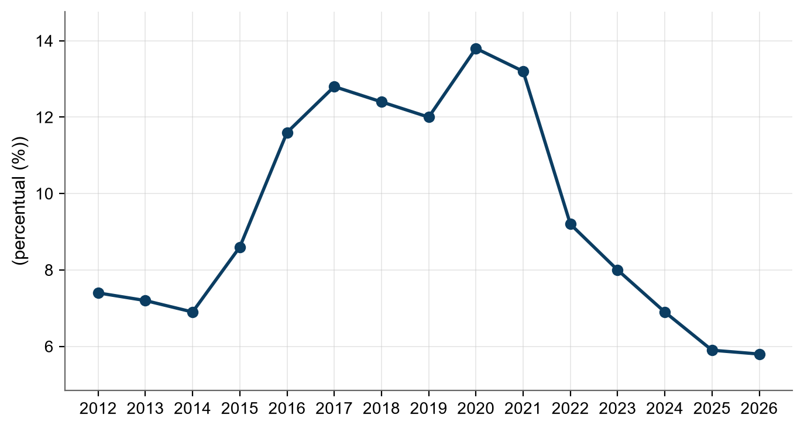<figcaption><strong>Figura 1 – Taxa de Desocupação Anual (2012-2026).</strong> <em>Fonte: [(IBGE, 2026a)](https://www.ibge.gov.br/estatisticas/sociais/trabalho/17270-pnad-continua.html).</em> Série histórica de médias anuais da PNAD Contínua.</figcaption></figure>

O volume de pessoas ocupadas demonstra crescimento sustentado, saindo de 89,2 milhões em 2012 para 102,5 milhões em 2026 [(IBGE, 2026a)](https://www.ibge.gov.br/estatisticas/sociais/trabalho/17270-pnad-continua.html). No entanto, observa-se que a força de trabalho apresenta menor dinamismo, com a taxa de participação em 62,1% no trimestre encerrado em abril de 2026, valor inferior aos 63,2% registrados na média pré-pandemia [(IPEA, 2026)](https://www.ipea.gov.br/cartadeconjuntura/index.php/category/mercado-de-trabalho/).

<figure class="figura">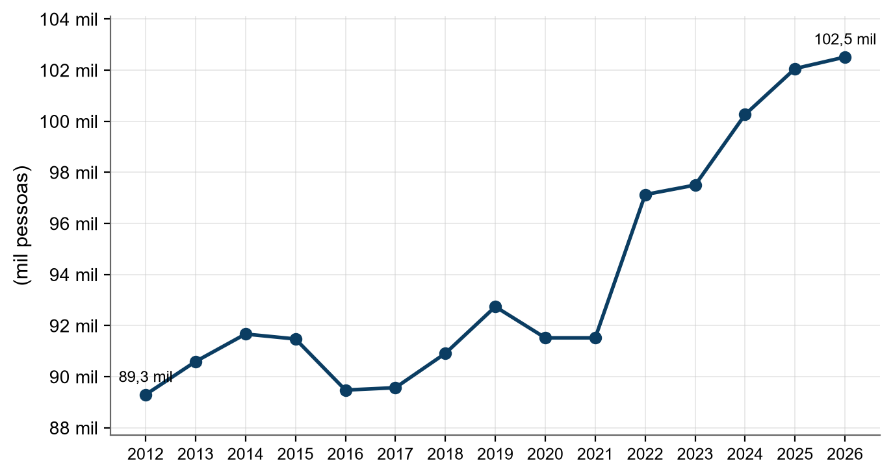<figcaption><strong>Figura 2 – População Ocupada Anual (2012-2026).</strong> <em>Fonte: [(IBGE, 2026a)](https://www.ibge.gov.br/estatisticas/sociais/trabalho/17270-pnad-continua.html).</em> Série histórica de médias anuais da PNAD Contínua.</figcaption></figure>

A taxa de desocupação, por si só, mede apenas quem está sem trabalho e procurando vaga. Para enxergar o conjunto, é preciso situar toda a população de 14 anos ou mais em três estados: ocupada, subocupada ou não ocupada. Em 2026, 56,2% da população estava ocupada com jornada suficiente, 2,4% era subocupada, 3,5% estava desocupada e 37,9% estava fora da força de trabalho [(IBGE, 2026a)](https://www.ibge.gov.br/estatisticas/sociais/trabalho/17270-pnad-continua.html).

<figure class="figura">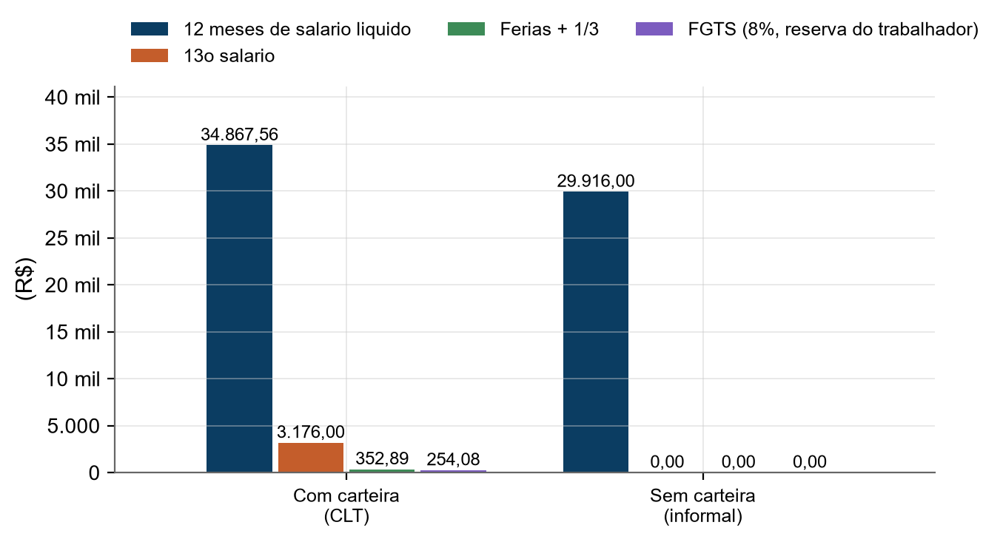<figcaption><strong>Figura 3 – Composição da População de 14 Anos ou Mais por Situação de Ocupação (2026).</strong> <em>Fonte: [(IBGE, 2026a)](https://www.ibge.gov.br/estatisticas/sociais/trabalho/17270-pnad-continua.html).</em> Média anual da PNAD Contínua: 58,6% da população está ocupada (dos quais 2,4 pontos percentuais são subocupados) e 41,4% não está ocupado, concentrado fora da força de trabalho.</figcaption></figure>

Ocupado é quem trabalhou pelo menos uma hora na semana de referência, por conta própria ou para outrem, com ou sem remuneração. Juntos, ocupados e desocupados formam a força de trabalho, que em 2026 correspondia a 62,1% da população de 14 anos ou mais [(IBGE, 2026a)](https://www.ibge.gov.br/estatisticas/sociais/trabalho/17270-pnad-continua.html). Desocupado é quem não tinha trabalho, estava disponível e procurava emprego — são exatamente os 3,5% do gráfico. Já fora da força de trabalho estão os 37,9% que não trabalham e também não procuram.

Os 41,4% da população que não estão ocupados se dividem em duas situações. Os 3,5% desocupados querem trabalhar e buscam vaga ativamente, por isso integram a força de trabalho. Os 37,9% fora da força não procuram trabalho: estudantes em tempo integral, pessoas dedicadas aos afazeres domésticos e ao cuidado da família, aposentados e pensionistas com renda própria, e quem desistiu de procurar por acreditar que não há vaga [(IBGE, 2026a)](https://www.ibge.gov.br/estatisticas/sociais/trabalho/17270-pnad-continua.html).

Subocupado é quem trabalhou na semana de referência, mas com menos horas do que desejava e estava disponível para trabalhar, a chamada insuficiência de horas. Esses trabalhadores têm emprego, porém jornada abaixo do pretendido, e por isso se distinguem dos desocupados: somam 2,4% da população, o equivalente a 4,2% dos ocupados [(IBGE, 2026a)](https://www.ibge.gov.br/estatisticas/sociais/trabalho/17270-pnad-continua.html). A subutilização da força de trabalho reúne essas três frentes: desocupados, subocupados e potencialmente desocupados, que reduziram a busca por vaga — estes últimos estão dentro dos 37,9% fora da força e somam 2,9% da população [(IBGE, 2026a)](https://www.ibge.gov.br/estatisticas/sociais/trabalho/17270-pnad-continua.html).

<figure class="figura">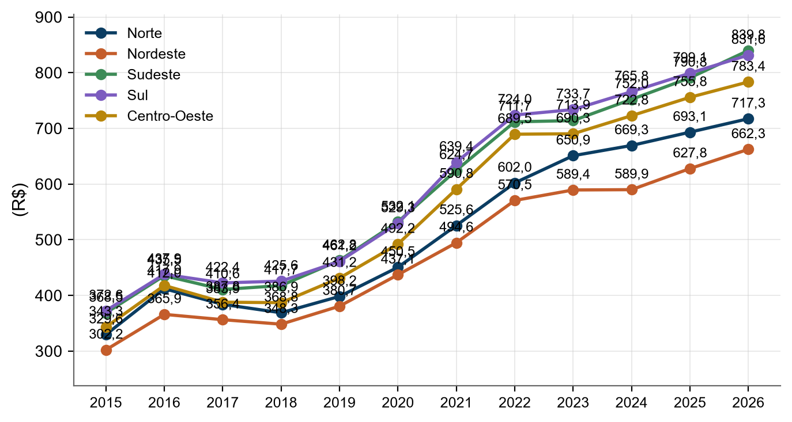<figcaption><strong>Figura 4 – Taxas de Desocupação, Subocupação e Subutilização da Força de Trabalho (2012-2026).</strong> <em>Fonte: [(IBGE, 2026a)](https://www.ibge.gov.br/estatisticas/sociais/trabalho/17270-pnad-continua.html).</em> A subutilização (desocupados + potencialmente desocupados + subocupados) segue bem acima da taxa de desocupação isolada, revelando o desemprego oculto dentro da ocupação.</figcaption></figure>

Em perspectiva histórica, a subutilização caiu de 18,2% em 2012 para 13,5% em 2026, acompanhando a queda da desocupação, de 7,4% para 5,6%, e da subocupação, de 6,7% para 4,2% [(IBGE, 2026a)](https://www.ibge.gov.br/estatisticas/sociais/trabalho/17270-pnad-continua.html). Ainda assim, em 2026 a taxa de subutilização (13,5%) permanece mais que o dobro da desocupação isolada (5,6%), o que mostra que olhar apenas para o desemprego subestima a pressão real sobre o mercado de trabalho.

**Composição demográfica.** Em 2026, as mulheres formavam 51,8% da população de 14 anos ou mais, mas respondiam por 43,9% da força de trabalho, enquanto os homens somavam 48,2% da população e 56,1% da força [(IPEA, 2026)](https://www.ipea.gov.br/cartadeconjuntura/index.php/category/mercado-de-trabalho/). A população em idade de trabalhar é, portanto, majoritariamente feminina, e a força de trabalho, majoritariamente masculina.

<figure class="figura">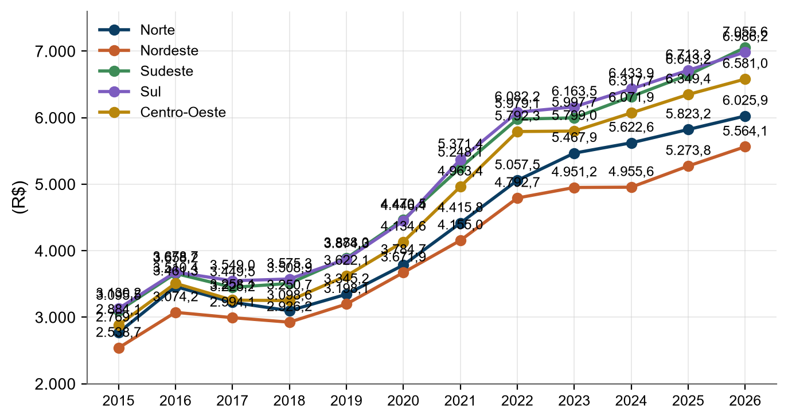<figcaption><strong>Figura 5 – Composição da População de 14 Anos ou Mais e da Força de Trabalho por Sexo (2026).</strong> <em>Fonte: [(IPEA, 2026)](https://www.ipea.gov.br/cartadeconjuntura/index.php/category/mercado-de-trabalho/).</em> As mulheres são maioria na população de 14 anos ou mais, mas minoria na força de trabalho, reflexo da menor participação feminina.</figcaption></figure>

**Subutilização por sexo.** A assimetria aparece com clareza na subutilização da força de trabalho: em 2026, a taxa foi de 16,6% entre as mulheres e de 11,2% entre os homens, e a desvantagem feminina se repetiu em todos os anos da série desde 2012 [(IPEA, 2026)](https://www.ipea.gov.br/cartadeconjuntura/index.php/category/mercado-de-trabalho/). Mesmo ocupando menor parcela da força de trabalho, as mulheres concentram maior proporção de pessoas ociosas, entre desocupadas, subocupadas e potencialmente desocupadas.

<figure class="figura">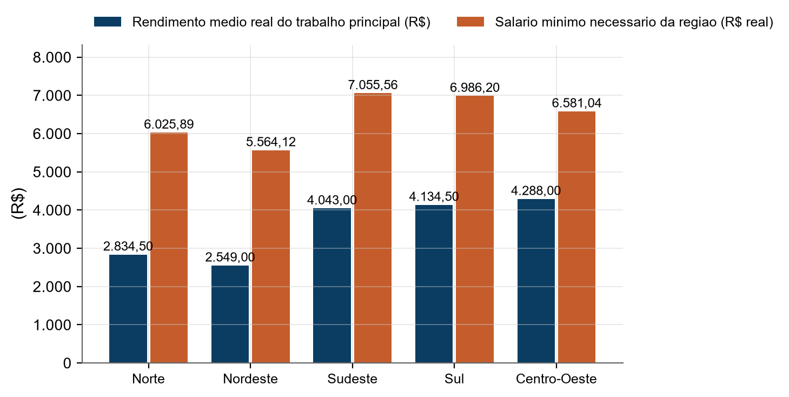<figcaption><strong>Figura 6 – Taxa de Subutilização da Força de Trabalho por Sexo (2012-2026).</strong> <em>Fonte: [(IPEA, 2026)](https://www.ipea.gov.br/cartadeconjuntura/index.php/category/mercado-de-trabalho/).</em> A taxa de subutilização das mulheres supera a dos homens em todos os anos da série histórica.</figcaption></figure>

**Rendimento por sexo.** No rendimento médio real do trabalho principal, a diferença de nível persiste: em 2026, os homens recebiam em média R$ 3.999,50 e as mulheres R$ 3.191,50, cerca de 20% menos [(IPEA, 2026)](https://www.ipea.gov.br/cartadeconjuntura/index.php/category/mercado-de-trabalho/). Entre 2012 e 2026, o rendimento real cresceu para os dois sexos, mas a diferença em reais mudou pouco, de R$ 833 para R$ 808 [(IPEA, 2026)](https://www.ipea.gov.br/cartadeconjuntura/index.php/category/mercado-de-trabalho/).

<figure class="figura">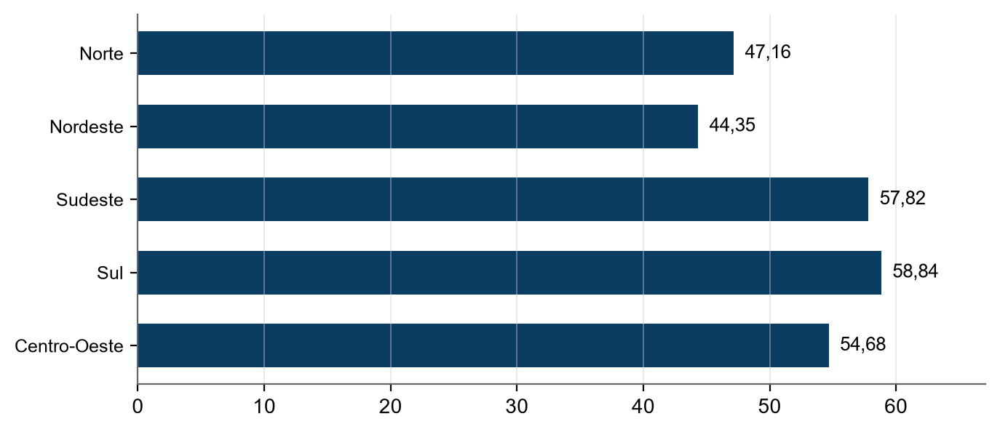<figcaption><strong>Figura 7 – Rendimento Médio Real Mensal do Trabalho Principal por Sexo (2012-2026).</strong> <em>Fonte: [(IPEA, 2026)](https://www.ipea.gov.br/cartadeconjuntura/index.php/category/mercado-de-trabalho/).</em> O rendimento médio real das mulheres permanece abaixo do dos homens em toda a série, com ausência de dados em 2021.</figcaption></figure>

**Saúde percebida.** A Pesquisa Nacional de Saúde (PNS), do IBGE, mostra que a autoavaliação de saúde acompanha a posição no mercado de trabalho: em 2019, 73,8% dos ocupados de 18 anos ou mais avaliavam a própria saúde como boa ou muito boa, contra 70,3% dos desocupados e 51,3% dos que estavam fora da força [(IBGE, 2019)](https://www.ibge.gov.br/estatisticas/sociais/saude/9160-pesquisa-nacional-de-saude.html). A diferença entre ocupados e pessoas fora da força passou de 20,4 pontos percentuais em 2013 para 22,5 em 2019 [(IBGE, 2019)](https://www.ibge.gov.br/estatisticas/sociais/saude/9160-pesquisa-nacional-de-saude.html).

<figure class="figura">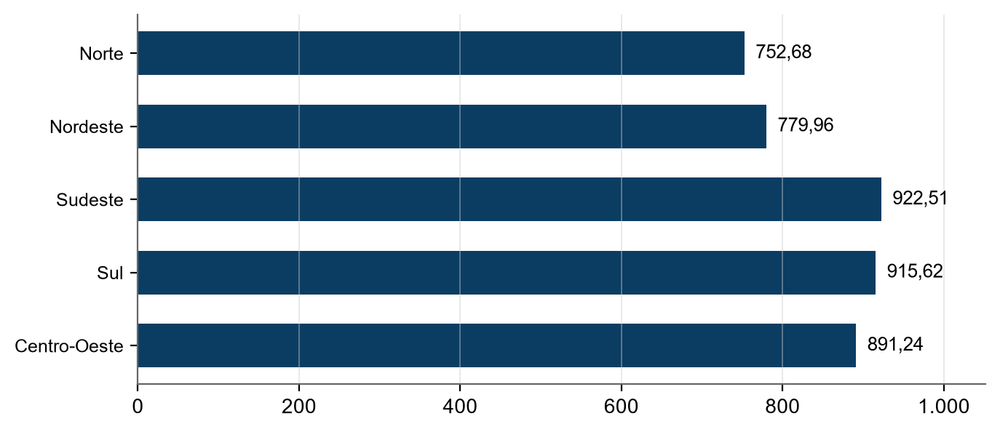<figcaption><strong>Figura 8 – Autoavaliação de Saúde Boa ou Muito Boa por Situação Ocupacional (2013 e 2019).</strong> <em>Fonte: [(IBGE, 2019)](https://www.ibge.gov.br/estatisticas/sociais/saude/9160-pesquisa-nacional-de-saude.html). PNS.</em> Quem estava fora da força de trabalho avaliava a própria saúde como boa ou muito boa 22,5 pontos percentuais menos do que os ocupados em 2019.</figcaption></figure>

**Renda e saúde.** A renda domiciliar per capita separa ainda mais a autoavaliação de saúde: em 2019, 55,5% dos adultos na menor faixa de renda, de até 1/4 do salário mínimo, avaliavam bem a própria saúde, contra 86,4% na maior, acima de 5 salários mínimos [(IBGE, 2019)](https://www.ibge.gov.br/estatisticas/sociais/saude/9160-pesquisa-nacional-de-saude.html). O gradiente já aparecia em 2013, de 56,6% a 84,3%, e se manteve entre as duas edições [(IBGE, 2019)](https://www.ibge.gov.br/estatisticas/sociais/saude/9160-pesquisa-nacional-de-saude.html).

<figure class="figura">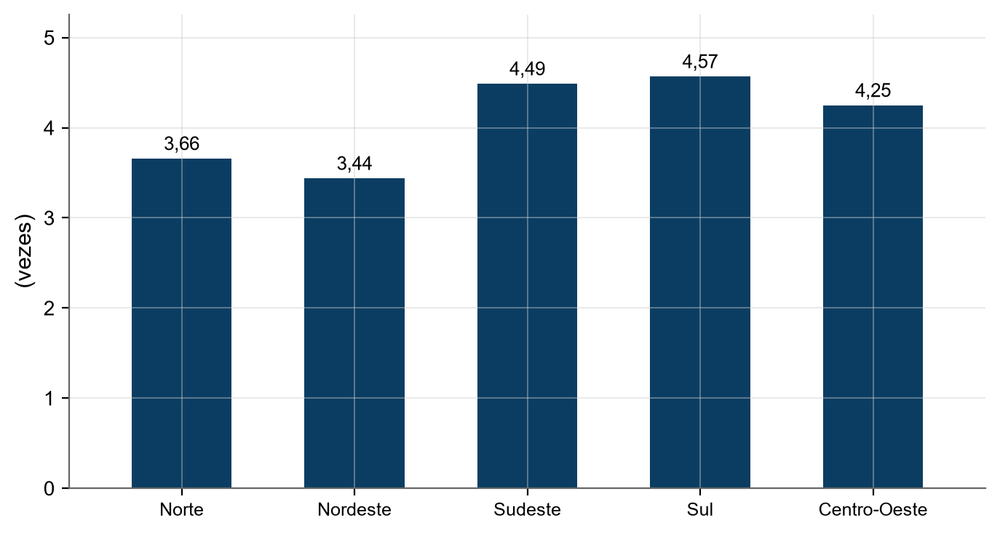<figcaption><strong>Figura 9 – Autoavaliação de Saúde Boa ou Muito Boa por Faixa de Renda Domiciliar per capita (2013 e 2019).</strong> <em>Fonte: [(IBGE, 2019)](https://www.ibge.gov.br/estatisticas/sociais/saude/9160-pesquisa-nacional-de-saude.html). PNS.</em> A avaliação positiva da saúde sobe de 55,5% na menor renda para 86,4% na maior em 2019.</figcaption></figure>

**Cor ou raça e saúde.** A desigualdade racial também aparece na percepção da saúde: em 2019, 71,0% das pessoas brancas avaliavam a própria saúde como boa ou muito boa, contra 62,9% das pretas e 62,1% das pardas [(IBGE, 2019)](https://www.ibge.gov.br/estatisticas/sociais/saude/9160-pesquisa-nacional-de-saude.html). O mesmo padrão valia em 2013, com 70,3% entre as brancas, 61,9% entre as pretas e 62,4% entre as pardas [(IBGE, 2019)](https://www.ibge.gov.br/estatisticas/sociais/saude/9160-pesquisa-nacional-de-saude.html).

<figure class="figura">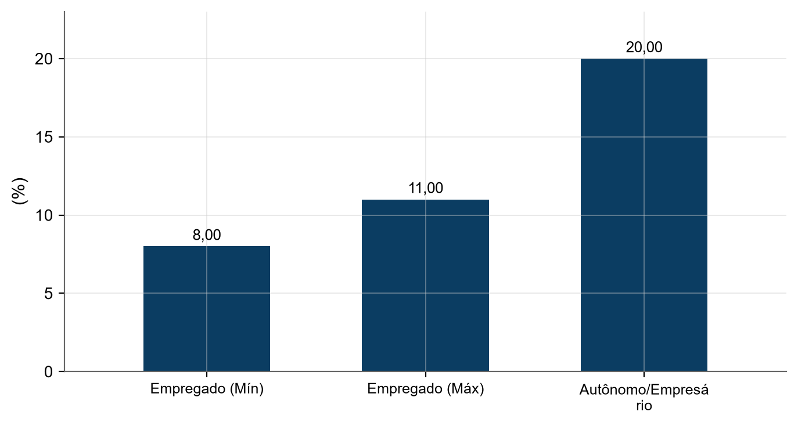<figcaption><strong>Figura 10 – Autoavaliação de Saúde Boa ou Muito Boa por Cor ou Raça (2013 e 2019).</strong> <em>Fonte: [(IBGE, 2019)](https://www.ibge.gov.br/estatisticas/sociais/saude/9160-pesquisa-nacional-de-saude.html). PNS.</em> Em 2019, 71,0% das pessoas brancas avaliaram a saúde como boa ou muito boa, contra 62,9% das pretas e 62,1% das pardas.</figcaption></figure>

Quanto aos rendimentos, o rendimento médio mensal real do trabalho principal atingiu R$ 3.777,50 em 2026 [(IBGE, 2026a)](https://www.ibge.gov.br/estatisticas/sociais/trabalho/17270-pnad-continua.html). Este valor representa a renovação do pico da série histórica iniciada em 2012, que partiu de R$ 3.191,3 [(IBGE, 2026a)](https://www.ibge.gov.br/estatisticas/sociais/trabalho/17270-pnad-continua.html).

<figure class="figura">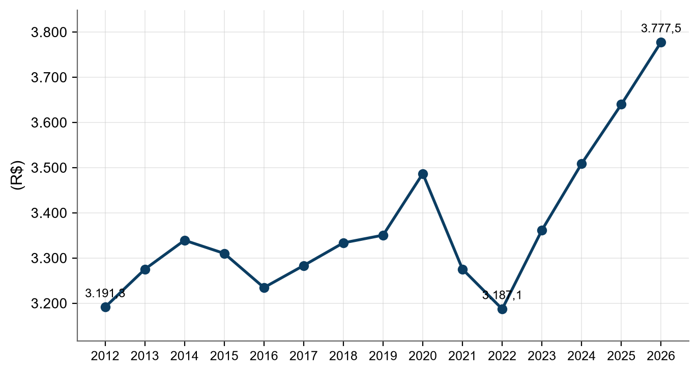<figcaption><strong>Figura 11 – Rendimento Médio Mensal Real (2012-2026).</strong> <em>Fonte: [(IBGE, 2026a)](https://www.ibge.gov.br/estatisticas/sociais/trabalho/17270-pnad-continua.html).</em> Série histórica de médias anuais da PNAD Contínua.</figcaption></figure>

A composição do mercado divide-se entre vínculos formais e informais. O setor formal tem demonstrado maior vigor, com taxa média de expansão de 3,6% nos últimos doze meses até abril, superando a expansão de 1,5% do setor informal [(IPEA, 2026)](https://www.ipea.gov.br/cartadeconjuntura/index.php/category/mercado-de-trabalho/). O crescimento da ocupação formal foi de 3,7% em doze meses, enquanto a informal cresceu 1,3% [(IPEA, 2026)](https://www.ipea.gov.br/cartadeconjuntura/index.php/category/mercado-de-trabalho/).

<strong>Tabela 1 – Comparativo de Crescimento por Vínculo.</strong> <em>Fonte: [(IPEA, 2026)](https://www.ipea.gov.br/cartadeconjuntura/index.php/category/mercado-de-trabalho/).</em>

| Tipo de Vínculo | Taxa de Expansão (12 meses) | Desempenho Relativo |
| :--- | :--- | :--- |
| Emprego Formal | 3,6% [(IPEA, 2026)](https://www.ipea.gov.br/cartadeconjuntura/index.php/category/mercado-de-trabalho/) | Superior [(IPEA, 2026)](https://www.ipea.gov.br/cartadeconjuntura/index.php/category/mercado-de-trabalho/) |
| Setor Informal | 1,5% [(IPEA, 2026)](https://www.ipea.gov.br/cartadeconjuntura/index.php/category/mercado-de-trabalho/) | Inferior [(IPEA, 2026)](https://www.ipea.gov.br/cartadeconjuntura/index.php/category/mercado-de-trabalho/) |

No detalhamento dos rendimentos por vínculo, trabalhadores por conta própria e empregados sem carteira apresentaram os maiores crescimentos interanuais de renda, com altas de 9,1% e 7%, respectivamente [(IPEA, 2026)](https://www.ipea.gov.br/cartadeconjuntura/index.php/category/mercado-de-trabalho/).

**Em termos simples:** O mercado de trabalho em 2026 está com o desemprego em níveis muito baixos, bem menores do que no auge da pandemia em 2020 [(IBGE, 2026a)](https://www.ibge.gov.br/estatisticas/sociais/trabalho/17270-pnad-continua.html). Mais pessoas estão trabalhando e os salários médios atingiram o valor mais alto desde 2012 [(IBGE, 2026a)](https://www.ibge.gov.br/estatisticas/sociais/trabalho/17270-pnad-continua.html). O emprego com carteira assinada está crescendo mais rápido do que os bicos e trabalhos informais [(IPEA, 2026)](https://www.ipea.gov.br/cartadeconjuntura/index.php/category/mercado-de-trabalho/). O retrato, porém, não é uniforme: as mulheres são maioria na população, mas minoria na força de trabalho e recebem menos, e a saúde autoavaliada é pior nas menores rendas e entre pretos e pardos [(IPEA, 2026)](https://www.ipea.gov.br/cartadeconjuntura/index.php/category/mercado-de-trabalho/); [(IBGE, 2019)](https://www.ibge.gov.br/estatisticas/sociais/saude/9160-pesquisa-nacional-de-saude.html).

Fontes consultadas:
* [(IBGE, 2019)](https://www.ibge.gov.br/estatisticas/sociais/saude/9160-pesquisa-nacional-de-saude.html)
* [(IBGE, 2026a)](https://www.ibge.gov.br/estatisticas/sociais/trabalho/17270-pnad-continua.html)
* [(IPEA, 2026)](https://www.ipea.gov.br/cartadeconjuntura/index.php/category/mercado-de-trabalho/)

## 2. Princípios constitucionais do trabalho

O trabalho é classificado como um direito social fundamental no ordenamento jurídico brasileiro [(BRASIL, 1988, art. 6º)](https://www.planalto.gov.br/ccivil_03/constituicao/constituicao.htm). A dignidade da pessoa humana e os valores sociais do trabalho, aliados à livre iniciativa, constituem fundamentos da República Federativa do Brasil [(BRASIL, 1988, art. 1º)](https://www.planalto.gov.br/ccivil_03/constituicao/constituicao.htm).

A proteção ao trabalho humano manifesta-se na proibição de trabalho noturno, perigoso ou insalubre a menores de dezoito anos, e de qualquer trabalho a menores de dezesseis anos, exceto na condição de aprendiz a partir dos quatorze anos [(BRASIL, 1988, art. 7º, XXXIII)](https://www.planalto.gov.br/ccivil_03/constituicao/constituicao.htm).

O Princípio da Proteção é central na relação entre empregador e empregado, visando mitigar a fragilidade das relações trabalhistas, especialmente diante de fenômenos como a "pejotização" [(BRASIL, 1988)](https://www.planalto.gov.br/ccivil_03/constituicao/constituicao.htm)

A liberdade sindical e o direito de greve são garantias asseguradas ao trabalhador [(BRASIL, 1943, art. 7º, XXVI e XXVII)](https://www.planalto.gov.br/ccivil_03/decreto-lei/del5452.htm). A liberdade de associação profissional ou sindical inclui o direito de não sofrer descontos salariais estabelecidos em convenção ou acordo coletivo sem prévia e expressa anuência [(BRASIL, 1943, art. 7º, XXVI)](https://www.planalto.gov.br/ccivil_03/decreto-lei/del5452.htm). Compete aos trabalhadores decidir sobre a oportunidade e os interesses da deflagração de greve [(BRASIL, 1943, art. 7º, XXVII)](https://www.planalto.gov.br/ccivil_03/decreto-lei/del5452.htm).

No âmbito da propriedade, a Constituição estabelece que a propriedade deve atender a sua função social [(BRASIL, 1988, art. 5º, XXIII)](https://www.planalto.gov.br/ccivil_03/constituicao/constituicao.htm).

<strong>Tabela 2 – Direitos Sociais e Garantias do Trabalhador.</strong> <em>Fonte: [(BRASIL, 1988)](https://www.planalto.gov.br/ccivil_03/constituicao/constituicao.htm).</em>

| Direito/Garantia | Descrição Legal | Base Legal [(BRASIL, 1988)](https://www.planalto.gov.br/ccivil_03/constituicao/constituicao.htm) |
| :--- | :--- | :--- |
| Jornada de Trabalho | Normal não superior a 8h diárias e 44h semanais | [(BRASIL, 1988, art. 7º, XIII)](https://www.planalto.gov.br/ccivil_03/constituicao/constituicao.htm) |
| Salário Mínimo | Garantia de salário nunca inferior ao mínimo para remuneração variável | [(BRASIL, 1988, art. 7º, VII)](https://www.planalto.gov.br/ccivil_03/constituicao/constituicao.htm) |
| Irredutibilidade | Salário irredutível, salvo disposição em convenção ou acordo coletivo | [(BRASIL, 1988, art. 7º, VI)](https://www.planalto.gov.br/ccivil_03/constituicao/constituicao.htm) |
| Trabalho Noturno | Remuneração superior à do trabalho diurno | [(BRASIL, 1988, art. 7º, IX)](https://www.planalto.gov.br/ccivil_03/constituicao/constituicao.htm) |
| Décimo Terceiro | Base na remuneração integral ou valor da aposentadoria | [(BRASIL, 1988, art. 7º, VIII)](https://www.planalto.gov.br/ccivil_03/constituicao/constituicao.htm) |

A igualdade de direitos é estendida ao trabalhador avulso, equiparando-o ao trabalhador com vínculo empregatício permanente [(BRASIL, 1943, art. 7º, XXV)](https://www.planalto.gov.br/ccivil_03/decreto-lei/del5452.htm). Aos trabalhadores domésticos, são assegurados diversos direitos previstos no art. 7º, incluindo a integração à previdência social [(BRASIL, 1988, art. 7º, parágrafo único)](https://www.planalto.gov.br/ccivil_03/constituicao/constituicao.htm).

**Em termos simples:** A lei brasileira trata o trabalho como um direito básico e protege o empregado, que é a parte mais fraca da relação, garantindo limites de horas, salário mínimo e a liberdade de se organizar em sindicatos ou fazer greve [(BRASIL, 1988)](https://www.planalto.gov.br/ccivil_03/constituicao/constituicao.htm).

<figure class="figura">

<h4>Garantias Econômicas</h4><ul><li>Salário mínimo e pagamento pontual [(BRASIL, 1988, art. 7º, VII)](https://www.planalto.gov.br/ccivil_03/constituicao/constituicao.htm)</li><li>Décimo terceiro salário [(BRASIL, 1988, art. 7º, VIII)](https://www.planalto.gov.br/ccivil_03/constituicao/constituicao.htm)</li><li>Férias anuais remuneradas com 1/3 [(BRASIL, 1988, art. 7º, XVII)](https://www.planalto.gov.br/ccivil_03/constituicao/constituicao.htm)</li></ul>

<h4>Jornada e Proteção</h4><ul><li>Jornada de até 8h diárias e 44h semanais [(BRASIL, 1988, art. 7º, XIII)](https://www.planalto.gov.br/ccivil_03/constituicao/constituicao.htm)</li><li>Proteção contra despedida arbitrária [(BRASIL, 1988, art. 7º, I)](https://www.planalto.gov.br/ccivil_03/constituicao/constituicao.htm)</li><li>Liberdade sindical e direito de greve [(BRASIL, 1988, art. 8º e 9º)](https://www.planalto.gov.br/ccivil_03/constituicao/constituicao.htm)</li></ul>

<figcaption><strong>Figura 12 – Principais Direitos Sociais do Trabalhador (CF, art. 7º).</strong> <em>Fonte: [(BRASIL, 1988)](https://www.planalto.gov.br/ccivil_03/constituicao/constituicao.htm).</em> Seleção dos direitos mais relevantes previstos no art. 7º da Constituição Federal.</figcaption></figure>

Em termos reais, o piso constitucional acompanhou de perto a renda média no período: entre 2012 e 2026, o salário mínimo real cresceu cerca de 21%, contra aproximadamente 18% do rendimento médio do trabalho principal, o que reduziu de forma moderada a distância entre o piso garantido em lei e a renda média [(IBGE, 2026a); (IPEA, 2026)](https://www.ibge.gov.br/estatisticas/sociais/trabalho/17270-pnad-continua.html).

<figure class="figura">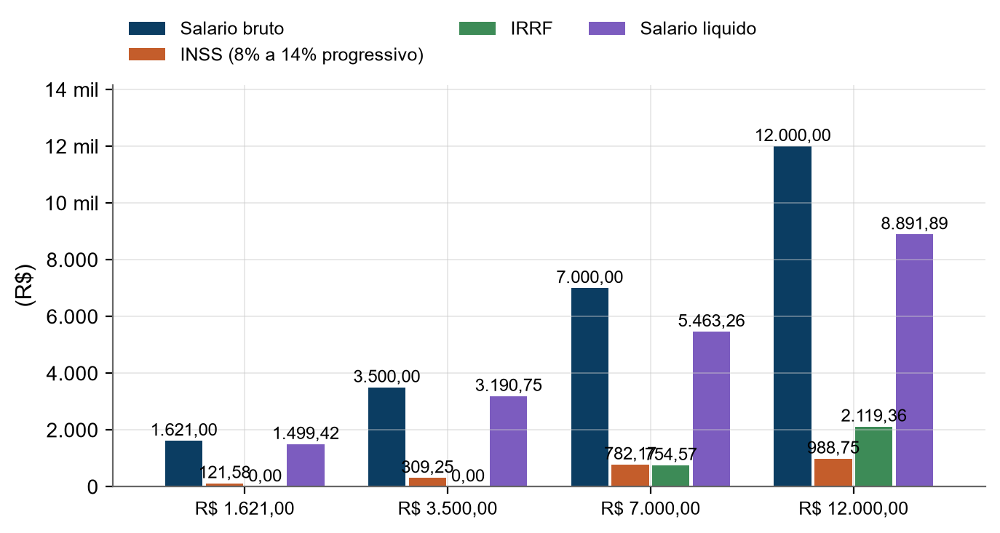<figcaption><strong>Figura 13 – Rendimento Médio x Salário Mínimo Real (índice 2012 = 100).</strong> <em>Fonte: [(IBGE, 2026a)](https://www.ibge.gov.br/estatisticas/sociais/trabalho/17270-pnad-continua.html); [(IPEA, 2026)](https://www.ipea.gov.br/cartadeconjuntura/index.php/category/mercado-de-trabalho/).</em> Índices com base 2012 = 100; rendimento médio real (IBGE) e salário mínimo real (Ipeadata).</figcaption></figure>

Fontes consultadas:
* [(BRASIL, 1988)](https://www.planalto.gov.br/ccivil_03/constituicao/constituicao.htm)
* [(BRASIL, 1943)](https://www.planalto.gov.br/ccivil_03/decreto-lei/del5452.htm)

## 3. CLT: estrutura, história e direitos essenciais

A Consolidação das Leis do Trabalho (CLT) foi aprovada pelo Decreto-Lei nº 5.452, de 1º de maio de 1943 [(BRASIL, 1943)](https://www.planalto.gov.br/ccivil_03/decreto-lei/del5452.htm). Esta norma estatui as regras que regulam as relações individuais e coletivas de trabalho [(BRASIL, 1943, art. 1º)](https://www.planalto.gov.br/ccivil_03/decreto-lei/del5452.htm). A estrutura define o empregador como a empresa que assume os riscos da atividade econômica, admite, assalaria e dirige a prestação pessoal de serviço [(BRASIL, 1943, art. 2º)](https://www.planalto.gov.br/ccivil_03/decreto-lei/del5452.htm).

### 3.1 Direitos Essenciais e Garantias

O ordenamento jurídico brasileiro assegura um conjunto de direitos fundamentais ao trabalhador, reforçados pela Constituição Federal e pela CLT: [(BRASIL, 1943)](https://www.planalto.gov.br/ccivil_03/decreto-lei/del5452.htm)

*   **Remuneração e Benefícios:** Garantia de salário mínimo, 13º salário e remuneração do trabalho noturno superior à do diurno [(BRASIL, LEI 13.467/2017)](https://www.planalto.gov.br/ccivil_03/_ato2015-2018/2017/lei/l13467.htm).
*   **Descanso e Férias:** Repouso semanal remunerado, preferencialmente aos domingos, e gozo de férias anuais remuneradas com acréscimo de, no mínimo, um terço do salário normal [(BRASIL, 1988)](https://www.planalto.gov.br/ccivil_03/constituicao/constituicao.htm).
*   **Proteções Específicas:** Licença-maternidade de 120 dias, licença-paternidade nos termos da lei e proteção ao mercado de trabalho da mulher [(BRASIL, 1988)](https://www.planalto.gov.br/ccivil_03/constituicao/constituicao.htm).
*   **Segurança e Saúde:** Adicional de remuneração para atividades penosas, insalubres ou perigosas, além de normas de higiene e segurança [(BRASIL, LEI 13.467/2017)](https://www.planalto.gov.br/ccivil_03/_ato2015-2018/2017/lei/l13467.htm).
*   **Rescisão:** Aviso prévio proporcional ao tempo de serviço, com mínimo de 30 dias [(BRASIL, 1988)](https://www.planalto.gov.br/ccivil_03/constituicao/constituicao.htm).

### 3.2 Jornada de Trabalho e Regras Excepcionais

A duração normal do trabalho é de até oito horas diárias e quarenta e quatro semanais [(BRASIL, 1988)](https://www.planalto.gov.br/ccivil_03/constituicao/constituicao.htm). A lei permite a compensação de horários e a redução da jornada mediante acordo ou convenção coletiva [(BRASIL, 1988)](https://www.planalto.gov.br/ccivil_03/constituicao/constituicao.htm).

Para casos excepcionais, o trabalhador pode ultrapassar a jornada normal:
1.  **Horas Extras:** A remuneração do serviço extraordinário deve ser, no mínimo, 50% superior à do normal [(BRASIL, 1988)](https://www.planalto.gov.br/ccivil_03/constituicao/constituicao.htm).
2.  **Limites e Compensação:** A prestação de horas extras habituais não descaracteriza o banco de horas ou o acordo de compensação de jornada [(BRASIL, 1943, art. 59-B)](https://www.planalto.gov.br/ccivil_03/decreto-lei/del5452.htm).
3.  **Jornada 12x36:** É facultado estabelecer horário de 12 horas de trabalho seguidas por 36 horas de descanso ininterruptas, via convenção ou acordo coletivo [(BRASIL, 1943, art. 59-A)](https://www.planalto.gov.br/ccivil_03/decreto-lei/del5452.htm).

<strong>Tabela 3 – Comparativo de Jornadas e Adicionais.</strong> <em>Fonte: [(BRASIL, 1988)](https://www.planalto.gov.br/ccivil_03/constituicao/constituicao.htm).</em>

| Tipo de Jornada/Hora | Limite/Regra | Adicional Mínimo | Fonte |
| :--- | :--- | :--- | :--- |
| Normal Diária | 8 horas [(BRASIL, 1988)](https://www.planalto.gov.br/ccivil_03/constituicao/constituicao.htm) | N/A [(BRASIL, 1988)](https://www.planalto.gov.br/ccivil_03/constituicao/constituicao.htm) | [(BRASIL, 1988)](https://www.planalto.gov.br/ccivil_03/constituicao/constituicao.htm) |
| Normal Semanal | 44 horas [(BRASIL, 1988)](https://www.planalto.gov.br/ccivil_03/constituicao/constituicao.htm) | N/A [(BRASIL, 1988)](https://www.planalto.gov.br/ccivil_03/constituicao/constituicao.htm) | [(BRASIL, 1988)](https://www.planalto.gov.br/ccivil_03/constituicao/constituicao.htm) |
| Extraordinária | Conforme acordo [(BRASIL, 1988)](https://www.planalto.gov.br/ccivil_03/constituicao/constituicao.htm) | 50% [(BRASIL, 1988)](https://www.planalto.gov.br/ccivil_03/constituicao/constituicao.htm) | [(BRASIL, 1988)](https://www.planalto.gov.br/ccivil_03/constituicao/constituicao.htm) |

<figure class="figura">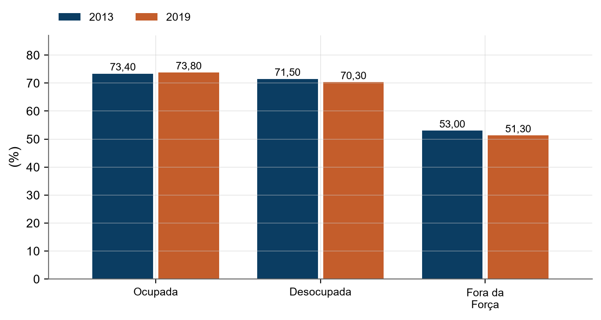<figcaption><strong>Figura 14 – Adicional de Remuneração do Serviço Extraordinário.</strong> <em>Fonte: [(BRASIL, 1988)](https://www.planalto.gov.br/ccivil_03/constituicao/constituicao.htm).</em> Valor base da hora normal considerado como 100%</figcaption></figure>

### 3.3 Reforma Trabalhista de 2017 e Mudanças Recentes

A Lei 13.467/2017 introduziu alterações significativas na CLT, priorizando a negociação sobre a lei em diversos pontos [(BRASIL, LEI 13.467/2017)](https://www.planalto.gov.br/ccivil_03/_ato2015-2018/2017/lei/l13467.htm). Entre as principais mudanças estão:

*   **Trabalho Intermitente:** Modalidade onde a prestação de serviços não é contínua, com verbas rescisórias calculadas pela média dos valores recebidos [(BRASIL, 1943, art. 452-F)](https://www.planalto.gov.br/ccivil_03/decreto-lei/del5452.htm).
*   **Compensação de Jornada:** O não atendimento de exigências legais para compensação não implica repetição de pagamento de horas excedentes se não ultrapassada a jornada semanal, sendo devido apenas o adicional [(BRASIL, 1943, art. 59-B)](https://www.planalto.gov.br/ccivil_03/decreto-lei/del5452.htm).
*   **Banco de Horas:** Reforço à validade de acordos de compensação mesmo com a prestação de horas extras habituais [(BRASIL, 1943, art. 59-B)](https://www.planalto.gov.br/ccivil_03/decreto-lei/del5452.htm).

<figure class="figura">

<h4>Regra Geral</h4><ul><li>Jornada 8h/dia [(BRASIL, 1988)](https://www.planalto.gov.br/ccivil_03/constituicao/constituicao.htm)</li><li>Adicional 50% [(BRASIL, 1988)](https://www.planalto.gov.br/ccivil_03/constituicao/constituicao.htm)</li></ul>

<h4>Pós-Reforma 2017</h4><ul><li>Banco de Horas mantido com extras habituais [(BRASIL, 1943)](https://www.planalto.gov.br/ccivil_03/decreto-lei/del5452.htm)</li><li>Validade de acordo tácito para adicional [(BRASIL, 1943)](https://www.planalto.gov.br/ccivil_03/decreto-lei/del5452.htm)</li></ul>

<figcaption><strong>Figura 15 – Impacto da Reforma Trabalhista na Compensação de Jornada.</strong> <em>Fonte: [(BRASIL, LEI 13.467/2017)](https://www.planalto.gov.br/ccivil_03/_ato2015-2018/2017/lei/l13467.htm).</em> Comparativo entre a base constitucional e as flexibilizações da Lei 13.467/2017</figcaption></figure>

**Em termos simples:** A CLT é o livro de regras do trabalho no Brasil. Ela garante que ninguém trabalhe mais de 8 horas por dia (ou 44 por semana) sem receber um extra de pelo menos 50% por hora a mais [(BRASIL, 1988)](https://www.planalto.gov.br/ccivil_03/constituicao/constituicao.htm). A Reforma de 2017 trouxe novas formas de contrato, como o intermitente, e facilitou acordos entre patrão e empregado para compensar horas [(BRASIL, LEI 13.467/2017)](https://www.planalto.gov.br/ccivil_03/_ato2015-2018/2017/lei/l13467.htm).

Fontes consultadas:
* [(BRASIL, 1988)](https://www.planalto.gov.br/ccivil_03/constituicao/constituicao.htm)
* [(BRASIL, 1943)](https://www.planalto.gov.br/ccivil_03/decreto-lei/del5452.htm)
* [(BRASIL, LEI 13.467/2017)](https://www.planalto.gov.br/ccivil_03/_ato2015-2018/2017/lei/l13467.htm)

## 4. Vínculo de emprego: os 4 requisitos e a subordinação algorítmica

A caracterização do vínculo empregatício no Brasil exige a presença cumulativa de requisitos específicos para que o trabalhador seja considerado empregado [(BRASIL, 1943, art. 3º)](https://www.planalto.gov.br/ccivil_03/decreto-lei/del5452.htm). A ausência de qualquer um desses elementos descaracteriza a relação de emprego, podendo configurar trabalho autônomo ou outras modalidades contratuais [(BRASIL, LEI 13.467/2017, art. 442-B)](https://www.planalto.gov.br/ccivil_03/_ato2015-2018/2017/lei/l13467.htm).

Os pressupostos fundamentais são: a prestação de serviços por pessoa física, a natureza não eventual (habitualidade), a dependência do empregador (subordinação) e a contraprestação financeira (salário) [(BRASIL, 1943, art. 3º)](https://www.planalto.gov.br/ccivil_03/decreto-lei/del5452.htm). A lei estabelece que não há distinção entre o trabalho realizado no estabelecimento da empresa, no domicílio do empregado ou a distância, desde que esses pressupostos estejam presentes [(BRASIL, 1943, art. 6º)](https://www.planalto.gov.br/ccivil_03/decreto-lei/del5452.htm).

<strong>Tabela 4 – Caracterização do vínculo empregatício.</strong> <em>Fonte: [(BRASIL, 1943)](https://www.planalto.gov.br/ccivil_03/decreto-lei/del5452.htm).</em> A presença de todos os requisitos é necessária para a configuração do vínculo.

| Etapa | Requisito | Base legal |
| :--- | :--- | :--- |
| 1 | Pessoa física | [(BRASIL, 1943, art. 3º)](https://www.planalto.gov.br/ccivil_03/decreto-lei/del5452.htm) |
| 2 | Habitualidade (não eventualidade) | [(BRASIL, 1943, art. 3º)](https://www.planalto.gov.br/ccivil_03/decreto-lei/del5452.htm) |
| 3 | Subordinação | [(BRASIL, 1943, art. 3º)](https://www.planalto.gov.br/ccivil_03/decreto-lei/del5452.htm) |
| 4 | Onerosidade (salário) | [(BRASIL, 1943, art. 3º)](https://www.planalto.gov.br/ccivil_03/decreto-lei/del5452.htm) |
| 5 | Vínculo de emprego reconhecido | [(BRASIL, 1943, art. 3º)](https://www.planalto.gov.br/ccivil_03/decreto-lei/del5452.htm) |

A subordinação jurídica é o ponto central para a distinção entre o emprego e o trabalho autônomo [(FONSECA, 2026)](https://doi.org/10.21527/2176-6622.2022.57.12136). No contexto do trabalho por aplicativos, discute-se a subordinação algorítmica, onde o controle é exercido por sistemas digitais [(FONSECA, 2026)](https://doi.org/10.21527/2176-6622.2022.57.12136). A legislação brasileira equipara os meios telemáticos e informatizados de comando, controle e supervisão aos meios pessoais e diretos de subordinação jurídica [(BRASIL, 1943, art. 6º, parágrafo único)](https://www.planalto.gov.br/ccivil_03/decreto-lei/del5452.htm).

<strong>Tabela 5 – Distinção entre Modalidades de Trabalho.</strong> <em>Fonte: [(BRASIL, 1943)](https://www.planalto.gov.br/ccivil_03/decreto-lei/del5452.htm), [(BRASIL, LEI 13.467/2017)](https://www.planalto.gov.br/ccivil_03/_ato2015-2018/2017/lei/l13467.htm).</em>

| Modalidade | Subordinação | Natureza do Vínculo | Base Legal |
| :--- | :--- | :--- | :--- |
| Empregado | Presente [(BRASIL, 1943, art. 3º)](https://www.planalto.gov.br/ccivil_03/decreto-lei/del5452.htm) | Vínculo Empregatício [(BRASIL, 1943, art. 3º)](https://www.planalto.gov.br/ccivil_03/decreto-lei/del5452.htm) | [(BRASIL, 1943, art. 3º)](https://www.planalto.gov.br/ccivil_03/decreto-lei/del5452.htm) |
| Autônomo | Ausente [(BRASIL, LEI 13.467/2017, art. 442-B)](https://www.planalto.gov.br/ccivil_03/_ato2015-2018/2017/lei/l13467.htm) | Prestação de Serviços [(BRASIL, LEI 13.467/2017, art. 442-B)](https://www.planalto.gov.br/ccivil_03/_ato2015-2018/2017/lei/l13467.htm) | [(BRASIL, LEI 13.467/2017, art. 442-B)](https://www.planalto.gov.br/ccivil_03/_ato2015-2018/2017/lei/l13467.htm) |
| Intermitente | Presente, mas não contínua [(BRASIL, LEI 13.467/2017, art. 443, § 3º)](https://www.planalto.gov.br/ccivil_03/_ato2015-2018/2017/lei/l13467.htm) | Vínculo Empregatício [(BRASIL, LEI 13.467/2017, art. 443, § 3º)](https://www.planalto.gov.br/ccivil_03/_ato2015-2018/2017/lei/l13467.htm) | [(BRASIL, LEI 13.467/2017, art. 443, § 3º)](https://www.planalto.gov.br/ccivil_03/_ato2015-2018/2017/lei/l13467.htm) |

A "pejotização" ocorre quando se contrata um trabalhador como pessoa jurídica para mascarar uma relação de emprego [(STF NOTICIAS, 2026)](https://noticias.stf.jus.br/postsnoticias/stf-retira-suspensao-de-processos-sobre-pejotizacao-na-primeira-instancia-e-nos-trts/). Essa prática é considerada abusiva quando os sócios da empresa contratada mantêm com o contratante relação de pessoalidade, subordinação e habitualidade [(BRASIL, LC 123/2006, art. 4º, § 4º, XI)](https://www.planalto.gov.br/ccivil_03/leis/lcp/lcp123.htm). O Projeto de Lei 3406/2026 visa justamente proteger o trabalhador contra a contratação fraudulenta e a pejotização abusiva [(CAMARA DOS DEPUTADOS, 2026b)](https://www.camara.leg.br/proposicoesWeb/fichadetramitacao?idProposicao=2636199).

Quanto à responsabilidade, empresas que integram grupo econômico respondem solidariamente pelas obrigações decorrentes da relação de emprego [(BRASIL, 1943, art. 2º, § 2º)](https://www.planalto.gov.br/ccivil_03/decreto-lei/del5452.htm). Para a configuração de grupo econômico, é necessária a demonstração de interesse integrado, comunhão de interesses e atuação conjunta, não bastando a mera identidade de sócios [(BRASIL, 1943, art. 2º, § 3º)](https://www.planalto.gov.br/ccivil_03/decreto-lei/del5452.htm). No âmbito da Seguridade Social, empresas de grupo econômico também respondem solidariamente [(BRASIL, LEI 8.212/1991, art. 31, IX)](https://www.planalto.gov.br/ccivil_03/leis/l8212cons.htm).

**Em termos simples:** Para ser considerado empregado, a pessoa precisa trabalhar com frequência, receber salário, ser pessoa física e obedecer às ordens do patrão [(BRASIL, 1943, art. 3º)](https://www.planalto.gov.br/ccivil_03/decreto-lei/del5452.htm). Se o patrão usa um aplicativo para dar ordens, isso ainda conta como subordinação [(BRASIL, 1943, art. 6º)](https://www.planalto.gov.br/ccivil_03/decreto-lei/del5452.htm). A "pejotização" é quando a empresa obriga o trabalhador a abrir um CNPJ para evitar pagar direitos trabalhistas, o que pode ser considerado fraude se a pessoa continuar trabalhando como se fosse empregada [(BRASIL, LC 123/2006)](https://www.planalto.gov.br/ccivil_03/leis/lcp/lcp123.htm).

Fontes consultadas:
* [(FONSECA, 2026)](https://doi.org/10.21527/2176-6622.2022.57.12136)
* [(BRASIL, 1943)](https://www.planalto.gov.br/ccivil_03/decreto-lei/del5452.htm)
* [(BRASIL, LC 123/2006)](https://www.planalto.gov.br/ccivil_03/leis/lcp/lcp123.htm)
* [(BRASIL, LEI 13.467/2017)](https://www.planalto.gov.br/ccivil_03/_ato2015-2018/2017/lei/l13467.htm)
* [(STF NOTICIAS, 2026)](https://noticias.stf.jus.br/postsnoticias/stf-retira-suspensao-de-processos-sobre-pejotizacao-na-primeira-instancia-e-nos-trts/)
* [(CAMARA DOS DEPUTADOS, 2026b)](https://www.camara.leg.br/proposicoesWeb/fichadetramitacao?idProposicao=2636199)
* [(BRASIL, LEI 8.212/1991)](https://www.planalto.gov.br/ccivil_03/leis/l8212cons.htm)

## 5. Modalidades de trabalho com vínculo empregatício

### 5.1 CLT tempo indeterminado (padrão)

**Como funciona na prática:**
O empregador admite o trabalhador para prestar serviços de forma pessoal, sob dependência de ordens e mediante pagamento de salário [(BRASIL, 1943, art. 2º)](https://www.planalto.gov.br/ccivil_03/decreto-lei/del5452.htm). O contrato não possui data de término fixada, permanecendo vigente enquanto houver interesse de ambas as partes [(BRASIL, 1943, art. 1º)](https://www.planalto.gov.br/ccivil_03/decreto-lei/del5452.htm).

**Como deveria funcionar segundo a lei:**
A relação é regida pela Consolidação das Leis do Trabalho [(BRASIL, 1943, art. 1º)](https://www.planalto.gov.br/ccivil_03/decreto-lei/del5452.htm). O empregador assume os riscos da atividade econômica, sendo responsável por dirigir a prestação do serviço e efetuar o pagamento do salário [(BRASIL, 1943, art. 2º)](https://www.planalto.gov.br/ccivil_03/decreto-lei/del5452.htm).

**Direitos e deveres:** [(BRASIL, 1943)](https://www.planalto.gov.br/ccivil_03/decreto-lei/del5452.htm)

<strong>Tabela 6 – Direitos e Deveres CLT Indeterminado.</strong> <em>Fonte: [(BRASIL, 1943)](https://www.planalto.gov.br/ccivil_03/decreto-lei/del5452.htm).</em>

| Direitos do trabalhador | Deveres (trabalhador e contratante) |
| :--- | :--- |
| Recebimento de salário [(BRASIL, 1943, art. 2º)](https://www.planalto.gov.br/ccivil_03/decreto-lei/del5452.htm) | Prestação pessoal do serviço [(BRASIL, 1943, art. 2º)](https://www.planalto.gov.br/ccivil_03/decreto-lei/del5452.htm) |
| Direção da atividade pelo empregador [(BRASIL, 1943, art. 2º)](https://www.planalto.gov.br/ccivil_03/decreto-lei/del5452.htm) | Assunção dos riscos econômicos pelo patrão [(BRASIL, 1943, art. 2º)](https://www.planalto.gov.br/ccivil_03/decreto-lei/del5452.htm) |

O contratante deve admitir, assalariar e dirigir a prestação de serviço [(BRASIL, 1943, art. 2º)](https://www.planalto.gov.br/ccivil_03/decreto-lei/del5452.htm).

**Como o Estado enxerga e age:**
A fiscalização é realizada pela Secretaria de Inspeção do Trabalho do MTE [(MTE, 2026b)](https://www.gov.br/trabalho-e-emprego/pt-br/assuntos/inspecao-do-trabalho). O Auditor-Fiscal do Trabalho atua na verificação do cumprimento das normas [(BRASIL, LEI 10.593/2002, art. 1º)](https://www.planalto.gov.br/ccivil_03/leis/2002/l10593.htm). O registro deve ser feito via CTPS digital e eSocial [(ESOCIAL, 2026)](https://www.esocial.gov.br/). Infrações resultam em autos de infração e multas administrativas [(BRASIL, 1943, Livro V)](https://www.planalto.gov.br/ccivil_03/decreto-lei/del5452.htm).

**Em termos simples:**
É a carteira assinada comum, onde você trabalha sem data para sair e recebe seu salário mensalmente [(BRASIL, 1943, art. 2º)](https://www.planalto.gov.br/ccivil_03/decreto-lei/del5452.htm).

### 5.2 CLT tempo determinado e contrato de experiência

**Como funciona na prática:**
O contrato possui um prazo de validade pré-estabelecido, podendo ser utilizado para atividades transitórias ou como teste inicial (experiência) para verificar a aptidão do empregado [(BRASIL, 1943, art. 445)](https://www.planalto.gov.br/ccivil_03/decreto-lei/del5452.htm).

**Como deveria funcionar segundo a lei:**
Regido pela CLT, o contrato por tempo determinado deve respeitar os limites legais de duração [(BRASIL, 1943, art. 445)](https://www.planalto.gov.br/ccivil_03/decreto-lei/del5452.htm). O contrato de experiência é uma modalidade específica de tempo determinado [(BRASIL, 1943, art. 445)](https://www.planalto.gov.br/ccivil_03/decreto-lei/del5452.htm).

**Direitos e deveres:** [(BRASIL, 1943)](https://www.planalto.gov.br/ccivil_03/decreto-lei/del5452.htm)

<strong>Tabela 7 – Direitos e Deveres Tempo Determinado.</strong> <em>Fonte: [(BRASIL, 1943)](https://www.planalto.gov.br/ccivil_03/decreto-lei/del5452.htm).</em>

| Direitos do trabalhador | Deveres (trabalhador e contratante) |
| :--- | :--- |
| Salário proporcional ao período [(BRASIL, 1943, art. 2º)](https://www.planalto.gov.br/ccivil_03/decreto-lei/del5452.htm) | Cumprimento do prazo estipulado [(BRASIL, 1943, art. 445)](https://www.planalto.gov.br/ccivil_03/decreto-lei/del5452.htm) |
| Registro em CTPS [(BRASIL, 1943, art. 1º)](https://www.planalto.gov.br/ccivil_03/decreto-lei/del5452.htm) | Pagamento de verbas ao término [(BRASIL, 1943, art. 2º)](https://www.planalto.gov.br/ccivil_03/decreto-lei/del5452.htm) |

O contratante deve definir claramente o prazo de término no ato da contratação [(BRASIL, 1943, art. 445)](https://www.planalto.gov.br/ccivil_03/decreto-lei/del5452.htm).

**Como o Estado enxerga e age:**
O MTE fiscaliza a duração dos contratos para evitar fraudes na contratação indeterminada [(MTE, 2026b)](https://www.gov.br/trabalho-e-emprego/pt-br/assuntos/inspecao-do-trabalho). A Auditoria-Fiscal do Trabalho verifica a anotação correta na CTPS digital [(BRASIL, LEI 10.593/2002, art. 1º)](https://www.planalto.gov.br/ccivil_03/leis/2002/l10593.htm). O envio dos eventos de admissão e desligamento ocorre via eSocial [(ESOCIAL, 2026)](https://www.esocial.gov.br/).

**Em termos simples:**
É aquele contrato com data para acabar ou o "período de teste" para ver se o funcionário serve para a vaga [(BRASIL, 1943, art. 445)](https://www.planalto.gov.br/ccivil_03/decreto-lei/del5452.htm).

### 5.3 Trabalho intermitente

**Como funciona na prática:**
O trabalhador é contratado, mas não trabalha continuamente, sendo chamado pelo empregador apenas quando há demanda, com pagamento proporcional às horas trabalhadas [(BRASIL, 1943, art. 452-A)](https://www.planalto.gov.br/ccivil_03/decreto-lei/del5452.htm).

**Como deveria funcionar segundo a lei:**
Conforme o art. 452-A da CLT, o empregador deve convocar o trabalhador com antecedência, e este tem o prazo de 3 dias para responder se aceita ou não a chamada [(BRASIL, 1943, art. 452-A)](https://www.planalto.gov.br/ccivil_03/decreto-lei/del5452.htm).

**Direitos e deveres:** [(BRASIL, 1943)](https://www.planalto.gov.br/ccivil_03/decreto-lei/del5452.htm)

<strong>Tabela 8 – Direitos e Deveres Intermitente.</strong> <em>Fonte: [(BRASIL, 1943)](https://www.planalto.gov.br/ccivil_03/decreto-lei/del5452.htm).</em>

| Direitos do trabalhador | Deveres (trabalhador e contratante) |
| :--- | :--- |
| Pagamento imediato ao fim do ciclo [(BRASIL, 1943, art. 452-A)](https://www.planalto.gov.br/ccivil_03/decreto-lei/del5452.htm) | Resposta à convocação em 3 dias [(BRASIL, 1943, art. 452-A)](https://www.planalto.gov.br/ccivil_03/decreto-lei/del5452.htm) |
| Direito de recusa da chamada [(BRASIL, 1943, art. 452-A)](https://www.planalto.gov.br/ccivil_03/decreto-lei/del5452.htm) | Formalização do contrato escrito [(BRASIL, 1943, art. 452-A)](https://www.planalto.gov.br/ccivil_03/decreto-lei/del5452.htm) |

O contratante deve realizar a convocação formal e pagar as verbas proporcionais ao final de cada período de prestação de serviço [(BRASIL, 1943, art. 452-A)](https://www.planalto.gov.br/ccivil_03/decreto-lei/del5452.htm).

**Como o Estado enxerga e age:**
A fiscalização do MTE monitora se o intermitente não está sendo usado para mascarar vínculo fixo sem direitos [(MTE, 2026b)](https://www.gov.br/trabalho-e-emprego/pt-br/assuntos/inspecao-do-trabalho). O controle de chamadas e pagamentos é auditado via eSocial [(ESOCIAL, 2026)](https://www.esocial.gov.br/). Sanções administrativas são aplicadas conforme o Livro V da CLT [(BRASIL, 1943)](https://www.planalto.gov.br/ccivil_03/decreto-lei/del5452.htm).

**Em termos simples:**
Você tem vínculo, mas só trabalha e ganha quando a empresa te chama e você aceita [(BRASIL, 1943, art. 452-A)](https://www.planalto.gov.br/ccivil_03/decreto-lei/del5452.htm).

### 5.4 Trabalho em tempo parcial

**Como funciona na prática:**
A jornada de trabalho é reduzida em comparação à jornada integral, com salário proporcionalmente menor [(BRASIL, 1943, art. 58-A)](https://www.planalto.gov.br/ccivil_03/decreto-lei/del5452.htm).

**Como deveria funcionar segundo a lei:**
Regido pelo art. 58-A da CLT, o regime de tempo parcial deve observar os limites de horas semanais definidos na legislação [(BRASIL, 1943, art. 58-A)](https://www.planalto.gov.br/ccivil_03/decreto-lei/del5452.htm).

**Direitos e deveres:** [(BRASIL, 1943)](https://www.planalto.gov.br/ccivil_03/decreto-lei/del5452.htm)

<strong>Tabela 9 – Direitos e Deveres Tempo Parcial.</strong> <em>Fonte: [(BRASIL, 1943)](https://www.planalto.gov.br/ccivil_03/decreto-lei/del5452.htm).</em>

| Direitos do trabalhador | Deveres (trabalhador e contratante) |
| :--- | :--- |
| Salário proporcional à jornada [(BRASIL, 1943, art. 58-A)](https://www.planalto.gov.br/ccivil_03/decreto-lei/del5452.htm) | Cumprimento da carga horária reduzida [(BRASIL, 1943, art. 58-A)](https://www.planalto.gov.br/ccivil_03/decreto-lei/del5452.htm) |
| Registro de jornada [(BRASIL, 1943, art. 1º)](https://www.planalto.gov.br/ccivil_03/decreto-lei/del5452.htm) | Pagamento de salário mínimo hora [(BRASIL, 1943, art. 2º)](https://www.planalto.gov.br/ccivil_03/decreto-lei/del5452.htm) |

O contratante deve respeitar o limite de horas acordado, não podendo exigir jornada integral sem a devida alteração contratual [(BRASIL, 1943, art. 58-A)](https://www.planalto.gov.br/ccivil_03/decreto-lei/del5452.htm).

**Como o Estado enxerga e age:**
O Auditor-Fiscal do Trabalho verifica se a jornada reduzida é real ou se há horas extras não pagas [(BRASIL, LEI 10.593/2002, art. 1º)](https://www.planalto.gov.br/ccivil_03/leis/2002/l10593.htm). O registro da jornada é controlado via eSocial [(ESOCIAL, 2026)](https://www.esocial.gov.br/).

**Em termos simples:**
É o emprego de "meio período", onde você trabalha menos horas e ganha proporcionalmente a isso [(BRASIL, 1943, art. 58-A)](https://www.planalto.gov.br/ccivil_03/decreto-lei/del5452.htm).

### 5.5 Trabalho temporário

**Como funciona na prática:**
Uma pessoa física é contratada por uma empresa de trabalho temporário para prestar serviços a uma empresa tomadora, visando substituir pessoal regular ou atender acréscimo extraordinário de serviços [(BRASIL, LEI 6.019/1974, art. 2º)](https://www.planalto.gov.br/ccivil_03/leis/l6019.htm).

**Como deveria funcionar segundo a lei:**
Regido pela Lei 6.019/1974, o contrato deve ser obrigatoriamente escrito e conter o motivo justificador da demanda [(BRASIL, LEI 6.019/1974, art. 9º)](https://www.planalto.gov.br/ccivil_03/leis/l6019.htm). A contratante é subsidiariamente responsável pelas obrigações trabalhistas [(BRASIL, LEI 6.019/1974, art. 2º, § 7º)](https://www.planalto.gov.br/ccivil_03/leis/l6019.htm).

**Direitos e deveres:** [(BRASIL, 1943)](https://www.planalto.gov.br/ccivil_03/decreto-lei/del5452.htm)

<strong>Tabela 10 – Direitos e Deveres Temporário.</strong> <em>Fonte: [(BRASIL, LEI 6.019/1974)](https://www.planalto.gov.br/ccivil_03/leis/l6019.htm).</em>

| Direitos do trabalhador | Deveres (trabalhador e contratante) |
| :--- | :--- |
| Atendimento médico e refeição da tomadora [(BRASIL, LEI 6.019/1974, art. 2º, § 2º)](https://www.planalto.gov.br/ccivil_03/leis/l6019.htm) | Garantia de segurança e higiene [(BRASIL, LEI 6.019/1974, art. 2º, § 1º)](https://www.planalto.gov.br/ccivil_03/leis/l6019.htm) |
| Condições de alimentação da tomadora [(BRASIL, LEI 13.467/2017, art. 4º-C)](https://www.planalto.gov.br/ccivil_03/_ato2015-2018/2017/lei/l13467.htm) | Registro do contrato escrito [(BRASIL, LEI 6.019/1974, art. 9º)](https://www.planalto.gov.br/ccivil_03/leis/l6019.htm) |

O contratante deve garantir as condições de segurança, higiene e salubridade no local de trabalho [(BRASIL, LEI 6.019/1974, art. 2º, § 1º)](https://www.planalto.gov.br/ccivil_03/leis/l6019.htm).

**Como o Estado enxerga e age:**
O MTE fiscaliza a regularidade da empresa de trabalho temporário, que deve ter registro no Departamento Nacional de Mão-de-Obra [(BRASIL, LEI 6.019/1974, art. 5º)](https://www.planalto.gov.br/ccivil_03/leis/l6019.htm). A Auditoria-Fiscal do Trabalho verifica se houve a caracterização de vínculo direto com a tomadora por excesso de prazo [(BRASIL, LEI 6.019/1974, art. 2º, § 6º)](https://www.planalto.gov.br/ccivil_03/leis/l6019.htm).

**Em termos simples:**
Você é contratado por uma agência para trabalhar em outra empresa por um tempo curto, para cobrir férias ou um pico de serviço [(BRASIL, LEI 6.019/1974, art. 2º)](https://www.planalto.gov.br/ccivil_03/leis/l6019.htm).

### 5.6 Teletrabalho/trabalho remoto e híbrido

**Como funciona na prática:**
A prestação de serviços ocorre preponderantemente fora das dependências do empregador, com a utilização de tecnologias de informação e comunicação [(BRASIL, 1943, art. 75-A)](https://www.planalto.gov.br/ccivil_03/decreto-lei/del5452.htm).

**Como deveria funcionar segundo a lei:**
Regido pelos artigos 75-A a 75-F da CLT, o regime deve estar expressamente previsto no contrato individual de trabalho [(BRASIL, 1943, art. 75-A)](https://www.planalto.gov.br/ccivil_03/decreto-lei/del5452.htm).

**Direitos e deveres:** [(BRASIL, 1943)](https://www.planalto.gov.br/ccivil_03/decreto-lei/del5452.htm)

<strong>Tabela 11 – Direitos e Deveres Teletrabalho.</strong> <em>Fonte: [(BRASIL, 1943)](https://www.planalto.gov.br/ccivil_03/decreto-lei/del5452.htm).</em>

| Direitos do trabalhador | Deveres (trabalhador e contratante) |
| :--- | :--- |
| Acordo sobre infraestrutura [(BRASIL, 1943, art. 75-A)](https://www.planalto.gov.br/ccivil_03/decreto-lei/del5452.htm) | Responsabilidade por equipamentos [(BRASIL, 1943, art. 75-A)](https://www.planalto.gov.br/ccivil_03/decreto-lei/del5452.htm) |
| Respeito à jornada acordada [(BRASIL, 1943, art. 75-A)](https://www.planalto.gov.br/ccivil_03/decreto-lei/del5452.htm) | Manutenção de canais de comunicação [(BRASIL, 1943, art. 75-A)](https://www.planalto.gov.br/ccivil_03/decreto-lei/del5452.htm) |

O contratante deve formalizar a transição para o regime de teletrabalho mediante aditivo contratual [(BRASIL, 1943, art. 75-A)](https://www.planalto.gov.br/ccivil_03/decreto-lei/del5452.htm).

**Como o Estado enxerga e age:**
A fiscalização do MTE foca na saúde e segurança do trabalhador remoto [(MTE, 2026b)](https://www.gov.br/trabalho-e-emprego/pt-br/assuntos/inspecao-do-trabalho). O registro da modalidade de trabalho é obrigatório no eSocial para fins de controle previdenciário e trabalhista [(ESOCIAL, 2026)](https://www.esocial.gov.br/).

**Em termos simples:**
É o famoso "home office", onde você trabalha de casa usando internet e computador, mas continua sendo empregado da empresa [(BRASIL, 1943, art. 75-A)](https://www.planalto.gov.br/ccivil_03/decreto-lei/del5452.htm).

### 5.7 Trabalhador avulso

**Como funciona na prática:**
O trabalhador presta serviços a diversas empresas, sem vínculo empregatício permanente, mas com intermediação de órgão gestor de mão de obra ou sindicato [(BRASIL, LEI 12.545/2011)](https://www.planalto.gov.br/ccivil_03/_ato2011-2014/2011/lei/l12545.htm).

**Como deveria funcionar segundo a lei:**
Regido pela Lei 12.545/2011, o trabalhador avulso (especialmente o portuário) possui direitos previdenciários equiparados aos do segurado empregado [(BRASIL, LEI 8.213/1991, art. 34)](https://www.planalto.gov.br/ccivil_03/leis/l8213cons.htm).

**Direitos e deveres:** [(BRASIL, 1943)](https://www.planalto.gov.br/ccivil_03/decreto-lei/del5452.htm)

<strong>Tabela 12 – Direitos e Deveres Avulso.</strong> <em>Fonte: [(BRASIL, LEI 8.213/1991)](https://www.planalto.gov.br/ccivil_03/leis/l8213cons.htm).</em>

| Direitos do trabalhador | Deveres (trabalhador e contratante) |
| :--- | :--- |
| Computo de salários para benefícios [(BRASIL, LEI 8.213/1991, art. 34)](https://www.planalto.gov.br/ccivil_03/leis/l8213cons.htm) | Prestação do serviço solicitado [(BRASIL, LEI 12.545/2011)](https://www.planalto.gov.br/ccivil_03/_ato2011-2014/2011/lei/l12545.htm) |
| Auxílio-acidente [(BRASIL, LEI 8.213/1991, art. 34)](https://www.planalto.gov.br/ccivil_03/leis/l8213cons.htm) | Recolhimento previdenciário [(BRASIL, LEI 8.213/1991, art. 34)](https://www.planalto.gov.br/ccivil_03/leis/l8213cons.htm) |

O contratante deve garantir o pagamento da remuneração através do órgão gestor responsável [(BRASIL, LEI 12.545/2011)](https://www.planalto.gov.br/ccivil_03/_ato2011-2014/2011/lei/l12545.htm).

**Como o Estado enxerga e age:**
A fiscalização ocorre via MTE e Receita Federal para garantir o recolhimento das contribuições previdenciárias [(BRASIL, LEI 8.213/1991, art. 34)](https://www.planalto.gov.br/ccivil_03/leis/l8213cons.htm). O controle de escalação é monitorado pelos órgãos gestores [(BRASIL, LEI 12.545/2011)](https://www.planalto.gov.br/ccivil_03/_ato2011-2014/2011/lei/l12545.htm).

**Em termos simples:**
É o trabalhador (como o do porto) que não tem um único patrão, mas trabalha para vários através de um sindicato ou órgão [(BRASIL, LEI 12.545/2011)](https://www.planalto.gov.br/ccivil_03/_ato2011-2014/2011/lei/l12545.htm).

### 5.8 Trabalhador doméstico

**Como funciona na prática:**
Pessoa que presta serviços de natureza não lucrativa à pessoa ou família, no âmbito residencial destas [(BRASIL, LEI 10.593/2002, art. 11-A)](https://www.planalto.gov.br/ccivil_03/leis/2002/l10593.htm).

**Como deveria funcionar segundo a lei:**
Regido pela Emenda Constitucional 72/2013 e pela Lei Complementar 150/2015, o doméstico possui direitos previdenciários e trabalhistas assegurados [(BRASIL, LEI 8.213/1991, art. 34)](https://www.planalto.gov.br/ccivil_03/leis/l8213cons.htm).

**Direitos e deveres:** [(BRASIL, 1943)](https://www.planalto.gov.br/ccivil_03/decreto-lei/del5452.htm)

<strong>Tabela 13 – Direitos e Deveres Doméstico.</strong> <em>Fonte: [(BRASIL, LEI 8.213/1991)](https://www.planalto.gov.br/ccivil_03/leis/l8213cons.htm).</em>

| Direitos do trabalhador | Deveres (trabalhador e contratante) |
| :--- | :--- |
| Salários de contribuição para benefícios [(BRASIL, LEI 8.213/1991, art. 34)](https://www.planalto.gov.br/ccivil_03/leis/l8213cons.htm) | Anotação na CTPS [(BRASIL, LEI 10.593/2002, art. 11-A)](https://www.planalto.gov.br/ccivil_03/leis/2002/l10593.htm) |
| Auxílio-acidente [(BRASIL, LEI 8.213/1991, art. 34)](https://www.planalto.gov.br/ccivil_03/leis/l8213cons.htm) | Recolhimento de encargos [(BRASIL, LEI 8.213/1991, art. 34)](https://www.planalto.gov.br/ccivil_03/leis/l8213cons.htm) |

O empregador doméstico deve manter a regularidade dos recolhimentos previdenciários para evitar penalidades [(BRASIL, LEI 8.213/1991, art. 34)](https://www.planalto.gov.br/ccivil_03/leis/l8213cons.htm).

**Como o Estado enxerga e age:**
A fiscalização do Auditor-Fiscal do Trabalho no domicílio depende de autorização do empregador ou do trabalhador [(BRASIL, LEI 10.593/2002, art. 11-A)](https://www.planalto.gov.br/ccivil_03/leis/2002/l10593.htm). A fiscalização tem natureza prioritariamente orientadora, utilizando o critério de dupla visita [(BRASIL, LEI 10.593/2002, art. 11-A, § 2º)](https://www.planalto.gov.br/ccivil_03/leis/2002/l10593.htm). O controle é feito obrigatoriamente via eSocial [(ESOCIAL, 2026)](https://www.esocial.gov.br/).

**Em termos simples:**
É quem trabalha na casa das pessoas (como faxineira ou babá) com carteira assinada e direitos garantidos por lei [(BRASIL, LEI 10.593/2002, art. 11-A)](https://www.planalto.gov.br/ccivil_03/leis/2002/l10593.htm).

### 5.9 Trabalhador rural

**Como funciona na prática:**
Prestação de serviços em propriedades rurais, envolvendo atividades agrícolas, pecuárias ou extrativistas [(BRASIL, LEI 5.889/1973)](https://www.planalto.gov.br/ccivil_03/leis/l5889.htm).

**Como deveria funcionar segundo a lei:**
Regido pela Lei 5.889/1973, o trabalhador rural possui normas específicas de jornada e remuneração adaptadas à atividade do campo [(BRASIL, LEI 5.889/1973)](https://www.planalto.gov.br/ccivil_03/leis/l5889.htm).

**Direitos e deveres:** [(BRASIL, 1943)](https://www.planalto.gov.br/ccivil_03/decreto-lei/del5452.htm)

<strong>Tabela 14 – Direitos e Deveres Rural.</strong> <em>Fonte: [(BRASIL, LEI 5.889/1973)](https://www.planalto.gov.br/ccivil_03/leis/l5889.htm).</em>

| Direitos do trabalhador | Deveres (trabalhador e contratante) |
| :--- | :--- |
| Salário mínimo rural [(BRASIL, LEI 5.889/1973)](https://www.planalto.gov.br/ccivil_03/leis/l5889.htm) | Fornecimento de condições de trabalho [(BRASIL, LEI 5.889/1973)](https://www.planalto.gov.br/ccivil_03/leis/l5889.htm) |
| Registro em CTPS [(BRASIL, 1943, art. 1º)](https://www.planalto.gov.br/ccivil_03/decreto-lei/del5452.htm) | Pagamento de encargos sociais [(BRASIL, LEI 5.889/1973)](https://www.planalto.gov.br/ccivil_03/leis/l5889.htm) |

O contratante rural deve observar as normas de saúde e segurança do trabalho rural [(BRASIL, LEI 5.889/1973)](https://www.planalto.gov.br/ccivil_03/leis/l5889.htm).

**Como o Estado enxerga e age:**
O MTE realiza fiscalizações em propriedades rurais para combater o trabalho análogo ao escravo e verificar o registro em CTPS [(MTE, 2026b)](https://www.gov.br/trabalho-e-emprego/pt-br/assuntos/inspecao-do-trabalho). A Auditoria-Fiscal do Trabalho aplica multas administrativas em caso de irregularidades [(BRASIL, LEI 10.593/2002, art. 1º)](https://www.planalto.gov.br/ccivil_03/leis/2002/l10593.htm).

**Em termos simples:**
É o trabalhador do campo, com regras próprias para a lida rural, mas que também tem direito a carteira assinada [(BRASIL, LEI 5.889/1973)](https://www.planalto.gov.br/ccivil_03/leis/l5889.htm).

### 5.10 Estágio

**Como funciona na prática:**
Ato educativo escolar supervisionado, desenvolvido no ambiente de trabalho, que visa a preparação para o trabalho produtivo [(BRASIL, LEI 11.788/2008)](https://www.planalto.gov.br/ccivil_03/_ato2007-2010/2008/lei/l11788.htm).

**Como deveria funcionar segundo a lei:**
Regido pela Lei 11.788/2008, o estágio não cria vínculo empregatício desde que cumpridos os requisitos legais: matrícula escolar, termo de compromisso e acompanhamento [(BRASIL, LEI 11.788/2008)](https://www.planalto.gov.br/ccivil_03/_ato2007-2010/2008/lei/l11788.htm).

**Direitos e deveres:** [(BRASIL, 1943)](https://www.planalto.gov.br/ccivil_03/decreto-lei/del5452.htm)

<strong>Tabela 15 – Direitos e Deveres Estágio.</strong> <em>Fonte: [(BRASIL, LEI 11.788/2008)](https://www.planalto.gov.br/ccivil_03/_ato2007-2010/2008/lei/l11788.htm).</em>

| Direitos do estagiário | Deveres (estagiário e empresa) |
| :--- | :--- |
| Bolsa-auxílio (estágio não obrigatório) [(BRASIL, LEI 11.788/2008)](https://www.planalto.gov.br/ccivil_03/_ato2007-2010/2008/lei/l11788.htm) | Frequência escolar obrigatória [(BRASIL, LEI 11.788/2008)](https://www.planalto.gov.br/ccivil_03/_ato2007-2010/2008/lei/l11788.htm) |
| Recesso remunerado [(BRASIL, LEI 11.788/2008)](https://www.planalto.gov.br/ccivil_03/_ato2007-2010/2008/lei/l11788.htm) | Supervisão por profissional da área [(BRASIL, LEI 11.788/2008)](https://www.planalto.gov.br/ccivil_03/_ato2007-2010/2008/lei/l11788.htm) |

A empresa concedente deve oferecer atividades compatíveis com o projeto pedagógico do curso do estudante [(BRASIL, LEI 11.788/2008)](https://www.planalto.gov.br/ccivil_03/_ato2007-2010/2008/lei/l11788.htm).

**Como o Estado enxerga e age:**
O MTE fiscaliza se o estágio não está sendo usado para substituir mão de obra regular (fraude ao vínculo) [(MTE, 2026b)](https://www.gov.br/trabalho-e-emprego/pt-br/assuntos/inspecao-do-trabalho). A ausência de termo de compromisso ou a extrapolação da jornada legal caracteriza vínculo de emprego [(BRASIL, LEI 11.788/2008)](https://www.planalto.gov.br/ccivil_03/_ato2007-2010/2008/lei/l11788.htm).

**Em termos simples:**
É um aprendizado prático para quem estuda; não é um emprego comum, por isso não tem carteira assinada, mas tem regras rígidas [(BRASIL, LEI 11.788/2008)](https://www.planalto.gov.br/ccivil_03/_ato2007-2010/2008/lei/l11788.htm).

### 5.11 Aprendiz

**Como funciona na prática:**
Contrato de trabalho especial, ajustado por escrito e por tempo determinado, para a formação técnico-profissional metódica de jovens [(BRASIL, 1943, art. 428)](https://www.planalto.gov.br/ccivil_03/decreto-lei/del5452.htm).

**Como deveria funcionar segundo a lei:**
Regido pela CLT e Lei 10.097/2000, o contrato de aprendizagem pressupõe anotação na CTPS, matrícula e frequência escolar [(BRASIL, 1943, art. 428, § 1º)](https://www.planalto.gov.br/ccivil_03/decreto-lei/del5452.htm). A duração máxima é de 2 anos, exceto para pessoas com deficiência [(BRASIL, 1943, art. 428, § 3º)](https://www.planalto.gov.br/ccivil_03/decreto-lei/del5452.htm).

**Direitos e deveres:** [(BRASIL, 1943)](https://www.planalto.gov.br/ccivil_03/decreto-lei/del5452.htm)

<strong>Tabela 16 – Direitos e Deveres Aprendiz.</strong> <em>Fonte: [(BRASIL, 1943)](https://www.planalto.gov.br/ccivil_03/decreto-lei/del5452.htm).</em>

| Direitos do aprendiz | Deveres (aprendiz e empresa) |
| :--- | :--- |
| Salário mínimo hora [(BRASIL, 1943, art. 428, § 2º)](https://www.planalto.gov.br/ccivil_03/decreto-lei/del5452.htm) | Frequência ao curso de aprendizagem [(BRASIL, 1943, art. 432)](https://www.planalto.gov.br/ccivil_03/decreto-lei/del5452.htm) |
| Formação profissional [(BRASIL, 1943, art. 428)](https://www.planalto.gov.br/ccivil_03/decreto-lei/del5452.htm) | Cota de contratação (5% a 15%) [(BRASIL, 1943, art. 429)](https://www.planalto.gov.br/ccivil_03/decreto-lei/del5452.htm) |

O aprendiz deve executar as tarefas com zelo e diligência, enquanto a empresa deve garantir a formação metódica [(BRASIL, 1943, art. 428)](https://www.planalto.gov.br/ccivil_03/decreto-lei/del5452.htm).

**Como o Estado enxerga e age:**
O MTE fiscaliza o cumprimento da cota obrigatória de aprendizes nos estabelecimentos [(BRASIL, 1943, art. 429)](https://www.planalto.gov.br/ccivil_03/decreto-lei/del5452.htm). A Auditoria-Fiscal do Trabalho verifica a frequência escolar e a validade do contrato [(BRASIL, LEI 10.593/2002, art. 1º)](https://www.planalto.gov.br/ccivil_03/leis/2002/l10593.htm). O descumprimento gera multas administrativas [(BRASIL, 1943, art. 434)](https://www.planalto.gov.br/ccivil_03/decreto-lei/del5452.htm).

**Em termos simples:**
É um emprego para jovens que mistura trabalho com curso profissionalizante, com a empresa sendo obrigada a contratar uma porcentagem de aprendizes [(BRASIL, 1943, art. 429)](https://www.planalto.gov.br/ccivil_03/decreto-lei/del5452.htm).

<figure class="figura">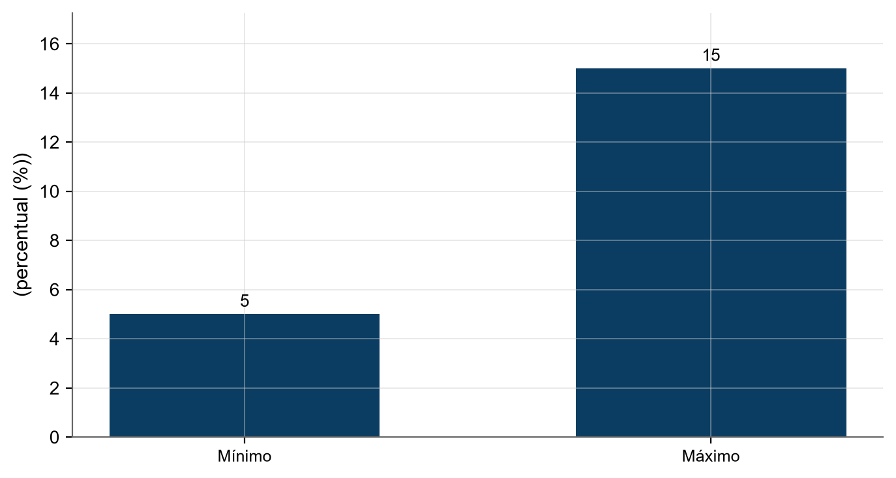<figcaption><strong>Figura 16 – Cota Obrigatória de Aprendizes por Estabelecimento.</strong> <em>Fonte: [(BRASIL, 1943)](https://www.planalto.gov.br/ccivil_03/decreto-lei/del5452.htm).</em> Percentual de aprendizes em relação aos trabalhadores cujas funções demandem formação profissional (art. 429).</figcaption></figure>

**Em termos simples:**
Existem várias formas de ser contratado: desde a carteira assinada comum, passando por contratos temporários, home office, até programas de aprendizado para jovens e estudantes, cada um com suas regras de pagamento e tempo de duração [(BRASIL, 1943; BRASIL, LEI 6.019/1974; BRASIL, LEI 11.788/2008)](https://www.planalto.gov.br/ccivil_03/decreto-lei/del5452.htm).

Os contratos com vínculo empregatício têm limites legais de prazo que variam conforme a modalidade [(BRASIL, 1943)](https://www.planalto.gov.br/ccivil_03/decreto-lei/del5452.htm) e [(BRASIL, LEI 6.019/1974)](https://www.planalto.gov.br/ccivil_03/leis/l6019.htm).

<figure class="figura">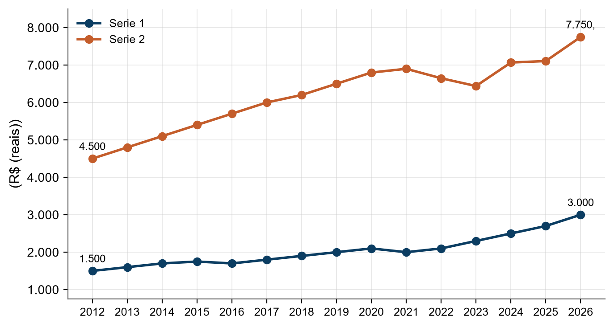<figcaption><strong>Figura 17 – Limites Legais de Prazo Contratual.</strong> <em>Fonte: [(BRASIL, 1943)](https://www.planalto.gov.br/ccivil_03/decreto-lei/del5452.htm) e [(BRASIL, LEI 6.019/1974)](https://www.planalto.gov.br/ccivil_03/leis/l6019.htm).</em> Cada modalidade tem teto legal de duração; no intermitente, o trabalhador tem até 3 dias para responder à chamada.</figcaption></figure>

**Fontes consultadas:**
* [(BRASIL, 1943)](https://www.planalto.gov.br/ccivil_03/decreto-lei/del5452.htm)
* [(BRASIL, LEI 6.019/1974)](https://www.planalto.gov.br/ccivil_03/leis/l6019.htm)
* [(BRASIL, LEI 8.213/1991)](https://www.planalto.gov.br/ccivil_03/leis/l8213cons.htm)
* [(BRASIL, LEI 13.467/2017)](https://www.planalto.gov.br/ccivil_03/_ato2015-2018/2017/lei/l13467.htm)
* [(BRASIL, LEI 10.593/2002)](https://www.planalto.gov.br/ccivil_03/leis/2002/l10593.htm)
* [(BRASIL, LEI 12.545/2011)](https://www.planalto.gov.br/ccivil_03/_ato2011-2014/2011/lei/l12545.htm)
* [(MTE, 2026b)](https://www.gov.br/trabalho-e-emprego/pt-br/assuntos/inspecao-do-trabalho)
* [(ESOCIAL, 2026)](https://www.esocial.gov.br/)

## 6. Modalidades de trabalho sem vínculo empregatício

### 6.1 Trabalhador autônomo

**Como funciona na prática:**
O trabalhador autônomo é a pessoa física que presta serviços de forma independente [(BRASIL, LEI 10.406/2002)](https://www.planalto.gov.br/ccivil_03/leis/2002/l10406.htm). A contratação ocorre geralmente via contrato de prestação de serviço, onde o profissional assume os riscos de sua própria atividade [(BRASIL, LEI 10.406/2002)](https://www.planalto.gov.br/ccivil_03/leis/2002/l10406.htm). O pagamento é acordado por serviço ou período, sem a subordinação característica do emprego [(BRASIL, 1943)](https://www.planalto.gov.br/ccivil_03/decreto-lei/del5452.htm).

**Como deveria funcionar segundo a lei:**
A base legal encontra-se nos artigos 593 e seguintes do Código Civil [(BRASIL, LEI 10.406/2002)](https://www.planalto.gov.br/ccivil_03/leis/2002/l10406.htm) e no artigo 603 da CLT [(BRASIL, 1943)](https://www.planalto.gov.br/ccivil_03/decreto-lei/del5452.htm). A modalidade deixa de ser legal quando presentes a habitualidade, a onerosidade, a pessoalidade e, principalmente, a subordinação jurídica, configurando vínculo empregatício [(BRASIL, 1943)](https://www.planalto.gov.br/ccivil_03/decreto-lei/del5452.htm).

**Direitos e deveres:** [(BRASIL, 1943)](https://www.planalto.gov.br/ccivil_03/decreto-lei/del5452.htm)

<strong>Tabela 17 – Direitos e Deveres do Autônomo.</strong> <em>Fonte: [(BRASIL, LEI 10.406/2002)](https://www.planalto.gov.br/ccivil_03/leis/2002/l10406.htm).</em>

| Direitos/garantias do prestador | Deveres (prestador e contratante) |
| :--- | :--- |
| Recebimento do valor acordado [(BRASIL, LEI 10.406/2002)](https://www.planalto.gov.br/ccivil_03/leis/2002/l10406.htm) | Execução do serviço conforme especificado [(BRASIL, LEI 10.406/2002)](https://www.planalto.gov.br/ccivil_03/leis/2002/l10406.htm) |
| Autonomia na condução do trabalho [(BRASIL, LEI 10.406/2002)](https://www.planalto.gov.br/ccivil_03/leis/2002/l10406.htm) | Pagamento pontual pelo contratante [(BRASIL, LEI 10.406/2002)](https://www.planalto.gov.br/ccivil_03/leis/2002/l10406.htm) |

O contratante deve respeitar a autonomia do profissional, não podendo impor ordens disciplinares ou controle de jornada rigoroso [(BRASIL, 1943)](https://www.planalto.gov.br/ccivil_03/decreto-lei/del5452.htm).

**Como o Estado enxerga e age:**
A fiscalização é realizada pela Auditoria-Fiscal do Trabalho [(BRASIL, LEI 10.593/2002)](https://www.planalto.gov.br/ccivil_03/leis/2002/l10593.htm). O Estado apura a "pejotização" ou a falsa autonomia para caracterizar vínculo indevido [(BRASIL, LEI 10.593/2002)](https://www.planalto.gov.br/ccivil_03/leis/2002/l10593.htm). Caso comprovado o vínculo, a empresa sofre sanções do Livro V da CLT, com a exigência de anotação na CTPS, recolhimentos ao eSocial e pagamento de verbas retroativas [(BRASIL, 1943)](https://www.planalto.gov.br/ccivil_03/decreto-lei/del5452.htm).

**Em termos simples:**
É o profissional "por conta própria" que vende seu serviço para quem precisa, sem ser empregado da empresa e sem ter carteira assinada [(BRASIL, LEI 10.406/2002)](https://www.planalto.gov.br/ccivil_03/leis/2002/l10406.htm).

### 6.2 PJ: ME, EPP, Simples Nacional, Lucro Presumido

**Como funciona na prática:**
A contratação ocorre entre duas pessoas jurídicas (B2B), onde a empresa contratada emite nota fiscal para receber pelos serviços [(BRASIL, LC 123/2006)](https://www.planalto.gov.br/ccivil_03/leis/lcp/lcp123.htm). A ME (Microempresa) e a EPP (Empresa de Pequeno Porte) utilizam frequentemente o Simples Nacional para unificar tributos [(BRASIL, LC 123/2006)](https://www.planalto.gov.br/ccivil_03/leis/lcp/lcp123.htm). Empresas maiores ou com faturamento elevado podem optar pelo Lucro Presumido [(BRASIL, LC 214/2025)](https://www.planalto.gov.br/ccivil_03/leis/lcp/lcp214.htm).

**Como deveria funcionar segundo a lei:**
Regulada pela Lei Complementar 123/2006 [(BRASIL, LC 123/2006)](https://www.planalto.gov.br/ccivil_03/leis/lcp/lcp123.htm) e atualizações da reforma tributária na LC 214/2025 [(BRASIL, LC 214/2025)](https://www.planalto.gov.br/ccivil_03/leis/lcp/lcp214.htm). É proibido que a PJ seja utilizada para mascarar vínculo empregatício; por exemplo, sócios que foram empregados da contratante não podem prestar serviços como PJ antes de 18 meses da demissão, salvo se aposentados [(BRASIL, LEI 6.019/1974)](https://www.planalto.gov.br/ccivil_03/leis/l6019.htm).

**Direitos e deveres:** [(BRASIL, 1943)](https://www.planalto.gov.br/ccivil_03/decreto-lei/del5452.htm)

<strong>Tabela 18 – Direitos e Deveres da PJ.</strong> <em>Fonte: [(BRASIL, LC 123/2006)](https://www.planalto.gov.br/ccivil_03/leis/lcp/lcp123.htm).</em>

| Direitos/garantias do prestador | Deveres (prestador e contratante) |
| :--- | :--- |
| Tratamento tributário favorecido (Simples) [(BRASIL, LC 123/2006)](https://www.planalto.gov.br/ccivil_03/leis/lcp/lcp123.htm) | Emissão obrigatória de nota fiscal [(BRASIL, LC 123/2006)](https://www.planalto.gov.br/ccivil_03/leis/lcp/lcp123.htm) |
| Acesso a crédito e mercado [(BRASIL, LC 123/2006)](https://www.planalto.gov.br/ccivil_03/leis/lcp/lcp123.htm) | Manutenção de contabilidade regular [(BRASIL, LC 214/2025)](https://www.planalto.gov.br/ccivil_03/leis/lcp/lcp214.htm) |

O contratante deve efetuar o pagamento mediante a apresentação da nota fiscal e observar o prazo de quarentena de 18 meses para ex-empregados [(BRASIL, LEI 6.019/1974)](https://www.planalto.gov.br/ccivil_03/leis/l6019.htm).

**Como o Estado enxerga e age:**
A Receita Federal e o Comitê Gestor do Simples Nacional fiscalizam a regularidade tributária e o enquadramento do faturamento [(BRASIL, LC 123/2006)](https://www.planalto.gov.br/ccivil_03/leis/lcp/lcp123.htm). A Auditoria-Fiscal do Trabalho atua na identificação de fraudes trabalhistas [(BRASIL, LEI 10.593/2002)](https://www.planalto.gov.br/ccivil_03/leis/2002/l10593.htm). Sanções incluem multas administrativas e a responsabilização solidária da empresa tomadora [(BRASIL, LEI 6.019/1974)](https://www.planalto.gov.br/ccivil_03/leis/l6019.htm).

**Em termos simples:**
É quando o trabalhador abre uma empresa para prestar serviços para outra empresa, emitindo nota fiscal em vez de receber salário [(BRASIL, LC 123/2006)](https://www.planalto.gov.br/ccivil_03/leis/lcp/lcp123.htm).

### 6.3 MEI (Microempreendedor Individual)

**Como funciona na prática:**
O MEI é a forma mais simplificada de formalização para quem trabalha sozinho [(BRASIL, LC 123/2006)](https://www.planalto.gov.br/ccivil_03/leis/lcp/lcp123.htm). O profissional paga mensalmente o DAS (Documento de Arrecadação do Simples Nacional), que inclui a contribuição previdenciária [(BRASIL, LC 123/2006)](https://www.planalto.gov.br/ccivil_03/leis/lcp/lcp123.htm). Pode contratar no máximo um empregado [(BRASIL, LC 123/2006)](https://www.planalto.gov.br/ccivil_03/leis/lcp/lcp123.htm).

**Como deveria funcionar segundo a lei:**
Regido pela LC 123/2006 [(BRASIL, LC 123/2006)](https://www.planalto.gov.br/ccivil_03/leis/lcp/lcp123.htm). Deve respeitar o limite de faturamento anual e exercer apenas atividades permitidas na lista oficial [(BRASIL, LC 123/2006)](https://www.planalto.gov.br/ccivil_03/leis/lcp/lcp123.htm). Há propostas legislativas (PLP 265/2026) para elevar o limite de receita e permitir a contratação de até dois empregados [(CAMARA DOS DEPUTADOS, 2026u)](https://www.camara.leg.br/proposicoesWeb/fichadetramitacao?idProposicao=2647294).

**Direitos e deveres:** [(BRASIL, 1943)](https://www.planalto.gov.br/ccivil_03/decreto-lei/del5452.htm)

<strong>Tabela 19 – Direitos e Deveres do MEI.</strong> <em>Fonte: [(BRASIL, LC 123/2006)](https://www.planalto.gov.br/ccivil_03/leis/lcp/lcp123.htm).</em>

| Direitos/garantias do prestador | Deveres (prestador e contratante) |
| :--- | :--- |
| Aposentadoria por idade e auxílios [(BRASIL, LC 123/2006)](https://www.planalto.gov.br/ccivil_03/leis/lcp/lcp123.htm) | Pagamento mensal do DAS [(BRASIL, LC 123/2006)](https://www.planalto.gov.br/ccivil_03/leis/lcp/lcp123.htm) |
| CNPJ e emissão de nota fiscal [(BRASIL, LC 123/2006)](https://www.planalto.gov.br/ccivil_03/leis/lcp/lcp123.htm) | Respeito ao limite de faturamento [(BRASIL, LC 123/2006)](https://www.planalto.gov.br/ccivil_03/leis/lcp/lcp123.htm) |

O contratante deve exigir a regularidade do MEI e evitar a subordinação direta para não descaracterizar a natureza do negócio [(BRASIL, 1943)](https://www.planalto.gov.br/ccivil_03/decreto-lei/del5452.htm).

**Como o Estado enxerga e age:**
A fiscalização é feita pela Receita Federal e Auditoria-Fiscal do Trabalho [(BRASIL, LEI 10.593/2002)](https://www.planalto.gov.br/ccivil_03/leis/2002/l10593.htm). O Estado monitora se o MEI está sendo usado para "camuflar" um empregado comum [(BRASIL, LEI 10.593/2002)](https://www.planalto.gov.br/ccivil_03/leis/2002/l10593.htm). A sanção envolve o desenquadramento do regime e a cobrança de todas as verbas trabalhistas retroativas [(BRASIL, 1943)](https://www.planalto.gov.br/ccivil_03/decreto-lei/del5452.htm).

**Em termos simples:**
É o "empresário de um homem só" que paga um valor fixo por mês para ter CNPJ e direitos básicos da previdência [(BRASIL, LC 123/2006)](https://www.planalto.gov.br/ccivil_03/leis/lcp/lcp123.htm).

### 6.4 Cooperado

**Como funciona na prática:**
O cooperado é um sócio de uma cooperativa de trabalho [(BRASIL, LEI 12.690/2012)](https://www.planalto.gov.br/ccivil_03/_ato2011-2014/2012/lei/l12690.htm). Ele não é empregado da cooperativa, mas presta serviços para terceiros através dela, recebendo a "retirada" ou "prolabore" [(BRASIL, LEI 12.690/2012)](https://www.planalto.gov.br/ccivil_03/_ato2011-2014/2012/lei/l12690.htm).

**Como deveria funcionar segundo a lei:**
Regulado pela Lei 12.690/2012 [(BRASIL, LEI 12.690/2012)](https://www.planalto.gov.br/ccivil_03/_ato2011-2014/2012/lei/l12690.htm). A cooperativa deve ser democrática e sem fins lucrativos. Configura fraude quando a cooperativa é usada apenas para intermediar mão de obra e reduzir custos trabalhistas, sem a real natureza cooperativista [(BRASIL, LEI 12.690/2012)](https://www.planalto.gov.br/ccivil_03/_ato2011-2014/2012/lei/l12690.htm).

**Direitos e deveres:** [(BRASIL, 1943)](https://www.planalto.gov.br/ccivil_03/decreto-lei/del5452.htm)

<strong>Tabela 20 – Direitos e Deveres do Cooperado.</strong> <em>Fonte: [(BRASIL, LEI 12.690/2012)](https://www.planalto.gov.br/ccivil_03/_ato2011-2014/2012/lei/l12690.htm).</em>

| Direitos/garantias do prestador | Deveres (prestador e contratante) |
| :--- | :--- |
| Participação nos resultados da cooperativa [(BRASIL, LEI 12.690/2012)](https://www.planalto.gov.br/ccivil_03/_ato2011-2014/2012/lei/l12690.htm) | Contribuição para o capital social [(BRASIL, LEI 12.690/2012)](https://www.planalto.gov.br/ccivil_03/_ato2011-2014/2012/lei/l12690.htm) |
| Gestão democrática da entidade [(BRASIL, LEI 12.690/2012)](https://www.planalto.gov.br/ccivil_03/_ato2011-2014/2012/lei/l12690.htm) | Cumprimento das normas da cooperativa [(BRASIL, LEI 12.690/2012)](https://www.planalto.gov.br/ccivil_03/_ato2011-2014/2012/lei/l12690.htm) |

O contratante da cooperativa deve observar a regularidade da entidade e não exercer poder diretivo direto sobre o cooperado [(BRASIL, LEI 12.690/2012)](https://www.planalto.gov.br/ccivil_03/_ato2011-2014/2012/lei/l12690.htm).

**Como o Estado enxerga e age:**
A Auditoria-Fiscal do Trabalho fiscaliza se a cooperativa é real ou se é uma "cooperativa de fachada" para fraudar a CLT [(BRASIL, LEI 10.593/2002)](https://www.planalto.gov.br/ccivil_03/leis/2002/l10593.htm). Se a fraude for comprovada, o vínculo de emprego é reconhecido entre o cooperado e a empresa tomadora [(BRASIL, 1943)](https://www.planalto.gov.br/ccivil_03/decreto-lei/del5452.htm).

**Em termos simples:**
É quando profissionais se unem em uma associação (cooperativa) para conseguir clientes e organizar o trabalho juntos, dividindo os lucros [(BRASIL, LEI 12.690/2012)](https://www.planalto.gov.br/ccivil_03/_ato2011-2014/2012/lei/l12690.htm).

### 6.5 Contribuinte individual previdenciário

**Como funciona na prática:**
É a pessoa física que trabalha por conta própria e recolhe a previdência social para garantir aposentadoria e auxílios [(BRASIL, LEI 8.212/1991)](https://www.planalto.gov.br/ccivil_03/leis/l8212cons.htm). Inclui autônomos e profissionais liberais [(BRASIL, LC 123/2006)](https://www.planalto.gov.br/ccivil_03/leis/lcp/lcp123.htm).

**Como deveria funcionar segundo a lei:**
Baseado na Lei 8.212/1991 [(BRASIL, LEI 8.212/1991)](https://www.planalto.gov.br/ccivil_03/leis/l8212cons.htm). O segurado contribuinte individual que trabalha por conta própria, sem relação com empresa, pode ter restrições quanto à aposentadoria por tempo de contribuição, dependendo da forma de recolhimento [(BRASIL, LC 123/2006)](https://www.planalto.gov.br/ccivil_03/leis/lcp/lcp123.htm).

**Direitos e deveres:** [(BRASIL, 1943)](https://www.planalto.gov.br/ccivil_03/decreto-lei/del5452.htm)

<strong>Tabela 21 – Direitos e Deveres do Contribuinte Individual.</strong> <em>Fonte: [(BRASIL, LEI 8.212/1991)](https://www.planalto.gov.br/ccivil_03/leis/l8212cons.htm).</em>

| Direitos/garantias do prestador | Deveres (prestador e contratante) |
| :--- | :--- |
| Acesso a benefícios previdenciários [(BRASIL, LEI 8.212/1991)](https://www.planalto.gov.br/ccivil_03/leis/l8212cons.htm) | Recolhimento mensal da contribuição [(BRASIL, LEI 8.212/1991)](https://www.planalto.gov.br/ccivil_03/leis/l8212cons.htm) |
| Proteção em caso de incapacidade [(BRASIL, LEI 8.212/1991)](https://www.planalto.gov.br/ccivil_03/leis/l8212cons.htm) | Declaração de rendimentos [(BRASIL, LEI 8.212/1991)](https://www.planalto.gov.br/ccivil_03/leis/l8212cons.htm) |

O contratante, em certos casos, pode ser sub-rogado na obrigação de recolher a contribuição da pessoa física [(BRASIL, LEI 8.212/1991)](https://www.planalto.gov.br/ccivil_03/leis/l8212cons.htm).

**Como o Estado enxerga e age:**
A Receita Federal fiscaliza o recolhimento das contribuições previdenciárias [(BRASIL, LEI 8.212/1991)](https://www.planalto.gov.br/ccivil_03/leis/l8212cons.htm). A falta de pagamento gera dívida ativa e perda de qualidade de segurado [(BRASIL, LC 123/2006)](https://www.planalto.gov.br/ccivil_03/leis/lcp/lcp123.htm).

**Em termos simples:**
É a pessoa que paga o INSS por conta própria para não ficar desamparada na velhice ou em caso de doença [(BRASIL, LEI 8.212/1991)](https://www.planalto.gov.br/ccivil_03/leis/l8212cons.htm).

### 6.6 Trabalho voluntário

**Como funciona na prática:**
É a atividade não remunerada prestada por pessoa física a entidades públicas ou instituições privadas sem fins lucrativos [(BRASIL, LEI 9.608/1998)](https://www.planalto.gov.br/ccivil_03/leis/l9608.htm). O voluntário atua em áreas cívicas, culturais, educacionais ou de assistência social [(BRASIL, LEI 9.608/1998)](https://www.planalto.gov.br/ccivil_03/leis/l9608.htm).

**Como deveria funcionar segundo a lei:**
Regulado pela Lei 9.608/1998 [(BRASIL, LEI 9.608/1998)](https://www.planalto.gov.br/ccivil_03/leis/l9608.htm). É obrigatória a celebração de um termo de adesão [(BRASIL, LEI 9.608/1998)](https://www.planalto.gov.br/ccivil_03/leis/l9608.htm). A lei é clara: o serviço voluntário não gera vínculo empregatício nem obrigações trabalhistas ou previdenciárias [(BRASIL, LEI 9.608/1998)](https://www.planalto.gov.br/ccivil_03/leis/l9608.htm).

**Direitos e deveres:** [(BRASIL, 1943)](https://www.planalto.gov.br/ccivil_03/decreto-lei/del5452.htm)

<strong>Tabela 22 – Direitos e Deveres do Voluntário.</strong> <em>Fonte: [(BRASIL, LEI 9.608/1998)](https://www.planalto.gov.br/ccivil_03/leis/l9608.htm).</em>

| Direitos/garantias do prestador | Deveres (prestador e contratante) |
| :--- | :--- |
| Ressarcimento de despesas autorizadas [(BRASIL, LEI 9.608/1998)](https://www.planalto.gov.br/ccivil_03/leis/l9608.htm) | Cumprimento do termo de adesão [(BRASIL, LEI 9.608/1998)](https://www.planalto.gov.br/ccivil_03/leis/l9608.htm) |
| Certificado de atuação [(BRASIL, LEI 9.608/1998)](https://www.planalto.gov.br/ccivil_03/leis/l9608.htm) | Atuação sem expectativa de salário [(BRASIL, LEI 9.608/1998)](https://www.planalto.gov.br/ccivil_03/leis/l9608.htm) |

A entidade contratante deve fornecer as condições básicas para a execução do serviço e não pode remunerar o voluntário, sob pena de descaracterizar a modalidade [(BRASIL, LEI 9.608/1998)](https://www.planalto.gov.br/ccivil_03/leis/l9608.htm).

**Como o Estado enxerga e age:**
A Auditoria-Fiscal do Trabalho verifica se a entidade está usando "voluntários" para substituir empregados remunerados [(BRASIL, LEI 10.593/2002)](https://www.planalto.gov.br/ccivil_03/leis/2002/l10593.htm). Se houver pagamento habitual ou subordinação típica de emprego, o vínculo é reconhecido [(BRASIL, 1943)](https://www.planalto.gov.br/ccivil_03/decreto-lei/del5452.htm).

**Em termos simples:**
É trabalhar de graça para ajudar uma causa ou instituição, com um papel assinado dizendo que você não quer salário [(BRASIL, LEI 9.608/1998)](https://www.planalto.gov.br/ccivil_03/leis/l9608.htm).

### 6.7 Trabalho informal sem qualquer formalização

**Como funciona na prática:**
Ocorre quando a prestação de serviço não possui contrato escrito, registro em CTPS ou CNPJ [(BRASIL, 1943)](https://www.planalto.gov.br/ccivil_03/decreto-lei/del5452.htm). O pagamento é feito de forma esporádica ou informal, sem qualquer garantia legal [(BRASIL, 1943)](https://www.planalto.gov.br/ccivil_03/decreto-lei/del5452.htm).

**Como deveria funcionar segundo a lei:**
Não possui base legal de "permissão", sendo a regra geral a formalização do trabalho [(BRASIL, 1943)](https://www.planalto.gov.br/ccivil_03/decreto-lei/del5452.htm). Quando a informalidade esconde os requisitos de emprego (subordinação, habitualidade, onerosidade e pessoalidade), a lei protege o trabalhador através do reconhecimento do vínculo [(BRASIL, 1943)](https://www.planalto.gov.br/ccivil_03/decreto-lei/del5452.htm).

**Direitos e deveres:** [(BRASIL, 1943)](https://www.planalto.gov.br/ccivil_03/decreto-lei/del5452.htm)

<strong>Tabela 23 – Direitos e Deveres na Informalidade.</strong> <em>Fonte: [(BRASIL, 1943)](https://www.planalto.gov.br/ccivil_03/decreto-lei/del5452.htm).</em>

| Direitos/garantias do prestador | Deveres (prestador e contratante) |
| :--- | :--- |
| Direito ao reconhecimento do vínculo [(BRASIL, 1943)](https://www.planalto.gov.br/ccivil_03/decreto-lei/del5452.htm) | Execução do serviço acordado [(BRASIL, 1943)](https://www.planalto.gov.br/ccivil_03/decreto-lei/del5452.htm) |
| Recebimento de verbas retroativas [(BRASIL, 1943)](https://www.planalto.gov.br/ccivil_03/decreto-lei/del5452.htm) | Pagamento do valor combinado [(BRASIL, 1943)](https://www.planalto.gov.br/ccivil_03/decreto-lei/del5452.htm) |

O contratante tem o dever legal de formalizar a relação de emprego assim que constatados os requisitos da CLT [(BRASIL, 1943)](https://www.planalto.gov.br/ccivil_03/decreto-lei/del5452.htm).

**Como o Estado enxerga e age:**
A Auditoria-Fiscal do Trabalho atua intensamente na formalização desses trabalhadores [(BRASIL, LEI 10.593/2002)](https://www.planalto.gov.br/ccivil_03/leis/2002/l10593.htm). A empresa é multada e obrigada a assinar a carteira com data retroativa, pagando FGTS e INSS [(BRASIL, 1943)](https://www.planalto.gov.br/ccivil_03/decreto-lei/del5452.htm).

**Em termos simples:**
É o famoso "bico", onde não tem contrato nem papel assinado, ficando o trabalhador totalmente desprotegido [(BRASIL, 1943)](https://www.planalto.gov.br/ccivil_03/decreto-lei/del5452.htm).

### 6.8 Serviço via aplicativos/plataformas

**Como funciona na prática:**
O trabalhador utiliza uma plataforma digital para conectar-se a clientes (KALIL, 2026). A remuneração é feita por tarefa ou corrida, e a gestão do trabalho é feita por algoritmos (KALIL, 2026). [(BRASIL, 1943)](https://www.planalto.gov.br/ccivil_03/decreto-lei/del5452.htm)

**Como deveria funcionar segundo a lei:**
Atualmente, há um intenso debate jurídico e legislativo sobre a regulação [(CAMARA DOS DEPUTADOS, 2026x)](https://www25.senado.leg.br/web/atividade/materias/-/materia/174042). A discussão gira em torno da segurança dos trabalhadores e a definição de diretrizes para regulação [(CAMARA DOS DEPUTADOS, 2026x)](https://www25.senado.leg.br/web/atividade/materias/-/materia/174042).

**Direitos e deveres:** [(BRASIL, 1943)](https://www.planalto.gov.br/ccivil_03/decreto-lei/del5452.htm)

<strong>Tabela 24 – Direitos e Deveres em Plataformas.</strong> <em>Fonte: [KALIL, 2026](https://doi.org/10.5151/9786555500295-03).</em>

| Direitos/garantias do prestador | Deveres (prestador e contratante) |
| :--- | :--- |
| Liberdade de conexão/desconexão (KALIL, 2026) | Manutenção do veículo/equipamento (KALIL, 2026) |
| Recebimento por serviço prestado (KALIL, 2026) | Cumprimento dos termos de uso (KALIL, 2026) |

A plataforma deve garantir a transparência nos pagamentos e a segurança básica do usuário e do prestador [(CAMARA DOS DEPUTADOS, 2026x)](https://www25.senado.leg.br/web/atividade/materias/-/materia/174042).

**Como o Estado enxerga e age:**
O Estado, via Auditoria-Fiscal do Trabalho, analisa a dependência econômica e a subordinação algorítmica [(BRASIL, LEI 10.593/2002)](https://www.planalto.gov.br/ccivil_03/leis/2002/l10593.htm). Existem discussões no Senado para criar regramentos específicos de segurança e previdência [(CAMARA DOS DEPUTADOS, 2026x)](https://www25.senado.leg.br/web/atividade/materias/-/materia/174042).

**Em termos simples:**
É o trabalho feito por apps (como motoristas e entregadores), onde o "chefe" é um algoritmo e não há vínculo fixo (KALIL, 2026). [(BRASIL, 1943)](https://www.planalto.gov.br/ccivil_03/decreto-lei/del5452.htm)

<figure class="figura">

<h4>Situação de Saída</h4><ul><li>Encerramento do contrato de trabalho anterior</li><li>Ex-funcionário passa a prestar serviços como pessoa jurídica (PJ)</li></ul>

<h4>Quarentena de 18 Meses</h4><ul><li>Intervalo mínimo recomendado entre o fim do contrato e a nova contratação</li><li>Contratação antes do prazo gera risco de fraude e reconhecimento do vínculo [(BRASIL, LEI 6.019/1974)](https://www.planalto.gov.br/ccivil_03/leis/l6019.htm)</li></ul>

<figcaption><strong>Figura 18 – Quarentena para Contratação de Ex-Empregado como PJ.</strong> <em>Fonte: [(BRASIL, LEI 6.019/1974)](https://www.planalto.gov.br/ccivil_03/leis/l6019.htm).</em> Período de 18 meses para evitar a caracterização de fraude na contratação de PJ.</figcaption></figure>

**Em termos simples:**
Existem várias formas de trabalhar sem ter a carteira assinada: desde abrir a própria empresa (PJ ou MEI), unir-se a colegas em cooperativas, fazer voluntariado ou trabalhar por aplicativos. O ponto principal é que, se o trabalhador tiver que obedecer ordens como um empregado, cumprir horário fixo e for essencial para a empresa, a lei pode entender que ele é, na verdade, um empregado comum e exigir todos os direitos da CLT [(BRASIL, 1943)](https://www.planalto.gov.br/ccivil_03/decreto-lei/del5452.htm).

A fronteira entre o trabalho autônomo legítimo e o vínculo encoberto (pejotização) define consequências práticas muito diferentes:

<figure class="figura">

<h4>Trabalho Autônomo Legítimo</h4><ul><li>Sem subordinação: o prestador define horários e métodos [(BRASIL, LEI 10.406/2002, art. 593)](https://www.planalto.gov.br/ccivil_03/leis/2002/l10406.htm)</li><li>Preços e organização do serviço por conta própria</li><li>Contrato de prestação de serviços com prazo ou entrega definidos</li></ul>

<h4>Vínculo Encoberto (Pejotização)</h4><ul><li>Ordens e horários impostos por algoritmo ou gestor direto</li><li>Exclusividade e rotina de empregado disfarçadas de PJ</li><li>Risco de reconhecimento retroativo do vínculo e das verbas [(BRASIL, 1943)](https://www.planalto.gov.br/ccivil_03/decreto-lei/del5452.htm)</li></ul>

<figcaption><strong>Figura 19 – Autonomia Legítima x Vínculo Encoberto.</strong> <em>Fonte: [(BRASIL, LEI 10.406/2002)](https://www.planalto.gov.br/ccivil_03/leis/2002/l10406.htm) e [(BRASIL, 1943)](https://www.planalto.gov.br/ccivil_03/decreto-lei/del5452.htm).</em> A subordinação é o critério que separa o autônomo do empregado encoberto.</figcaption></figure>

Fontes consultadas:
* [(BRASIL, LEI 12.690/2012)](https://www.planalto.gov.br/ccivil_03/_ato2011-2014/2012/lei/l12690.htm)
* [(BRASIL, LEI 9.608/1998)](https://www.planalto.gov.br/ccivil_03/leis/l9608.htm)
* [(BRASIL, LEI 13.467/2017)](https://www.planalto.gov.br/ccivil_03/_ato2015-2018/2017/lei/l13467.htm)
* [(IBGE, 2026d)](https://agenciabrasil.ebc.com.br/radioagencia-nacional/economia/audio/2026-09/brasil-tem-2-milhoes-de-trabalhadores-por-aplicativos-diz-ibge)
* [(BRASIL, LEI 6.019/1974)](https://www.planalto.gov.br/ccivil_03/leis/l6019.htm)
* [(BRASIL, LC 123/2006)](https://www.planalto.gov.br/ccivil_03/leis/lcp/lcp123.htm)
* [(BRASIL, LEI 8.212/1991)](https://www.planalto.gov.br/ccivil_03/leis/l8212cons.htm)
* [(BRASIL, LC 214/2025)](https://www.planalto.gov.br/ccivil_03/leis/lcp/lcp214.htm)
* [(CAMARA DOS DEPUTADOS, 2026u)](https://www.camara.leg.br/proposicoesWeb/fichadetramitacao?idProposicao=2647294)
* [(BRASIL, LEI 10.406/2002)](https://www.planalto.gov.br/ccivil_03/leis/2002/l10406.htm)
* [(BRASIL, 1943)](https://www.planalto.gov.br/ccivil_03/decreto-lei/del5452.htm)
* [(BRASIL, LEI 10.593/2002)](https://www.planalto.gov.br/ccivil_03/leis/2002/l10593.htm)
* [(KALIL, 2026)](https://doi.org/10.5151/9786555500295-03)
* [(CAMARA DOS DEPUTADOS, 2026x)](https://www25.senado.leg.br/web/atividade/materias/-/materia/174042)

## 7. PJ versus CLT: comparação objetiva

A distinção entre o regime de Consolidação das Leis do Trabalho (CLT) e a prestação de serviços via Pessoa Jurídica (PJ) reside na natureza do vínculo e nos encargos associados. No regime CLT, o empregador assume os riscos da atividade econômica e dirige a prestação pessoal de serviço [(BRASIL, 1943)](https://www.planalto.gov.br/ccivil_03/decreto-lei/del5452.htm). Já a atuação como PJ é lícita quando há autonomia, como observado em casos de profissionais médicos onde a ausência de subordinação afasta a configuração de fraude [(CONSULTOR JURÍDICO, 2026a)](https://conjur.com.br/2026-ago-12/sem-prova-de-subordinacao-pejotizacao-de-medicos-nao-configura-fraude/).

A "pejotização" configura fraude quando a estrutura de empresa é utilizada para mascarar uma relação de emprego real, visando a redução de custos tributários e trabalhistas [(BRASIL, LEI 8.036/1990)](https://www.planalto.gov.br/ccivil_03/leis/l8036consol.htm).

<strong>Tabela 25 – Comparativo de Direitos e Encargos.</strong> <em>Fonte: [(BRASIL, 1943)](https://www.planalto.gov.br/ccivil_03/decreto-lei/del5452.htm), [(BRASIL, LEI 13.467/2017)](https://www.planalto.gov.br/ccivil_03/_ato2015-2018/2017/lei/l13467.htm), [(BRASIL, LEI 8.036/1990)](https://www.planalto.gov.br/ccivil_03/leis/l8036consol.htm).</em>

| Item | Regime CLT | Regime PJ [(BRASIL, 1943)](https://www.planalto.gov.br/ccivil_03/decreto-lei/del5452.htm) |
| :--- | :--- | :--- |
| FGTS | Obrigatório [(BRASIL, LEI 8.036/1990)](https://www.planalto.gov.br/ccivil_03/leis/l8036consol.htm) | Não aplicável [(BRASIL, LEI 8.036/1990)](https://www.planalto.gov.br/ccivil_03/leis/l8036consol.htm) |
| Aviso Prévio | Mínimo de 30 dias para mensais [(BRASIL, 1943)](https://www.planalto.gov.br/ccivil_03/decreto-lei/del5452.htm) | Definido em contrato [(CONSULTOR JURÍDICO, 2026a)](https://conjur.com.br/2026-ago-12/sem-prova-de-subordinacao-pejotizacao-de-medicos-nao-configura-fraude/) |
| Horas Extras | Integram aviso prévio indenizado [(BRASIL, 1943)](https://www.planalto.gov.br/ccivil_03/decreto-lei/del5452.htm) | Não aplicável [(CONSULTOR JURÍDICO, 2026a)](https://conjur.com.br/2026-ago-12/sem-prova-de-subordinacao-pejotizacao-de-medicos-nao-configura-fraude/) |
| Verbas Salariais | Fixas, gratificações e comissões [(BRASIL, LEI 13.467/2017)](https://www.planalto.gov.br/ccivil_03/_ato2015-2018/2017/lei/l13467.htm) | Valor bruto da nota fiscal [(CONSULTOR JURÍDICO, 2026a)](https://conjur.com.br/2026-ago-12/sem-prova-de-subordinacao-pejotizacao-de-medicos-nao-configura-fraude/) |
| Ajuda de Custo | Não integra remuneração se habitual [(BRASIL, LEI 13.467/2017)](https://www.planalto.gov.br/ccivil_03/_ato2015-2018/2017/lei/l13467.htm) | Composição de preço do serviço [(CONSULTOR JURÍDICO, 2026a)](https://conjur.com.br/2026-ago-12/sem-prova-de-subordinacao-pejotizacao-de-medicos-nao-configura-fraude/) |

A carga tributária para a empresa no regime CLT envolve encargos previdenciários sobre a folha, enquanto no regime PJ a tributação é simplificada via Simples Nacional ou MEI [(BRASIL, LC 123/2006)](https://www.planalto.gov.br/ccivil_03/leis/lcp/lcp123.htm). A reforma tributária, através da LC 214/2025, estabelece novas regras para a apuração de receitas omitidas e a base de cálculo da CBS e do IBS, impactando a fiscalização de prestadores de serviço [(BRASIL, LC 214/2025)](https://www.planalto.gov.br/ccivil_03/leis/lcp/lcp214.htm).

No aspecto de rendimentos, observa-se que categorias informais (conta própria e sem carteira) apresentaram crescimentos interanuais de renda superiores aos trabalhadores com carteira assinada [(IPEA, 2026)](https://www.ipea.gov.br/cartadeconjuntura/index.php/category/mercado-de-trabalho/). No primeiro trimestre de 2026, trabalhadores por conta própria e sem carteira cresceram 6% e 9,9%, respectivamente, enquanto os privados com carteira cresceram 2,8% [(IPEA, 2026)](https://www.ipea.gov.br/cartadeconjuntura/index.php/category/mercado-de-trabalho/).

A diferença de rendimento entre os regimes reflete a ausência de encargos patronais no informal e a maior flexibilidade de precificação de quem atua por conta própria. Na série anual de 2012 a 2026, as categorias informais avançaram mais em termos relativos: a renda de quem trabalha por conta própria subiu cerca de 26% e a dos empregados sem carteira cerca de 43%, enquanto o rendimento com carteira cresceu apenas cerca de 11% em termos reais [(IPEA, 2026)](https://www.ipea.gov.br/cartadeconjuntura/index.php/category/mercado-de-trabalho/). O trabalhador CLT, ainda com menor crescimento relativo, mantém maior estabilidade e acesso a direitos como o aviso prévio proporcional ao tempo de serviço [(BRASIL, LC 150/2015)](https://www.planalto.gov.br/ccivil_03/leis/lcp/lcp150.htm).

<figure class="figura">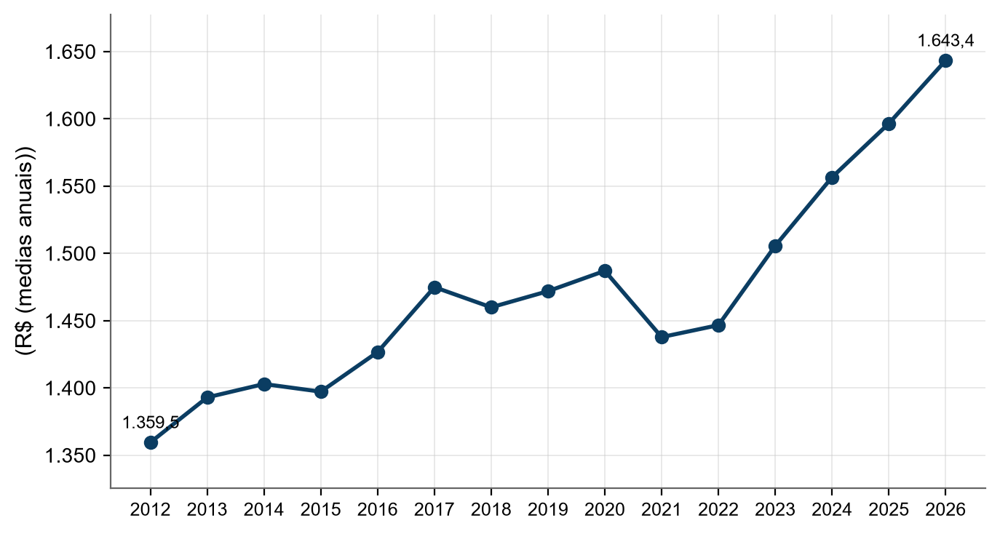<figcaption><strong>Figura 20 – Rendimento Real Médio por Categoria de Ocupação (2012-2026).</strong> <em>Fonte: [(IPEA, 2026)](https://www.ipea.gov.br/cartadeconjuntura/index.php/category/mercado-de-trabalho/).</em> Médias anuais do rendimento real do trabalho principal (Ipeadata/PNAD Contínua); em termos relativos, as categorias informais avançaram mais.</figcaption></figure>

Ao mesmo tempo, o prêmio de rendimento do vínculo formal estreitou-se ao longo das duas décadas: a razão entre o rendimento médio com carteira e o sem carteira caiu de 1,63 vez em 2012 para 1,27 vez em 2026, aproximando a renda dos dois regimes [(IPEA, 2026)](https://www.ipea.gov.br/cartadeconjuntura/index.php/category/mercado-de-trabalho/).

<figure class="figura">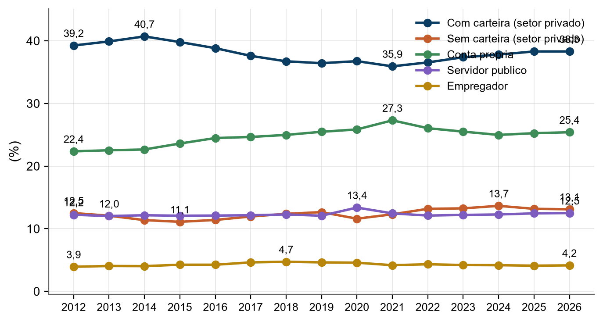<figcaption><strong>Figura 21 – Gap de Rendimento: Com vs Sem Carteira Assinada (2012-2026).</strong> <em>Fonte: [(IPEA, 2026)](https://www.ipea.gov.br/cartadeconjuntura/index.php/category/mercado-de-trabalho/).</em> Razão entre o rendimento médio com carteira e o rendimento médio sem carteira; valores reais, médias anuais.</figcaption></figure>

No volume de ocupados, a série de 2012 a 2026 mostra que o emprego com carteira no setor privado passou de 35,1 milhões para 39,3 milhões de pessoas, enquanto o sem carteira subiu de 11,2 milhões para 13,5 milhões [(IPEA, 2026)](https://www.ipea.gov.br/cartadeconjuntura/index.php/category/mercado-de-trabalho/). O segmento informal cresceu proporcionalmente mais no período, embora o formal continue sendo o maior em volume absoluto.

<figure class="figura">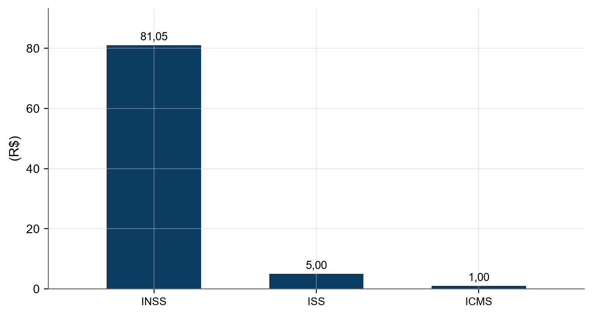<figcaption><strong>Figura 22 – Empregados no Setor Privado: Com vs Sem Carteira Assinada (2012-2026).</strong> <em>Fonte: [(IPEA, 2026)](https://www.ipea.gov.br/cartadeconjuntura/index.php/category/mercado-de-trabalho/).</em> Médias anuais do número de ocupados no setor privado (Ipeadata/PNAD Contínua).</figcaption></figure>

<figure class="figura">

<h4>Regime CLT</h4><ul><li>Vínculo empregatício com direitos da Constituição e da CLT [(BRASIL, 1943)](https://www.planalto.gov.br/ccivil_03/decreto-lei/del5452.htm)</li><li>FGTS, férias com 1/3, 13º e aviso prévio [(BRASIL, LEI 8.036/1990)](https://www.planalto.gov.br/ccivil_03/leis/l8036consol.htm)</li><li>Encargos e riscos do negócio a cargo do empregador</li></ul>

<h4>Regime PJ</h4><ul><li>Contrato entre empresas, sem direitos trabalhistas [(BRASIL, LEI 10.406/2002)](https://www.planalto.gov.br/ccivil_03/leis/2002/l10406.htm)</li><li>Nota fiscal e tributação via Simples Nacional ou MEI [(BRASIL, LC 123/2006)](https://www.planalto.gov.br/ccivil_03/leis/lcp/lcp123.htm)</li><li>Autonomia exigida: subordinação configura fraude (pejotização)</li></ul>

<figcaption><strong>Figura 23 – Comparativo CLT x PJ.</strong> <em>Fonte: [(BRASIL, 1943)](https://www.planalto.gov.br/ccivil_03/decreto-lei/del5452.htm), [(BRASIL, LEI 8.036/1990)](https://www.planalto.gov.br/ccivil_03/leis/l8036consol.htm) e [(BRASIL, LC 123/2006)](https://www.planalto.gov.br/ccivil_03/leis/lcp/lcp123.htm).</em> O regime CLT concentra direitos e garantias; o PJ exige autonomia real para ser lícito.</figcaption></figure>

**Em termos simples:**
A CLT é como um "pacote completo" com salário e garantias (FGTS, aviso prévio), mas custa mais caro para a empresa [(BRASIL, 1943)](https://www.planalto.gov.br/ccivil_03/decreto-lei/del5452.htm). O PJ é um contrato entre empresas: o profissional ganha mais no bruto e a empresa economiza impostos, mas ele não tem as proteções da lei trabalhista [(CONSULTOR JURÍDICO, 2026a)](https://conjur.com.br/2026-ago-12/sem-prova-de-subordinacao-pejotizacao-de-medicos-nao-configura-fraude/). Se o PJ tiver que obedecer ordens e horários como um empregado, a justiça pode considerar que houve fraude [(BRASIL, LEI 8.036/1990)](https://www.planalto.gov.br/ccivil_03/leis/l8036consol.htm).

Fontes consultadas:
* [(CONSULTOR JURÍDICO, 2026a)](https://conjur.com.br/2026-ago-12/sem-prova-de-subordinacao-pejotizacao-de-medicos-nao-configura-fraude/)
* [(BRASIL, 1943)](https://www.planalto.gov.br/ccivil_03/decreto-lei/del5452.htm)
* [(BRASIL, LEI 13.467/2017)](https://www.planalto.gov.br/ccivil_03/_ato2015-2018/2017/lei/l13467.htm)
* [(BRASIL, LEI 8.036/1990)](https://www.planalto.gov.br/ccivil_03/leis/l8036consol.htm)
* [(IPEA, 2026)](https://www.ipea.gov.br/cartadeconjuntura/index.php/category/mercado-de-trabalho/)
* [(BRASIL, LC 214/2025)](https://www.planalto.gov.br/ccivil_03/leis/lcp/lcp214.htm)
* [(BRASIL, LC 150/2015)](https://www.planalto.gov.br/ccivil_03/leis/lcp/lcp150.htm)
* [(BRASIL, LC 123/2006)](https://www.planalto.gov.br/ccivil_03/leis/lcp/lcp123.htm)

## 8. MEI e trabalho informal

O Microempreendedor Individual (MEI) é regido por normas que estabelecem um tratamento diferenciado e favorecido para microempresas e empresas de pequeno porte [(BRASIL, LC 123/2006, art. 1º)](https://www.planalto.gov.br/ccivil_03/leis/lcp/lcp123.htm). Este regime visa simplificar a apuração e o recolhimento de impostos e contribuições da União, Estados, Distrito Federal e Municípios por meio de um regime único de arrecadação [(BRASIL, LC 123/2006, art. 1º, I)](https://www.planalto.gov.br/ccivil_03/leis/lcp/lcp123.htm).

A formalização como MEI oferece a dispensa de diversas obrigações acessórias, como a apresentação da Relação Anual de Informações Sociais (Rais) e a declaração de ausência de fato gerador para a Caixa Econômica Federal para emissão da Certidão de Regularidade Fiscal perante o FGTS [(BRASIL, LC 123/2006, § 13, II e III)](https://www.planalto.gov.br/ccivil_03/leis/lcp/lcp123.htm).

No âmbito previdenciário, o MEI está integrado ao Regime Geral de Previdência Social (RGPS), que assegura a manutenção do beneficiário em casos de incapacidade, idade avançada, tempo de serviço, encargos familiares e morte [(BRASIL, LEI 8.213/1991, art. 1º)](https://www.planalto.gov.br/ccivil_03/leis/l8213cons.htm). O RGPS garante a cobertura de quase todas as situações previstas na lei, com exceção do desemprego involuntário e da aposentadoria por tempo de contribuição para o trabalhador do MEI, a menos que haja complementação da contribuição previdenciária [(BRASIL, LC 123/2006, art. 82, § 1º)](https://www.planalto.gov.br/ccivil_03/leis/lcp/lcp123.htm).

O inadimplemento do recolhimento das contribuições previstas para o MEI resulta na não contagem da competência em atraso para fins de carência na obtenção de benefícios [(BRASIL, LC 123/2006, § 15)](https://www.planalto.gov.br/ccivil_03/leis/lcp/lcp123.htm).

O trabalho informal caracteriza-se pela ausência de vínculo empregatício e de formalização previdenciária. O trabalhador autônomo, por exemplo, é a pessoa física que exerce atividade econômica por conta própria, com fins lucrativos ou não [(BRASIL, LEI 8.213/1991, art. 11, IV, b)](https://www.planalto.gov.br/ccivil_03/leis/l8213cons.htm). Outra categoria é o trabalhador avulso, que presta serviços a diversas empresas sem vínculo empregatício [(BRASIL, LEI 8.213/1991, art. 11, VI)](https://www.planalto.gov.br/ccivil_03/leis/l8213cons.htm).

Em termos de composição do emprego, a participação do vínculo com carteira sobre o total de ocupados no setor privado recuou de 75,8% em 2012 para 74,5% em 2026, sinalizando leve avanço da informalidade ao longo do período [(IPEA, 2026)](https://www.ipea.gov.br/cartadeconjuntura/index.php/category/mercado-de-trabalho/).

<figure class="figura">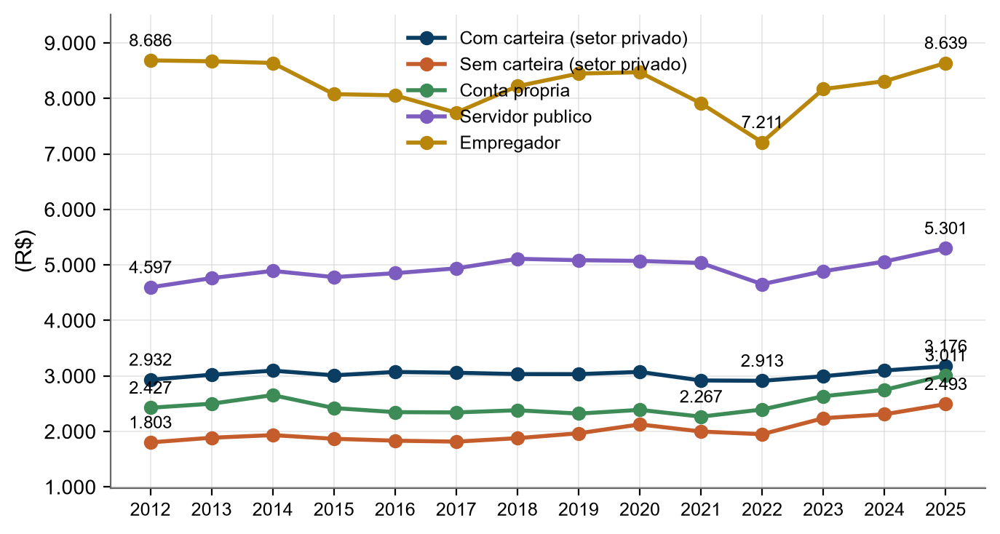<figcaption><strong>Figura 24 – Taxa de Formalização do Emprego (2012-2026).</strong> <em>Fonte: [(IPEA, 2026)](https://www.ipea.gov.br/cartadeconjuntura/index.php/category/mercado-de-trabalho/).</em> Participação do emprego com carteira sobre o total (com + sem carteira), em médias anuais (Ipeadata/PNAD Contínua).</figcaption></figure>

Os riscos da informalidade incluem a falta de cobertura previdenciária automática. Enquanto o segurado empregado tem a empresa responsável por medidas de proteção e segurança da saúde [(BRASIL, LEI 8.213/1991, art. 19, § 1º)](https://www.planalto.gov.br/ccivil_03/leis/l8213cons.htm), o informal assume integralmente os riscos de sua atividade.

<strong>Tabela 26 – Comparativo de Cobertura Previdenciária.</strong> <em>Fonte: [(BRASIL, LC 123/2006)](https://www.planalto.gov.br/ccivil_03/leis/lcp/lcp123.htm).</em>

| Situação | Cobertura RGPS | Observação [(BRASIL, LC 123/2006)](https://www.planalto.gov.br/ccivil_03/leis/lcp/lcp123.htm) |
| :--- | :--- | :--- |
| MEI | Sim [(BRASIL, LC 123/2006, art. 82)](https://www.planalto.gov.br/ccivil_03/leis/lcp/lcp123.htm) | Exceto desemprego involuntário [(BRASIL, LC 123/2006, art. 82, § 1º)](https://www.planalto.gov.br/ccivil_03/leis/lcp/lcp123.htm) |
| Informal | Não [(BRASIL, LEI 8.213/1991, art. 11)](https://www.planalto.gov.br/ccivil_03/leis/l8213cons.htm) | Depende de contribuição facultativa ou autônoma [(BRASIL, LEI 8.213/1991, art. 11)](https://www.planalto.gov.br/ccivil_03/leis/l8213cons.htm) |
| CLT | Sim [(BRASIL, LEI 8.213/1991, art. 11)](https://www.planalto.gov.br/ccivil_03/leis/l8213cons.htm) | Cobertura integral via empregador [(BRASIL, LEI 8.213/1991, art. 11)](https://www.planalto.gov.br/ccivil_03/leis/l8213cons.htm) |

Existem categorias específicas, como o segurado especial, que engloba o pescador artesanal e o produtor rural em regime de economia familiar [(BRASIL, LEI 8.213/1991, art. 11, VII)](https://www.planalto.gov.br/ccivil_03/leis/l8213cons.htm). Estes podem exercer atividade remunerada em períodos de entressafra ou defeso por até 120 dias no ano civil sem perder a condição de segurado especial [(BRASIL, LEI 8.213/1991, art. 11, § 9º, III)](https://www.planalto.gov.br/ccivil_03/leis/l8213cons.htm).

<figure class="figura">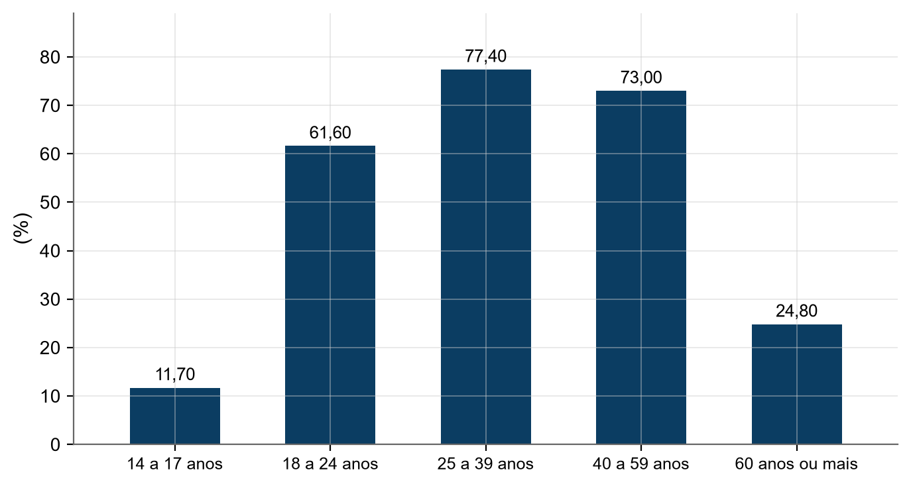<figcaption><strong>Figura 25 – Limite de Dias de Atividade Remunerada do Segurado Especial.</strong> <em>Fonte: [(BRASIL, LEI 8.213/1991)](https://www.planalto.gov.br/ccivil_03/leis/l8213cons.htm).</em> Divisão do ano civil: até 120 dias de atividade remunerada mantêm a condição de segurado especial; nos demais 245 dias, a atividade não pode ser remunerada.</figcaption></figure>

<figure class="figura">

<h4>MEI Formalizado</h4><ul><li>CNPJ ativo e DAS mensal com INSS embutido [(BRASIL, LC 123/2006, art. 18 a 20)](https://www.planalto.gov.br/ccivil_03/leis/lcp/lcp123.htm)</li><li>Acesso a aposentadoria, auxílio-doença e pensão [(BRASIL, LEI 8.213/1991)](https://www.planalto.gov.br/ccivil_03/leis/l8213cons.htm)</li><li>Pode ter até 1 empregado, dentro do limite de faturamento</li></ul>

<h4>Trabalho Informal</h4><ul><li>Sem CNPJ, sem registro e sem FGTS [(BRASIL, LEI 8.213/1991)](https://www.planalto.gov.br/ccivil_03/leis/l8213cons.htm)</li><li>Previdência apenas com contribuição facultativa ou autônoma</li><li>Sem direitos trabalhistas e com risco de penalidades</li></ul>

<figcaption><strong>Figura 26 – MEI Formalizado x Trabalho Informal.</strong> <em>Fonte: [(BRASIL, LC 123/2006)](https://www.planalto.gov.br/ccivil_03/leis/lcp/lcp123.htm) e [(BRASIL, LEI 8.213/1991)](https://www.planalto.gov.br/ccivil_03/leis/l8213cons.htm).</em> A formalização como MEI abre acesso a benefícios previdenciários que o trabalho informal não garante.</figcaption></figure>

**Em termos simples:** O MEI é um jeito fácil de tirar o CNPJ e pagar o INSS para ter direito a aposentadoria e auxílio-doença, mas ele não dá direito ao seguro-desemprego [(BRASIL, LC 123/2006)](https://www.planalto.gov.br/ccivil_03/leis/lcp/lcp123.htm). Já quem trabalha na informalidade (sem registro ou CNPJ) corre o risco de ficar sem nenhum amparo do governo se ficar doente ou envelhecer, a menos que pague o INSS por conta própria [(BRASIL, LEI 8.213/1991)](https://www.planalto.gov.br/ccivil_03/leis/l8213cons.htm).

Fontes consultadas:
* [(BRASIL, LEI 8.213/1991)](https://www.planalto.gov.br/ccivil_03/leis/l8213cons.htm)
* [(BRASIL, LC 123/2006)](https://www.planalto.gov.br/ccivil_03/leis/lcp/lcp123.htm)
* [(BRASIL, LEI 8.212/1991)](https://www.planalto.gov.br/ccivil_03/leis/l8212cons.htm)

## 9. Previdência e tributos do trabalhador

O custeio da previdência social é organizado para assegurar a manutenção do beneficiário em casos de incapacidade, idade avançada, tempo de serviço, encargos familiares, prisão ou morte [(BRASIL, LEI 8.213/1991)](https://www.planalto.gov.br/ccivil_03/leis/l8213cons.htm). A Seguridade Social fundamenta-se nos princípios de universalidade de cobertura, uniformidade de benefícios entre populações urbanas e rurais, e equidade na participação do custeio [(BRASIL, LEI 8.212/1991)](https://www.planalto.gov.br/ccivil_03/leis/l8212cons.htm).

Para o trabalhador CLT (empregado), inclusive o doméstico e o trabalhador avulso, a contribuição é calculada aplicando-se alíquotas sobre o salário-de-contribuição mensal [(BRASIL, LEI 8.212/1991)](https://www.planalto.gov.br/ccivil_03/leis/l8212cons.htm). No caso do empregado doméstico, o recolhimento ocorre via documento único, abrangendo a contribuição do segurado (8% a 11%), a contribuição patronal (8%), o seguro contra acidentes de trabalho (0,8%) e o FGTS (8%) [(BRASIL, LC 150/2015)](https://www.planalto.gov.br/ccivil_03/leis/lcp/lcp150.htm).

Para os segurados contribuintes individuais, como o trabalhador autônomo, empresário e facultativos, a alíquota de contribuição é de 20% sobre o salário-de-contribuição mensal [(BRASIL, LEI 8.212/1991)](https://www.planalto.gov.br/ccivil_03/leis/l8212cons.htm). Estes profissionais são obrigados a recolher a contribuição por iniciativa própria até o dia quinze do mês seguinte ao da competência [(BRASIL, LEI 8.212/1991)](https://www.planalto.gov.br/ccivil_03/leis/l8212cons.htm).

O Microempreendedor Individual (MEI) possui regras específicas de contribuição, podendo optar por complementações previdenciárias para fins de aposentadoria por tempo de contribuição [(BRASIL, LC 123/2006)](https://www.planalto.gov.br/ccivil_03/leis/lcp/lcp123.htm). O MEI é dispensado de apresentar a Relação Anual de Informações Sociais (Rais) e de declarar ausência de fato gerador para a Caixa Econômica Federal para emissão de Certidão de Regularidade Fiscal perante o FGTS [(BRASIL, LC 123/2006)](https://www.planalto.gov.br/ccivil_03/leis/lcp/lcp123.htm).

No setor rural, o trabalhador contratado por pequeno prazo tem sua contribuição fixada em 8% sobre o respectivo salário-de-contribuição [(BRASIL, LEI 5.889/1973)](https://www.planalto.gov.br/ccivil_03/leis/l5889.htm).

<strong>Tabela 27 – Alíquotas de Contribuição Previdenciária.</strong> <em>Fonte: [(BRASIL, LEI 8.212/1991)](https://www.planalto.gov.br/ccivil_03/leis/l8212cons.htm).</em>

| Categoria de Segurado | Alíquota (%) | Base de Cálculo |
| :--- | :--- | :--- |
| Empregado (até 249,80) | 8,00% [(BRASIL, LEI 8.212/1991)](https://www.planalto.gov.br/ccivil_03/leis/l8212cons.htm) | Salário-de-contribuição [(BRASIL, LEI 8.212/1991)](https://www.planalto.gov.br/ccivil_03/leis/l8212cons.htm) |
| Empregado (249,81 a 416,33) | 9,00% [(BRASIL, LEI 8.212/1991)](https://www.planalto.gov.br/ccivil_03/leis/l8212cons.htm) | Salário-de-contribuição [(BRASIL, LEI 8.212/1991)](https://www.planalto.gov.br/ccivil_03/leis/l8212cons.htm) |
| Empregado (416,34 a 832,66) | 11,00% [(BRASIL, LEI 8.212/1991)](https://www.planalto.gov.br/ccivil_03/leis/l8212cons.htm) | Salário-de-contribuição [(BRASIL, LEI 8.212/1991)](https://www.planalto.gov.br/ccivil_03/leis/l8212cons.htm) |
| Autônomo/Empresário/Facultativo | 20,00% [(BRASIL, LEI 8.212/1991)](https://www.planalto.gov.br/ccivil_03/leis/l8212cons.htm) | Salário-de-contribuição [(BRASIL, LEI 8.212/1991)](https://www.planalto.gov.br/ccivil_03/leis/l8212cons.htm) |

<figure class="figura">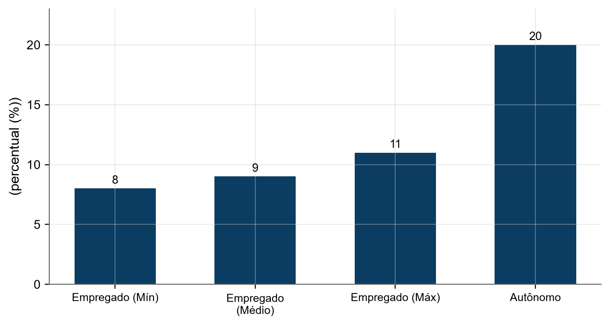<figcaption><strong>Figura 27 – Comparativo de Alíquotas Previdenciárias.</strong> <em>Fonte: [(BRASIL, LEI 8.212/1991)](https://www.planalto.gov.br/ccivil_03/leis/l8212cons.htm).</em> Valores baseados nas faixas de contribuição da Lei 8.212/1991</figcaption></figure>

A carência para aposentadorias por idade, tempo de serviço e especial para segurados urbanos e rurais variou historicamente conforme o ano de entrada do requerimento [(BRASIL, LEI 8.213/1991)](https://www.planalto.gov.br/ccivil_03/leis/l8213cons.htm). Por exemplo, em 1991 a exigência era de 60 meses, subindo gradualmente até atingir 180 meses em 2011, patamar mantido até hoje [(BRASIL, LEI 8.213/1991)](https://www.planalto.gov.br/ccivil_03/leis/l8213cons.htm).

<figure class="figura">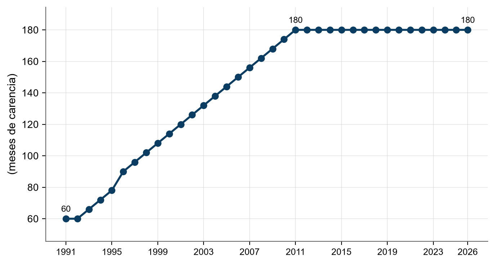<figcaption><strong>Figura 28 – Evolução da Carência Exigida para Aposentadoria (1991-2026).</strong> <em>Fonte: [(BRASIL, LEI 8.213/1991)](https://www.planalto.gov.br/ccivil_03/leis/l8213cons.htm).</em> Série anual da tabela do art. 142 da Lei 8.213/1991 (meses de carência exigidos por ano de entrada do requerimento): de 60 meses em 1991 a 180 meses desde 2011, patamar vigente até 2026.</figcaption></figure>

**Em termos simples:** O INSS é como uma poupança obrigatória. Quem trabalha com carteira assinada tem um desconto no salário que varia entre 8% e 11% [(BRASIL, LEI 8.212/1991)](https://www.planalto.gov.br/ccivil_03/leis/l8212cons.htm). Quem trabalha por conta própria (autônomo) ou é empresário paga geralmente 20% [(BRASIL, LEI 8.212/1991)](https://www.planalto.gov.br/ccivil_03/leis/l8212cons.htm). O MEI tem um valor reduzido e simplificado no boleto mensal [(BRASIL, LC 123/2006)](https://www.planalto.gov.br/ccivil_03/leis/lcp/lcp123.htm).

Fontes consultadas:
* [(BRASIL, LEI 8.212/1991)](https://www.planalto.gov.br/ccivil_03/leis/l8212cons.htm)
* [(BRASIL, LEI 8.213/1991)](https://www.planalto.gov.br/ccivil_03/leis/l8213cons.htm)
* [(BRASIL, LC 123/2006)](https://www.planalto.gov.br/ccivil_03/leis/lcp/lcp123.htm)
* [(BRASIL, LC 150/2015)](https://www.planalto.gov.br/ccivil_03/leis/lcp/lcp150.htm)
* [(BRASIL, LEI 5.889/1973)](https://www.planalto.gov.br/ccivil_03/leis/l5889.htm)

## 10. Trabalho por plataformas digitais

O trabalho mediado por plataformas digitais no Brasil abrange serviços de transporte individual de passageiros e de entrega de bens e mercadorias [(CAMARA DOS DEPUTADOS, 2026z)](https://www25.senado.leg.br/web/atividade/materias/-/materia/175660). Esse modelo é caracterizado por assimetrias nas relações de comunicação, onde a interface do aplicativo pode limitar a interação entre a empresa e o trabalhador, gerando desigualdade de informações [(REBECHI, 2026)](https://doi.org/10.1590/1982-0259.2022.e82596).

No setor de transporte de passageiros, o volume de trabalhadores atingiu a marca de 1,2 milhão de pessoas no país [(IBGE, 2026e)](https://agenciadenoticias.ibge.gov.br/agencia-noticias/2012-agencia-de-noticias/noticias/47966-trabalhadores-de-transporte-de-passageiros-por-aplicativo-chegam-a-1-2-milhao-de-pessoas-no-pais). Paralelamente, a população ocupada total no Brasil apresenta crescimento constante, chegando a 102,5 milhões de pessoas em 2026 [(IBGE, 2026a)](https://www.ibge.gov.br/estatisticas/sociais/trabalho/17270-pnad-continua.html).

<figure class="figura">

<h4>Transporte por App</h4><ul><li>1,2 milhão de trabalhadores (transporte de passageiros por aplicativo)</li></ul>

<h4>Ocupação Total Brasil</h4><ul><li>102,5 milhões de pessoas ocupadas em 2026</li></ul>

<figcaption><strong>Figura 29 – Volume de Trabalhadores por Categoria.</strong> <em>Fonte: [(IBGE, 2026e)](https://agenciadenoticias.ibge.gov.br/agencia-noticias/2012-agencia-de-noticias/noticias/47966-trabalhadores-de-transporte-de-passageiros-por-aplicativo-chegam-a-1-2-milhao-de-pessoas-no-pais) e [(IBGE, 2026a)](https://www.ibge.gov.br/estatisticas/sociais/trabalho/17270-pnad-continua.html).</em> Comparativo entre motoristas de app e a população ocupada total do país; os motoristas de app equivalem a cerca de 1,2% dos ocupados.</figcaption></figure>

A situação jurídica em 2026 é marcada por proposições legislativas que buscam regulamentar a atividade. O PL 05253/2026 dispõe sobre as relações de trabalho aplicáveis a quem presta serviços de transporte remunerado privado ou de coleta e entrega de mercadorias via plataformas [(CAMARA DOS DEPUTADOS, 2026z)](https://www25.senado.leg.br/web/atividade/materias/-/materia/175660). Outra medida focada na infraestrutura é o PL 2911/2025, que estabelece a obrigatoriedade de disponibilização de pontos de apoio para trabalhadores de entrega e transporte individual [(CAMARA DOS DEPUTADOS, 2026a)](https://www.camara.leg.br/proposicoesWeb/fichadetramitacao?idProposicao=2525925).

<strong>Tabela 28 – Ciclo de trabalho em plataformas digitais.</strong> <em>Fonte: [(REBECHI, 2026)](https://doi.org/10.1590/1982-0259.2022.e82596) e [(CAMARA DOS DEPUTADOS, 2026z)](https://www25.senado.leg.br/web/atividade/materias/-/materia/175660).</em> Etapas da prestação de serviço por aplicativos.

| Etapa | Descrição | Fonte |
| :--- | :--- | :--- |
| 1 | Acesso à interface do aplicativo | [(REBECHI, 2026)](https://doi.org/10.1590/1982-0259.2022.e82596) |
| 2 | Recebimento de demanda via algoritmo | [(REBECHI, 2026)](https://doi.org/10.1590/1982-0259.2022.e82596) |
| 3 | Execução do serviço de transporte ou entrega | [(CAMARA DOS DEPUTADOS, 2026z)](https://www25.senado.leg.br/web/atividade/materias/-/materia/175660) |
| 4 | Remuneração mediada pela plataforma | [(CAMARA DOS DEPUTADOS, 2026z)](https://www25.senado.leg.br/web/atividade/materias/-/materia/175660) |

Os direitos em discussão envolvem a proteção social e a transparência. A contribuição para a Seguridade Social e o FGTS são pontos centrais, especialmente para aqueles que operam sob regimes simplificados como o Simples Nacional e MEI [(BRASIL, LC 123/2006)](https://www.planalto.gov.br/ccivil_03/leis/lcp/lcp123.htm). A transparência remuneratória, embora detalhada para empresas com mais de 100 empregados na Lei 14.611/2023, serve de referência para a discussão de critérios de pagamento justos [(BRASIL, LEI 14.611/2023)](https://www.planalto.gov.br/ccivil_03/_ato2023-2026/2023/lei/l14611.htm).

<strong>Tabela 29 – Impactos das Propostas Legislativas.</strong> <em>Fonte: [(CAMARA DOS DEPUTADOS, 2026a)](https://www.camara.leg.br/proposicoesWeb/fichadetramitacao?idProposicao=2525925) e [(CAMARA DOS DEPUTADOS, 2026z)](https://www25.senado.leg.br/web/atividade/materias/-/materia/175660).</em>

| Proposta | Beneficiados | Prejudicados/Impactados | Objetivo Principal |
| :--- | :--- | :--- | :--- |
| PL 2911/2025 | Trabalhadores (apoio físico) [(CAMARA DOS DEPUTADOS, 2026a)](https://www.camara.leg.br/proposicoesWeb/fichadetramitacao?idProposicao=2525925) | Plataformas (custo de infraestrutura) [(CAMARA DOS DEPUTADOS, 2026a)](https://www.camara.leg.br/proposicoesWeb/fichadetramitacao?idProposicao=2525925) | Pontos de apoio [(CAMARA DOS DEPUTADOS, 2026a)](https://www.camara.leg.br/proposicoesWeb/fichadetramitacao?idProposicao=2525925) |
| PL 05253/2026 | Trabalhadores (segurança jurídica) [(CAMARA DOS DEPUTADOS, 2026z)](https://www25.senado.leg.br/web/atividade/materias/-/materia/175660) | Plataformas (novas obrigações) [(CAMARA DOS DEPUTADOS, 2026z)](https://www25.senado.leg.br/web/atividade/materias/-/materia/175660) | Regulamentação da relação [(CAMARA DOS DEPUTADOS, 2026z)](https://www25.senado.leg.br/web/atividade/materias/-/materia/175660) |

A renda média mensal real do trabalho no Brasil, que engloba diversas categorias, apresentou tendência de alta, atingindo R$ 3.777,50 em 2026 [(IBGE, 2026a)](https://www.ibge.gov.br/estatisticas/sociais/trabalho/17270-pnad-continua.html).

**Em termos simples:** O trabalho por aplicativos (como Uber e iFood) cresceu muito, com mais de 1 milhão de motoristas [(IBGE, 2026e)](https://agenciadenoticias.ibge.gov.br/agencia-noticias/2012-agencia-de-noticias/noticias/47966-trabalhadores-de-transporte-de-passageiros-por-aplicativo-chegam-a-1-2-milhao-de-pessoas-no-pais). Atualmente, existem projetos de lei para criar locais de descanso para esses trabalhadores [(CAMARA DOS DEPUTADOS, 2026a)](https://www.camara.leg.br/proposicoesWeb/fichadetramitacao?idProposicao=2525925) e regras mais claras sobre como eles devem ser contratados e pagos [(CAMARA DOS DEPUTADOS, 2026z)](https://www25.senado.leg.br/web/atividade/materias/-/materia/175660).

Fontes consultadas:
* [(CAMARA DOS DEPUTADOS, 2026a)](https://www.camara.leg.br/proposicoesWeb/fichadetramitacao?idProposicao=2525925)
* [(CAMARA DOS DEPUTADOS, 2026z)](https://www25.senado.leg.br/web/atividade/materias/-/materia/175660)
* [(IBGE, 2026a)](https://www.ibge.gov.br/estatisticas/sociais/trabalho/17270-pnad-continua.html)
* [(IBGE, 2026e)](https://agenciadenoticias.ibge.gov.br/agencia-noticias/2012-agencia-de-noticias/noticias/47966-trabalhadores-de-transporte-de-passageiros-por-aplicativo-chegam-a-1-2-milhao-de-pessoas-no-pais)
* [(REBECHI, 2026)](https://doi.org/10.1590/1982-0259.2022.e82596)
* [(BRASIL, LC 123/2006)](https://www.planalto.gov.br/ccivil_03/leis/lcp/lcp123.htm)
* [(BRASIL, LEI 14.611/2023)](https://www.planalto.gov.br/ccivil_03/_ato2023-2026/2023/lei/l14611.htm)

## 11. Mudanças em tramitação no Congresso em 2026

O cenário legislativo de 2026 apresenta propostas focadas na regulação de novas modalidades de trabalho e na redução da carga horária semanal [(IMPRENSA, 2026f)](https://g1.globo.com/politica/noticia/2026/10/14/senado-aprova-pec-do-fim-da-escala-6x1.ghtml). As discussões concentram-se na proteção de trabalhadores de aplicativos e na alteração de escalas de descanso [(CAMARA DOS DEPUTADOS, 2026z)](https://www25.senado.leg.br/web/atividade/materias/-/materia/175660).

### 11.1 Proposições em Tramitação

As principais matérias em discussão no Congresso Nacional buscam mitigar assimetrias de informação e precariedade no trabalho mediado por plataformas [(REBECHI, 2026)](https://doi.org/10.1590/1982-0259.2022.e82596).

<strong>Tabela 30 – Proposições Legislativas sobre Trabalho.</strong> <em>Fonte: [(CAMARA DOS DEPUTADOS, 2026z; CAMARA DOS DEPUTADOS, 2026a)](https://www25.senado.leg.br/web/atividade/materias/-/materia/175660).</em>

| Proposição | Ementa | Situação | Impacto |
| :--- | :--- | :--- | :--- |
| PL 05253/2026 | Relações de trabalho para transporte e entrega via plataformas digitais [(CAMARA DOS DEPUTADOS, 2026z)](https://www25.senado.leg.br/web/atividade/materias/-/materia/175660) | Em tramitação [(CAMARA DOS DEPUTADOS, 2026z)](https://www25.senado.leg.br/web/atividade/materias/-/materia/175660) | Regula vínculo de motoristas e entregadores [(CAMARA DOS DEPUTADOS, 2026z)](https://www25.senado.leg.br/web/atividade/materias/-/materia/175660) |
| PL 2911/2025 | Obrigatoriedade de pontos de apoio para trabalhadores de plataformas [(CAMARA DOS DEPUTADOS, 2026a)](https://www.camara.leg.br/proposicoesWeb/fichadetramitacao?idProposicao=2525925) | Em tramitação [(CAMARA DOS DEPUTADOS, 2026a)](https://www.camara.leg.br/proposicoesWeb/fichadetramitacao?idProposicao=2525925) | Beneficia entregadores e motoristas privados [(CAMARA DOS DEPUTADOS, 2026a)](https://www.camara.leg.br/proposicoesWeb/fichadetramitacao?idProposicao=2525925) |

Além das proposições legislativas, há denúncias junto ao Ministério do Trabalho sobre a prática de "pejotização" e reduções salariais em instituições de ensino [(EXTRA CLASSE, 2026a)](https://www.extraclasse.org.br/movimento/2026/10/sindicatos-denunciam-ulbra-ao-ministerio-do-trabalho-por-pejotizacao-e-reducoes-salariais/).

<strong>Tabela 31 – Tramitação da PEC do Fim da Escala 6x1.</strong> <em>Fonte: [(IMPRENSA, 2026f)](https://g1.globo.com/politica/noticia/2026/10/14/senado-aprova-pec-do-fim-da-escala-6x1.ghtml).</em> Processo de transição da escala 6x1 para a jornada de 40h.

| Etapa | Ato | Observação |
| :--- | :--- | :--- |
| 1 | Aprovação no Senado | PEC do fim da escala 6x1 e redução para 40h [(IMPRENSA, 2026f)](https://g1.globo.com/politica/noticia/2026/10/14/senado-aprova-pec-do-fim-da-escala-6x1.ghtml) |
| 2 | Nova configuração | Dois dias de folga por semana [(IMPRENSA, 2026f)](https://g1.globo.com/politica/noticia/2026/10/14/senado-aprova-pec-do-fim-da-escala-6x1.ghtml) |
| 3 | Implementação | Redução da jornada semanal para 40 horas [(IMPRENSA, 2026f)](https://g1.globo.com/politica/noticia/2026/10/14/senado-aprova-pec-do-fim-da-escala-6x1.ghtml) |

### 11.2 Cenário Pós-Aprovação no Senado: Escala 6x1 e Jornada de 40 Horas

Com a aprovação da PEC no Senado, ocorre a extinção da escala 6x1, garantindo que o trabalhador tenha dois dias de folga por semana [(IMPRENSA, 2026f)](https://g1.globo.com/politica/noticia/2026/10/14/senado-aprova-pec-do-fim-da-escala-6x1.ghtml). A medida reduz a jornada de trabalho de 44 horas para 40 horas semanais [(IMPRENSA, 2026f)](https://g1.globo.com/politica/noticia/2026/10/14/senado-aprova-pec-do-fim-da-escala-6x1.ghtml).

**Funcionamento da Jornada e Intervalos**
A nova jornada estabelece o limite de 40 horas semanais [(IMPRENSA, 2026f)](https://g1.globo.com/politica/noticia/2026/10/14/senado-aprova-pec-do-fim-da-escala-6x1.ghtml). Para a compensação de dias e horas, a legislação vigente prevê que o excesso de horas de um dia pode ser compensado em outro, mediante acordo escrito [(BRASIL, LC 150/2015, § 4º)](https://www.planalto.gov.br/ccivil_03/leis/lcp/lcp150.htm). No regime de tempo parcial, a jornada não deve exceder 30 horas semanais sem horas suplementares, ou 26 horas com possibilidade de até seis horas extras [(BRASIL, LEI 13.467/2017, art. 58-A)](https://www.planalto.gov.br/ccivil_03/_ato2015-2018/2017/lei/l13467.htm).

**Proporcionalidade Salarial e Direitos**
O salário para regimes de jornada reduzida ou tempo parcial deve ser proporcional à jornada cumprida em relação aos empregados de tempo integral na mesma função [(BRASIL, 1943, § 1º)](https://www.planalto.gov.br/ccivil_03/decreto-lei/del5452.htm). As horas suplementares à jornada normal são pagas com acréscimo de 50% sobre o salário-hora normal [(BRASIL, LEI 13.467/2017, § 3º)](https://www.planalto.gov.br/ccivil_03/_ato2015-2018/2017/lei/l13467.htm).

**Impactos Práticos**
*   **Para o Trabalhador:** Passa a ter direito a dois dias de descanso semanal [(IMPRENSA, 2026f)](https://g1.globo.com/politica/noticia/2026/10/14/senado-aprova-pec-do-fim-da-escala-6x1.ghtml) e redução da carga horária total [(IMPRENSA, 2026f)](https://g1.globo.com/politica/noticia/2026/10/14/senado-aprova-pec-do-fim-da-escala-6x1.ghtml).
*   **Para o Empregador:** Necessidade de reorganização das escalas de trabalho para adequação ao limite de 40 horas e garantia de duas folgas [(IMPRENSA, 2026f)](https://g1.globo.com/politica/noticia/2026/10/14/senado-aprova-pec-do-fim-da-escala-6x1.ghtml).

**Em termos simples:** O Senado aprovou o fim daquela escala onde a pessoa trabalha seis dias para folgar um; agora, todo trabalhador terá dois dias de folga na semana e a carga horária caiu de 44 para 40 horas [(IMPRENSA, 2026f)](https://g1.globo.com/politica/noticia/2026/10/14/senado-aprova-pec-do-fim-da-escala-6x1.ghtml).

Fontes consultadas:
* [(IMPRENSA, 2026f)](https://g1.globo.com/politica/noticia/2026/10/14/senado-aprova-pec-do-fim-da-escala-6x1.ghtml)
* [(CAMARA DOS DEPUTADOS, 2026z)](https://www25.senado.leg.br/web/atividade/materias/-/materia/175660)
* [(CAMARA DOS DEPUTADOS, 2026a)](https://www.camara.leg.br/proposicoesWeb/fichadetramitacao?idProposicao=2525925)
* [(REBECHI, 2026)](https://doi.org/10.1590/1982-0259.2022.e82596)
* [(EXTRA CLASSE, 2026a)](https://www.extraclasse.org.br/movimento/2026/10/sindicatos-denunciam-ulbra-ao-ministerio-do-trabalho-por-pejotizacao-e-reducoes-salariais/)
* [(BRASIL, LC 150/2015)](https://www.planalto.gov.br/ccivil_03/leis/lcp/lcp150.htm)
* [(BRASIL, LEI 13.467/2017)](https://www.planalto.gov.br/ccivil_03/_ato2015-2018/2017/lei/l13467.htm)
* [(BRASIL, 1943)](https://www.planalto.gov.br/ccivil_03/decreto-lei/del5452.htm)

## 12. Riscos e como se proteger

A gestão de riscos no ambiente laboral varia drasticamente conforme a modalidade de contratação, impactando a responsabilidade sobre a saúde e a segurança do trabalhador. [(MTE, 2026b)](https://www.gov.br/trabalho-e-emprego/pt-br/assuntos/inspecao-do-trabalho)

### 12.1 Saúde, Segurança e Equipamentos de Proteção

No regime CLT, a empresa detém a responsabilidade legal integral pela segurança do trabalhador. É obrigação do empregador fornecer, gratuitamente, Equipamentos de Proteção Individual (EPI) adequados ao risco e em perfeito estado de conservação [(BRASIL, 1943, art. 166)](https://www.planalto.gov.br/ccivil_03/decreto-lei/del5452.htm). O uso desses equipamentos, como óculos, luvas, máscaras e capacetes, é obrigatório para o empregado [(BRASIL, 1943, art. 165)](https://www.planalto.gov.br/ccivil_03/decreto-lei/del5452.htm).

A legislação estabelece que a empresa deve adotar medidas coletivas e individuais de proteção à saúde [(BRASIL, LEI 8.213/1991, art. 19, § 1º)](https://www.planalto.gov.br/ccivil_03/leis/l8213cons.htm). O descumprimento das normas de segurança e higiene do trabalho é classificado como contravenção penal, punível com multa [(BRASIL, LEI 8.213/1991, art. 19, § 2º)](https://www.planalto.gov.br/ccivil_03/leis/l8213cons.htm). Além disso, a Constituição Federal prevê a redução dos riscos inerentes ao trabalho por meio de normas de saúde e higiene [(BRASIL, 1988, art. 7º, XXII)](https://www.planalto.gov.br/ccivil_03/constituicao/constituicao.htm).

Para trabalhadores em plataformas digitais, observa-se a "corrosão" da legislação protetora, resultando em condições de trabalho exaustivas e riscos à saúde [(ENGELMANN, 2026)](https://openalex.org/W7215382595).

<strong>Tabela 32 – Comparativo de Riscos e Proteções.</strong> <em>Fonte: [(BRASIL, 1943; BRASIL, LEI 8.213/1991; BRASIL, LEI 10.406/2002)](https://www.planalto.gov.br/ccivil_03/decreto-lei/del5452.htm).</em>

| Elemento | CLT (Empregado) | PJ/MEI (Prestador) [(MTE, 2026b)](https://www.gov.br/trabalho-e-emprego/pt-br/assuntos/inspecao-do-trabalho) |
| :--- | :--- | :--- |
| Fornecimento de EPI | Obrigação gratuita da empresa [(BRASIL, 1943, art. 166)](https://www.planalto.gov.br/ccivil_03/decreto-lei/del5452.htm) | Responsabilidade do prestador/empresa [(BRASIL, LEI 10.406/2002)](https://www.planalto.gov.br/ccivil_03/leis/2002/l10406.htm) |
| Risco Econômico | Assumido pelo empregador [(BRASIL, 1943, art. 2º)](https://www.planalto.gov.br/ccivil_03/decreto-lei/del5452.htm) | Alocado na pessoa jurídica [(BRASIL, LEI 10.406/2002, art. 50)](https://www.planalto.gov.br/ccivil_03/leis/2002/l10406.htm) |
| Fiscalização | Foco em normas de segurança e saúde [(MTE, 2026b)](https://www.gov.br/trabalho-e-emprego/pt-br/assuntos/inspecao-do-trabalho) | Natureza prioritariamente orientadora [(BRASIL, LC 123/2006, art. 55)](https://www.planalto.gov.br/ccivil_03/leis/lcp/lcp123.htm) |
| Seguro Acidente | A cargo do empregador [(BRASIL, 1988, art. 7º, XXVIII)](https://www.planalto.gov.br/ccivil_03/constituicao/constituicao.htm) | Responsabilidade do segurado/empresa [(BRASIL, LEI 10.406/2002)](https://www.planalto.gov.br/ccivil_03/leis/2002/l10406.htm) |

<figure class="figura">

<h4>Riscos de Quem Atua como PJ/MEI</h4><ul><li>EPI e segurança por conta própria [(BRASIL, 1943, art. 166)](https://www.planalto.gov.br/ccivil_03/decreto-lei/del5452.htm)</li><li>Sem seguro-acidente e sem FGTS [(BRASIL, 1988, art. 7º, XXVIII)](https://www.planalto.gov.br/ccivil_03/constituicao/constituicao.htm)</li><li>Bens pessoais respondem em caso de fraude [(BRASIL, LEI 10.406/2002, art. 50)](https://www.planalto.gov.br/ccivil_03/leis/2002/l10406.htm)</li></ul>

<h4>Proteções de Quem é Empregado CLT</h4><ul><li>EPI gratuito e obrigatório do empregador [(BRASIL, 1943, art. 166)](https://www.planalto.gov.br/ccivil_03/decreto-lei/del5452.htm)</li><li>Seguro-acidente e responsabilidade do empregador [(BRASIL, LEI 8.213/1991, art. 19)](https://www.planalto.gov.br/ccivil_03/leis/l8213cons.htm)</li><li>Fiscalização pela Auditoria-Fiscal do Trabalho [(BRASIL, LEI 10.593/2002)](https://www.planalto.gov.br/ccivil_03/leis/2002/l10593.htm)</li></ul>

<figcaption><strong>Figura 30 – Riscos do Prestador x Proteções do Empregado.</strong> <em>Fonte: [(BRASIL, 1943)](https://www.planalto.gov.br/ccivil_03/decreto-lei/del5452.htm), [(BRASIL, LEI 8.213/1991)](https://www.planalto.gov.br/ccivil_03/leis/l8213cons.htm) e [(BRASIL, LEI 10.406/2002)](https://www.planalto.gov.br/ccivil_03/leis/2002/l10406.htm).</em> O prestador assume os riscos que o empregado CLT tem cobertos pela lei.</figcaption></figure>

### 12.2 Fiscalização e Fraude Trabalhista

A fiscalização do trabalho é exercida pelo Ministério do Trabalho e Emprego (MTE), que atua na aplicação da lei e no recebimento de denúncias [(MTE, 2026b)](https://www.gov.br/trabalho-e-emprego/pt-br/assuntos/inspecao-do-trabalho). Para microempresas e empresas de pequeno porte (MEI), a fiscalização trabalhista e de segurança deve ter natureza prioritariamente orientadora, desde que o risco seja compatível [(BRASIL, LC 123/2006, art. 55)](https://www.planalto.gov.br/ccivil_03/leis/lcp/lcp123.htm).

No caso de fraudes ou desvios, a Justiça do Trabalho pode ser acionada. Se houver abuso da personalidade jurídica, caracterizado por desvio de finalidade ou confusão patrimonial, o juiz pode desconsiderar a PJ para estender obrigações aos bens particulares de sócios ou administradores [(BRASIL, LEI 10.406/2002, art. 50)](https://www.planalto.gov.br/ccivil_03/leis/2002/l10406.htm).

### 12.3 Papel do Sindicato e Conciliação

Os sindicatos possuem papel ativo no acompanhamento do cumprimento das normas de segurança e higiene [(BRASIL, LEI 8.213/1991, art. 19, § 4º)](https://www.planalto.gov.br/ccivil_03/leis/l8213cons.htm). Além disso, podem ser instituídas Comissões de Conciliação Prévia no âmbito do sindicato ou da empresa para resolver demandas trabalhistas antes de chegarem à justiça [(BRASIL, 1943, art. 625-D)](https://www.planalto.gov.br/ccivil_03/decreto-lei/del5452.htm).

### 12.4 Checklist para Migração de Modalidade

Para quem deseja migrar entre CLT e PJ/MEI, deve-se observar:
*   **De CLT para PJ:** Ciência de que a autonomia patrimonial da PJ serve para segregar riscos [(BRASIL, LEI 10.406/2002, art. 50)](https://www.planalto.gov.br/ccivil_03/leis/2002/l10406.htm).
*   **De PJ para CLT:** Recuperação do direito ao FGTS (8% da remuneração) [(BRASIL, LEI 8.036/1990, art. 15)](https://www.planalto.gov.br/ccivil_03/leis/l8036consol.htm).
*   **Segurança:** Verificação de quem proverá os EPIs e a responsabilidade por acidentes [(BRASIL, 1943, art. 166; BRASIL, LEI 8.213/1991, art. 19)](https://www.planalto.gov.br/ccivil_03/decreto-lei/del5452.htm).

**Em termos simples:** Quem é CLT tem a empresa obrigada a dar equipamentos de segurança de graça e a pagar o seguro se houver acidente [(BRASIL, 1943, art. 166; BRASIL, 1988, art. 7º, XXVIII)](https://www.planalto.gov.br/ccivil_03/decreto-lei/del5452.htm). Já quem é PJ assume seus próprios riscos e custos, mas a lei pode "quebrar" a empresa para pegar os bens do dono se houver fraude [(BRASIL, LEI 10.406/2002, art. 50)](https://www.planalto.gov.br/ccivil_03/leis/2002/l10406.htm).

Fontes consultadas:
* [(MTE, 2026b)](https://www.gov.br/trabalho-e-emprego/pt-br/assuntos/inspecao-do-trabalho)
* [(BRASIL, 1943)](https://www.planalto.gov.br/ccivil_03/decreto-lei/del5452.htm)
* [(BRASIL, LEI 8.213/1991)](https://www.planalto.gov.br/ccivil_03/leis/l8213cons.htm)
* [(BRASIL, LC 123/2006)](https://www.planalto.gov.br/ccivil_03/leis/lcp/lcp123.htm)
* [(ENGELMANN, 2026)](https://openalex.org/W7215382595)
* [(BRASIL, LEI 10.406/2002)](https://www.planalto.gov.br/ccivil_03/leis/2002/l10406.htm)
* [(BRASIL, 1988)](https://www.planalto.gov.br/ccivil_03/constituicao/constituicao.htm)
* [(BRASIL, LEI 8.036/1990)](https://www.planalto.gov.br/ccivil_03/leis/l8036consol.htm)

## 13. Quadro resumo e conclusões

A análise das modalidades de trabalho revela estruturas distintas de risco e governança. No emprego formal, o empregador assume os riscos da atividade econômica ao admitir e dirigir a prestação de serviço [(BRASIL, 1943, art. 2º)](https://www.planalto.gov.br/ccivil_03/decreto-lei/del5452.htm). Já no cooperativismo de trabalho, a gestão, os direitos e os deveres dos sócios são deliberados em Assembleias Gerais, com rateio de prejuízos ou sobras líquidas decidido coletivamente [(BRASIL, LEI 12.690/2012, art. 1º, § 1º e § 2º)](https://www.planalto.gov.br/ccivil_03/_ato2011-2014/2012/lei/l12690.htm).

Para microempresas e empresas de pequeno porte, existe um tratamento diferenciado no recolhimento de impostos e no cumprimento de obrigações trabalhistas e previdenciárias [(BRASIL, LC 123/2006, art. 1º)](https://www.planalto.gov.br/ccivil_03/leis/lcp/lcp123.htm).

<strong>Tabela 33 – Comparativo de Modalidades de Trabalho.</strong> <em>Fonte: [(BRASIL, 1943)](https://www.planalto.gov.br/ccivil_03/decreto-lei/del5452.htm), [(BRASIL, LEI 12.690/2012)](https://www.planalto.gov.br/ccivil_03/_ato2011-2014/2012/lei/l12690.htm), [(BRASIL, LC 123/2006)](https://www.planalto.gov.br/ccivil_03/leis/lcp/lcp123.htm).</em>

| Modalidade | Direitos/Deveres | Risco | Indicação de Uso |
| :--- | :--- | :--- | :--- |
| Emprego Formal | Salário, férias e admissão anotados em CTPS [(BRASIL, 1943, art. 423)](https://www.planalto.gov.br/ccivil_03/decreto-lei/del5452.htm) | Assumido pelo empregador [(BRASIL, 1943, art. 2º)](https://www.planalto.gov.br/ccivil_03/decreto-lei/del5452.htm) | Relações de subordinação e dependência [(BRASIL, 1943, art. 2º)](https://www.planalto.gov.br/ccivil_03/decreto-lei/del5452.htm) |
| Cooperativismo | Deliberados em Assembleia Geral [(BRASIL, LEI 12.690/2012, art. 1º)](https://www.planalto.gov.br/ccivil_03/_ato2011-2014/2012/lei/l12690.htm) | Rateio de prejuízos entre sócios [(BRASIL, LEI 12.690/2012, art. 1º, § 1º)](https://www.planalto.gov.br/ccivil_03/_ato2011-2014/2012/lei/l12690.htm) | Trabalho associativo e autogestão [(BRASIL, LEI 12.690/2012, art. 1º)](https://www.planalto.gov.br/ccivil_03/_ato2011-2014/2012/lei/l12690.htm) |
| MEI/Simples | Regime único de arrecadação tributária [(BRASIL, LC 123/2006, art. 1º, I)](https://www.planalto.gov.br/ccivil_03/leis/lcp/lcp123.htm) | Do empreendedor individual [(BRASIL, LC 123/2006, art. 1º)](https://www.planalto.gov.br/ccivil_03/leis/lcp/lcp123.htm) | Pequenos negócios e prestadores de serviços [(BRASIL, LC 123/2006, art. 1º)](https://www.planalto.gov.br/ccivil_03/leis/lcp/lcp123.htm) |

### 13.1 Cenários Futuros e Tendências até 2030

O mercado de trabalho apresenta forte dinamismo, com a população ocupada em crescimento [(IPEA, 2026)](https://www.ipea.gov.br/cartadeconjuntura/index.php/category/mercado-de-trabalho/). O emprego formal tem expandido a uma taxa média de 3,6%, superando o setor informal, que cresce 1,5% [(IPEA, 2026)](https://www.ipea.gov.br/cartadeconjuntura/index.php/category/mercado-de-trabalho/).

No campo tributário, a Reforma Tributária introduz o IBS e a CBS, impactando a aquisição de bens imateriais e serviços de fornecedores no exterior [(BRASIL, LC 214/2025, art. 29)](https://www.planalto.gov.br/ccivil_03/leis/lcp/lcp214.htm). As plataformas digitais, mesmo residentes no exterior, são citadas no contexto da nova regulamentação tributária [(BRASIL, LC 214/2025, art. 29, IX)](https://www.planalto.gov.br/ccivil_03/leis/lcp/lcp214.htm).

Quanto à jornada, a discussão sobre o fim da escala 6x1 pode alterar a dinâmica de contratação, especialmente para empregados domésticos e seus patrões [(EXTRA ONLINE, 2026)](https://extra.globo.com/economia/noticia/2026/10/fim-da-escala-6x1-o-que-pode-mudar-para-domesticas-e-patroes-se-a-pec-for-aprovada.ghtml).

Em perspectiva, a taxa de desocupação recuou de 7,4% em 2012, passando pelo pico de 13,8% em 2020, até 5,8% em 2026 [(IBGE, 2026a)](https://www.ibge.gov.br/estatisticas/sociais/trabalho/17270-pnad-continua.html).

<figure class="figura">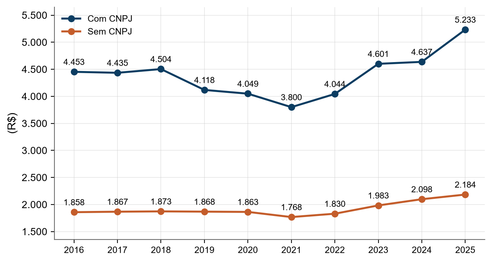<figcaption><strong>Figura 31 – Taxa de Desocupação (2012-2026).</strong> <em>Fonte: [(IBGE, 2026a)](https://www.ibge.gov.br/estatisticas/sociais/trabalho/17270-pnad-continua.html).</em> Taxa de desocupação (PNAD Contínua); pico da pandemia em 2020 e menor patamar da série em 2026.</figcaption></figure>

### 13.2 Conclusões Objetivas

Está estabelecido que o emprego formal garante a anotação de salário e férias na CTPS [(BRASIL, 1943, art. 423)](https://www.planalto.gov.br/ccivil_03/decreto-lei/del5452.htm), enquanto o cooperativismo exige quóruns específicos para instalação de assembleias, variando de 2/3 a 20% dos sócios dependendo da convocação [(BRASIL, LEI 12.690/2012, art. 1º, § 3º)](https://www.planalto.gov.br/ccivil_03/_ato2011-2014/2012/lei/l12690.htm).

As mudanças tributárias via IBS e CBS afetarão a apropriação de créditos para adquirentes sujeitos ao regime regular [(BRASIL, LC 214/2025, art. 29, VII)](https://www.planalto.gov.br/ccivil_03/leis/lcp/lcp214.htm). O setor de tecnologia e serviços digitais é um dos mais impactados pelas novas regras de importação de serviços e responsabilidade de plataformas [(BRASIL, LC 214/2025, art. 29)](https://www.planalto.gov.br/ccivil_03/leis/lcp/lcp214.htm).

O rendimento médio mensal real subiu de R$ 3.191,30 em 2012 para R$ 3.777,50 em 2026, alta real de cerca de 18,4% [(IBGE, 2026a)](https://www.ibge.gov.br/estatisticas/sociais/trabalho/17270-pnad-continua.html).

<figure class="figura">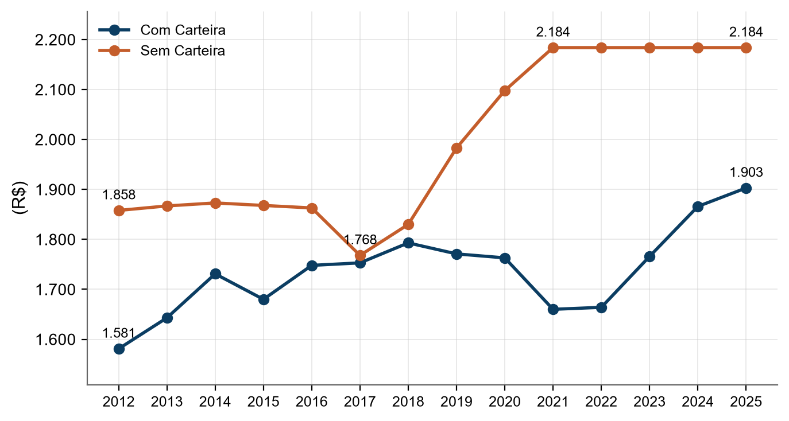<figcaption><strong>Figura 32 – Rendimento Médio Mensal Real do Trabalho Principal (2012-2026).</strong> <em>Fonte: [(IBGE, 2026a)](https://www.ibge.gov.br/estatisticas/sociais/trabalho/17270-pnad-continua.html).</em> Rendimento médio real do trabalho principal (PNAD Contínua); alta acumulada de cerca de 18% em termos reais.</figcaption></figure>

**Em termos simples:** O emprego com carteira assinada é o mais seguro para o trabalhador, pois o patrão assume os riscos do negócio [(BRASIL, 1943)](https://www.planalto.gov.br/ccivil_03/decreto-lei/del5452.htm). Já nas cooperativas, os sócios dividem os lucros e os prejuízos [(BRASIL, LEI 12.690/2012)](https://www.planalto.gov.br/ccivil_03/_ato2011-2014/2012/lei/l12690.htm). Para o futuro, a reforma dos impostos vai mudar como empresas e plataformas digitais pagam tributos [(BRASIL, LC 214/2025)](https://www.planalto.gov.br/ccivil_03/leis/lcp/lcp214.htm), e há a possibilidade de a jornada de trabalho 6x1 acabar [(EXTRA ONLINE, 2026)](https://extra.globo.com/economia/noticia/2026/10/fim-da-escala-6x1-o-que-pode-mudar-para-domesticas-e-patroes-se-a-pec-for-aprovada.ghtml).

Fontes consultadas:
* [(BRASIL, 1943)](https://www.planalto.gov.br/ccivil_03/decreto-lei/del5452.htm)
* [(BRASIL, LEI 12.690/2012)](https://www.planalto.gov.br/ccivil_03/_ato2011-2014/2012/lei/l12690.htm)
* [(BRASIL, LC 123/2006)](https://www.planalto.gov.br/ccivil_03/leis/lcp/lcp123.htm)
* [(BRASIL, LC 214/2025)](https://www.planalto.gov.br/ccivil_03/leis/lcp/lcp214.htm)
* [(IPEA, 2026)](https://www.ipea.gov.br/cartadeconjuntura/index.php/category/mercado-de-trabalho/)
* [(IBGE, 2026a)](https://www.ibge.gov.br/estatisticas/sociais/trabalho/17270-pnad-continua.html)
* [(EXTRA ONLINE, 2026)](https://extra.globo.com/economia/noticia/2026/10/fim-da-escala-6x1-o-que-pode-mudar-para-domesticas-e-patroes-se-a-pec-for-aprovada.ghtml)

## Apêndice A - Legislação citada e o que ela muda na prática

<strong>Tabela 34 – Legislacao consultada e efeitos praticos.</strong> <em>Fonte: [(BRASIL, 1988)](https://www.planalto.gov.br/ccivil_03/constituicao/constituicao.htm).</em>

| Norma | O que regula | Quem protege ou obriga | Onde encontrar |
| :--- | :--- | :--- | :--- |
| CLT [(BRASIL, 1943)](https://www.planalto.gov.br/ccivil_03/decreto-lei/del5452.htm) | Regras gerais de trabalho e emprego | Empregados e empregadores | [Link](https://www.planalto.gov.br/ccivil_03/decreto-lei/del5452.htm) |
| Constituição Federal [(BRASIL, 1988)](https://www.planalto.gov.br/ccivil_03/constituicao/constituicao.htm) | Direitos fundamentais do trabalhador | Todos os trabalhadores | [Link](https://www.planalto.gov.br/ccivil_03/constituicao/constituicao.htm) |
| Reforma da Previdência [(BRASIL, EC 103/2019)](https://www.planalto.gov.br/ccivil_03/constituicao/emendas/emc/emc103.htm) | Novas regras de aposentadoria | Segurados do INSS | [Link](https://www.planalto.gov.br/ccivil_03/constituicao/emendas/emc/emc103.htm) |
| Reforma Tributária [(BRASIL, EC 132/2023)](https://www.planalto.gov.br/ccivil_03/constituicao/emendas/emc/emc132.htm) | Mudanças nos impostos nacionais | Contribuintes e empresas | [Link](https://www.planalto.gov.br/ccivil_03/constituicao/emendas/emc/emc132.htm) |
| Simples Nacional e MEI [(BRASIL, LC 123/2006)](https://www.planalto.gov.br/ccivil_03/leis/lcp/lcp123.htm) | Regimes tributários para pequenas empresas | Micro e pequenas empresas | [Link](https://www.planalto.gov.br/ccivil_03/leis/lcp/lcp123.htm) |
| Trabalho Doméstico [(BRASIL, LC 150/2015)](https://www.planalto.gov.br/ccivil_03/leis/lcp/lcp150.htm) | Direitos de quem trabalha em residências | Empregados domésticos | [Link](https://www.planalto.gov.br/ccivil_03/leis/lcp/lcp150.htm) |
| Regras Reforma Tributária [(BRASIL, LC 214/2025)](https://www.planalto.gov.br/ccivil_03/leis/lcp/lcp214.htm) | Detalhes sobre IBS, CBS e Simples | Empresas e governo | [Link](https://www.planalto.gov.br/ccivil_03/leis/lcp/lcp214.htm) |
| Aprendizado Jovem [(BRASIL, LEI 10.097/2000)](https://www.planalto.gov.br/ccivil_03/leis/l10097.htm) | Formação profissional de jovens | Jovens aprendizes | [Link](https://www.planalto.gov.br/ccivil_03/leis/l10097.htm) |
| Código Civil [(BRASIL, LEI 10.406/2002)](https://www.planalto.gov.br/ccivil_03/leis/2002/l10406.htm) | Contratos de prestação de serviço | Prestadores de serviço autônomos | [Link](https://www.planalto.gov.br/ccivil_03/leis/2002/l10406.htm) |
| Auditoria-Fiscal [(BRASIL, LEI 10.593/2002)](https://www.planalto.gov.br/ccivil_03/leis/2002/l10593.htm) | Fiscalização do trabalho e seguridade | Empresas e trabalhadores | [Link](https://www.planalto.gov.br/ccivil_03/leis/2002/l10593.htm) |
| Estágio [(BRASIL, LEI 11.788/2008)](https://www.planalto.gov.br/ccivil_03/_ato2007-2010/2008/lei/l11788.htm) | Regras para estudantes em formação | Estagiários e instituições | [Link](https://www.planalto.gov.br/ccivil_03/_ato2007-2010/2008/lei/l11788.htm) |
| Igualdade Racial [(BRASIL, LEI 12.288/2010)](https://www.planalto.gov.br/ccivil_03/_ato2007-2010/2010/lei/l12288.htm) | Combate ao racismo e promoção da igualdade | População negra | [Link](https://www.planalto.gov.br/ccivil_03/_ato2007-2010/2010/lei/l12288.htm) |
| Trabalho Portuário [(BRASIL, LEI 12.545/2011)](https://www.planalto.gov.br/ccivil_03/_ato2011-2014/2011/lei/l12545.htm) | Regras para trabalhadores de portos | Trabalhadores portuários avulsos | [Link](https://www.planalto.gov.br/ccivil_03/_ato2011-2014/2011/lei/l12545.htm) |
| Cooperativismo [(BRASIL, LEI 12.690/2012)](https://www.planalto.gov.br/ccivil_03/_ato2011-2014/2012/lei/l12690.htm) | Organização de cooperativas de trabalho | Cooperados | [Link](https://www.planalto.gov.br/ccivil_03/_ato2011-2014/2012/lei/l12690.htm) |
| Reforma Trabalhista [(BRASIL, LEI 13.467/2017)](https://www.planalto.gov.br/ccivil_03/_ato2015-2018/2017/lei/l13467.htm) | Atualização de normas da CLT | Empregados e empregadores | [Link](https://www.planalto.gov.br/ccivil_03/_ato2015-2018/2017/lei/l13467.htm) |
| Prevenção ao Assédio [(BRASIL, LEI 14.457/2022)](https://www.planalto.gov.br/ccivil_03/_ato2019-2022/2022/lei/l14457.htm) | Combate à violência e assédio no trabalho | Todos os trabalhadores | [Link](https://www.planalto.gov.br/ccivil_03/_ato2019-2022/2022/lei/l14457.htm) |
| Igualdade Salarial [(BRASIL, LEI 14.611/2023)](https://www.planalto.gov.br/ccivil_03/_ato2023-2026/2023/lei/l14611.htm) | Salários iguais para homens e mulheres | Mulheres e empresas | [Link](https://www.planalto.gov.br/ccivil_03/_ato2023-2026/2023/lei/l14611.htm) |
| Trabalho Rural [(BRASIL, LEI 5.889/1973)](https://www.planalto.gov.br/ccivil_03/leis/l5889.htm) | Regras para quem trabalha no campo | Trabalhadores rurais | [Link](https://www.planalto.gov.br/ccivil_03/leis/l5889.htm) |
| Trabalho Temporário [(BRASIL, LEI 6.019/1974)](https://www.planalto.gov.br/ccivil_03/leis/l6019.htm) | Contratações por tempo determinado | Trabalhadores temporários | [Link](https://www.planalto.gov.br/ccivil_03/leis/l6019.htm) |
| FGTS [(BRASIL, LEI 8.036/1990)](https://www.planalto.gov.br/ccivil_03/leis/l8036consol.htm) | Fundo de Garantia do Tempo de Serviço | Trabalhadores com carteira assinada | [Link](https://www.planalto.gov.br/ccivil_03/leis/l8036consol.htm) |
| Seguridade Social [(BRASIL, LEI 8.212/1991)](https://www.planalto.gov.br/ccivil_03/leis/l8212cons.htm) | Organização do custeio da previdência | Contribuintes e governo | [Link](https://www.planalto.gov.br/ccivil_03/leis/l8212cons.htm) |
| Benefícios Previdenciários [(BRASIL, LEI 8.213/1991)](https://www.planalto.gov.br/ccivil_03/leis/l8213cons.htm) | Regras para auxílios e aposentadorias | Segurados do INSS | [Link](https://www.planalto.gov.br/ccivil_03/leis/l8213cons.htm) |
| Trabalho Voluntário [(BRASIL, LEI 9.608/1998)](https://www.planalto.gov.br/ccivil_03/leis/l9608.htm) | Atividades sem remuneração | Voluntários e entidades | [Link](https://www.planalto.gov.br/ccivil_03/leis/l9608.htm) |
| eSocial [(ESOCIAL, 2026)](https://www.esocial.gov.br/) | Digitalização de dados trabalhistas | Empresas e governo | [Link](https://www.esocial.gov.br/) |

**Em termos simples:** Esta tabela mostra as leis que mandam no dia a dia do trabalho, desde quem limpa a casa até quem trabalha no porto ou no campo, e onde você pode ler cada uma delas [(BRASIL, 1988)](https://www.planalto.gov.br/ccivil_03/constituicao/constituicao.htm).

## Referências

Todas as fontes citadas neste relatório, em formato ABNT (NBR 6023):

* BRASIL. Consolidacao das Leis do Trabalho (Decreto-Lei 5.452/1943). Disponível em: https://www.planalto.gov.br/ccivil_03/decreto-lei/del5452.htm. Acesso em: 16 out. 2026.
* BRASIL. Constituicao Federal 1988 - capitulos dos direitos trabalhistas. Disponível em: https://www.planalto.gov.br/ccivil_03/constituicao/constituicao.htm. Acesso em: 16 out. 2026.
* BRASIL. Lei 10.406/2002 - Codigo Civil (arts. 593 e seguintes: prestacao de servico). Disponível em: https://www.planalto.gov.br/ccivil_03/leis/2002/l10406.htm. Acesso em: 16 out. 2026.
* BRASIL. Lei 10.593/2002 - Auditoria-Fiscal do Trabalho e Seguridade Social. Disponível em: https://www.planalto.gov.br/ccivil_03/leis/2002/l10593.htm. Acesso em: 16 out. 2026.
* BRASIL. Lei 12.545/2011 - trabalhador portuario avulso e organizacao sindical. Disponível em: https://www.planalto.gov.br/ccivil_03/_ato2011-2014/2011/lei/l12545.htm. Acesso em: 16 out. 2026.
* BRASIL. Lei 12.690/2012 - politica nacional de cooperativismo. Disponível em: https://www.planalto.gov.br/ccivil_03/_ato2011-2014/2012/lei/l12690.htm. Acesso em: 16 out. 2026.
* BRASIL. Lei 13.467/2017 - reforma trabalhista. Disponível em: https://www.planalto.gov.br/ccivil_03/_ato2015-2018/2017/lei/l13467.htm. Acesso em: 16 out. 2026.
* BRASIL. Lei 14.611/2023 - equalizacao salarial entre homens e mulheres. Disponível em: https://www.planalto.gov.br/ccivil_03/_ato2023-2026/2023/lei/l14611.htm. Acesso em: 16 out. 2026.
* BRASIL. Lei 5.889/1973 - regulamenta o trabalho no campo. Disponível em: https://www.planalto.gov.br/ccivil_03/leis/l5889.htm. Acesso em: 16 out. 2026.
* BRASIL. Lei 6.019/1974 - trabalho temporario e empresas de trabalho temporario. Disponível em: https://www.planalto.gov.br/ccivil_03/leis/l6019.htm. Acesso em: 16 out. 2026.
* BRASIL. Lei 8.036/1990 - FGTS. Disponível em: https://www.planalto.gov.br/ccivil_03/leis/l8036consol.htm. Acesso em: 16 out. 2026.
* BRASIL. Lei 8.212/1991 - organizacao da seguridade social. Disponível em: https://www.planalto.gov.br/ccivil_03/leis/l8212cons.htm. Acesso em: 16 out. 2026.
* BRASIL. Lei 8.213/1991 - beneficios da previdencia social. Disponível em: https://www.planalto.gov.br/ccivil_03/leis/l8213cons.htm. Acesso em: 16 out. 2026.
* BRASIL. Lei 9.608/1998 - trabalho voluntario. Disponível em: https://www.planalto.gov.br/ccivil_03/leis/l9608.htm. Acesso em: 16 out. 2026.
* BRASIL. Lei Complementar 123/2006 - Simples Nacional e MEI. Disponível em: https://www.planalto.gov.br/ccivil_03/leis/lcp/lcp123.htm. Acesso em: 16 out. 2026.
* BRASIL. Lei Complementar 150/2015 - regulamenta trabalho domestico (EC 72/2013). Disponível em: https://www.planalto.gov.br/ccivil_03/leis/lcp/lcp150.htm. Acesso em: 16 out. 2026.
* BRASIL. Lei Complementar 214/2025 - regras da reforma tributaria (IBS, CBS, Simples). Disponível em: https://www.planalto.gov.br/ccivil_03/leis/lcp/lcp214.htm. Acesso em: 16 out. 2026.
* CAMARA DOS DEPUTADOS. PL 05253/2026. Disponível em: https://www25.senado.leg.br/web/atividade/materias/-/materia/175660. Acesso em: 16 out. 2026.
* CAMARA DOS DEPUTADOS. PL 2911/2025. Disponível em: https://www.camara.leg.br/proposicoesWeb/fichadetramitacao?idProposicao=2525925. Acesso em: 16 out. 2026.
* CAMARA DOS DEPUTADOS. PL 3406/2026. Disponível em: https://www.camara.leg.br/proposicoesWeb/fichadetramitacao?idProposicao=2636199. Acesso em: 16 out. 2026.
* CAMARA DOS DEPUTADOS. PLP 265/2026. Disponível em: https://www.camara.leg.br/proposicoesWeb/fichadetramitacao?idProposicao=2647294. Acesso em: 16 out. 2026.
* CAMARA DOS DEPUTADOS. REQ 00044/2026. Disponível em: https://www25.senado.leg.br/web/atividade/materias/-/materia/174042. Acesso em: 16 out. 2026.
* CONSULTOR JURÍDICO. Pejotização de médico com autonomia não configura fraude - Consultor Jurídico. Disponível em: https://conjur.com.br/2026-ago-12/sem-prova-de-subordinacao-pejotizacao-de-medicos-nao-configura-fraude/. Acesso em: 16 out. 2026.
* ENGELMANN. A face oculta das plataformas digitais: Trabalhadores/as por aplicativo em condições de trabalho exaustivas e o riscos à saúde - Anais de Resumos Expandidos do Seminário Internacional de Pesquisas em Midiatização e Processos Sociais (2025). Disponível em: https://openalex.org/W7215382595. Acesso em: 16 out. 2026.
* ESOCIAL. eSocial - sistema de declaracoes digitais trabalhistas e previdenciarias. Disponível em: https://www.esocial.gov.br/. Acesso em: 16 out. 2026.
* EXTRA CLASSE. Sindicatos denunciam Ulbra ao Ministério do Trabalho por pejotização e reduções salariais - Extra Classe. Disponível em: https://www.extraclasse.org.br/movimento/2026/10/sindicatos-denunciam-ulbra-ao-ministerio-do-trabalho-por-pejotizacao-e-reducoes-salariais/. Acesso em: 16 out. 2026.
* EXTRA ONLINE. Fim da escala 6x1: o que pode mudar para domésticas e patrões se a PEC for aprovada - Extra online. Disponível em: https://extra.globo.com/economia/noticia/2026/10/fim-da-escala-6x1-o-que-pode-mudar-para-domesticas-e-patroes-se-a-pec-for-aprovada.ghtml. Acesso em: 16 out. 2026.
* FONSECA. O Trabalho por Aplicativos Digitais no contexto da Quarta Revolução Industrial - Revista Direito em Debate (2022). Disponível em: https://doi.org/10.21527/2176-6622.2022.57.12136. Acesso em: 16 out. 2026.
* IBGE. Brasil tem 2 milhões de trabalhadores por aplicativos, diz IBGE - Agência Brasil. Disponível em: https://agenciabrasil.ebc.com.br/radioagencia-nacional/economia/audio/2026-09/brasil-tem-2-milhoes-de-trabalhadores-por-aplicativos-diz-ibge. Acesso em: 16 out. 2026.
* IBGE. IBGE - PNAD Continua: desocupacao, ocupacao e rendimento (series). Disponível em: https://www.ibge.gov.br/estatisticas/sociais/trabalho/17270-pnad-continua.html. Acesso em: 16 out. 2026.
* IBGE. Pesquisa Nacional de Saúde (PNS) - saúde autoavaliada por situação ocupacional, renda e cor ou raça. Disponível em: https://www.ibge.gov.br/estatisticas/sociais/saude/9160-pesquisa-nacional-de-saude.html. Acesso em: 16 out. 2026.
* IBGE. Trabalhadores de transporte de passageiros por aplicativo chegam a 1,2 milhão de pessoas no país - Agência de Notícias - IBGE. Disponível em: https://agenciadenoticias.ibge.gov.br/agencia-noticias/2012-agencia-de-noticias/noticias/47966-trabalhadores-de-transporte-de-passageiros-por-aplicativo-chegam-a-1-2-milhao-de-pessoas-no-pais. Acesso em: 16 out. 2026.
* IMPRENSA. Em vitória de Lula, Senado aprova PEC do fim da escala 6x1 e trabalhador terá dois dias de folga por semana - G1. Disponível em: https://g1.globo.com/politica/noticia/2026/10/14/senado-aprova-pec-do-fim-da-escala-6x1.ghtml. Acesso em: 16 out. 2026.
* IPEA. Ipea - Carta de Conjuntura, tema Mercado de Trabalho (rendimentos, formal e informal). Disponível em: https://www.ipea.gov.br/cartadeconjuntura/index.php/category/mercado-de-trabalho/. Acesso em: 16 out. 2026.
* KALIL. Trabalho Sob Demanda por Meio de Aplicativos - A Regulação do Trabalho via Plataformas Digitais (2020). Disponível em: https://doi.org/10.5151/9786555500295-03. Acesso em: 16 out. 2026.
* MTE. MTE - Inspecao do Trabalho: fiscalizacao e aplicacao da lei. Disponível em: https://www.gov.br/trabalho-e-emprego/pt-br/assuntos/inspecao-do-trabalho. Acesso em: 16 out. 2026.
* REBECHI. O trabalho mediado por plataformas digitais e assimetrias nas relações de comunicação - Revista Katálysis (2022). Disponível em: https://doi.org/10.1590/1982-0259.2022.e82596. Acesso em: 16 out. 2026.
* STF NOTICIAS. STF retira suspensão de processos sobre ‘pejotização’ na primeira instância e nos TRTs - stf noticias. Disponível em: https://noticias.stf.jus.br/postsnoticias/stf-retira-suspensao-de-processos-sobre-pejotizacao-na-primeira-instancia-e-nos-trts/. Acesso em: 16 out. 2026.

## Anexo B – Graficos complementares (IBGE/PNAD/IPEA)

Series historicas complementares coletadas diretamente das APIs oficiais do IBGE (SIDRA) e do Ipea (Series Temporais/Ipeadata), usadas para contextualizar formalidade, informalidade e rendimentos no mercado de trabalho brasileiro. Os dados replicam a PNAD Continua.

<figure class="figura">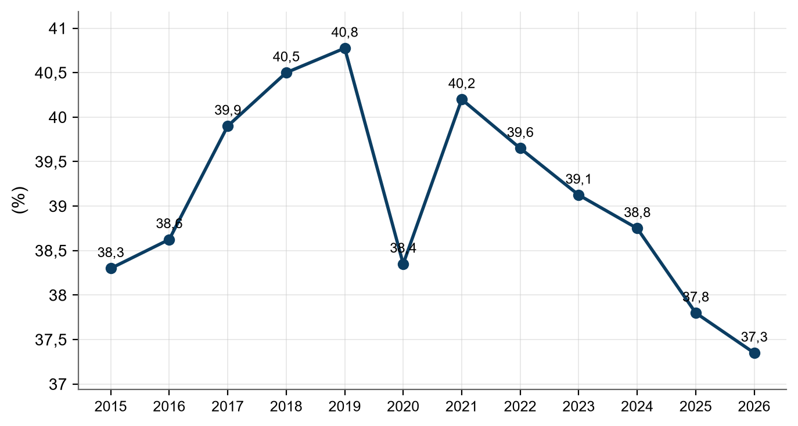<figcaption><strong>Figura 33 – Taxa de Informalidade no Emprego Urbano (2015-2026).</strong> <em>Fonte: (IPEA, Series Temporais/Ipeadata (IBGE/PNAD Continua)).</em> Media anual da serie PNADCT_TXINFORMUF, territorio Brasil.</figcaption></figure>

<figure class="figura">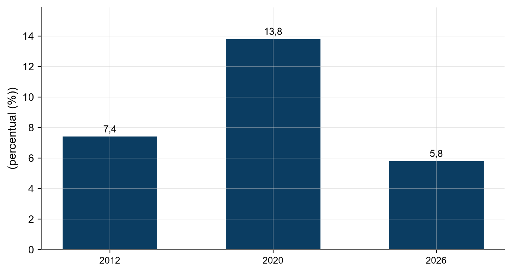<figcaption><strong>Figura 34 – Salario Minimo Real (2012-2026).</strong> <em>Fonte: (IPEA, Series Temporais/Ipeadata (IBGE/PNAD Continua)).</em> Media anual da serie GAC12_SALMINRE12; valores reais.</figcaption></figure>
